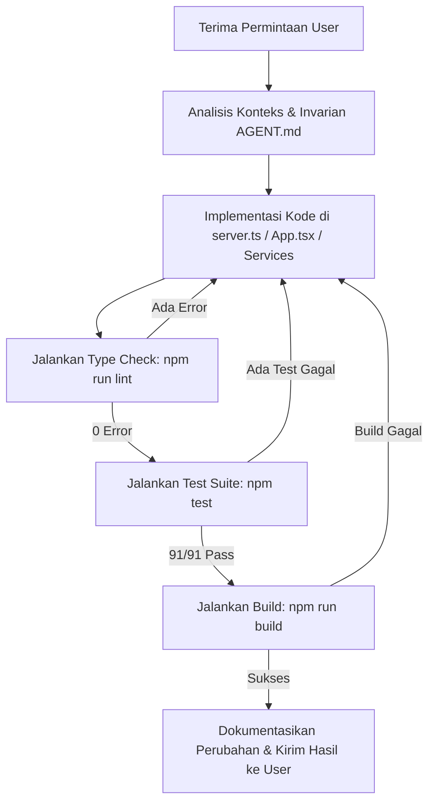

# 🤖 AGENT.MD — OPERATIONAL INSTRUCTIONS & ARCHITECTURAL INVARIANTS
**Platform:** GOJJA SmartTV — Hospitality TV Experience & Fleet Management Platform  
**Target Audience:** AI Agents (Antigravity, Claude, Cursor, Gemini CLI) & Senior Software Engineers  
**Version:** 4.2.0-Enterprise  
**Last Updated:** November 2026

---

## 1. Core Identity & Architectural Mission

GOJJA SmartTV adalah platform manajemen armada TV pintar (*Smart TV Fleet Management*) dan antarmuka perhotelan (*Hospitality TV OS*) kelas enterprise. Sistem ini bertindak sebagai **Single Source of Truth (SSOT)** yang mengintegrasikan CMS konten perhotelan, manajemen kamar & tamu (*Zero-PII*), billing berbasis lisensi kursi (*Seat Ledger*), dan kontrol perangkat keras TV fisik over-the-network (ADB).

Dalam mengembangkan atau memodifikasi kode di repositori ini, seluruh agen AI dan developer **wajib mematuhi arsitektur dan invarian berikut tanpa pengecualian**.

---

## 2. Sepuluh (10) Invarian Arsitektur Mutlak (The 10 Invariants)

Setiap perubahan kode yang melanggar salah satu dari 10 aturan berikut akan menyebabkan regresi kritis dan ditolak:

### Invarian 1: Prinsip Non-Destruktif CleanYourTV (Zero Deletion)
* **Aturan:** DILARANG KERAS menggunakan perintah `pm uninstall` pada aplikasi bawaan TV fisik.
* **Standar Wajib:** Hanya gunakan perintah `pm disable-user --user 0 <package_name>`. File biner sistem di partisi `/system` dan `/vendor` harus tetap utuh di TV agar dapat dikembalikan 100% ke kondisi pabrik.

### Invarian 2: CleanYourTV Safety Guardrail Enforcement
* **Aturan:** Pengambilalihan launcher (`POST /api/branding/launcher-takeover`) dan deaktivasi paket DILARANG dieksekusi jika TV target belum memiliki snapshot backup yang berstatus `VERIFIED` atau `HEALTHY`.
* **Standar Wajib:** Backend harus merespons dengan HTTP 400 `BACKUP_REQUIRED` dan mencatat event audit `DENY`. UI Brand Studio harus mengunci tombol eksekusi dengan ikon gembok dan kartu peringatan amber.

### Invarian 3: Dual-Mode Deployment Parity (Bulk & Per-Room)
* **Aturan:** Sistem deployment launcher wajib mendukung dua skenario:
  1. *Bulk Fleet Rollout*: Dijalankan oleh Admin Property di Brand Studio untuk seluruh TV hotel.
  2. *Per-Room Control*: Dijalankan oleh teknisi lapangan di tab Kamar & TV untuk 1 TV spesifik menggunakan parameter `endpointId`.
* **Standar Wajib:** Endpoint API `/api/branding/launcher-takeover` harus memeriksa apakah `endpointId` disertakan. Jika ada, eksekusi hanya menyasar TV kamar tersebut.

### Invarian 4: Dynamic Web Manifest (Zero-Rebuild Policy)
* **Aturan:** Pengeditan logo, warna tema, video promosi, running text ticker, menu F&B, atau saluran IPTV di Brand Studio **TIDAK BOLEH** mewajibkan compile ulang atau instalasi ulang file APK.
* **Standar Wajib:** APK `GojjaLauncher` bertindak sebagai *web-container kiosk* yang dipasang hanya 1 kali. Seluruh perubahan konten dikirimkan secara dinamis via API manifest dan dimuat secara real-time (*Live Hot-Reload*).

### Invarian 5: Perlindungan Privasi Tamu Mutlak (Zero-PII Compliance)
* **Aturan:** Nama tamu hotel dilarang ditampilkan secara telanjang di log, dashboard umum, atau telemetri iklan pihak ketiga.
* **Standar Wajib:** Gunakan algoritma penyamaran nama (`maskGuestName`): `Budi Santoso` $\rightarrow$ `B*** S***`, `Dr. Dian Wulandari` $\rightarrow$ `D*** D*** W***`.

### Invarian 6: 100% Paritas Backend Server vs Vercel Client-Side Fallback
* **Aturan:** Repositori ini dapat dijalankan dalam mode Full-Stack lokal (`server.ts` + Express) maupun mode Serverless Static di Vercel (`src/App.tsx` via `handleClientSideFallbackApi`).
* **Standar Wajib:** Setiap penambahan endpoint API baru di `server.ts` **HARUS** diimplementasikan dengan logika dan respons yang identik di dalam fungsi `handleClientSideFallbackApi` di `src/App.tsx`.

### Invarian 7: 91/91 Automated Test Suite Wajib Lulus
* **Aturan:** Dilarang mengakhiri sesi jika ada pengujian otomatis yang gagal.
* **Standar Wajib:** Jalankan `npm test`. Seluruh 91 checks (31 Fase A-D + 51 TV Experience + 9 CleanYourTV Backup & Safety Guardrail) harus menghasilkan status **PASS**.

### Invarian 8: Zero TypeScript Errors (`tsc --noEmit`)
* **Aturan:** Dilarang menggunakan bypass `any` yang ceroboh atau membiarkan compiler error.
* **Standar Wajib:** Jalankan `npm run lint`. Hasil kompilasi harus `0 errors`.

### Invarian 9: Safe-List Protection pada Perangkat Keras TV
* **Aturan:** Debloat script DILARANG mematikan komponen sistem vital berikut:
  - `com.google.android.apps.mediashell` *(Chromecast Built-in / Google Cast)*
  - `com.google.android.inputmethod.latin` *(Virtual Keyboard)*
  - `com.google.android.gms` *(Google Play Services)*
  - Driver Tuner HDMI Switch OEM (`com.sony.dtv.*`, `com.tcl.tv.*`, `com.mediatek.tv.*`)

### Invarian 10: Dukungan Modern Google TV LauncherX
* **Aturan:** Pada TV Google TV modern (Sony Bravia, Xiaomi, TCL), nama launcher resmi adalah `com.google.android.apps.tv.launcherx`.
* **Standar Wajib:** Paket ini harus selalu disertakan di daftar debloat `GOJJA_CLEANTV_PACKAGES` bersama `com.google.android.tvlauncher`.

---

## 3. Peta Direktori & File Kunci (Codebase Architecture)

```
smarttv-gojja/
├── server.ts                                   # Express Full-Stack Server & ADB Backend API (4,500+ lines)
├── package.json                                # Project Scripts & Dependencies
├── .gojja-ssot-store.json                      # Persistent Local SSOT Database
├── android-launcher/                           # Standalone Android TV Launcher Project Template
│   ├── app/src/main/AndroidManifest.xml        # Certified Leanback Manifest with QUERY_ALL_PACKAGES
│   ├── app/src/main/java/.../GojjaHomeActivity.kt # Fullscreen Kiosk, Autoplay Bypass, D-Pad Key Map
│   ├── app/src/main/java/.../GojjaNativeBridge.kt # JavascriptInterface (Launch Netflix, YouTube)
│   └── scripts/build_apk.bat                   # Gradle APK Builder Script
├── bin/                                        # Staging folder for compiled GojjaLauncher APK
├── backups/                                    # Local Directory for TV Baseline Backup Snapshots
│   └── <device-id>/                            # Per-device folder: manifest.json, restore.bat, restore.sh
├── public/                                     # Static Public Assets & CLI scripts
│   └── gojja-connector.mjs                     # Local Connector CLI scanner for remote cloud setup
├── src/
│   ├── App.tsx                                 # Main CMS Application, State, & Vercel Fallback API (8,100+ lines)
│   ├── index.css                               # Tailwind CSS Tokens & Luxury Animations
│   ├── components/
│   │   ├── DeviceDiscoveryView.tsx             # Live Lab Scanner, Backup Inspector & 1-Click Restore Modal
│   │   ├── TvGuestAppModal.tsx                 # 10-Foot UI Hospitality TV Guest Canvas (1920x1080)
│   │   └── TvEntertainmentSettings.tsx         # Channel & App Entitlement Configurations
│   ├── data/
│   │   └── mockData.ts                         # SSOT Initial Data, Types & GOJJA_CLEANTV_PACKAGES
│   └── services/
│       ├── adbBackupService.ts                 # Node.js ADB Live Execution & Disk Persistence Engine
│       └── adbBackupTypes.ts                   # Browser-Safe Backup Types, Fixtures & Restore Script Generators
└── tests/
    ├── run_all_tests.ts                        # Master Test Runner (Fase A s/d D: 31 checks)
    ├── tv_experience.test.ts                   # TV Entitlements, Wi-Fi QR, Settings (51 checks)
    └── adb_backup.test.ts                      # CleanYourTV Backup, Scripts & Safety Guardrail (9 checks)
```

---

## 4. Alur Kerja Rekayasa Perangkat Lunak (Standard Operating Procedure)

Setiap agen AI yang menerima instruksi pengembangan wajib mengikuti alur kerja terstruktur ini:



---

## 5. Konfigurasi Lingkungan Pengguna & Database Memori
* **OS**: Windows (PowerShell Shell).
* **Database MySQL Lokal User**: `host: 'localhost'`, `user: 'root'`, `password: ''`, `database: 'db_visionai2'`.
* **Path Scheme**: Selalu gunakan tautan markdown berkas berformat `file:///d:/Studio%20Works/Riset/smarttv-gojja/...` dengan forward slash `/`.
* **Math Prose**: Hindari tabrakan KaTeX; selalu escape simbol literal dollar sebagai `\$`.
