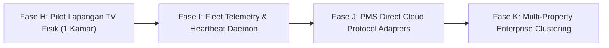

# 🗺️ MASTER EXECUTION PLAN & STRATEGIC ROADMAP
**Platform:** GOJJA SmartTV — Hospitality TV Experience & Fleet Management Platform  
**Target:** Enterprise Hospitality Deployment & Fleet Scalability  
**Status:** COMPLETED THROUGH FASE G (Fase H s/d K Scheduled)

---

## 1. Status Penyelesaian Milestone (Completed Milestones)

Sistem GOJJA SmartTV telah berhasil menyelesaikan seluruh tahap pengembangan fondasi, operasional, perhotelan, hingga pengambilalihan perangkat keras TV fisik:

```
[FASE A] Foundation & Capability Gating                ───► SELESAI & VERIFIKASI (PASS)
[FASE B] Core Operations & OTA Update State Machine    ───► SELESAI & VERIFIKASI (PASS)
[FASE C] Multi-Layer Branding & Luxury Stream Player   ───► SELESAI & VERIFIKASI (PASS)
[FASE D] Marketplace, Zero-PII & Commercial Expansion ───► SELESAI & VERIFIKASI (PASS)
[FASE E] CleanYourTV Non-Root ADB Backup & Restore     ───► SELESAI & VERIFIKASI (PASS)
[FASE F] Safety Guardrail & Dual-Mode Deployment       ───► SELESAI & VERIFIKASI (PASS)
[FASE G] Android TV Launcher Container Project         ───► SELESAI & VERIFIKASI (PASS)
```

### Rincian Pencapaian Tiap Fase:
1. **Fase A — Foundation & Capability Gating**:
   - Penghitungan akurat saldo lisensi kursi TV (*Seat Ledger net active seats*).
   - Taksonomi 10 kapabilitas hardware (`launcher.takeover`, `adb.install`, `kiosk.mode`, `playback.hls`, `remote.dpad`, dll).
   - Perhitungan prorata tagihan saat terjadi perubahan jumlah kamar (*Change Order Prorata*).
2. **Fase B — Core Operations & OTA Engine**:
   - 9-step state machine evaluasi OTA update firmware.
   - Penangguhan otomatis update firmware saat tamu akan segera check-in (*BR06 Check-in Imminent Deferral <6 jam*).
   - Penentuan otomatis lineup siaran TV resmi sesuai kelas kamar (*Standard, Suite, Villa*).
3. **Fase C — Multi-Layer Branding & Luxury Player**:
   - 6-tier Branding Inheritance Resolver (*Default $\rightarrow$ Brand $\rightarrow$ Property $\rightarrow$ RoomClass $\rightarrow$ Group $\rightarrow$ Stay*).
   - Kalkulator rasio kontras warna WCAG 2.1 AA (>4.5:1).
   - Animated luxury buffer loader (*orbital dual-ring spinner*) pada pemutar siaran TV HLS.
4. **Fase D — Marketplace & Zero-PII**:
   - Algoritma penyamaran privasi tamu (*Zero-PII Data Masking*).
   - Siklus hidup pemesanan layanan kamar (*Request $\rightarrow$ Confirm $\rightarrow$ InFulfilment $\rightarrow$ Fulfilled*).
   - Tata kelola penawaran iklan pihak ketiga (*AdOffer opt-in*).
5. **Fase E — CleanYourTV Backup & Restore Engine**:
   - Perekaman dinamis komponen launcher OEM pabrikan via `cmd package resolve-activity`.
   - Pembuatan otomatis 7 artefak baseline dan skrip mandiri offline (`restore.bat` & `restore.sh`).
   - Jaminan 100% reversible ke kondisi pabrik menggunakan `pm disable-user --user 0`.
6. **Fase F — Safety Guardrail & Dual-Mode Deployment**:
   - Penguncian otomatis aksi takeover pada API (HTTP 400 `BACKUP_REQUIRED`) dan UI hingga seluruh TV ter-backup.
   - Dual-Mode Deployment: **Bulk Rollout** di Brand Studio dan **Per-Room Control** di tab Kamar & TV.
   - Dukungan paket Google TV modern `com.google.android.apps.tv.launcherx`.
7. **Fase G — Android TV Launcher Container Project**:
   - Proyek Android Studio lengkap di `android-launcher/` dengan izin `QUERY_ALL_PACKAGES`, `usesCleartextTraffic="true"`, dan `mediaPlaybackRequiresUserGesture = false`.
   - Skrip kompilasi otomatis `build_apk.bat` dan `build_apk.sh`.
   - Arsitektur *Dynamic Web Manifest* (pembaruan branding tanpa perlu rebuild APK).

---

## 2. Peta Jalan Pengembangan Mendatang (Future Roadmap: Fase H s/d K)



### Fase H: Uji Coba Pilot Lapangan TV Fisik Nyata (Target: Q4 2026)
* **Tujuan**: Memverifikasi pengambilalihan launcher pada 1 unit Smart TV fisik percontohan (Kamar 101) di jaringan lokal hotel.
* **Milestone & Delivery**:
  - [ ] Pemasangan APK `GojjaLauncher-v4.2.0-hospitality.apk` pada TV Sony Bravia / Xiaomi TV.
  - [ ] Validasi tombol fisik remote TV (Home, D-Pad, Back, Volume).
  - [ ] Uji coba peluncuran aplikasi Netflix dan YouTube via `AndroidTvBridge`.
  - [ ] Verifikasi uji coba rollback darurat menggunakan `restore.bat`.

### Fase I: Background Fleet Telemetry & Heartbeat Daemon (Target: Q1 2027)
* **Tujuan**: Pemantauan kesehatan perangkat TV secara berkala (*standing cron monitoring*) tanpa membebani memori browser.
* **Milestone & Delivery**:
  - [ ] Polling background status TV online/offline setiap 60 detik.
  - [ ] Deteksi otomatis ketika TV dimatikan paksa (*power unplug*) atau kehilangan koneksi Wi-Fi.
  - [ ] Notifikasi proaktif ke dashboard jika ada TV kamar yang mengalami error playback siaran.

### Fase J: Integrasi Protokol PMS Hotel Langsung (Target: Q2 2027)
* **Tujuan**: Sinkronisasi data tamu dan check-in otomatis secara dua arah dengan Property Management System hotel terkemuka.
* **Milestone & Delivery**:
  - [ ] Adaptor protokol Oracle Hospitality OPERA Cloud API.
  - [ ] Adaptor protokol Cloudbeds & VHP (Visual Hotel Program).
  - [ ] Check-in otomatis memicu TV kamar menyala dan menampilkan nama tamu secara instan.
  - [ ] Check-out otomatis menghapus riwayat tontonan dan merestore preferensi kamar.

### Fase K: Multi-Property Enterprise Clustering (Target: Q3 2027)
* **Tujuan**: Tata kelola terpusat untuk jaringan hotel waralaba (*hotel chains*) dengan ratusan cabang properti.
* **Milestone & Delivery**:
  - [ ] Dashboard master untuk kantor pusat grup hotel.
  - [ ] Distribusi kampanye promosi serentak ke 50+ hotel dalam satu klik.
  - [ ] Analitik agregat tontonan siaran TV dan pendapatan layanan kamar lintas properti.

---

## 3. Matriks Risiko & Rencana Mitigasi (Risk Mitigation Matrix)

| Potensi Risiko | Tingkat Dampak | Probabilitas | Rencana Mitigasi yang Diterapkan |
| :--- | :---: | :---: | :--- |
| **TV Brick / Layar Hitam saat Takeover** | Tinggi | Rendah | **Zero Deletion Policy**: Hanya gunakan `pm disable-user`. TV dapat dipulihkan dalam 5 detik via `restore.bat` offline. |
| **Tamu Terganggu saat Admin Edit Konten** | Sedang | Rendah | **Dynamic Web Manifest**: Konten terupdate via *Live Hot-Reload* tanpa restart TV dan tanpa install ulang APK. |
| **Kebocoran Data Tamu (PII Leak)** | Tinggi | Rendah | **Zero-PII Masking**: Nama disamarkan (`B*** S***`) di seluruh log, API publik, dan telemetri iklan. |
| **Konflik Tombol Home di Google TV Baru** | Sedang | Sedang | **Google TV LauncherX Inclusion**: Paket `com.google.android.apps.tv.launcherx` otomatis dinonaktifkan bersama launcher lama. |
| **Router Wi-Fi Hotel Drop karena Scan Massal** | Sedang | Rendah | **Subnet Bounding `/24`**: Pemindaian dibatasi maksimal 254 host dengan jeda waktu probe yang terkontrol. |

---

## 4. Kriteria Gerbang Rilis (Release Verification Gates)

Sebelum setiap rilis kode di-deploy ke lingkungan produksi:
1. **Gate 1 (Automated Tests)**: `npm test` wajib menghasilkan **100% Passed (91/91 checks)**.
2. **Gate 2 (Static Analysis)**: `npm run lint` wajib menghasilkan **0 error TypeScript**.
3. **Gate 3 (Production Bundle)**: `npm run build` wajib menghasilkan bundle yang valid tanpa warning chunk melebihi batas toleransi.
4. **Gate 4 (Safety Guardrail)**: Takeover API wajib menolak perintah ganti launcher jika TV belum ter-backup.
