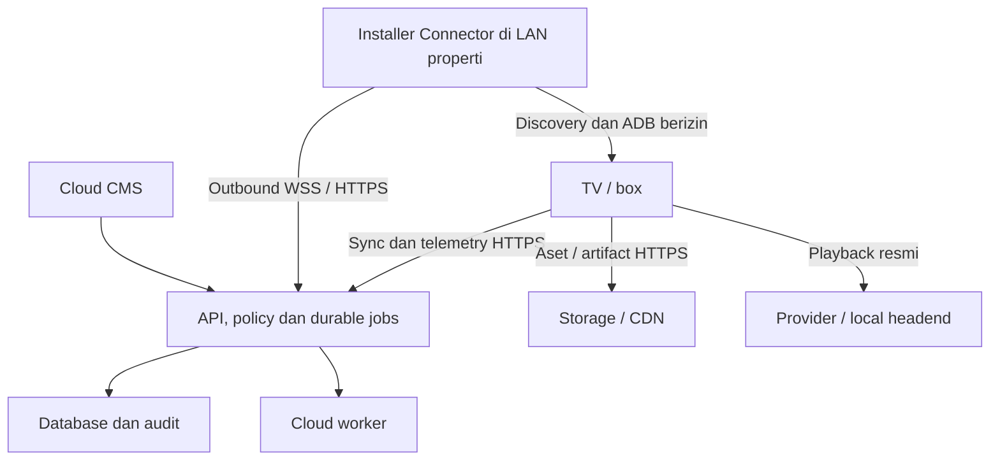

# GOJJA SmartTV
# Product Consolidation & Decision Register v1.1

**Tanggal konsolidasi: 31 Oktober 2026, Asia/Jakarta**  
**Tujuan:** menetapkan satu catatan arah produk, perubahan, batas fase, keputusan, asumsi, risiko, dan pembuktian sebelum penyusunan prototype serta revisi spesifikasi implementasi.

## Ringkasan eksekutif

GOJJA SmartTV dirumuskan sebagai platform SaaS untuk pengalaman TV, konten, layanan properti, serta pengelolaan perangkat yang dapat dijual langsung maupun melalui beberapa ISP. Hospitality merupakan peluncuran awal. Serviced apartment short stay mengikuti workflow hospitality; residence, rumah B2C, dan shared display mempunyai profil serta kebijakan tersendiri.

Konsep cukup matang untuk menjadi dasar prototype dan POC terarah. Kesiapan tersebut tidak berarti perangkat sudah tersertifikasi, provider telah terintegrasi, harga final telah disahkan, atau operasi produksi telah lulus. Nilai produk berasal dari pengalaman tamu yang konsisten, self-service properti, operasi armada yang terukur, serta fleksibilitas hubungan ISP–provider–pelanggan.

Perubahan paling material sejak baseline v1.0 adalah perincian onboarding sebelum APK terpasang; native Installer Connector untuk LAN properti; pemisahan installer sementara dari edge permanen; empat bahasa; kustomisasi bertingkat yang dapat dipreview; pengelolaan provider, kontrak, paket dan hak akses; serta pengukuran campaign dan channel yang tidak menyamakan playback dengan manusia menonton.

**Delapan batas yang harus dipertahankan:**

1. APK GOJJA bukan firmware pengganti seluruh OS TV. Dukungan langsung di TV dan melalui box mengikuti kemampuan yang dibuktikan.
2. Cloud CMS tidak langsung melakukan raw TCP ADB ke jaringan privat hotel. Pekerjaan lokal memerlukan connector yang terdaftar dan berwenang.
3. Menjadi launcher, menutup ADB, mencegah developer mode diaktifkan lagi, silent APK update, dan factory reset adalah kemampuan terpisah.
4. Hak software GOJJA berbeda dari hak konten provider. Daftar channel di CMS bukan bukti lisensi siaran.
5. Approval teknis rilis GOJJA berbeda dari izin pemasangan properti. Checkout dan TV online hanyalah sebagian syarat kesiapan maintenance.
6. Reset konteks GOJJA berbeda dari logout aplikasi OTT, pemulihan launcher, dan factory reset OEM.
7. Observasi playback bukan bukti panel terlihat atau tamu menonton. Data finansial iklan memerlukan validasi dan ledger tersendiri.
8. Prototype boleh mendemonstrasikan seluruh visi dengan penanda simulasi; scope produksi Phase 1 tetap dibatasi dan harus disahkan.

Rp15.000/TV/bulan tetap hipotesis wholesale Core software. Peluang sekitar 1.000 TV dari satu ISP merupakan potensi installed base, bukan tambahan pasti setiap bulan. Core harus layak tanpa mengandalkan pendapatan iklan atau marketplace yang belum tervalidasi.

## Daftar isi

1. Kontrol dokumen dan hierarki keputusan
2. Sumber baseline dan hasil pemeriksaan
3. Posisi produk dan segmen
4. Ekosistem bisnis dan kewenangan
5. Katalog kapabilitas dan batas fase
6. Arsitektur aplikasi dan jaringan
7. Perangkat, instalasi, penguncian, dan recovery
8. Model konfigurasi dan self-service properti
9. Stay, personalisasi, bahasa, dan sesi tamu
10. Provider, paket konten, dan entitlement
11. Content, campaign, dan placement
12. Playback measurement dan analytics
13. Update, deployment, dan approval
14. Komersial, invoice, support, dan AI
15. Keamanan, privasi, dan ketahanan
16. Decision Register
17. Change Register dan dampak dokumen
18. Asumsi dan keputusan terbuka
19. Risk Register dan skenario kegagalan
20. Rencana prototype dan POC
21. Gate, bukti, dan acceptance
22. Urutan pembaruan dokumen
23. Governance dan review
24. Referensi dan glosarium

## 1. Kontrol dokumen dan hierarki keputusan

### 1.1 Peran dan batas

Dokumen ini mengonsolidasikan percakapan produk dan baseline yang sudah ada. Ia merupakan penghubung dari visi ke prototype serta revisi PRD. Ia tidak menggantikan rincian API, kontrak hak tayang, quotation, persetujuan perangkat, kebijakan privasi final, maupun runbook produksi.

Versi 1.1 pada judul adalah versi dokumen konsolidasi ini. Dokumen Foundation, Blueprint, Commercial Model, Master PRD, Phase 1 PRD, Architecture, Certification Plan, dan Brand Guideline tetap pada versi masing-masing sampai direvisi sebagai pekerjaan terpisah. Tidak ada klaim bahwa semua file tersebut sudah diperbarui.

### 1.2 Dua sumbu status

Setiap keputusan memiliki **status arah** dan **status pembuktian**. Keputusan arah yang sudah konsisten dengan permintaan pengguna belum otomatis memiliki hasil uji.

| Kode arah | Makna | Implikasi |
| --- | --- | --- |
| K | Arah konsolidasi dari instruksi dan diskusi pengguna | Menjadi acuan prototype; perubahan material dicatat |
| R | Rekomendasi desain/operasional | Perlu pengesahan sebelum menjadi baseline implementasi final |
| H | Hipotesis harga, kapasitas, biaya, atau target | Tidak dipakai sebagai fakta penjualan |
| O | Keputusan terbuka | Harus diputuskan sebelum gate yang disebut |

| Kode bukti | Makna |
| --- | --- |
| B0 | Belum diuji atau belum ada dokumen pendukung yang memadai |
| B1 | Sumber publik resmi mendukung kemungkinan/pola, bukan implementasi GOJJA |
| B2 | Bukti lab GOJJA untuk kombinasi yang dinyatakan |
| B3 | Bukti pilot properti dan acceptance yang dinyatakan |
| B4 | Operasional produksi terpantau dengan periode dan denominator |

Pada penerbitan ini belum ada bukti B2–B4 yang disertakan. Pernyataan vendor tetap B1, bukan sertifikasi independen. Penugasan owner di bawah adalah **peran yang diusulkan**, bukan konfirmasi bahwa personelnya sudah ditunjuk.

### 1.3 Aturan konflik

Instruksi eksplisit terbaru pemilik produk mengendalikan arah. Kontrak, hak konten, dan kewenangan platform menentukan batas pelaksanaan. Untuk perubahan yang diidentifikasi di sini, brief prototype memakai arah konsolidasi; implementasi produksi menunggu revisi spesifikasi, review teknis, dan bukti yang relevan. Bagian baseline yang tidak diubah tetap berlaku sebagai acuan perencanaan.

Mockup merupakan ilustrasi, bukan kontrak teknis. Ketidaksesuaian nama/IP/status pada gambar tidak disalin ke model data. Foto, logo, atau nama Hotel Tentrem pada demonstrasi tidak berarti hotel tersebut pelanggan atau telah menyetujui produk.

## 2. Sumber baseline dan hasil pemeriksaan

### 2.1 Inventaris dokumen

| Ref | Dokumen baseline | Fungsi | Arah revisi |
| --- | --- | --- | --- |
| I01 | Product Foundation & Feasibility v1.0 | Posisi, hipotesis, feasibility | Perbarui ringkasan batas deployment/provider dan asumsi |
| I02 | Master Product Blueprint & Grand Design v1.0 | Domain lintas segmen | Tambahkan hubungan connector, provider package dan content measurement |
| I03 | Commercial & Operating Model v1.0 | Penjualan, seat, operasi, invoice | Rinci bundling, kewenangan ISP, biaya connector dan provider |
| I04 | Master PRD v1.0 | Requirement induk | Tambahkan delta teridentifikasi tanpa mengganti ID lama |
| I05 | Phase 1 PRD & Functional Specification v1.0 | Flow, aturan, acceptance P1 | Perluas onboarding, empat bahasa, profile, paket dan reporting |
| I06 | Technical Architecture & Integration Specification v1.0 | Komponen, keamanan, kontrak komunikasi | Tambahkan native installer, LAN jobs dan enforcement hak |
| I07 | Device Compatibility & Certification Plan v1.0 | Matriks dukungan dan pembuktian | Uji jalur ADB yang dinyatakan, hardening dan recovery |
| I08 | GOJJA Design & Brand Guideline v1.0 | Identitas Open Future | Pertahankan logo; lengkapi master aset dan sistem UI terpisah |

Pembacaan ulang dilakukan pada kontrol/scope delapan baseline dan bagian rinci yang relevan dari I05–I07; ini bukan audit baris-per-baris terhadap semua requirement. Rujukan bagian berikut mengacu konten baseline yang dibaca. Tautan sumber tersedia di bagian 24.

### 2.2 Delta yang terkonfirmasi

| Area | Kondisi baseline | Klarifikasi v1.1 |
| --- | --- | --- |
| Onboarding | I05 FS04 dimulai dari kode pairing pada aplikasi yang sudah berjalan | Tambah discovery, otorisasi dan instalasi sebelum app enrollment |
| Local edge | I06 §19 mengatur edge opsional untuk cache/bridge | Bedakan native installer sementara, cloud worker dan edge permanen |
| Bahasa | I05 FS05/FS06/FS09 memakai ID/EN | Target pengalaman GOJJA menjadi ID/EN/zh-CN/ja-JP |
| Branding | I05 FS06 telah punya preset, aset, warna, menu dan editor/publisher | Perinci profile inheritance, preview provenance dan konflik antar-layer |
| Publishing | I05 FS08 telah punya manifest immutable dan ACK bertahap | Pertahankan; tambahkan status operasional connector dan outcome unknown |
| Campaign | I05 FS15 sudah punya slot, prioritas, cap dan playback facts | Perinci taksonomi, definisi event, channel QoE dan funnel; settlement tetap fase lanjut |
| Instalasi ADB | I07 DCT007 menyebut tanpa privilege ADB/debug tambahan | Jelaskan ADB onboarding yang dinyatakan berbeda dari privilege produksi tersembunyi |
| Power test | Jumlah siklus pada Foundation dan Certification Plan belum selaras | Sahkan satu protokol uji lintas dokumen sebelum pengujian |

Sebagian besar prinsip v1.1 memperdalam desain awal. Pemisahan hak tayang, dukungan perangkat bersyarat, approval properti, manual stay, keamanan tenant, serta penundaan ad settlement sudah ada dalam baseline. Dokumen ini tidak menyajikannya sebagai penemuan baru.

## 3. Posisi produk dan segmen

**Positioning kerja:** GOJJA SmartTV adalah platform pengalaman TV dan operasi layanan digital properti yang dapat di-branding, dikelola dari cloud, dan didistribusikan langsung atau melalui mitra, dengan kemampuan perangkat serta sumber konten yang diverifikasi.

| Profil | Subjek dan kendali | Batas peluncuran |
| --- | --- | --- |
| Hospitality | Kamar, stay sementara, operator hotel | Prioritas P1: hotel, resort, villa dan serviced apartment short stay |
| Residence | Unit dan occupancy jangka panjang | Model domain disiapkan; workflow penuh ditunda |
| Home | Household dan pemilik akun | Ekspansi berikutnya; tanpa kiosk hotel atau reset checkout default |
| Shared Display | Layar lobby/area umum dan playlist | Konten umum; hak tayang dan profil tanpa PII tamu terpisah |

Alamat bangunan tidak menentukan profil. Apartemen harian dapat memakai Hospitality, sedangkan hunian tetap memerlukan Residence. Hak provider hospitality tidak diasumsikan berlaku untuk rumah B2C atau penayangan publik.

### 3.1 Kekuatan produk yang ingin dibuktikan

- Branding properti dan layanan hotel dapat dikelola staf tanpa rebuild aplikasi.
- Pengelolaan beberapa ISP dan pelanggan direct memakai batas akses yang jelas.
- Penyedia konten dapat berbeda antar properti tanpa membuat cabang aplikasi per hotel.
- Instalasi terbimbing memperkecil ketergantungan kunjungan teknisi GOJJA.
- Approval, jadwal, readiness, canary dan health membuat update dapat diawasi.
- Telemetry membedakan gangguan aplikasi, perangkat, jaringan dan sumber channel.
- Arsitektur mempertahankan peluang promosi, marketplace serta B2C tanpa memaksakan semuanya ke P1.

Semua poin adalah tujuan produk sampai dibuktikan. Tidak ada klaim lebih unggul dari Smartiv secara keseluruhan, lebih murah dari seluruh pesaing, atau kompatibel dengan semua TV.

## 4. Ekosistem bisnis dan kewenangan

### 4.1 Hubungan yang harus disimpan terpisah

Organisasi pelanggan, operator properti, pemilik aset, pembayar invoice, reseller software, installer, pemasok internet, distributor konten, dan provider pemegang hak merupakan entitas/relasi berbeda. Satu perusahaan boleh memegang beberapa peran. Delegasi mempunyai scope, tindakan, periode, pemberi izin, dan status pencabutan.

| Peran | Kendali utama | Pembatasan |
| --- | --- | --- |
| GOJJA platform administrator | Organisasi, katalog, lisensi, operasi global | Akses guest/secret tidak otomatis terbuka |
| GOJJA technical administrator | Sertifikasi, rilis, insiden, tooling terbatas | Approval teknis tidak menggantikan izin properti |
| GOJJA finance | Wholesale/direct invoice, pembayaran, credit | Tidak mengubah hak konten melalui status bayar semata |
| ISP partner administrator | Pelanggan/properti yang didelegasikan, seat/order | Tidak melihat properti ISP lain atau kontrak di luar scope |
| Property owner/manager | Branding, publikasi, paket yang sah, maintenance | Tidak menerbitkan APK atau membuka konten tanpa hak |
| Content editor/publisher | Draft dan publikasi sesuai pemisahan kewenangan | Tidak mendapat provider secret secara default |
| Front office | Manual stay, group welcome, checkout | Tidak memiliki factory reset/billing secara default |
| Installer | Discovery, pemasangan, verifikasi yang ditugaskan | Izin lokal berjangka; bukan shell bebas |
| Guest | TV, bahasa, informasi dan layanan yang disediakan | Tanpa akses CMS/admin/setting terlarang |

Multi-property bukan satu tenant terbuka. Penambahan ISP baru, perpindahan ISP, perubahan pembayar, dan transfer perangkat harus menjaga isolasi, audit serta kontinuitas konfigurasi pelanggan. Hubungan reseller dihentikan tanpa mengalihkan hak provider secara otomatis.

## 5. Katalog kapabilitas dan batas fase

### 5.1 Legenda scope

**P1:** inti produksi yang direncanakan. **P1C:** bersyarat kontrak, perangkat, anggaran, adapter dan acceptance. **P2+:** roadmap. **Prototype:** dapat didemonstrasikan dengan data sintetis tanpa menjanjikan kesiapan produksi.

Tabel ini merupakan rekomendasi scope v1.1 untuk review; tidak menghitung ulang total FR baseline. Jumlah requirement pada I04/I05 harus dihitung ulang hanya setelah delta dipetakan ke ID dan disetujui.

| Kelompok | P1 yang direkomendasikan | P1C / P2+ |
| --- | --- | --- |
| Identity dan partner | GOJJA, ISP, direct, role/scope, delegation | Enterprise federation sesuai kebutuhan |
| Lisensi dan bisnis | Order/seat, alokasi, invoice, pencatatan pembayaran | Gateway/ERP adapter bila tersedia |
| Property dan room | Properti, room class/group, unit, endpoint | Residence/Home penuh P2+ |
| TV experience | Home, live channel, informasi, bantuan, remote navigation | Cast/VOD terintegrasi P2+ atau scope khusus |
| Branding | Preset, aset, warna, menu, preview, publish | Arbitrary HTML/JS tidak P1; white-label sesuai entitlement |
| Stay dan bahasa | Manual check-in/out, corporate welcome, empat bahasa | PMS adapter P1C |
| Device enrollment | Pairing dan capability inventory | Installer-assisted LAN route P1C sampai POC lulus |
| Management | Monitoring, declared policy, update orchestration | Silent install/OS lock/power/reset sesuai bukti P1C |
| Provider | Kontrak, sumber resmi, lineup, assignment | Satu adapter pilot P1C; GOJJA content resale setelah kontrak |
| Campaign | Welcome, promo internal, home slots, cap dan playback facts | External paid offer pilot terbatas; jaringan/settlement P2+ |
| Analytics | Fleet, publishing, playback dasar dan channel QoE awal | Attribution kompleks, payout dan forecasting P2+ |
| Support AI | Intake, klasifikasi, KB, diagnosis read-only | Patch proposal bertahap P2+ dengan approval |
| Marketplace | Model katalog dan titik ekspansi | Booking/payment/revenue share lintas merchant P2+ |

### 5.2 Definisi paket Core sementara

Core ditujukan mencakup CMS standar dengan kuota, branding melalui preset, welcome manual, pengelolaan channel yang berhak, informasi/promosi internal, device monitoring, workflow update, reporting dasar, serta ticket software sesuai layanan yang disepakati. Silent update, full lock, cleanup OTT dan power recovery hanya dicantumkan jika route perangkat mendukung.

Harga Core tidak otomatis mencakup hak siaran, akun OTT, hardware, internet, headend, EMM/OEM license, instalasi on-site, custom PMS atau unlimited video delivery. Kuota dan biaya aktual tetap perlu validasi; draft kuota v1.0 tidak diangkat menjadi final melalui dokumen ini.

## 6. Arsitektur aplikasi dan jaringan

### 6.1 Komponen yang dibangun

| Komponen | Tanggung jawab | Kebenaran data |
| --- | --- | --- |
| React/TypeScript CMS | Antarmuka admin, ISP, properti, preview | Tidak menjadi sumber izin hanya dari state browser |
| NestJS API modular monolith | Identity, domain, policy, audit, command authorization | PostgreSQL untuk transaksi dan histori |
| Cloud worker dan queue | Dispatch, retry, publish, rekonsiliasi, reporting | Durable job/DB; queue bukan satu-satunya catatan |
| Kotlin Android TV app | Guest shell, player, sync, media cache, telemetry | Applied state lokal dan konteks tervalidasi |
| Native Installer Connector | Discovery dan pekerjaan LAN berizin | Eksekutor lokal; tidak menerbitkan hak sendiri |
| Optional property edge | Cache/bridge/headend/PMS sesuai kebutuhan | Bukan sumber kebenaran finance, rights atau guest |
| Object storage/CDN | Aset umum dan artifact resmi | Versi immutable; akses sesuai scope/hak |

Redis/queue dipakai untuk pekerjaan dan koordinasi yang sesuai, bukan pengganti ledger finansial. Tidak ada kewajiban Laravel. Pemilihan hosting, queue product dan platform connector awal masih terbuka. Android phone dan desktop merupakan kandidat; keduanya tidak otomatis wajib diselesaikan pada pilot pertama.

### 6.2 Topologi kerja

Diagram menyederhanakan dispatch: connector mengambil/ menerima sinyal pekerjaan yang sudah disahkan server. Tidak diperlukan inbound port forwarding dari internet ke ADB. APK/media memakai HTTPS; WebSocket dipakai untuk sinyal dan status, bukan transfer semua video atau sumber kebenaran job.

### 6.3 Batas LAN

Cloud browser tidak mempunyai akses raw TCP ADB universal ke IP privat hotel. Worker cloud juga tidak bisa mencapai LAN hanya karena dashboard dibuka melalui Wi-Fi hotel. Connector berjalan di perangkat lokal yang benar-benar mempunyai route jaringan ke TV.

NSD/mDNS menemukan layanan yang mengumumkan diri, bukan menjamin inventaris seluruh TV [S02]. Discovery dilengkapi input manual dan, bila diotorisasi, probe terbatas pada subnet/interface yang dipilih. Port 5555 merupakan salah satu pola ADB; wireless debugging dapat memakai pairing dan port berbeda [S01]. Jangan hardcode semua TV pada 5555.

Satu SSID tidak menjamin komunikasi karena client isolation, VLAN, firewall, multicast filtering dan routing. Sebaliknya installer Wi-Fi dapat menjangkau TV Ethernet bila konfigurasi jaringan mengizinkan. Hasil harus membedakan Found, Reachable, Authorization Required, Paired, Installed dan Enrolled. “ADB tidak terjangkau” tidak boleh ditampilkan sebagai kepastian “developer mode mati”.

IP dan friendly name bukan identitas tepercaya. Hotel A dan B dapat menggunakan subnet privat identik. Inventory memakai tenant/property/connector/network context serta device identity terverifikasi; label jaringan disanitasi dan pencocokan kamar dikonfirmasi staf.

## 7. Perangkat, instalasi, penguncian, dan recovery

### 7.1 Strategi dukungan

GOJJA mendukung native TV Android atau box tervalidasi. Box memberi runtime lebih seragam tetapi tidak mengendalikan seluruh panel secara otomatis. Samsung Tizen, LG webOS, dan perangkat non-Android bukan target APK Kotlin yang sama; integrasi native masa depan adalah pekerjaan tersendiri.

Kategori Compatible dan Managed adalah profil kemampuan. Tiap klaim harus menunjuk exact SKU/hardware revision, firmware, build GOJJA, enrollment route, panel/HDMI/remote, jaringan dan sumber konten. Belum ada daftar perangkat yang boleh diberi label certified melalui dokumen ini.

### 7.2 Urutan onboarding yang dikonsolidasikan

1. Buat organisasi/properti, kamar dan order/seat yang sah.
2. Daftarkan connector dengan kode sekali pakai, scope, expiry dan identitas perangkat installer.
3. Pilih jaringan/interface yang diizinkan dan lakukan discovery; sediakan input manual.
4. Konfirmasi identitas TV dan target kamar; tampilkan route yang tersedia.
5. Jika perlu ADB, staf mengaktifkan serta mengotorisasi akses di TV sesuai OEM; jangan bypass konfirmasi.
6. Preflight OS, storage, sumber artifact, signer, kompatibilitas dan kesiapan fallback.
7. Pasang APK resmi melalui route yang dinyatakan; verifikasi package/version dan peluncuran.
8. Lakukan app enrollment, bind room/endpoint, reservasi/alokasi seat konsisten.
9. Unduh/validasi profile dan aset; uji Home, remote, playback dan jaringan.
10. Terapkan policy yang didukung serta verifikasi jalur update/recovery sesudah hardening.
11. Tutup akses debug sementara dan cabut kepercayaan installer yang tidak diperlukan bila route mendukung; cek hasilnya.
12. Simpan evidence, limitations, acceptance properti dan titik mulai komersial sesuai kontrak.

Instalasi APK, app enrollment, dan awal penagihan adalah event berbeda. Connector boleh ditutup/dibawa pulang setelah pekerjaan selesai; sync GOJJA selanjutnya berjalan dari TV ke cloud. Pekerjaan lokal berikutnya membutuhkan connector tersedia kembali atau jalur manajemen lain yang telah dibuktikan.

### 7.3 Matriks klaim penguncian

| Klaim | Bukti minimum | Batas |
| --- | --- | --- |
| GOJJA menjadi Home | Remote Home kembali ke GOJJA sesudah reboot/resume | Tidak membuktikan settings OS tertutup |
| Guest shell terbatas | Menu admin dan tautan keluar tidak dapat diakses tamu | Tidak membuktikan OEM shortcut terkunci |
| OS kiosk/restrictions | Route DPC/OEM/EMM sah dan tes escape | Device-owner bukan otomatis tersedia pada semua Android TV |
| Developer debugging ditutup | Status koneksi dan percobaan ulang terverifikasi | Tidak sama dengan larangan mengaktifkannya lagi |
| Re-enable debugging dibatasi | Policy/vendor authority dan tes remote/settings | Hide menu saja bukan enforcement |
| Power recovery | Uji AC restore, standby, panel/input/box pair | Tidak cukup menguji app restart |
| Silent update | Installer berwenang dan health sesudah update | ADB onboarding tidak membuktikan kemampuan ini setelah debugoff |

Dokumentasi lock task Android menguraikan model allowlisting DPC; implementasi aktual tetap harus cocok dengan perangkat dan route pengelolaan [S03]. Aksesibilitas, perintah shell, overlay dan pemilihan launcher tidak dianggap ekuivalen dengan kontrol device-owner.

### 7.4 Recovery sebagai tiga tindakan terpisah

| Tindakan | Dampak | Otorisasi dan fallback |
| --- | --- | --- |
| Reset guest context | Hapus konteks/sesi GOJJA untuk stay terkait | Front office sesuai scope; version guard |
| Restore lingkungan GOJJA | Pulihkan stock Home dan perubahan yang direkam | Admin berwenang; rollback plan dan dependensi |
| Factory reset OEM | Reset sistem sesuai kemampuan vendor; data hilang | Step-up approval, verifikasi target, konfirmasi dampak dan local recovery |

Restore recorded changes bukan snapshot sempurna seluruh TV. Cloud reset tidak dijanjikan saat TV offline. Jalur staf lokal diperlukan agar pemilik tidak terkunci ketika cloud/connector gagal. Jangan gunakan PIN master yang sama pada seluruh properti. Reset box tidak otomatis mereset panel dan sebaliknya.

## 8. Model konfigurasi dan self-service properti

### 8.1 Layer dan profile

Layer umum: platform baseline → organisasi/brand group → properti → room class/group → room/endpoint → konteks stay sementara. Ini urutan resolusi **field konfigurasi**, bukan mekanisme untuk memperluas hak.

Profile dipisahkan menjadi branding, menu/informasi, channel lineup, content package entitlement, campaign/placement, device/security, maintenance, locale dan stay. Perubahan logo tidak menimpa jadwal update; welcome corporate tidak mengubah lisensi provider.

Resolver mengeluarkan effective value, sumber layer, version, alasan override/deny, fallback dan expiry. Preview harus dapat memilih properti, kamar, bahasa, waktu dan contoh stay. Hak konten dan keamanan memakai irisan aturan, bukan last-write-wins. Konflik prioritas grup diselesaikan deterministik; urutan dan tie-breaker final masuk spesifikasi turunan.

### 8.2 Kustomisasi mandiri

| Area | Dapat diatur klien sesuai entitlement | Guardrail |
| --- | --- | --- |
| Identitas | Logo properti, background, warna preset, kontak | Hak aset, rasio, ukuran, kontras, safe area |
| Splash/welcome | Aset umum, pesan personal/grup, masa berlaku | Kebijakan privasi, cap, skip/sound, expiry |
| Home | Hero, urutan menu yang diizinkan, label terjemahan | Televisi/Bantuan dan akses remote mengikuti product policy |
| Informasi | Fasilitas, jam layanan, restoran, spa, gym, QR | Input terstruktur/sanitized, link aman, availability |
| Channel | Kategori, urutan, nomor, label, kelompok kamar | Hanya sumber/paket yang sah dan capability tersedia |
| Campaign | Creative, target, jadwal, prioritas, cap | Approval, kelayakan, konflik dan budget slot |
| Update | Window, delegasi approval, cohort, hold | Rilis teknis harus disetujui dan readiness terkini |
| Reporting | Rentang waktu, properti, agregasi, ekspor | Scope, retensi dan perlindungan kelompok kecil |

P1 memakai preset/schema yang versioned; tidak menerima arbitrary JavaScript/HTML dari pelanggan. White-label merupakan entitlement kontraktual. Hak mengganti tema hotel tidak berarti boleh mewarnai ulang logo GOJJA.

### 8.3 Publish

Draft → validasi → preview target/effective config → approval → schedule/publish → fetch/staging → verified → atomic apply → health. Received tidak berarti Applied; Applied tidak berarti Healthy. Bulk report menunjukkan total target, berhasil, gagal, tertunda dan offline secara terpisah. Rollback membuat publikasi baru dengan histori tetap utuh.

## 9. Stay, personalisasi, bahasa, dan sesi tamu

Manual mode adalah kemampuan inti, termasuk hotel tanpa PMS. Adapter PMS bersyarat. Form minimum memakai kamar, interval stay, optional display name, locale, group, source reference dan context version; tidak membutuhkan passport atau kartu pembayaran untuk TV.

Corporate welcome dapat ditargetkan ke kamar peserta tertentu dan periode menginap. Membership grup bukan sekadar daftar nomor kamar permanen. Room move mengakhiri binding konteks lama dan mengaktifkan yang baru; departure yang diperpanjang menginvalidasi expiry job lama.

Empat bahasa pengalaman GOJJA: **Bahasa Indonesia, English, Mandarin simplified (zh-CN), Japanese (ja-JP)**. Property default dan staff/PMS dapat memberi nilai awal; tamu dapat mengganti bahasa selama stay. Bahasa UI tidak mengubah audio/subtitle channel atau bahasa aplikasi OTT secara otomatis. Pilihan bahasa tidak dipakai sebagai inferensi kewarganegaraan.

Checkout memakai stay/assignment/context version. Event checkout tamu A yang terlambat tidak boleh menghapus konteks tamu B. Device offline membersihkan konteks personal berdasarkan lease/expiry aman dan melakukan rekonsiliasi; jangan menampilkan nama lama saat boot tanpa validasi. Setelah checkout bahasa kembali ke kebijakan default properti.

Cleanup setiap aplikasi eksternal mempunyai registry sendiri: package/version, authority, data yang dibersihkan, hasil uji dan limitations. Reset GOJJA tidak diklaim sebagai logout Netflix/OTT. Perubahan stay/profile tidak memerlukan APK update selama schema telah didukung.

## 10. Provider, paket konten, dan entitlement

### 10.1 Model supply

Empat model didukung pada rancangan: BYO property, provider melalui ISP, paket melalui GOJJA setelah kontrak, dan hybrid. Model GOJJA–ISP–provider–customer maupun GOJJA–provider–customer adalah relasi bisnis, bukan urutan wajib trafik video.

| Objek | Makna | Hal yang tidak boleh disamakan |
| --- | --- | --- |
| GOJJA plan | Fitur software, quota dan layanan | Bukan hak siaran |
| Provider contract | Pemegang hak/izin, lokasi, waktu, cara distribusi | Bukan sekadar bukti URL dapat dibuka |
| Content package version | Daftar channel/konten dan syarat | Bukan lineup kosmetik hotel |
| Connection | Jalur teknis, token, DRM, headend/app | Bukan pemberian resale rights |
| Allocation | Pembagian hak ke unit/TV sesuai kontrak | Bukan jumlah TV online saja |
| Lineup | Nama, kategori, urutan dan nomor tampilan | Tidak mengamankan akses sumber sendiri |
| Commercial bundle | Penawaran software + konten + layanan | Tidak menyatukan seluruh aturan billing |

Kontrak mencatat legal party, authorized distributor chain bila relevan, properti/territory/use case, dates, basis kamar/TV/concurrent stream, minimum, perangkat/app diizinkan, public area, recording/caching, advertisement restrictions, renewal serta revocation. Mengunggah kontrak tidak otomatis membuat status Verified atau Active.

### 10.2 Integrasi dan pengamanan

Jalur kandidat adalah stream resmi langsung, API/SDK provider, headend lokal, official app/deeplink dan tuner/input yang didukung. HLS/DASH/DRM support tidak membuktikan provider kompatibel; kombinasi media, device security dan lisensi harus diuji [S06]. API privat dan stream uji belum diperoleh dalam pekerjaan ini.

Entitlement efektif = hak aktif ∩ lokasi/penggunaan diizinkan ∩ paket ∩ alokasi ∩ capability ∩ policy. Hotel boleh menata lineup dari channel berhak. Paket per kelas kamar hanya tersedia jika kontrak mengizinkan. Dua TV dalam satu suite mungkin memerlukan dua lisensi; satu lisensi kamar tidak diasumsikan setara dua endpoint.

Menu hiding tidak cukup mengamankan channel premium. Gunakan enforcement provider/token/DRM atau kontrol distribusi jaringan yang sesuai. Multicast terbuka pada seluruh VLAN tidak menjadi aman hanya karena aplikasi menyembunyikan channel. Jangan menyediakan proxy umum atau mengambil stream internal dari aplikasi konsumen.

### 10.3 Lifecycle

Contract: Draft → Submitted → Verified → Active → Expired/Suspended/Terminated. Connection: Unconfigured → Testing → Ready/Degraded/Failed. Provisioning: Requested → Approved → Provisioning → Active atau Failed/OutcomeUnknown. Status ini terpisah; paid invoice tidak otomatis mengubah semuanya menjadi Active.

Aktivasi dimulai dari verifikasi hak, uji koneksi di jaringan TV, alokasi, preview perubahan/biaya, approval, publish dan device ACK. Probe dari cloud saja tidak membuktikan stream dapat diakses dari LAN/IP hotel. Token expiry, IP allowlist dan concurrency diuji. Provider revocation dapat mencabut akses tanpa menunggu jadwal kosmetik hotel, sesuai kontrak.

### 10.4 OTT dan perluasan pasar

Label aplikasi harus eksplisit: Available App, Guest Account Required, atau Included under Specific Contract. Kehadiran Netflix/HBO/Max/Vision+ pada katalog tidak berarti kontennya termasuk. Batas consumer concurrent streams tidak diterjemahkan menjadi lisensi beberapa kamar. Dukungan akun tamu, logout, casting dan deep links diperiksa per layanan/perangkat serta ketentuan saat integrasi.

Untuk B2C, kontrak retail, hak rumah tangga, fulfilment, hardware warranty dan jalur penjualan olshop adalah workstream terpisah. Harga sepakbola lebih murah belum boleh dijanjikan sebelum hak, biaya dan margin diketahui.

### 10.5 Informasi publik dan batas kepastian

Smartiv menjelaskan konfigurasi IPTV/DTV/deeplink serta distribusi channel per unit, dengan tanggung jawab konten pada klien [S04]. Transvision menampilkan beberapa jalur hospitality/korporasi [S05]. MNC Vision menyediakan jalur Hotel Sales dan SMATV Sales [S07]. Alteox mencontohkan model channel berlisensi melalui aplikasi/playout [S08]. Informasi ini mendukung pola industri; tidak membuktikan hak penjualan atau adapter GOJJA tersedia di Indonesia.

Rekomendasi pilot: satu provider hospitality resmi, satu jalur integrasi, satu profil perangkat tervalidasi. Provider pertama belum dipilih. Transvision/MNC dan alternatif lain tetap kandidat yang memerlukan proposal resmi dan test access.

## 11. Content, campaign, dan placement

### 11.1 Taksonomi

Asset adalah file. Creative version adalah representasi pesan dengan aset/copy/locale tertentu. Campaign menetapkan tujuan, periode dan audience. Placement adalah lokasi/trigger tampilan. Playlist menetapkan urutan item. Memisahkan objek ini memungkinkan satu aset digunakan ulang tanpa mengubah histori campaign.

Jenis konten: identitas brand, generic welcome, personal/group welcome, promo internal spa/gym/dining/laundry/late checkout, operational notice, external ad berizin, serta shared signage. Informasi keselamatan di TV tidak diposisikan sebagai pengganti sistem alarm bangunan.

| Placement | Arah penggunaan | Guardrail |
| --- | --- | --- |
| Splash | Identitas GOJJA/property saat launch yang relevan | Singkat, reduced motion/silent; tidak loop tiap resume |
| Welcome | Generic atau personal pada stay yang valid | Once-per-stay hanya jika stay dapat diketahui |
| Home hero | Promo prioritas di Home | Rotasi, cap, periode dan locale |
| Service tile/detail | Promo kontekstual saat eksplorasi fasilitas | Jam layanan dan status tersedia |
| Idle Home | Konten setelah idle di Home | Tidak mengambil alih live TV/OTT secara diam-diam |
| Pre-Live-TV | Interstitial opsional sebelum masuk TV | Default off, skippable/capped sesuai kebijakan uji |
| Shared signage | Layar publik untuk konten umum | Tanpa nama tamu; rights lokasi terpisah |

Tidak ada iklan setiap channel zap dan tidak ada injeksi iklan ke stream atau UI OTT pihak ketiga. User experience dan batas provider mengendalikan monetisasi.

### 11.2 Eligibility dan prioritas

Urutan seleksi: periksa scope/property acceptance → status dan periode → placement → locale/fallback → aset Ready → audience → cap → service availability → pilih prioritas/rotasi dalam budget slot. Priority tinggi tidak menembus approval atau expiry. Semua campaign eligible tidak otomatis diputar berturut-turut.

Usulan uji awal: satu welcome per stay dan maksimal satu promo singkat pada trigger yang disahkan. Durasi, cap dan timeout belum final. Jika stay tidak tersedia, cap berbasis device/time harus diberi nama berbeda. App restart, boot, stay dan playback adalah peristiwa berbeda.

Creative fallback yang direkomendasikan: bahasa pilihan → English → default properti → generic valid; hindari duplikasi layer bahasa. Copy promo tidak diterjemahkan otomatis tanpa review. Aset rusak/expired dilewati dengan fallback aman. Offline lease membatasi periode konten; dashboard tidak mengklaim penghentian instan pada TV yang tidak terhubung.

### 11.3 External ads dan marketplace

Hotel menerima tawaran campaign secara sadar: brand, kategori, materi/version, placement, periode, cap, revenue basis, pengecualian dan aturan pembatalan. Perubahan material memerlukan persetujuan ulang. Pemilik iklan tidak mendapat data guest atau seluruh channel viewing history.

External ad exchange, self-service advertiser, anti-fraud billing, payout dan settlement bukan scope wajib P1. Pilot kurasi dapat ditambahkan hanya melalui change request dengan hak, kontrak, batas data, anggaran dan acceptance. Marketplace layanan lokal/pariwisata, spa/dining, transport, attraction dan merchant lain adalah peluang roadmap, bukan pendapatan terjamin.

## 12. Playback measurement dan analytics

### 12.1 Definisi pengukuran

| Ukuran | Definisi rancangan | Klaim yang dilarang |
| --- | --- | --- |
| Playback start | Frame/playback benar-benar mulai menurut instrumentasi player | Satu request = satu tayangan manusia |
| Quartile | Progress konten 25/50/75% yang tervalidasi | Event terduplikasi dihitung lagi |
| Completion | Konten mencapai akhir sesuai definisi format | Sama dengan perhatian tamu |
| Play seconds | Waktu media berjalan; buffering/pause dikeluarkan | Sama dengan wall-clock sesi |
| Image exposure | Aset di placement aktif/foreground selama interval terukur | Panel pasti terlihat atau kamar berpenghuni |
| Channel session | Interval tuned/playing yang terinstrumentasi | Identitas orang yang menonton |
| App launch | Pembukaan aplikasi eksternal yang dapat diamati | Judul/durasi tontonan aplikasi tersebut |
| QR conversion | Landing/request terverifikasi yang terkait token | QR ditampilkan = QR dipindai |

Event minimum yang direkomendasikan: event_id, schema_version, tenant/property, pseudonymous endpoint/assignment, playback/session, creative/campaign/placement atau channel/source, app build, occurred/received timestamps, monotonic interval, boot reference, clock trust, outcome/error dan effective config version. Tidak menyertakan display name tamu, raw token atau URL bertanda tangan ke analytics umum.

Dedup memakai identitas event dan aturan sesi; offline batching dibatasi quota/TTL. Clock skew, reboot, stop mendadak, late arrival, duplicate retry, buffering dan interrupted playback harus diuji. Session end yang hilang diberi estimasi/status kualitas; jangan mengisi seluruh gap sebagai waktu menonton.

### 12.2 Dashboard yang direncanakan

- **Business:** seat contracted/allocated, MRR software, invoice aging, renewal; pisahkan pendapatan konten/hardware.
- **Fleet:** online/offline dengan last_seen, versi, capability, crash, storage, update readiness dan coverage.
- **Content:** starts, completion, played seconds, skipped/interrupted/failed, placement dan locale.
- **Channel:** start, unique endpoints, play minutes, median session, zapping, waktu penggunaan dan pemanfaatan paket.
- **QoE:** first frame, startup failure, rebuffering, decoder/DRM/token/network reason, provider/source breakdown.
- **Service funnel:** exposure → detail → QR landing → request → confirmed → fulfilled → paid, hanya tahapan yang benar-benar dicatat.

Denominator, event coverage, TV offline, missing sessions, timezone dan periode data ditampilkan. Channel jarang diputar mungkin tidak diminati atau gagal diputar; keduanya tidak digabung. Private room tidak diidentifikasi kepada advertiser. Data HDMI/tuner/OTT di luar instrumentasi tidak ditampilkan seolah tercakup.

### 12.3 Data iklan finansial

Pisahkan observed → validated → eligible → billable → settled. Playback fact tidak langsung menambah saldo hotel. Aturan invalid traffic, dispute, approval materi, batas kontrak, reconciliation, adjustment dan refund diperlukan sebelum payout. Attribution memerlukan window, dedup dan sumber transaksi; tidak membuktikan incremental revenue tanpa rancangan evaluasi terpisah.

## 13. Update, deployment, dan approval

### 13.1 Empat jenis perubahan

| Jenis | Contoh | Route |
| --- | --- | --- |
| Config/content | Logo, channel, promo, locale, stay | Manifest/sync tanpa APK bila schema kompatibel |
| APK | Bug fix/fitur native | Artifact signed dan installer sesuai capability |
| Firmware/OS | Patch OEM/system | Route vendor/EMM tersendiri |
| Cloud/web | Backend dan CMS | CI/CD cloud, compatibility dan migration plan |

Play Store bukan satu-satunya jalur, tetapi install langsung tidak otomatis memberi silent updates. Kemampuan mengendalikan waktu update juga mengikuti store/OEM/EMM yang dipilih; Play auto-update tidak boleh diasumsikan identik dengan approval granular milik GOJJA. Route pilot harus dibuktikan sebelum dijual sebagai managed scheduled update.

### 13.2 Dua lapis izin dan readiness

GOJJA technical approval mengesahkan artifact beserta evidence. Properti memberi izin instalasi spesifik atau standing policy yang versioned, terbatas target/waktu/masa berlaku. Izin keduanya tidak menghilangkan pemeriksaan readiness tepat sebelum eksekusi.

Readiness mencakup versi/capability, power dan storage yang memadai, koneksi, window properti, tidak ada konflik job, status stay/room yang segar, serta kebijakan maintenance. Checkout dapat memicu evaluasi, bukan otomatis memaksa update. TV online tidak membuktikan panel menyala atau daya akan stabil; pengukuran dan SOP lokal dicatat.

Jika occupancy unknown/stale, default menahan update disruptif sampai ada readiness manual atau sumber sah. Check-in baru membatalkan eligibility lama. Pesan besar “sedang update, jangan dimatikan” membantu komunikasi pada tahap yang dikuasai app, tetapi tidak dapat mengendalikan listrik kamar atau UI installer OS tanpa hak.

### 13.3 Eksekusi dan pemulihan

Release manifest memuat package/versionCode, artifact hash, signer/signing lineage, target certification tuple, schema compatibility, approval dan recovery plan. Verifikasi checksum tidak menggantikan verifikasi signer. Unduh/stage terlebih dahulu; canary sebelum batch, health setelah restart, stop rollout bila kondisi gagal.

Job states rancangan: Queued, AwaitingApproval, AwaitingReadiness, Dispatched, Running, Succeeded, Failed, Deferred, Cancelled, Expired dan OutcomeUnknown. Jika koneksi putus setelah command mungkin sudah berjalan, lakukan reconciliation sebelum retry. Setiap job/attempt memiliki idempotency, target binding version, expiry, scope check dan hasil per perangkat.

Rollback APK tidak diasumsikan dapat downgrade biasa; siapkan forward fix atau route rollback yang didukung beserta kompatibilitas data. Firmware rollback hanya menurut vendor. Config rollback menggunakan versi publikasi baru. Emergency patch mempunyai eskalasi dan kebijakan izin yang disepakati, bukan bypass approval tersembunyi.

## 14. Komersial, invoice, support, dan AI

### 14.1 Ekonomi dan penawaran

Hipotesis wholesale Core Rp15.000/seat/bulan harus diuji terhadap biaya per properti dan per endpoint. Harga direct, discount tier, minimum, trial, setup, quota dan SLA pada baseline adalah usulan sampai disahkan. ISP menentukan margin retail sesuai perjanjiannya; sistem tidak menampilkan harga beli antar partner.

Biaya aktual mencakup compute/DB/queue, storage/CDN, traffic media, logs/analytics retention, backup, keamanan, AI, EMM/OEM bila ada, support manusia, onboarding, gagal instalasi, payment fees dan warranty/kunjungan sesuai scope. “Cloud termasuk subscription” tidak berarti operasional cloud gratis.

MRR software hipotetis untuk 1.000 seat × Rp15.000 = Rp15.000.000/bulan sebelum pajak, diskon dan biaya. Ini bukan forecast kontrak. Rumus kontribusi: pendapatan software neto − biaya variabel yang dapat diatribusikan. Beban tetap, working capital, piutang dan biaya akuisisi tetap perlu ditutup. Tambahan ad revenue tidak dipakai menyelamatkan Core yang rugi.

### 14.2 Bundle dan invoice

Software, konten, perangkat/instalasi dan layanan tambahan ditampilkan sebagai komponen. Provider dapat menagih per hotel, kamar, TV atau concurrency dengan minimum/kontrak berbeda. Prorata GOJJA tidak otomatis berlaku pada provider. Kamar kosong dan TV offline tidak otomatis mengurangi tagihan.

Flow direct: GOJJA menagih pembeli direct. Flow reseller: GOJJA menagih ISP bila ISP pembeli; ISP menerbitkan retail invoice sendiri, kecuali fungsi itu dikontrak terpisah. Ledger menyimpan order/version, quantity snapshot, activation/effective date, currency, adjustment dan payment reference. Invoice issued tidak diedit diam-diam. Cash verification dan settlement dibedakan dari screenshot pembayaran.

### 14.3 Pembagian operasi

Property/ISP menangani persiapan LAN/listrik, pemasangan, mapping dan L1 berdasarkan kontrak. GOJJA tetap bertanggung jawab atas platform, software bug, release, keamanan, incident coordination dan dokumentasi. Provider menangani hak dan sumber siaran sesuai SLA-nya. Meskipun instalasi dilakukan sendiri, biaya dukungan onboarding GOJJA tetap diukur.

Tiket memuat properti/endpoint, severity, symptom, versi/capability, network/source context, diagnostic evidence tersanitasi, owner dan eskalasi. Intake otomatis tidak sama dengan manusia support 24/7. Service window dan respons perlu disahkan setelah kapasitas operasi diketahui.

### 14.4 Agent AI bertahap

P1: penerimaan tiket, klasifikasi, pencarian knowledge, rangkuman telemetry dan rekomendasi read-only dengan sumber. Jika AI gagal, ticket intake dan human handoff tetap berjalan. AI tidak boleh menutup insiden tanpa evidence atau mengarang hasil perbaikan.

Roadmap: reproduksi masalah → branch/patch proposal → automated checks → review manusia teknis → approved signed release → izin pemasangan properti → rollout/health. AI tidak memegang signing key, shell/ADB bebas, deployment tanpa batas, posting invoice atau payout. Log dari TV dan attachment diperlakukan sebagai data tidak tepercaya, bukan instruksi agent.

## 15. Keamanan, privasi, dan ketahanan

### 15.1 Kontrol wajib rancangan

- Authorization tenant/property/resource pada API, worker, storage, export dan reporting; tidak hanya filter UI.
- Connector credentials per instalasi/properti, scoped dan dapat dicabut; tidak ada universal ADB key.
- Job allowlist dengan parameter terstruktur; tidak menerima arbitrary shell, arbitrary URL download, atau general LAN proxy.
- Scan dibatasi subnet/interface yang disahkan, concurrency/rate/timeout; tidak meluas otomatis ke jaringan lain.
- Artifact resmi dan immutable; signer, hash, version, compatibility dan origin diverifikasi.
- Provider secrets berada pada jalur yang membutuhkan; credential master tidak ditaruh di frontend/APK/log.
- Step-up authentication untuk tindakan destruktif, perubahan hak dan delegasi sensitif.
- Local staff recovery, backup/restore drill, revocation dan device transfer diuji.

Logout browser CMS tidak otomatis mencabut trusted ADB key di TV. Mematikan ADB dapat menutup jalur installer; management handoff harus dibuktikan lebih dahulu. Menutup port internet tidak menghilangkan risiko LAN tamu, device spoofing, atau connector yang disalahgunakan.

### 15.2 Data dan retensi

Pisahkan identitas akun, data properti, personal stay, media umum, telemetry, hak provider, financial records dan security audit. Tujuan, dasar pemrosesan, akses, retensi dan penghapusan ditetapkan per kategori sebelum pilot. Tidak ada durasi retensi baru yang disahkan hanya melalui angka contoh.

Pseudonymous endpoint/session masih dapat menjadi data terlindungi bila dapat dihubungkan kembali. Hindari nama tamu di event analytics, URL QR, log dan screenshot umum. Ekspor agregat memperhatikan kelompok kecil dan batas akses. Penghapusan konteks guest tidak menghapus histori invoice yang wajib dipertahankan sesuai kebijakan yang ditinjau.

### 15.3 Ketahanan dan offline

TV mempertahankan shell dan aset umum valid ketika cloud terputus; live internet dan sumber lokal memiliki availability masing-masing. Personal context dan rights memakai expiry/lease serta clock trust. Offline tidak memberi izin memperpanjang hak secara sepihak. Media delivery tidak otomatis melalui cloud GOJJA; relay/transcode/cache hanya jika diizinkan dan diperhitungkan.

Status dashboard memakai last_seen, observed_at dan confidence. Provider outage, LAN failure, DNS/TLS, token expired, unsupported codec, storage full dan cloud outage mempunyai reason code berbeda. Semua retry dibatasi; privacy/security failure tidak disembunyikan sebagai sukses.

## 16. Decision Register

### 16.1 Cara memakai register

ID D-001 sampai D-050 stabil untuk dokumen konsolidasi ini; tidak mengganti ID FR/FS/DCT baseline. Rincian operasional suatu keputusan dibaca bersama bagian tematik yang dirujuk. Status K mencatat arah diskusi, bukan tanda tangan approval baru. Nilai B0/B1 menunjukkan batas bukti saat penerbitan. Setiap penutupan validasi harus menambahkan evidence ID, tanggal, reviewer, configuration tuple dan hasil.

### 16.2 Produk, bisnis, dan domain

| ID | Keputusan dan alasan | Status / bukti | Owner peran / implikasi / syarat penutupan |
| --- | --- | --- | --- |
| D-001 | Hospitality menjadi peluncuran awal; Residence/Home tetap arah platform (§3) | K/B0 | Product; prototype membedakan profil; pilot tidak mencakup Home penuh |
| D-002 | Software dapat berjalan native Android TV atau box tervalidasi, bukan replace firmware (§7) | K/B1 | Device lead; dukungan diumumkan hanya dengan tuple/evidence |
| D-003 | Multi-ISP dan penjualan direct berjalan bersama; relasi pembayar/operator/provider dipisahkan (§4) | K/B0 | Product/Commercial; uji scope ISP dan perpindahan delegasi |
| D-004 | Rp15.000 adalah hipotesis wholesale software Core (§14) | H/B0 | Finance/Product; tutup melalui cost pilot dan price approval |
| D-005 | Potensi 1.000 TV bukan pertumbuhan bulanan terjamin (§14) | K/B0 | Commercial; forecast memakai funnel/komitmen terpisah |
| D-006 | Cloud standar direncanakan termasuk subscription dengan quota; layanan khusus terpisah (§5,14) | R/B0 | Finance/Ops; validasi quota, egress dan support sebelum quotation |
| D-007 | Core harus bernilai dan layak tanpa ads/marketplace (§14) | R/B0 | Product/Finance; kontribusi Core diukur tanpa pendapatan spekulatif |
| D-008 | Dataset operasional memisahkan property, room/unit, endpoint dan stay (§4,9) | K/B0 | Architect; uji multi-TV/unit, room move dan RMA |
| D-009 | Customer self-service dibatasi entitlement, template dan role (§8) | K/B0 | Product/Design; uji editor/publisher/API restrictions |
| D-010 | ISP/property dapat menjadi installer/L1; GOJJA tetap bertanggung jawab atas software dan platform (§14) | K/B0 | Ops; kontrak support dan escalation matrix sebelum pilot |

### 16.3 Arsitektur, device, dan deployment

| ID | Keputusan dan alasan | Status / bukti | Owner peran / implikasi / syarat penutupan |
| --- | --- | --- | --- |
| D-011 | Kotlin TV, React/TS CMS, NestJS, PostgreSQL dan worker mempertahankan baseline non-Laravel (§6) | R/B0 | Architect; sahkan ADR dan runtime sebelum implementasi |
| D-012 | Native local connector mengerjakan discovery/ADB; cloud mengelola izin/job (§6) | K untuk kebutuhan, R untuk desain/B1 | Architect/Device; POC cloud-to-local tanpa port forward |
| D-013 | WSS/HTTPS outbound digunakan; DB/job ledger menjadi sumber status (§6,13) | R/B0 | Backend/Security; reconnect dan reconciliation test |
| D-014 | Edge permanen opsional dan berbeda dari installer sementara (§6) | K/B0 | Architect/Ops; edge dipilih berdasarkan kebutuhan/TCO situs |
| D-015 | Discovery tidak menjamin seluruh TV ditemukan; sediakan manual add (§6) | R/B1 | Device/QA; uji mDNS off, VLAN, firewall dan port berbeda |
| D-016 | ADB-assisted onboarding diizinkan sebagai route eksplisit berotorisasi (§7) | K/B1 | Device/Security; instalasi dan trusted-key lifecycle diuji |
| D-017 | ADB tidak perlu dibiarkan aktif bila management handoff terbukti (§7) | R/B0 | Device; update/config/recovery tetap terverifikasi setelah hardening |
| D-018 | Debugoff berbeda dari larangan re-enable; badge capability harus spesifik (§7) | K/B1 | Device/QA; uji OEM shortcuts dan settings escape |
| D-019 | Compatible/Managed diberikan berdasarkan kemampuan, bukan nama brand perangkat (§7) | K/B0 | Certification owner; publish matrix setelah gate lulus |
| D-020 | Recovery dipisah menjadi guest reset, recorded-change restore dan factory reset (§7) | K/B0 | Device/Product; role, dampak, offline recovery dan evidence terpisah |
| D-021 | Connector tidak menyediakan generic shell/proxy dan tidak memakai universal ADB key (§15) | R/B0 | Security; abuse tests dan revocation sebelum pilot |
| D-022 | Install, enrollment dan billing activation bukan event yang sama (§7,14) | R/B0 | Product/Finance; atomic seat allocation dan order rules diuji |

### 16.4 Guest, branding, provider, dan konten

| ID | Keputusan dan alasan | Status / bukti | Owner peran / implikasi / syarat penutupan |
| --- | --- | --- | --- |
| D-023 | Manual check-in/out dan group welcome adalah Core; PMS opsional (§9) | K/B0 | Product/Integration; uji hotel tanpa PMS dan replay event |
| D-024 | Empat bahasa GOJJA: ID, EN, zh-CN dan ja-JP (§9) | K/B0 | Product/Localization; translation review, glyph dan remote UI test |
| D-025 | Personal context berumur terbatas dan checkout memakai version guard (§9) | K/B0 | Backend/TV/Security; delayed checkout A tidak menghapus B |
| D-026 | Inheritance per field/profile; effective preview menampilkan provenance (§8) | R/B0 | Product/Backend; conflict/fallback dan stale preview tests |
| D-027 | Identitas lowercase gojja Open Future tetap; master vector masih perlu finalisasi (§24) | K/B0 | Brand owner; tidak mengganti dengan font generik/uppercase |
| D-028 | BYO property, ISP, GOJJA bundle dan hybrid adalah model supply (§10) | K/B0 | Partnership/Product; GOJJA resale hanya setelah hak tersedia |
| D-029 | Software plan, provider contract, package, connection, allocation dan lineup dipisah (§10) | R/B0 | Architect/Finance; invoice dan entitlement tidak saling menyamar |
| D-030 | Paket per room class hanya jika kontrak mengizinkan (§10) | K/B0 | Partnership; evidence hak dan enforcement sebelum aktivasi |
| D-031 | Hak premium harus ditegakkan di akses sumber, tidak hanya menu hiding (§10) | R/B0 | Integration/Security; direct-access dan multicast bypass tests |
| D-032 | Pilot memilih satu provider/jalur resmi; belum ada provider terkonfirmasi (§10) | R/B0 | Partnership; test access, terms dan acceptance playback |
| D-033 | App OTT tersedia berbeda dari konten termasuk; cleanup per package/route (§9,10) | K/B0 | Integration/Device; disclosure dan session isolation terbukti |
| D-034 | Live media tidak melalui relay GOJJA secara default (§6,15) | K/B0 | Architect/Finance; route dan bandwidth situs diverifikasi |
| D-035 | Asset, creative, campaign, placement dan playlist adalah objek berbeda (§11) | R/B0 | Product/Content; versioned publishing dan histori measurement |
| D-036 | Welcome/internal promo P1; pre-TV opsional default off; tanpa ad tiap zap/OTT injection (§11) | R/B0 | Product/UX; uji cap/skip dan pengalaman tamu |
| D-037 | External campaign memerlukan property acceptance; perubahan material reapproval (§11) | K arah bisnis/B0 | Commercial/Content; paid pilot melalui scope terpisah |

### 16.5 Measurement, update, dan governance

| ID | Keputusan dan alasan | Status / bukti | Owner peran / implikasi / syarat penutupan |
| --- | --- | --- | --- |
| D-038 | Playback, panel visibility dan human audience tidak disamakan (§12) | K/B0 | Analytics/Product; metric dictionary dan copy review |
| D-039 | Channel usage harus dibaca bersama QoE dan coverage (§12) | R/B0 | Analytics/TV; session semantics dan error attribution diuji |
| D-040 | Ad observed/eligible/billable/settled menggunakan tahap terpisah (§12) | R/B0 | Finance/Analytics; settlement deferred sampai ledger lulus |
| D-041 | Update dibagi config, APK, OS dan cloud (§13) | K/B0 | Architect/Ops; UI dan release procedure membedakan jenis |
| D-042 | GOJJA technical approval dan property install permission terpisah (§13) | K/B0 | Release/Property; uji bypass pada API/worker/device |
| D-043 | Checkout memicu readiness evaluation; unknown occupancy menahan update disruptif (§13) | R/B0 | Product/Ops; freshness, check-in race dan manual override audit |
| D-044 | Job terputus dapat OutcomeUnknown; reconcile sebelum retry (§13) | R/B0 | Backend/Device; fault injection setelah command commit |
| D-045 | Silent update dan store timing sesuai route tervalidasi, bukan jaminan universal (§13) | K/B0 | Device/Release; debugoff update pada perangkat pilot |
| D-046 | AI P1 read-only; patch/deploy masa depan tetap human technical approval (§14) | K/B0 | Support/AI/Security; injection dan scope tests |
| D-047 | Iklan berbayar luas, settlement, casting, marketplace transaksi dan Home penuh ditunda (§5) | R/B0 | Product; perubahan wajib scope/cost/acceptance review |
| D-048 | Prototype membedakan fungsi nyata dan simulasi; POC hardware adalah stream kerja terpisah (§20) | K/B0 | Product/Engineering; label dan demo scenario review |
| D-049 | Retensi, SLO, quota, cap, platform connector dan threshold uji belum final (§18) | O/B0 | Owner terkait; sahkan sebelum gate masing-masing |
| D-050 | Dokumen v1.0 tidak otomatis berubah; revisi dilacak dengan Change Register (§17,22) | K/B0 | Product/document control; persetujuan delta dan traceability |

## 17. Change Register dan dampak dokumen

### 17.1 Klasifikasi

Add = kapabilitas/objek baru yang perlu dirinci. Clarify = batas yang dipertegas. Expand = detail baseline diperluas. Correct = ketidaksesuaian diselaraskan. Defer = scope sengaja tidak dinaikkan. Semua CR di bawah **tercatat**, belum berarti perubahan sudah diterapkan pada file sumber.

| CR | Jenis / perubahan | Alasan dan dampak | Target / prioritas / verifikasi |
| --- | --- | --- | --- |
| CR-001 | Add pre-APK onboarding | Pairing app tidak cukup menjelaskan instalasi awal | I02/I04/I05 FS04/I06; tinggi; uninstalled TV → enrolled |
| CR-002 | Add Installer Connector dan local jobs | Cloud tidak menjangkau private LAN secara langsung | I06 dan spesifikasi onboarding; kritis; remote dashboard → local authorized executor |
| CR-003 | Clarify worker/connector/edge | Mencegah kewajiban server lokal dan hak installer universal | I01/I02/I06 §19/I03; tinggi; deployment topology review |
| CR-004 | Correct bahasa ID/EN → empat locale | Permintaan ID/EN/CN/JP harus konsisten di form, UI dan tes | I04/I05 FS05/06/09/I07 DCT016; tinggi; locale matrix |
| CR-005 | Expand effective config dan provenance | Banyak layer brand/kelas/grup/stay berpotensi konflik | I02/I04/I05 FS06/08/I06; tinggi; deterministic resolver tests |
| CR-006 | Expand self-service property | Klien perlu tahu batas perubahan dan approval | I05, UI guide, prototype brief; tinggi; editor-to-publisher flow |
| CR-007 | Expand provider/package/rights domain | Banyak kontrak dan hubungan supply tidak cukup sebagai URL | I02/I03/I04/I05/I06; kritis; rights/allocation/enforcement tests |
| CR-008 | Clarify rights enforcement | Hide menu tidak melindungi sumber premium | I06/I07/provider spec; kritis; denied direct access |
| CR-009 | Expand restore dan developer policy | Reset/lock sebelumnya mudah disalahartikan universal | I01/I04/I05/I06/I07; kritis; exact capability/evidence |
| CR-010 | Correct DCT007 wording | ADB onboarding eksplisit boleh diuji tanpa debug privilege produksi tersembunyi | I07 PK02; tinggi; procedure + hardening handoff |
| CR-011 | Correct protokol power test | Foundation dan Certification mempunyai jumlah berbeda | I01/I07; tinggi sebelum lab; satu parameter register approved |
| CR-012 | Expand update readiness/OutcomeUnknown | Checkout race dan disconnect dapat membuat retry salah | I05/I06/I07; kritis; fault injection dan version guards |
| CR-013 | Expand content taxonomy/eligibility | Welcome, internal promo dan external ad perlu aturan berbeda | I04/I05 FS07/15/content spec; tinggi; cap/priority/fallback |
| CR-014 | Expand analytics dictionary/QoE | Playback bukan audience; channel usage perlu coverage | I04 M25/I05/I06; tinggi; event dedup dan known timeline |
| CR-015 | Defer paid ad settlement | Keinginan revenue tidak otomatis menjadi delivery P1 | I03/I04/I05; tinggi; jelas pada scope/pricing/demo |
| CR-016 | Expand provider billing dan supply models | Prorata/minimum provider berbeda dari software | I03/I05 FS16/provider spec; tinggi; multi-line reconciliation |
| CR-017 | Clarify agentic support roadmap | Triage otomatis tidak sama dengan deploy tanpa approval | I03/I04/I05 FS14/I06; tinggi; tool boundary tests |
| CR-018 | Add UI interaction system dan prototype boundaries | Brandboard/mockup bukan spesifikasi layar fungsional | UI guide/prototype brief; tinggi; screen/flow acceptance |
| CR-019 | Expand network threat/identity | SSID dan IP bukan jaminan aman atau identitas global | I06/I07/security spec; kritis; overlapping LAN dan scope tests |
| CR-020 | Clarify forecast dan harga | Potensi 1.000 TV bukan tambahan pasti/bulan; Rp15K belum final | I01/I03/sales materials; tinggi; commercial review |

### 17.2 Aturan migrasi requirement

Pertahankan FR/FS/DCT ID lama. Tambahan memakai ID baru atau revision field yang dapat dilacak. Perubahan label P1/P1C/P2 membutuhkan alasan, owner, biaya, dependensi dan acceptance. Buat matriks D-ID → CR-ID → FR/FS/API/entity/test-ID. Jangan mengklaim seluruh traceability selesai hanya dari tabel lintas dokumen ini.

I04/I05 mengandung jumlah requirement baseline. Angka tersebut tidak disalin sebagai jumlah v1.1. Hitung ulang dari sumber terstruktur setelah delta dimasukkan; review item yang dipecah/digabung agar tidak double count. Semua test yang belum dijalankan tetap Not Run/Blocked, bukan Passed.

## 18. Asumsi dan keputusan terbuka

### 18.1 Assumption Register

| A-ID | Asumsi / status | Risiko bila salah | Cara validasi / owner / gate |
| --- | --- | --- | --- |
| A-001 | Ada calon hotel/ISP yang bersedia pilot; B0 | Prototype tidak menguji kebutuhan nyata | Wawancara dan pilot agreement; Commercial; G1 |
| A-002 | Potensi sekitar 1.000 endpoint dari satu ISP; H | Forecast overestimate | Daftar properti, peluang dan komitmen tanpa PII tidak perlu; Commercial; G6 |
| A-003 | Rp15K memberi kontribusi memadai; H | Core rugi meski seat bertambah | Cost per endpoint/property dan willingness-to-pay; Finance; G6 |
| A-004 | Satu route managed dapat diperoleh; H | Full lock/update tidak dapat dijual | Vendor qualification dan exact-device POC; Device; G3 |
| A-005 | Provider bersedia menyediakan jalur hospitality resmi; H | Tidak ada konten produksi | Terms, test account, technical review; Partnership; G4 |
| A-006 | Jaringan situs mendukung delivery yang dipilih; H | Buffering dan gagal discovery | Survey VLAN/ACL/WAN/multicast dan load; ISP; G3/G4 |
| A-007 | Staff/ISP mampu instalasi terbimbing; H | Support/kunjungan melonjak | Ukur assisted vs independent completion; Ops; G5 |
| A-008 | Power/HDMI/remote konsisten di kamar pilot; H | Guest experience gagal setelah kartu listrik | AC/standby/panel pairing tests; Device; G3 |
| A-009 | Telemetry cukup untuk diagnosis; H | AI/support membuat inferensi salah | Reproduksi insiden dengan observed evidence; Support; G5 |
| A-010 | Empat bahasa dapat disediakan berkualitas; H | UI/copy terpotong atau salah makna | Native-language review dan rendering; Localization; G2/G5 |
| A-011 | Kuota media/analytics dapat dimasukkan ke Core; H | Egress/retensi menghabiskan margin | Workload nyata dan cost attribution; Finance/Architect; G6 |
| A-012 | Hotel tertarik external ads; H | Revenue ecosystem tidak terbentuk | Discovery terpisah tanpa mengubah Core economics; Commercial; P2 gate |

### 18.2 Open Decision Register

Semua O-ID berstatus Open pada penerbitan. Tidak ada tanggal delivery yang dibuat tanpa kapasitas tim atau komitmen eksternal. Gate menjadi batas keputusan, bukan jadwal kalender.

| O-ID | Keputusan yang dibutuhkan | Opsi / rekomendasi kerja | Owner / harus sebelum |
| --- | --- | --- | --- |
| O-001 | Platform connector pertama | Desktop Windows atau Android phone; pilih satu dari workflow installer pilot | Device/Product; G3 |
| O-002 | Perangkat dan vendor pilot | Exact SKU/firmware dengan route management dan supply lifecycle | Device/Procurement; G3 |
| O-003 | Managed route | OEM/EMM/DPC yang benar-benar didukung; Compatible sebagai alternatif terbatas | Architect/Security; G3 |
| O-004 | Provider dan supply pertama | BYO/ISP resmi lebih dahulu; pilih dari test access dan terms | Partnership; G4 |
| O-005 | Bentuk integrasi provider | Direct stream/API/SDK/headend/app; tidak harus semua | Integration; G4 |
| O-006 | Harga, minimum dan quota Core | Validasi Rp15K wholesale; harga direct/discount terpisah | Product/Finance; G6 |
| O-007 | Unit billing provider | Kamar/TV/property/concurrency sesuai kontrak, bukan asumsi sistem | Partnership/Finance; G4/G6 |
| O-008 | Cap/durasi/skip promo | Usulan ringan; pre-TV default off; uji tamu/staf | Product/UX; G2/G5 |
| O-009 | Locale fallback per konteks | Sahkan guest/UI/creative fallback yang konsisten | Product/Localization; G2 |
| O-010 | Retensi dan dasar pemrosesan | Matriks kategori/purpose/akses; review pihak kompeten | Privacy/Product; G5 |
| O-011 | SLO dan support window | Berdasarkan kemampuan operasi dan dependency provider | Ops/Commercial; G6 |
| O-012 | Protokol power dan update | Selaraskan 100 siklus usulan Foundation vs 30+30 pada Certification; jangan pilih berdasar hasil | QA/Device; sebelum lab |
| O-013 | Freshness occupancy/lease/TTL | Tetapkan berdasarkan risiko, sumber data dan offline | Backend/Product; G3/G5 |
| O-014 | Pertama PMS atau manual pilot | Manual Core wajib; adapter PMS hanya jika akses tersedia | Product/Integration; G5 |
| O-015 | Status external ad pilot | Default tanpa paid settlement; optional curated CR | Product/Commercial; scope freeze |
| O-016 | Master logo vector dan sonic assets | Finalisasi artwork standar sebelum produksi; motion/audio punya hak penggunaan | Brand; G2/G5 |
| O-017 | Shared display pilot | Hanya bila dibutuhkan dan tidak mencampur rights/PII kamar | Product/Partnership; G1 |
| O-018 | Hosting dan disaster recovery | Pilih dari biaya, residency, capability dan operational skills | Architect/Ops; G5 |
| O-019 | P1 minimum analytics | Prioritaskan actionable fleet, playback facts dan QoE; scope breakdown ditetapkan | Analytics/Product; G2 |
| O-020 | Siapa reviewer teknis/finance/privacy | Tunjuk individu dan delegasi; peran dokumen belum person assignment | Pemilik produk; G1 |

## 19. Risk Register dan skenario kegagalan

### 19.1 Metode

Penilaian awal memakai dampak Critical/High/Medium dan kemungkinan Unknown sampai ada evidence. Tidak ada skor probabilitas palsu. Prioritas menunjukkan urgensi desain/uji. Risiko hanya ditutup dengan bukti; mitigasi yang ditulis belum dianggap diterapkan.

| R-ID | Risiko / dampak | Mitigasi dan deteksi | Owner / residual / gate |
| --- | --- | --- | --- |
| R-001 | APK dianggap full OS replacement; High | Capability disclosure dan certified matrix | Product; keterbatasan OEM tersisa; G3 |
| R-002 | ADB terekspos atau trusted key tersisa; Critical | Local-only, unique key, revocation, hardening verification | Security/Device; physical access tersisa; G3 |
| R-003 | Connector salah properti atau disalahgunakan; Critical | Scoped enrollment, identity, allowlist, step-up, audit | Security; endpoint installer tetap harus dijaga; G3 |
| R-004 | Discovery salah/kurang, nama palsu; High | Identity confirmation, manual add, sanitized labels | Device; perangkat non-announcing perlu bantuan; G3 |
| R-005 | IP subnet sama menyebabkan job salah TV; Critical | Network/property context + verified binding | Backend; salah mapping manusia perlu verifikasi; G3 |
| R-006 | Debugoff memutus satu-satunya update/recovery route; High | Handoff test sebelum menutup route; local recovery | Device; akses fisik mungkin diperlukan; G3 |
| R-007 | Stock Home/dependency rusak akibat modifikasi; High | Model-specific allowlist, recorded changes, launch verify | Device; generic debloat dilarang; G3 |
| R-008 | Power recovery gagal walau app sehat; High | Panel/box/CEC/input/AC tests | Device/ISP; listrik situs dependency; G3 |
| R-009 | Update mengganggu tamu/check-in baru; High | Fresh readiness, version guard, cancel/recheck | Product/Release; PMS terlambat perlu fallback; G5 |
| R-010 | Retry job menyebabkan efek ganda; High | Idempotency, OutcomeUnknown dan reconciliation | Backend; vendor tanpa status API butuh manual resolve; G3 |
| R-011 | Hak siaran tidak mencakup penggunaan hotel/public; Critical | Rights verification, scope enforcement, contract review | Partnership; terms tetap dapat berubah; G4 |
| R-012 | Channel premium dapat diakses di luar lineup; Critical | Token/DRM/network control; bypass test | Integration; multicast design perlu evaluasi; G4 |
| R-013 | Stream gagal karena IP/token/DRM/device; High | TV-side probe, capability matrix, explicit error | Integration; provider outage di luar GOJJA; G4 |
| R-014 | Akun/nama guest bocor antar stay; Critical | Versioned context, expiry, per-app cleanup evidence | Security/TV; unsupported OTT harus dibatasi; G5 |
| R-015 | Tenant/ISP leakage pada export/jobs/storage; Critical | Server scope, adversarial tests, audit | Security/Backend; privileged access direview; G5 |
| R-016 | Metrics overcount atau disebut audience manusia; High | Dictionary, dedup, clock/session QA, disclosure | Analytics; panel/human visibility unknown; G5 |
| R-017 | Campaign kadaluwarsa tetap tampil offline; High | Validity lease, fallback dan pending status | Content/TV; cut-off instan offline tidak tersedia; G5 |
| R-018 | Pendapatan iklan dihitung sebelum validasi; High | Deferred settlement, separate financial ledger | Finance; fraud/dispute membutuhkan fase khusus; P2 |
| R-019 | Biaya egress/support melampaui margin; High | Quota, cost attribution, TCO dan independent install tests | Finance/Ops; harga dapat perlu diubah; G6 |
| R-020 | AI menjalankan instruksi berbahaya dari log/tiket; Critical | Read-only tools, scope, injection tests, human approval | AI/Security; model errors tetap perlu handoff; G5 |
| R-021 | Prototype dijual sebagai sistem siap produksi; High | Simulation labels, claim register, gate evidence | Product/Sales; review materi demo; G2/G6 |
| R-022 | Scope bertambah tanpa kapasitas; High | P1/P1C/P2 split, CR impact dan budget review | Product; dependent vendor dapat menunda; setiap gate |

### 19.2 Skenario yang wajib masuk rancangan dan demo

1. Connector offline ketika scan diminta: dashboard menunjukkan prasyarat lokal, bukan daftar TV palsu.
2. TV ditemukan tetapi ADB tidak reachable: tampilkan diagnosis jaringan/otorisasi yang mungkin; jangan menyimpulkan debugoff.
3. TV perlu konfirmasi otorisasi di layar: pekerjaan menunggu staf, bukan melewati prompt.
4. Instalasi selesai tetapi enrollment gagal: status parsial, seat reservation direkonsiliasi, stok launcher tidak dinonaktifkan tanpa fallback.
5. Koneksi putus setelah command install: OutcomeUnknown sampai package/version diperiksa.
6. TV lama RMA online lagi: binding/credential dicabut; tidak menerima konteks kamar pengganti.
7. Property A mengirim ID perangkat B: API/worker menolak tanpa membocorkan detail B.
8. Paket premium dialokasikan ke kelas kamar yang tidak dicakup kontrak: preview menunjukkan deny reason.
9. Pembayaran software berhasil tetapi provider provisioning gagal: invoice dan service state tetap terpisah.
10. Checkout A terlambat setelah check-in B: B tetap aktif; audit mencatat stale event.
11. Check-in terjadi saat update menunggu: readiness dibatalkan dan dievaluasi ulang sebelum eksekusi.
12. Creative rusak atau belum ada terjemahan: fallback valid, tidak ada layar buntu.
13. Campaign dihentikan saat beberapa TV offline: status pending dan expiry jujur; tidak disebut seluruh TV sudah berhenti.
14. Analytics batch dikirim dua kali setelah offline: hitungan tidak bertambah dua kali.
15. Hotel pindah ISP: delegasi dan invoice berubah melalui flow resmi; hak provider dievaluasi ulang.
16. Cloud gagal ketika staf perlu recovery: prosedur lokal terdokumentasi; tidak ada ketergantungan PIN universal.

## 20. Rencana prototype dan POC

### 20.1 Dua hasil yang berbeda

**Prototype produk** memvalidasi pengalaman, struktur menu, aturan dan pemahaman pengguna. **Technical POC** memvalidasi kemampuan platform/perangkat/provider. Prototype tidak dapat membuktikan silent install, full OS lock, hak tayang, factory reset atau ketahanan listrik.

Rekomendasi prototype: satu web app dengan beberapa mode peran serta TV preview dan installer simulation. Gunakan data sintetis dan state yang benar-benar berubah pada flow; jika persistence hanya lokal, jelaskan. Jangan memakai credential atau data guest nyata.

### 20.2 Information architecture minimum

| Surface | Modul yang perlu terlihat |
| --- | --- |
| GOJJA admin | Overview, organisasi/ISP/direct, subscription/order/seat, fleet, katalog plan/provider, release, invoice/payment, ticket, audit |
| ISP portal | Pelanggan/properti yang didelegasikan, order/quota, installation jobs, provider connection yang berhak, service health |
| Property CMS | Overview, rooms/TVs, branding/profile, media, campaign/publish, guest/group, provider/packages/lineup, updates, analytics, users |
| Installer | Connector registration, network selection, discovery, authorization, room mapping, deploy, verification, recovery |
| TV | Splash, welcome, Home, live channel/player, hotel info/services, promotions, locale, help, offline, maintenance |

Finance global dan technical release tidak ditampilkan seolah hak property editor. UI peran dapat berbagi komponen, tetapi scope dan tindakan berbeda.

### 20.3 Dataset demonstrasi

Gunakan dua customer/property untuk membuktikan isolasi, satu ISP dan satu customer direct, beberapa kelas kamar, room group corporate, satu kamar dengan dua endpoint, serta TV online/offline/limited/unpaired. Provider A/B adalah contoh fiktif; kontrak masing-masing memiliki periode, quantity dan hak berbeda. Sertakan status invoice unpaid/paid, campaign draft/active/expired dan update awaiting approval/deferred/healthy.

Jika tetap menggunakan Hotel Tentrem untuk visual konsep, beri label konseptual dan gunakan aset yang hak penggunaannya sesuai. Data kapasitas kamar, nama guest, invoice, kontrak dan channel dalam prototype tidak boleh disajikan sebagai fakta operasional hotel tersebut.

### 20.4 Scenario acceptance prototype

| P-ID | Skenario | Hasil yang harus dapat ditinjau |
| --- | --- | --- |
| P-001 | Admin membuat ISP dan customer direct | Role/scope dan pembayar berbeda terlihat |
| P-002 | ISP membuat properti dan alokasi seat | Batas quota dan konflik alokasi bekerja |
| P-003 | Properti mengganti logo/warna/menu | Draft/preview; TV terpilih berubah setelah publish simulasi |
| P-004 | Corporate check-in pada subset kamar | Welcome hanya muncul di assignment/periode sah |
| P-005 | Guest mengubah bahasa | Empat locale; checkout memulihkan default |
| P-006 | Connector scan/auth/deploy | Found/reachable/auth/installed/enrolled dibedakan; diberi label simulasi |
| P-007 | Job putus saat install | OutcomeUnknown dan reconcile tersedia |
| P-008 | Mengalokasikan provider package | Hak/quantity/class membatasi pilihan; lineup preview jelas |
| P-009 | Membuat promo internal | Eligibility, priority, locale, cap dan timeline dapat diperiksa |
| P-010 | Menerima external campaign demo | Materi/terms/acceptance terlihat; tidak membuat payout nyata |
| P-011 | Hotel approve update | Menampilkan readiness, konflik check-in, cohort dan hasil per-TV |
| P-012 | Checkout dan recovery | Guest reset berbeda dari restore/factory reset; destructive warning sesuai |
| P-013 | Analytics dan invoice | Dataset konsisten, denominator dan label estimasi/simulasi jelas |
| P-014 | Role di luar scope mencoba aksi | UI serta mock service menolak; bukan hanya tombol disembunyikan |

### 20.5 Workstream technical POC

1. **LAN connector:** discovery, manual add, scoped authorization, outbound cloud connection, reconnect dan revocation.
2. **Device route:** fresh install, Home, guest escape, debug lifecycle, management handoff dan local recovery.
3. **Update:** signed artifact, property permission, safe readiness, disconnect reconciliation dan post-update health.
4. **Power:** panel/box pair, standby/AC restore/HDMI/input/remote berdasarkan satu protokol yang disahkan.
5. **Provider:** source resmi, rights, authentication, DRM, channel switching, load, QoE dan denial di luar entitlement.
6. **Guest isolation:** manual stay, stale event, offline expiry dan OTT cleanup yang memang didukung.
7. **Economics:** waktu install, bantuan L1, support tickets, traffic media, telemetry dan biaya cloud terukur.

Setiap POC menyimpan setup, artifact, perintah/tindakan berizin, expected/actual, logs tersanitasi, video bila perlu, limitation dan reviewer. Tidak melakukan eksperimen pada TV produksi tamu tanpa otorisasi dan recovery plan.

## 21. Gate, bukti, dan acceptance

### 21.1 Gate delivery

| Gate | Exit criteria | Keputusan keluaran |
| --- | --- | --- |
| G1 — Baseline review | Pemilik produk meninjau K/R/H/O, scope, owner peran dan prototype intent | Scope brief dapat dibekukan dengan open items jelas |
| G2 — Prototype validation | Flow utama dan failure states dinilai hotel/ISP; visual/locale/rights tidak menyesatkan | Revisi UX dan prioritas sebelum implementasi |
| G3 — Device/LAN proof | Satu exact route lulus install, hardening, recovery, update dan protokol power | Capability matrix terbatas; lanjut/tolak kandidat |
| G4 — Provider proof | Hak, jalur resmi, enforcement, TV-side playback dan billing basis terverifikasi | Adapter/package boleh dipakai pilot sesuai cakupan |
| G5 — Controlled property pilot | Security/privacy, manual operation, support, analytics dan incident/recovery diuji | Hasil acceptance situs dan limitation disetujui |
| G6 — Commercial readiness | TCO, pricing, quota, SLA, dokumen kontrak dan support siap | Penjualan terbatas berdasarkan kemampuan terbukti |
| G7 — Expansion review | Data pilot/produksi mendukung ISP tambahan, provider atau profil baru | Scope ekspansi tersendiri, bukan otomatis unlocked |

G3 dan G4 dapat berjalan paralel bila tidak saling bergantung. G5 memerlukan keduanya untuk fungsi yang diaktifkan. Fitur P1C tanpa bukti tetap Blocked/Not Enabled. Gate yang gagal mengarah ke perbaikan, Compatible route dengan limitations yang diterima, atau penghentian kandidat.

### 21.2 Acceptance Register lintas domain

Seluruh AT-C di bawah berstatus **Not Run** pada penerbitan ini. Kriteria angka/timing yang belum disahkan tidak dibuat-buat sebagai SLA.

| AT-C | Kriteria minimum | Keputusan terkait / jenis bukti |
| --- | --- | --- |
| AT-C01 | Role/tenant/property tidak dapat mengakses resource lain melalui API/jobs/export | D-003/021; adversarial authorization |
| AT-C02 | Duplicate enrollment tidak membuat dua binding atau oversubscribe seat | D-008/022; race/retry test |
| AT-C03 | Identical private IP di dua properti tidak menyebabkan wrong-target job | D-012/015; network context test |
| AT-C04 | Manual add bekerja saat multicast discovery tidak tersedia | D-015; network lab |
| AT-C05 | Otorisasi TV tidak dibypass dan trusted key dapat dicabut sesuai route | D-016/017; device evidence |
| AT-C06 | Debugoff tidak memutus jalur config/update/recovery yang dijanjikan | D-017/045; post-hardening test |
| AT-C07 | Developer-mode restriction dinilai terpisah dari hidden menu | D-018/019; escape/physical-path test |
| AT-C08 | Recovery lokal tersedia ketika cloud/connector offline | D-020; drill |
| AT-C09 | Exact power/HDMI/remote setup memenuhi protokol yang telah disahkan | D-019; certification pack |
| AT-C10 | Effective config dan preview sesuai layer/version/locale serta deny reason | D-009/026; resolver/UX test |
| AT-C11 | Empat bahasa terbaca dan Core reachable dengan D-pad | D-024/027; localization/remote UAT |
| AT-C12 | Stale checkout/room move tidak menghapus konteks guest berikutnya | D-023/025; replay/race test |
| AT-C13 | Personal context berakhir aman saat offline dan reboot | D-025; expiry/clock drill |
| AT-C14 | OTT cleanup hanya diberi label berhasil pada package/route teruji | D-033; app-specific evidence |
| AT-C15 | Kontrak/paket expired atau di luar scope menolak akses sumber | D-029/030/031; rights enforcement |
| AT-C16 | Token/DRM/provider failure dibedakan dari app/LAN failure | D-032/039; fault injection |
| AT-C17 | Tidak ada repeated ad tiap zap atau takeover OTT | D-036; guest flow/UAT |
| AT-C18 | Campaign cap, expiry, fallback dan approval berlaku per version | D-035/036/037; scheduler test |
| AT-C19 | Duplicate/offline events tidak menggandakan metrics | D-038/039; event replay |
| AT-C20 | Buffering/clock/reboot tidak dilaporkan sebagai waktu tonton valid penuh | D-038/039; known playback timeline |
| AT-C21 | Rilis tanpa technical approval atau property permission tidak diinstal | D-041/042; negative permission test |
| AT-C22 | Check-in baru/stale room readiness menahan update disruptif | D-043; concurrency test |
| AT-C23 | Putus koneksi setelah command masuk OutcomeUnknown lalu reconcile | D-044; network fault injection |
| AT-C24 | Unsigned/wrong-signer/corrupt artifact ditolak | D-045; supply-chain negative test |
| AT-C25 | Invoice software/provider berbeda basis, duplicate payment tidak double post | D-004/029; finance reconciliation |
| AT-C26 | AI tidak menerima instruksi tool dari log/tiket dan tidak mengeksekusi produksi | D-046; injection/tool scope test |
| AT-C27 | Prototype menyatakan scan/ADB/provider/update yang disimulasikan | D-048; demo/claim review |
| AT-C28 | Cost report memisahkan software Core dari ad/marketplace dan biaya pihak ketiga | D-004/006/007; pilot finance evidence |

### 21.3 Evidence register template

Setiap bukti berisi: evidence_id, D/CR/FR/test references, owner/reviewer, tanggal, environment, exact device/source tuple, app/artifact/signer versions, network profile, input/preconditions, expected/actual, pass/fail/blocked, reproducibility, attachment references, known limitations dan review expiry. Hindari raw provider credentials atau nama tamu di attachment umum.

## 22. Urutan pembaruan dokumen

### 22.1 Paket pekerjaan yang direkomendasikan

| Urutan | Deliverable | Isi inti | Dependensi |
| --- | --- | --- | --- |
| 1 | Dokumen konsolidasi ini | Arah, keputusan, delta, risiko, bukti dan scope | Review pemilik produk |
| 2 | Prototype Specification & Build Brief v1.0 | Persona, IA, screen inventory, flow, dataset, states, simulasi, acceptance | G1 dan keputusan UX yang relevan |
| 3 | UI/UX Design System & Interaction Guide v1.0 | Tokens, komponen, D-pad, focus, responsive CMS, locale, brand assets | I08 dan brief; dapat berkembang bersama |
| 4 | Prototype Implementation Prompt & Acceptance Checklist | Instruksi builder, struktur app, behaviour, demo/reset dan coverage | Brief + UI guide |
| 5 | Revisi Blueprint/Master PRD/Phase 1 PRD | Delta dengan ID, scope dan traceability | Hasil prototype dan prioritas yang disahkan |
| 6 | Device Onboarding, Deployment & Recovery Specification | Connector, auth, job contract, ADB route, hardening, recovery | G3 POC menghasilkan koreksi |
| 7 | Provider, Content Packages & Entitlement Specification | Contract/package/allocation, enforcement, provisioning, billing | G4 POC dan terms provider |
| 8 | Property Customization, Content, Campaign & Analytics Specification | Resolver, CMS fields, placement, events, metrics, approval | Brief + batas provider/privacy |
| 9 | Revisi Technical Architecture dan Certification Plan | API/schema, trust boundary, exact tests/thresholds/runbooks | Spesifikasi 6–8 dan hasil POC |
| 10 | Revisi Commercial Model dan Foundation | Harga/quota/support/TCO/claim feasibility terbaru | G5/G6 evidence; draft dapat lebih awal |

Urutan ini bukan keharusan serial penuh. Rancangan teknis serta pilot dapat berjalan bersamaan setelah scope jelas. Prototype tidak perlu menunggu seluruh revisi selesai. Sebaliknya rollout produksi tidak boleh memakai prototype sebagai satu-satunya spesifikasi.

### 22.2 Detail revisi per baseline

- **Foundation:** selaraskan feasibility cloud/LAN, perangkat, harga/forecast dan protokol power; tetap bedakan potensi dari hasil.
- **Blueprint:** masukkan installer connector, profile resolution, supply contracts, package/allocation dan analytics boundaries; pertahankan profil lintas segmen.
- **Commercial:** tambahkan struktur bundle, siapa menagih siapa, biaya installer/EMM/media, provider minima dan service responsibility.
- **Master PRD:** tambah/ubah requirement empat locale, pre-APK onboarding, provider rights, campaign measurement, connector security dan OutcomeUnknown; sertakan change trace.
- **Phase 1 PRD:** revisi FS04/05/06/08/09/15/16 dan fungsi terkait; formulir, states, negative paths dan acceptance harus terhubung.
- **Architecture:** tetapkan connector route, credential/job lifecycle, network context, event schema, source enforcement dan platform-specific limitations.
- **Certification:** revisi DCT007/016, protokol power, management handoff/debug policy, update route, direct-access denial dan failure recovery.
- **Brand:** tidak mengeksplorasi logo baru; finalisasi master vector/mono/reverse/app icon sesuai approval dan UI guide terpisah.

### 22.3 Definition of Ready untuk mulai prototype

Brief dapat dimulai menggunakan arah dokumen ini dengan open items yang diberi label. Sebelum build freeze, pilih audience demo, daftar flow wajib, scope fitur simulasi, dataset, hak aset, navigation mode dan review criteria. Technical POC tidak perlu selesai untuk membuat simulasi yang jelas; klaim produksi tetap menunggu bukti.

## 23. Governance dan review

### 23.1 Wewenang persetujuan

| Objek | Pemberi keputusan yang diusulkan | Tidak otomatis mencakup |
| --- | --- | --- |
| Arah produk dan scope | Pemilik produk | Kontrak provider atau kelulusan teknis |
| Architecture/security | Technical lead dan reviewer keamanan | Persetujuan install tiap properti |
| Harga/term | Pemilik produk/finance dan pihak komersial berwenang | Hak menjual konten tanpa kontrak |
| Capability certificate | Certification owner dan reviewer evidence | Semua SKU/firmware merek sama |
| Artifact release | Technical release authority GOJJA | Approval hotel memasang saat itu |
| Install/publish properti | Property authority/delegation sesuai policy | Mengubah artifact atau bypass rights |
| Campaign berbayar/payout | Pihak kontraktual, properti dan finance sesuai scope | Penggunaan data guest individual |

### 23.2 Change request template

CR baru memuat: ID, pemohon, masalah, keputusan terdampak, opsi, rekomendasi, alasan, scope/fase, dampak UX/tech/security/privacy/rights/finance/support, dependensi, biaya/effort dengan asumsi, migration/rollback, acceptance, owner, approver, effective version serta evidence. Perubahan materi provider, target campaign, model billing atau capability harus dianggap material bila mengubah persetujuan sebelumnya.

### 23.3 Ritme review berbasis peristiwa

Review dilakukan saat scope prototype dibekukan, perangkat/provider dipilih, hasil lab keluar, kontrak berubah, pilot dimulai/ditutup, firmware berubah, insiden signifikan, atau ekspansi segmen diusulkan. Tidak ada jadwal meeting/automation yang dibuat oleh dokumen ini.

### 23.4 Riwayat versi dan approval record

| Versi | Tanggal | Perubahan | Status |
| --- | --- | --- | --- |
| 1.1 | 31 Oktober 2026 | Penerbitan konsolidasi setelah baseline v1.0 dan diskusi tambahan; 50 keputusan, 20 CR, 12 asumsi, 20 open decisions, 22 risiko, 28 acceptance cases | Disiapkan untuk review; belum menjadi approval produksi |

Approval record disiapkan untuk diisi: reviewer/role, tanggal, keputusan Approved/Approved with Conditions/Revision Required, cakupan yang disetujui, pengecualian, evidence yang dirujuk, serta next action. Tidak ada nama/tanda tangan atau hasil uji yang diisi seolah telah diberikan.

## 24. Referensi dan glosarium

### 24.1 Dokumen internal otoritatif

- [I01 — Product Foundation & Feasibility v1.0](https://chatgpt.com/library?file_id=libfile_39ddce4fa9948191b2c528f7c8dc5abe&account_id=personal)
- [I02 — Master Product Blueprint & Grand Design v1.0](https://chatgpt.com/library?file_id=libfile_dc2b94aceaa481919a24c1f1e1beff8c&account_id=personal)
- [I03 — Commercial & Operating Model v1.0](https://chatgpt.com/library?file_id=libfile_1d4d0a4921ec8191b656fbafdb88946c&account_id=personal)
- [I04 — Master PRD v1.0](https://chatgpt.com/library?file_id=libfile_5a0010cf62208191843d0db162feacc2&account_id=personal)
- [I05 — Phase 1 PRD & Functional Specification v1.0](https://chatgpt.com/library?file_id=libfile_7138c03ba3b08191b8fc81b147e78b9d&account_id=personal)
- [I06 — Technical Architecture & Integration Specification v1.0](https://chatgpt.com/library?file_id=libfile_55ae5043013081918ec5c97bd67f31b9&account_id=personal)
- [I07 — Device Compatibility & Certification Plan v1.0](https://chatgpt.com/library?file_id=libfile_d13a7899b2e48191b6d40f2f039ae0cc&account_id=personal)
- [I08 — Design & Brand Guideline v1.0](https://chatgpt.com/library?file_id=libfile_c9d4dbb63988819190c720a53caab695&account_id=personal)

### 24.2 Sumber publik pendukung

Sumber di bawah diperiksa pada 31 Oktober 2026. Batas interpretasi dicatat agar fakta platform/vendor tidak berubah menjadi klaim dukungan GOJJA. Dokumen bukan opini hukum; cakupan penggunaan konten mengikuti kontrak resmi dan review pihak yang berwenang.

| Ref | Sumber | Klaim yang didukung / batas |
| --- | --- | --- |
| S01 | [Android Debug Bridge](https://developer.android.com/tools/adb) | ADB sebagai mekanisme komunikasi/install serta route koneksi; tidak memberi hak full management universal |
| S02 | [Android Network Service Discovery](https://developer.android.com/develop/connectivity/wifi/use-nsd) | NSD/DNS-SD menemukan layanan yang diumumkan; tidak menjamin seluruh host ditemukan |
| S03 | [Android lock task mode](https://developer.android.com/work/dpc/dedicated-devices/lock-task-mode) | Model DPC/allowlisting untuk dedicated device; bukan bukti setiap TV mendukung enrollment yang sama |
| S04 | [Smartiv FAQ](https://smartiv.tv/f-a-q/) | Vendor menjelaskan IPTV/DTV/deeplink, distribusi unit dan tanggung jawab konten klien; bukan audit GOJJA terhadap implementasinya |
| S05 | [Transvision Corporate](https://bisnis.transvision.co.id/) | Penawaran hospitality melalui beberapa jalur; tidak membuktikan public API atau resale rights GOJJA |
| S06 | [Android Media3 DRM](https://developer.android.com/media/media3/exoplayer/drm) | Dukungan DRM bergantung scheme/format/platform; tetap memerlukan konfigurasi dan izin provider |
| S07 | [MNC Vision Sales](https://www.mncvision.id/sales) | Ada jalur komersial Hotel Sales dan SMATV; tidak menetapkan harga/lineup/integrasi untuk GOJJA |
| S08 | [Alteox Hospitality TV](https://alteox.com/en/hotel-tv) | Contoh vendor memasarkan licensed content dengan app/playout; wilayah/hak GOJJA tidak terkonfirmasi |

CleanYourTV menjadi referensi eksplorasi sebelumnya untuk pola instalasi/launcher: [repository](https://github.com/Gathin23/cleanyourtv) dan [aplikasi komunitas](https://cleanyour.tv/app). Analisis kode terdahulu tidak diperlakukan sebagai pengujian perangkat GOJJA atau jaminan versi repository saat ini. Sebelum reuse kode lakukan review versi yang dipin, lisensi/dependensi, keamanan dan kompatibilitas. Dokumen ini tidak menyatakan seluruh fitur repository tersebut diadopsi.

### 24.3 Identitas visual

Logo standar adalah lowercase custom **gojja**, konsep **Open Future**, dengan celah diagonal pada o dan karakter jj sesuai I08. Baseline warna: cobalt #0050F5, indigo #4F3FE5, violet #7C35E0, magenta #CA3596, coral #FF5E70. Warna per huruf dan reverse/monochrome mengikuti guideline resmi; jangan merekonstruksi wordmark dari font biasa. Master vector, geometri presisi, motion dan sonic assets belum dinyatakan selesai.

CMS mengutamakan permukaan terang yang bersih, hierarki konsisten, typography terbaca dan kontrol yang jelas. Sidebar gelap dapat mengikuti mockup terpilih tanpa menjadikan seluruh dashboard gelap. TV menggunakan tema properti yang premium dengan kontras, safe area dan fokus remote; glass/transparency merupakan pilihan visual yang harus lolos readability/performance test.

### 24.4 Glosarium

| Istilah | Arti dalam GOJJA |
| --- | --- |
| Seat | Unit lisensi software yang dipesan sesuai kontrak |
| Endpoint | Instalasi/perangkat terdaftar dengan identity dan binding |
| Unit/room | Lokasi operasional yang dapat memiliki satu atau lebih endpoint |
| Stay | Periode konteks tamu sementara |
| Entitlement | Hak fitur/konten yang efektif berdasarkan aturan terkait |
| Lineup | Penyajian daftar channel; bukan hak sumber itu sendiri |
| Connector | Eksekutor native lokal yang didelegasikan untuk pekerjaan LAN |
| Edge | Komponen lokal persisten opsional untuk kebutuhan situs tertentu |
| Worker | Pemroses pekerjaan cloud dengan scope dan retry terkontrol |
| Capability | Kemampuan spesifik yang tersedia pada tuple dan route tertentu |
| Applied state | Versi yang benar-benar diterapkan endpoint |
| Desired state | Versi/konfigurasi yang ditargetkan server |
| OutcomeUnknown | Efek tindakan belum dapat dipastikan sesudah komunikasi terputus |
| Lease | Batas waktu validitas lokal yang mencegah penggunaan konteks/hak tanpa batas |
| QoE | Pengukuran kualitas playback dari sisi pengalaman teknis |
| P1C | Fitur fase awal yang hanya aktif setelah prasyarat dan bukti dipenuhi |
| Proof of play | Fakta playback terinstrumentasi, bukan bukti perhatian manusia |

**Hasil yang dimaksud dari konsolidasi ini:** satu arah yang dapat ditelusuri untuk menyusun prototype dan memilih pembuktian berikutnya. Klaim pasar, harga, hak konten dan capability produksi hanya mengikuti bagian yang telah disahkan serta didukung evidence yang sesuai.
