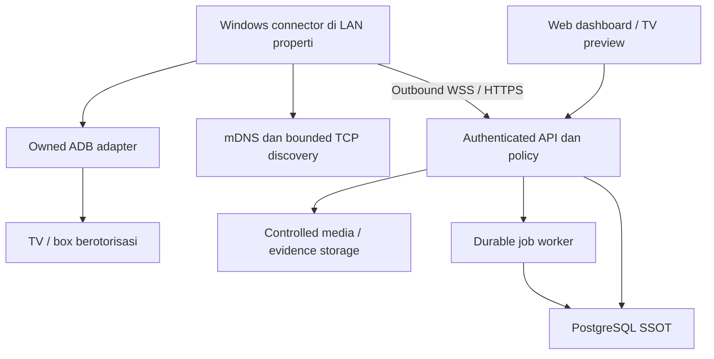

# GOJJA SmartTV
# Prototype Implementation Prompt & Acceptance Checklist v1.0

**31 Oktober 2026 — Asia/Jakarta**  
**Hasil yang diminta:** prototype yang benar-benar dapat dioperasikan, dengan data tersimpan konsisten, login/RBAC server-side, dan connector lokal yang melakukan scan terbatas serta koneksi ADB nyata ke TV/box yang berwenang.

## Ringkasan implementasi

Instruksi terbaru memperluas scope dari web prototype berbasis mock service menjadi **functional prototype + live device lab**. Browser/dashboard sendiri tidak mempunyai raw TCP ADB universal ke private LAN. Solusi yang dirumuskan adalah React/TypeScript CMS, NestJS API dengan PostgreSQL sebagai single source of truth, dan Windows desktop connector berbasis Electron/Node yang menjalankan discovery serta official Android SDK Platform-Tools melalui action allowlist.

Cloud/server menyimpan identitas, peran, scope, properti, lisensi, konfigurasi, job dan evidence. Connector berada pada jaringan yang dapat menjangkau TV dan membuka koneksi outbound ke backend. TV tetap meminta approval/pairing sesuai OS/OEM. **ADB**, bukan ADM, adalah nama mekanismenya. Port 5555 adalah salah satu jalur, bukan port universal. Wireless debugging modern memisahkan pairing dan koneksi, tergantung versi serta implementasi perangkat.

Data contoh disimpan di database yang sama melalui seed/migrations, bukan disalin ke array setiap halaman. DEMO dan LIVE_LAB merupakan namespace/workspace berbeda dengan provenance yang eksplisit. Candidate dari simulasi tidak dapat berubah menjadi hasil scan nyata. Live scan/connect/read-only inventory wajib dibuktikan pada perangkat fisik agar milestone hardware dinyatakan lulus.

Dokumen ini menyediakan keputusan implementasi, RBAC lengkap, kontrak data/API/jobs, runbook, master prompt siap dipakai builder, prompt bertahap, dan **100 acceptance tests**. Tidak ada aplikasi, connector, APK atau scan jaringan pengguna yang telah dibuat/dijalankan melalui pekerjaan penulisan ini. Seluruh acceptance hasil implementasi berstatus **Not Run** sampai evidence tersedia.

## Navigasi dokumen

1. Mandat dan perubahan scope
2. Hasil riset dan batas kepastian
3. Arsitektur yang dipilih
4. Jalur implementasi dan definition of working
5. Prasyarat runtime, perangkat dan jaringan
6. Single source of truth dan model data
7. Dataset lengkap dan provenance
8. Role catalogue administrator sampai end user
9. Permission catalogue dan grant sets
10. Scope, delegation dan authorization rules
11. Authentication, sessions dan connector identity
12. Kontrak UI dan coverage layar
13. Real discovery dan network scan
14. Real ADB connection, pairing dan device verification
15. Command allowlist, install dan recovery boundaries
16. Backend API, WSS dan durable jobs
17. Optional Android TV probe/client
18. Branding, stay, provider dan campaign end-to-end
19. Release, approval dan maintenance
20. Analytics, finance dan support integrity
21. Security dan operational failure handling
22. Runbook untuk mencoba langsung
23. Scenario catalogue dan test data controls
24. Work packages dan urutan pembangunan
25. Master implementation prompt — English
26. Incremental prompts dan continuation protocol
27. Functional acceptance —36 tests
28. RBAC/security acceptance —24 tests
29. Live LAN/ADB acceptance —28 tests
30. UI/UX/motion acceptance —12 tests
31. Evidence, gates dan final handoff
32. Traceability, referensi dan change record

## 1. Mandat dan perubahan scope

### 1.1 Apa yang berubah

Prototype Specification & Build Brief v1.0 [I01] menggunakan mock service/local persistence dan menyatakan ADB/scan sebagai simulasi. User sekarang meminta scan serta koneksi perangkat yang nyata. Dokumen ini menjadi **change contract untuk implementation prototype** pada area tersebut. Semua aturan branding, domain, guest privacy dan batas platform tetap berlaku.

| Area | Sebelumnya | Implementation contract ini |
| --- | --- | --- |
| Data utama | Normalized browser store + fixture | PostgreSQL melalui authenticated API; UI cache hanya projection |
| RBAC | Pemeriksaan mock services | Pemeriksaan backend, worker, connector dan resource scope |
| Login | Persona/demo access | Credential login nyata; persona switch hanya DEMO terkontrol |
| Scan/ADB | Deterministic simulation | Native connector melakukan authorized LAN discovery/ADB nyata |
| Mode | Demo synthetic | DEMO dan LIVE_LAB terpisah; no fallback mock di LIVE |
| UI | Light/dark belum konsolidasi awal | UI/UX v1.0 R1 [I02]: Light terang termasuk sidebar, Warm Graphite Dark, motion |
| Acceptance | Prototype flow saja | Software tests + hardware evidence; tidak bisa saling menggantikan |

Dokumen sumber tidak diedit diam-diam. Revisi I01/Architecture/Certification berikutnya harus memasukkan perubahan ini dengan ID baru; domain requirement lama tetap dapat dilacak. Perubahan scope perangkat nyata tidak mengesahkan provider rights, silent update, full OS lock atau factory reset universal.

### 1.2 Target minimum yang tidak boleh direduksi

Satu instalasi developer dapat menjalankan API/database, web UI dan connector Windows; pengguna login sesuai role, memilih LIVE_LAB, memberi grant lokal, menjalankan scan, mengotorisasi TV, connect, lalu melihat inventory read-only aktual beserta evidence. Tidak cukup tombol yang hanya mengubah teks dari Disconnected menjadi Connected.

Hardware tidak tersedia → software dapat diserahkan sebagai partially verified, tetapi milestone LIVE tetap Blocked/Not Run. Manual IP add berguna sebagai fallback, namun tidak menggantikan implementasi scan bila requirement real scan belum terpenuhi.

## 2. Hasil riset dan batas kepastian

| Temuan | Implikasi produk | Sumber |
| --- | --- | --- |
| ADB memiliki client/server/device daemon dan memerlukan authorization sesuai route | Connector menjalankan tool resmi; dialog TV tidak boleh dibypass | S01 |
| Wireless debugging memakai pairing dan koneksi; dukungan berbeda antar platform/versi | Dua port/endpoints dan state PairRequired dipisah; capability detection | S01/S02 |
| DNS-SD/NSD menemukan layanan yang diumumkan | mDNS tidak menjamin semua TV; perlu manual add dan bounded probe | S03 |
| Native desktop mendapat privilege lebih besar dari browser | Renderer diisolasi; IPC action-specific, no arbitrary shell | S04/S05 |
| Child process dapat dijalankan tanpa shell | Gunakan executable+argument array, timeout/output limits | S06 |
| Authorization harus diperiksa di jalur server | UI hiding bukan RBAC; scope/relationship/rights/capability ikut dicek | S07 |
| Local-network permissions Android berkembang menurut target SDK | Android phone connector bukan runtime pertama; bila ditambah, perlu permission review tersendiri | S09 |

Dokumentasi Android saat akses menyebut wireless debugging modern untuk TV pada Android13/API33ke atas; jangan menerjemahkannya menjadi dukungan semua TV Android13, atau bahwa TV lebih lama pasti mendukung TCP5555. OEM dapat berbeda. Rilis Platform-Tools terus berkembang; builder memilih versi resmi yang didukung lalu mencatat version/hash/kemampuan yang diuji, bukan hardcode asumsi port dan protokol lama.

Aplikasi pihak ketiga seperti CleanYourTV hanya menjadi referensi pola yang pernah dibahas. Tidak ada kode, hak perangkat, kontrak konten atau assurance GOJJA yang diperoleh otomatis dari keberadaan aplikasi tersebut. Riset ini merumuskan jalur yang dapat dibangun; belum ada uji TV pengguna dalam sesi ini.

## 3. Arsitektur yang dipilih

### 3.1 Stack prototype

| Komponen | Pilihan kerja | Alasan / batas |
| --- | --- | --- |
| Web CMS/TV preview | React + TypeScript | Reuse design system dan shared interaction |
| API | NestJS modular monolith | Auth/domain/validation/jobs dalam satu backend terukur |
| SSOT | PostgreSQL | Transaksi, constraints, scope dan durable records |
| Jobs | PostgreSQL jobs/outbox + worker process | Tidak bergantung queue memory; Redis optional setelah kebutuhan nyata |
| Local connector | Electron desktop + Node main process, Windows pertama | Akses LAN dan adb.exe; distributed companion untuk cloud |
| Real ADB | Official SDK Platform-Tools | Pair/connect/inventory melalui adapter terbatas |
| Media/artifacts | Local controlled storage lab; object-store adapter untuk remote | Asset metadata dan immutable hash di DB |
| Device client | Kotlin TV probe/client optional milestone | Bukan browser preview yang disamarkan sebagai APK |

Tidak perlu Laravel. Node/Electron/framework/library versions dipilih saat build berdasarkan dukungan dan keamanan saat itu; pin lockfile/toolchain. Jangan menambahkan microservices atau Kubernetes sebagai syarat demo. Database tidak boleh menjadi file bersama yang diakses langsung browser/connector; hanya backend menulis kebenaran domain.

### 3.2 Topologi



Web UI mengirim intent ke API; API membuat scoped job; connector mengambil/ menerima sinyal job melalui koneksi outbound. Cloud tidak membuka port ADB ke internet. Pada LOCAL_LAB, API/UI dapat di-loopback mesin Windows dan connector tetap memakai protokol sama. Pada REMOTE_LAB, API berada di hosting HTTPS/WSS dan connector tetap di properti. Deploy remote bukan syarat awal real local scan.

### 3.3 Trust boundaries

Renderer web tidak punya Node APIs. Electron renderer memuat packaged trusted local UI, nodeIntegration=false, contextIsolation=true dan sandbox yang didukung; privileged main process menerima action spesifik, bukan raw IPC channel bebas. Website cloud tidak dimuat ke privileged window. Koneksi API remote memakai TLS valid; jangan disable TLS verification atau webSecurity.

Connector mempunyai local grant dan server grant. Keduanya harus cocok untuk property/network/action/expiry. Local grant tidak dapat diperluas hanya dengan server command; server tidak boleh memerintah host/network lain. Tidak ada listener ADB/proxy di0.0.0.0atau router port forwarding.

## 4. Jalur implementasi dan definition of working

| Lane | Perilaku | Status wajib |
| --- | --- | --- |
| DEMO | Semua domain workflow berjalan terhadap DB dengan data sintetis, deterministic scenarios dan auth | M1 wajib functional |
| LIVE_LAB | Discovery, ADB connect/pair, transport verification dan inventory aktual | M2 wajib untuk klaim scan/connect nyata |
| APK_LAB | Install/update GOJJA-owned probe APK, enrollment dan config ACK nyata | M3 conditional; terpisah jika APK/toolchain/hardware belum ada |
| Provider/PMS/payment/AI external | Adapter sandbox/fixture eksplisit, bukan credential/rights nyata | Live integrations di luar M1/M2 sampai tersedia |

M1 dan M2 adalah dua milestone wajib; browser-only M1 tidak memenuhi seluruh permintaan. M3 direkomendasikan agar demo deploy bisa dibuktikan, tetapi jangan menyatakan install/launcher/lock nyata bila hanya M2 selesai. Factory reset, debloat, root, firmware dan general remote shell **tidak menjadi default live prototype**.

Seluruh form/tabel/filter/branding/stay/campaign/invoice/ticket bekerja end-to-end dengan DB dan domain validation. Pembayaran tetap pencatatan transaksi sintetis; tidak memindahkan uang. Provider package contoh tetap simulasi hak; tidak mengakses konten premium tanpa kontrak.

## 5. Prasyarat runtime, perangkat dan jaringan

### 5.1 Mesin dan toolchain

Windows host dengan Node/toolchain yang didukung, package manager, Docker Desktop atau PostgreSQL terpasang, official Platform-Tools, serta Electron connector yang dibangun. Android Studio/JDK/SDK diperlukan hanya untuk membangun M3 APK. Runtime health menampilkan API/DB/migration/connector/adb version, bukan green all-systems tanpa probe.

Installer desktop pertama boleh development executable/packaged build untuk lab; signed distribution installer merupakan pekerjaan delivery berikutnya. README mencatat requirements versi aktual dan keterbatasan arsitektur CPU. Jangan mengunduh adb.exe dari mirror tidak tepercaya; gunakan sumber resmi dan review licence bila hendak membundel/redistribusi [S02].

### 5.2 TV dan LAN

TV/box Android yang dimiliki/diizinkan pengguna; staf dapat membuka pengaturan dan mengonfirmasi authorization. Host connector harus punya route ke TV. VLAN/isolation/firewall/mDNS filtering dapat menghalangi meskipun SSID sama. TV Ethernet dapat dijangkau host Wi-Fi bila route diizinkan. Menghidupkan USB debugging saja tidak selalu membuka network ADB; UI menunjukkan prerequisite sesuai route.

Tidak mewajibkan factory reset untuk memulai scan/connect. Jika OEM tidak menyediakan network ADB, laporkan Unsupported/NeedsUSBSetup sesuai bukti; jangan mengubah firmware, membuka bootloader atau mem-bypass authorization. USB onboarding manual dapat menjadi jalur terpisah, bukan diklaim sebagai Wi-Fi success.

### 5.3 Network default lab

Pilih satu interface LAN fisik dan RFC1918 IPv4 CIDR yang benar-benar ada pada host. Default maksimum satu/24atau254host; jaringan lebih besar harus dipersempit dan disetujui eksplisit. VPN/Docker/loopback tidak dipilih otomatis. IPv6 dan routed multi-subnet merupakan perluasan, bukan support diam-diam. Host scan diberikan local consent, time limit dan action scope.

## 6. Single source of truth dan model data

### 6.1 Satu sumber kebenaran

PostgreSQL menyimpan seluruh resource bisnis dan observations metadata. Seed adalah input migrations/fixtures, bukan runtime source kedua. React cache, WebSocket payload dan local connector spool bukan authoritative business state. Semua perubahan melewati API/transaction/constraints; UI meng-invalidate/refetch atau menerapkan response version server.

Scope fields minimum: environmentId, organizationId/customerId, propertyId bila relevan, resourceVersion, createdAt/updatedAt, createdBy, origin/provenance. DB namespace DEMO dan LIVE_LAB memakai environmentId pada key/FK/unique constraint yang relevan, bukan sekadar tag UI.

### 6.2 Entities dan invariants

| Group | Entities | Invariant |
| --- | --- | --- |
| Access | User, Credential, Session, Role, Permission, RoleGrant, Delegation | Deny default; grants scoped dan dapat revoked |
| Business | Organization, PartnerRelationship, Property, Buyer, Subscription, SeatAllocation | Buyer/operator/ISP/provider terpisah |
| Rooms/devices | RoomClass, Room, Group, Endpoint, DeviceIdentity, Assignment, CapabilityObservation | Satu binding aktif; IP/name bukan credential |
| LAN | Connector, ConnectorCredential, LocalConsent, NetworkContext, DiscoveryRun, Candidate, Observation | Candidate belum enrolled/allocated seat |
| Commands | Job, Target, Attempt, Lease, Result, Outbox, Inbox, Evidence | Idempotency; outcome unknown direkonsiliasi |
| Experience | ProfileVersion, EffectiveConfig, Publication, Asset, Creative, Campaign, Placement | Published immutable; draft bukan applied |
| Guest | Stay, StayAssignment, CorporateGroup, ContextLease, CleanupTask | Version guard dan no overlapping active room stay |
| Provider | Contract, PackageVersion, Connection, Allocation, Lineup, Channel | Rights bukan URL/paid status; basis quantity explicit |
| Operations | Release, TechnicalApproval, InstallPermission, ReadinessSnapshot | Dua approvals dan recheck kondisi |
| Reporting | PlaybackEvent, SessionFact, QoEFact, AggregationWatermark | Event dedup dan provenance; no guest-name metrics |
| Finance/support | Invoice, Line, Receipt, Credit, Ticket, Diagnostic, AuditEvent | Issued immutable; duplicate payment no double post |

Constraints: unique(environmentId,propertyId,roomCodeNormalized); unique active endpoint binding; eventId/inbox unique; unique payment source+transactionRef; job idempotency scoped actor/action; quantity reservation transaction dan lock agar last seat tidak dipakai dua kali. Optimistic concurrency memakai expectedVersion/ETag. Transaction writes domain+audit+outbox yang diperlukan secara konsisten.

### 6.3 Data provenance

origin=SEEDED/MANUAL/LIVE_OBSERVATION/SIMULATION_EVENT; executionMode=SIMULATED/LIVE; verificationLevel=UNVERIFIED/OBSERVED/TRANSPORT_VERIFIED/DEVICE_VERIFIED/APPLIED/HEALTHY. Fields tidak dapat diubah user/editor untuk mengubah simulated menjadi live. Live observations mencatat connectorId, runId, target, timestamp wall-clock nyata, tool version, command/action allowlist ID, result hash dan sensitive redaction status.

Single DB tidak berarti semua data dicampur. Query/report memilih environmentId dan permitted scope, menyatakan data source serta completeness. Counter online DEMO tidak dihitung dari host LAN; counter LIVE tidak diisi dari fixture ketika connector gagal.

### 6.4 Cache dan clocks

DEMO memakai controlled clock2November2026pukul14.00WIB sesuai I01. LIVE memakai actual UTC wall-clock plus monotonic duration untuk timeouts/measurement; demo advance-clock tidak memengaruhi grant/job expiry LIVE. Theme preference boleh local storage user-scoped; finance/roles/seat/rights tidak.

## 7. Dataset lengkap dan provenance

### 7.1 DEMO seed yang konsisten

| Organization/property | Sales route / buyer | Seats | Rooms / endpoints | Online / offline |
| --- | --- | ---: | --- | --- |
| C-01 / P-01 Hotel Arunika Yogyakarta | ISP-A Alpha Hospitality Network |12×Rp15K |6rooms /7TV |5/2 |
| C-02 / P-02 Bayu Bali Suites | ISP-B Beta Property Connect |8×Rp15K |4rooms /5TV |4/1 |
| C-03 / P-03 Sora Serviced Residence short stay | Direct C-03 |10×Rp25K demo |2rooms /2TV |2/0 |

Total30contracted,14allocated,16available,12rooms,11online/3offline. Harga merupakan hipotesis/demo, bukan tarif final. P-01room101/102/103Standard,201/202Deluxe,301Suite duaTV E-06/E-07. P-02room401/402Deluxe,501/502Suite dengan duaTV E-11/E-12pada502. P-03room601/602Studio. Offline E-05/E-07/E-12. E-09Limited; E-14assisted update. Detail IDs sesuai I01.

Stay S-01room101; S-02/03room102/103corporate; S-04room301; S-05room401; S-06room501; S-07room601. Occupied7/12rooms. Room201vacant tetapi housekeeping belum ready; status network/occupancy/housekeeping tidak disamakan. Names sintetis optional dan masked berdasarkan role.

Contracts: CT-01P-01basisroom6, Basic semua, International201/202/301, Sports301, explicit two-TV inclusion dan no-lobby rights. CT-02P-02basisendpoint5dengan Sports E-10/E-11/E-12. CT-03P-03Submitted/unverified, premium ditolak. Provider F-A/F-Bdan channels fiktif. Kampanye CMP-01spaActive, CMP-02corporateActive, CMP-03diningDraft, CMP-04Expired. Asset library mencakup gambar/property logo, four-locale creative metadata dan invalid file fixture.

Invoices INV-01Rp180KIssued/unpaid; INV-02Rp120KPaid; INV-03Rp250KIssued/unpaid. Issued550K,paid120K,outstanding430K, tax disabled demo. Payment INV-01sekali180K →paid300K/outstanding250K. Provider quote/hardware bukan MRR software.

Analytics fixture CMP-01:10starts;6complete×30s,2skip×5s,1interrupted20s,1failed-after-start2s=212playseconds, completion60%. Channel8attempts/7starts/1before-start failure; valid durations600/300/240/180/120/60/30s=1530s=25,5minutes,median180s. Source/funnel/coverage mengikuti I01dan ditandai fixture.

### 7.2 LIVE_LAB seed

LIVE_LAB dimulai kosong dari endpoint/candidate/result. Buat satu lab customer/property dan room draft melalui API, initial licensed trial quantity yang dinyatakan untuk lab, accounts/grants yang berwenang dan connector registration. Jangan seed IP TV pengguna sebagai perangkat terverifikasi. Operator memasukkan interface/subnet atau manual target yang benar saat uji.

Artefak sample bernama jelas GOJJA Lab Probe jika M3dikerjakan; tidak memakai signed release produksi. Source legal local demo boleh terdaftar sebagai fixture media, bukan paket provider komersial. Live raw observation tidak boleh dihapus melalui Reset Demo. Reset Live Database memerlukan backup/authority, tidak mereset TV/ADB trust.

### 7.3 Accounts dan fixture generation

Seed menyediakan akun untuk seluruh role di§8dan minimal dua property scopes berbeda. Password di-generate random/di-set melalui local setup secret, dihash server, tidak hardcoded ke source atau ditampilkan sebagai password universal. Demo launcher boleh merujuk account aliases, tetapi LIVE selalu login nyata. Tester mendapatkan credential awal melalui local secure setup output sekali dan mengganti sesuai kebijakan. Superuser bypass tersembunyi dilarang.

Tulis seed validation script untuk FK, totals, quantities, stay overlap, package rights, permission grants, invoice arithmetic, metrics dan live emptiness. Semua KPI dihitung query/selectors dari DB; jangan mengulang angka card/table sebagai const yang terpisah.

### 7.4 Machine-readable seed manifest minimum

Manifest berikut memperjelas IDs, relasi, room mapping dan angka dasar. Builder mengembangkannya menjadi database seed lengkap dengan required fields/migrations, bukan menyalinnya ke setiap komponen UI. Arrays berkolom pendek mempunyai header yang eksplisit. Semua record berada di DEMO/originSEEDED; manifest ini tidak menghasilkan candidate/TV nyata.

```json
{
  "seedVersion": "gojja-functional-demo-1",
  "environmentId": "DEMO",
  "origin": "SEEDED",
  "clockUtc": "2026-11-02T07:00:00Z",
  "partners": [
    {"id": "ISP-A", "name": "Alpha Hospitality Network"},
    {"id": "ISP-B", "name": "Beta Property Connect"}
  ],
  "customers": [
    {"id": "C-01", "propertyId": "P-01", "partnerId": "ISP-A"},
    {"id": "C-02", "propertyId": "P-02", "partnerId": "ISP-B"},
    {"id": "C-03", "propertyId": "P-03", "partnerId": null}
  ],
  "properties": [
    {"id": "P-01", "name": "Hotel Arunika Yogyakarta", "timezone": "Asia/Jakarta", "locale": "id"},
    {"id": "P-02", "name": "Bayu Bali Suites", "timezone": "Asia/Makassar", "locale": "en"},
    {"id": "P-03", "name": "Sora Serviced Residence", "timezone": "Asia/Jakarta", "locale": "id"}
  ],
  "subscriptions": [
    {"id": "SUB-01", "customerId": "C-01", "buyerId": "ISP-A", "seats": 12, "unitPriceIdr": 15000},
    {"id": "SUB-02", "customerId": "C-02", "buyerId": "ISP-B", "seats": 8, "unitPriceIdr": 15000},
    {"id": "SUB-03", "customerId": "C-03", "buyerId": "C-03", "seats": 10, "unitPriceIdr": 25000}
  ],
  "roomColumns": ["id", "propertyId", "code", "class", "housekeeping"],
  "rooms": [
    ["ROOM-101", "P-01", "101", "Standard", "Ready"],
    ["ROOM-102", "P-01", "102", "Standard", "Ready"],
    ["ROOM-103", "P-01", "103", "Standard", "Ready"],
    ["ROOM-201", "P-01", "201", "Deluxe", "Dirty"],
    ["ROOM-202", "P-01", "202", "Deluxe", "Ready"],
    ["ROOM-301", "P-01", "301", "Suite", "Ready"],
    ["ROOM-401", "P-02", "401", "Deluxe", "Ready"],
    ["ROOM-402", "P-02", "402", "Deluxe", "Ready"],
    ["ROOM-501", "P-02", "501", "Suite", "Ready"],
    ["ROOM-502", "P-02", "502", "Suite", "Ready"],
    ["ROOM-601", "P-03", "601", "Studio", "Ready"],
    ["ROOM-602", "P-03", "602", "Studio", "Ready"]
  ],
  "endpointColumns": ["id", "roomId", "subscriptionId", "connection", "capabilityProfile"],
  "endpoints": [
    ["E-01", "ROOM-101", "SUB-01", "Online", "DEMO-MANAGED"],
    ["E-02", "ROOM-102", "SUB-01", "Online", "DEMO-MANAGED"],
    ["E-03", "ROOM-103", "SUB-01", "Online", "DEMO-MANAGED"],
    ["E-04", "ROOM-201", "SUB-01", "Online", "DEMO-MANAGED"],
    ["E-05", "ROOM-202", "SUB-01", "Offline", "DEMO-MANAGED"],
    ["E-06", "ROOM-301", "SUB-01", "Online", "DEMO-MANAGED"],
    ["E-07", "ROOM-301", "SUB-01", "Offline", "DEMO-MANAGED"],
    ["E-08", "ROOM-401", "SUB-02", "Online", "DEMO-MANAGED"],
    ["E-09", "ROOM-402", "SUB-02", "Online", "DEMO-LIMITED"],
    ["E-10", "ROOM-501", "SUB-02", "Online", "DEMO-MANAGED"],
    ["E-11", "ROOM-502", "SUB-02", "Online", "DEMO-MANAGED"],
    ["E-12", "ROOM-502", "SUB-02", "Offline", "DEMO-MANAGED"],
    ["E-13", "ROOM-601", "SUB-03", "Online", "DEMO-MANAGED"],
    ["E-14", "ROOM-602", "SUB-03", "Online", "DEMO-ASSISTED"]
  ],
  "stayColumns": ["id", "roomId", "displayName", "locale", "groupId"],
  "stayIntervalUtc": {"arrival": "2026-11-01T07:00:00Z", "departure": "2026-11-03T04:00:00Z"},
  "stays": [
    ["S-01", "ROOM-101", "Bapak Aditya", "id", null],
    ["S-02", "ROOM-102", null, "en", "G-CORP"],
    ["S-03", "ROOM-103", null, "zh-CN", "G-CORP"],
    ["S-04", "ROOM-301", "Demo Guest Suite", "ja-JP", null],
    ["S-05", "ROOM-401", null, "en", null],
    ["S-06", "ROOM-501", null, "id", null],
    ["S-07", "ROOM-601", null, "id", null]
  ],
  "groups": [{"id": "G-CORP", "propertyId": "P-01", "stayIds": ["S-02", "S-03"], "message": "Welcome, Nusantara Corporate Group"}],
  "invoices": [
    {"id": "INV-01", "subscriptionId": "SUB-01", "totalIdr": 180000, "paidIdr": 0},
    {"id": "INV-02", "subscriptionId": "SUB-02", "totalIdr": 120000, "paidIdr": 120000},
    {"id": "INV-03", "subscriptionId": "SUB-03", "totalIdr": 250000, "paidIdr": 0}
  ],
  "liveLabCandidates": [],
  "liveLabVerifiedDevices": []
}
```

Perbedaan timezone P-02dibuat eksplisit: fixed clock07.00UTCmenjadi15.00WITA, bukan14.00WIB. Stay intervals UTCsama tetap ditampilkan dengan property timezone yang benar. Housekeeping Ready pada occupied room bukan izin update; occupancy dan maintenance authorization tetap membatasi.

Builder wajib menambahkan seed children yang terhubung, bukan orphan metadata: four-locale dictionaries/creative, provider package versions/channel rights, publication targets/ACK, capability flags dengan evidenceTypeDemo, invoice lines/receiptINV-02,profile versions,events/aggregates yang menghasilkan angka§7.1,release approvals,tickets,audit dan account role grants. Seed validator membandingkan derived totals dari row nyata, bukan memvalidasi ulang angka const yang sama.

## 8. Role catalogue administrator sampai end user

Role adalah kumpulan permission; resource scope/delegation/rights/capability masih diperiksa. User boleh beberapa role yang disahkan, tidak mendapat semua role karena jabatan owner. Daftar berikut16human/guest personas plus2service principals, bukan16akun global tanpa scope.

| Role | Nama | Scope default / fungsi |
| --- | --- | --- |
| R-01 | Product/Business Owner | Commercial/product governance, approve business policy; tidak default raw device execution |
| R-02 | Platform Administrator | Organisasi, partner, properties, plan catalog dan scoped users |
| R-03 | Technical Administrator | Release/evidence/technical review; device diagnostics lewat delegation |
| R-04 | Security Administrator | Roles/delegation/revoke/audit; tidak otomatis finance atau guest names |
| R-05 | GOJJA Finance | Wholesale/direct invoices, receipts, credit review |
| R-06 | Support Operator | Tickets dan scoped read-only diagnostic; no shell/deploy default |
| R-07 | Auditor | Read-only scoped audit/aggregate/export redacted |
| R-08 | ISP Partner Administrator | Customers/orders/properties dalam partner relationship aktif |
| R-09 | Partner/Assigned Installer | Connector/discovery/ADB read-only pada delegated property/network/time |
| R-10 | Property Owner | Property policy/users/branding/publish/install permission sesuai entitlement |
| R-11 | Property Manager | Operasi properti, publishing, content contract submission, maintenance |
| R-12 | Content Editor | Draft branding/media/campaign/locale; no publish |
| R-13 | Front Office | Manual stay/group/check-in/out/room move, readiness facts |
| R-14 | Property Analyst | Aggregate analytics/reporting sesuai scope; no guest names by default |
| R-15 | Property Finance | Lihat invoice/customer billing yang diizinkan; no GOJJA receipt posting |
| R-16 | Guest / end user | Context TV aktif, bahasa/menu/channel/service request; tidak CMS/network/admin |
| SP-01 | Connector principal | Claim/report hanya job connector/property/grant yang sah |
| SP-02 | TV client principal | Sync/ACK/telemetry/guest-context resource miliknya; bukan staff user |

Residence/Home account roles merupakan roadmap; jangan memakai property owner hotel untuk mengendalikan household tanpa persetujuan. Guest adalah session/context principal, bukan akun CMS dengan password bersama di semua kamar. Service principal tidak login sebagai human administrator.

## 9. Permission catalogue dan grant sets

### 9.1 Action permissions

| Group | Permission keys | Rule |
| --- | --- | --- |
| IAM | users.read, users.manage, roles.assign, delegation.grant, delegation.revoke | Tidak dapat memberi permission/scope melebihi kewenangan pemberi |
| Tenancy | customers.read, customers.manage, partners.manage, properties.read, properties.manage | Relationship dan environment wajib |
| Business | plans.read, plans.manage, subscriptions.read, subscriptions.manage, seats.allocate | Payer/quantity/entitlement transaction |
| Rooms | rooms.read, rooms.manage, endpoints.read, endpoints.bind, endpoints.transfer | Exact binding version |
| Branding | branding.read, branding.edit, branding.publish, media.manage, info.edit | Editor≠publisher |
| Guests | stays.read, guests.name.read, stays.manage, guest.reset | Name scope terpisah; lease/version |
| Content | contracts.read, contracts.submit, contracts.verify, providers.configure, packages.allocate, lineup.edit | Verify grant bukan hak reseller otomatis |
| Campaign | campaigns.edit, campaigns.publish, externaloffers.accept | Material version dan consent |
| Reporting | analytics.read, reports.export, audit.read | Aggregation/privacy/scope |
| Connector | connectors.enroll, connectors.revoke, network.scan, adb.pair, adb.connect, adb.inventory, adb.disconnect | Local consent + server grant; no arbitrary command |
| Lab install | artifacts.register, labapk.install, labapk.update, labapk.uninstall | Own artifact/package, separate local approval and permission |
| Release | releases.create, releases.technicalapprove, updates.propertyapprove, updates.readiness, updates.execute | Two approvals + execution recheck |
| Recovery | recovery.preview, recovery.restore, recovery.factoryreset | LIVE restore/factory reset default disabled sampai adapter/evidence tersedia |
| Finance | invoices.read, invoices.issue, payments.verify, credits.review | Buyer access dan reviewer separation |
| Support | tickets.create, tickets.manage, diagnostics.read | Read-only default; redacted evidence |
| Guest API | guest.menu.read, guest.locale.set, guest.channel.play, guest.service.request | Hanya device/stay context sah |

Tidak ada wildcard adb.*atau permission shell.execute. Property manager bukan installer sampai diberi R-09/delegation yang sesuai. Role assignment dilakukan server dengan audit dan reauthentication untuk grants sensitif.

### 9.2 Grant defaults per role

| Role | Grant set utama | Explicit exclusions |
| --- | --- | --- |
| R-01 | Business policy/plans/subscriptions review, aggregate business reporting | No default payments.verify, adb, guest.name |
| R-02 | customers/partners/properties/users terbatas, plan/subscription administration | No technicalapprove/payments/ADB/name otomatis |
| R-03 | release create/technicalapprove sesuai separation, diagnostics, artifacts review | Tidak propertyapprove; no local network tanpa R-09grant |
| R-04 | IAM/delegation/revocation/audit | No konten/finance/device execution dari jabatan saja |
| R-05 | invoice/receipt/credit scope GOJJA | Tidak mengubah rights karena invoice paid |
| R-06 | tickets/manage dan diagnostics.read delegated | No raw provider secret, live execution, name default |
| R-07 | audit/report aggregate read/export redacted | No mutation, no raw pairing code/key |
| R-08 | customer/property/order in own relationship, provider submit bila berwenang | No other ISP/direct, no content verification universal |
| R-09 | enroll/scan/pair/connect/inventory/disconnect sesuai grant | No install/reset sampai tambahan permission + approval |
| R-10 | property management/users subset, publish, policy/install approval | No releases.technicalapprove/GOJJA finance |
| R-11 | property operations/publish/contract submit/package allowed/maintenance | Tidak memperluas content rights atau admin grants |
| R-12 | branding/media/info/campaign drafts | No publish, guest names, ADB atau invoice |
| R-13 | stays/manage, name read, group/reset, readiness observations | No APK approve, factory reset, provider secret |
| R-14 | analytics/read, aggregate export | No personal names/view history by individual |
| R-15 | own billing read/export, payment evidence submission opsional | No GOJJA payments.verify/credit issue |
| R-16 | guest endpoints saja | No /admin,/connector,/finance,/roles |

R-03technical approval pada own-created artifact direview dengan second approver bila policy lab mensyaratkan; prototype menyimpan reviewer relationship dan conflict reason. Seed dapat menyediakan dua akun teknis agar separation benar-benar dapat diuji. R-09milik ISP-A tidak otomatis mengakses property direct atau ISP-B.

### 9.3 Grant fixture schema dan account coverage

Setiap role seed disimpan sebagai permission rows eksplisit. Grant set dalam§9.2adalah dasar mapping; builder membuat `permissions` dan `rolePermissions` yang dapat dibaca/test, tanpa wildcard tersembunyi. Untuk setiap role sediakan account alias,environment,scope,positive action dan negative action. Minimum aliases:demo-business-owner,demo-platform-admin,demo-technical-admin-a/b,demo-security-admin,demo-finance,demo-support,demo-auditor,alpha-admin,beta-admin,alpha-installer,property-owner,property-manager,content-editor,front-office,property-analyst,property-finance. Guest masuk melalui device/stay session, bukan admin alias. LIVEaccounts/grants terpisah dan tidak diperoleh dari demo alias switch.

Contoh schema grant, bukan credential nyata:

```json
{
  "principalAlias": "alpha-installer",
  "environmentId": "LIVE_LAB",
  "roleId": "R-09",
  "scope": {"type": "PROPERTY", "ids": ["generated-lab-property-id"]},
  "permissions": [
    "connectors.enroll",
    "network.scan",
    "adb.pair",
    "adb.connect",
    "adb.inventory",
    "adb.disconnect"
  ],
  "requiresLocalConsent": true,
  "expiresAt": "issued-by-server-at-grant-creation",
  "delegationRef": "approved-property-network-delegation",
  "grantableRoleIds": [],
  "allowArbitraryShell": false
}
```

Role assignment authority memakai explicit approved `grantableRoleIds`,scope ceiling dan review policy; bukan hanya apakah grantor bisa melakukan aksi role tersebut. Security admin dapat mengelola assignment dalam katalog yang disahkan tanpa otomatis memiliki finance/ADB execution sendiri. User tidak boleh self-escalate atau memperluas grantable roles dari payload. Untuk grant berisiko, simpan approver/purpose/version dan pisahkan assignment dari local device consent.

Export permission matrix untuk review:rowsroleId,columnspermissionKey,cellAllow/Deny/Conditional dan scope rule. Generate APIauthorization tests dari policy cases yang ditinjau, termasuk deny bagi permission yang tidak dicantumkan. Actual role fixtures dan matrix menjadi deliverable build, bukan hanya gambar tabel UI.

## 10. Scope, delegation dan authorization rules

### 10.1 Policy equation

Allow = authenticated principal ∩ environment ∩ active role grant ∩ organization/property relationship ∩ action permission ∩ resource ownership/binding ∩ relevant software/content entitlement ∩ current capability ∩ required approval ∩ local consent untuk LAN. Missing/unknown critical authorization →deny atau hold, bukan fallback allow.

Masing-masing permission mempunyai resource/action, scopeType, scopeIds, validFrom/until dan delegable flag. Delegation memuat grantor, grantee, purpose, allowed actions, property/network, expiry dan revocation. Platform-role access tidak otomatis memberi guest-name read. API tidak mempercayai propertyId/role yang dikirim browser.

### 10.2 Endpoint enforcement

Validasi saat list/query/detail/export/upload URL/job create/job claim/native execute/result ingestion. Filter resource server-side sebelum pagination/aggregate; jangan ambil semua lalu mask di frontend. Direct object ID milik pihak lain memberi safe denial tanpa detail sensitif. Worker memuat ulang current grants/binding/approval sebelum eksekusi; revoked user/job grant tidak terus berlaku karena job sudah queued.

### 10.3 End user dan guest APIs

Guest device principal hanya membaca applied guest-safe projection untuk assignment/current stay. Locale/service request memakai context token pendek yang tidak memberi admin scope. Guest tidak boleh mengirim endpointId lain untuk membuka context/name. Checkout/contextVersion invalidation menolak token lama. PIN staff tidak menjadi universal code pada menu guest.

### 10.4 Permission inspector untuk tester

UI lab menyediakan halaman RBAC inspector read-only bagi role berwenang: actor, role, scope, effective permission, allow/deny reason dan policy version. Edit permission harus lewat IAM workflow nyata. DEMO persona switch dapat membuka akun seed menggunakan mekanisme dev-only yang terisolasi, tetapi endpoint tersebut tidak ada/disabled di LIVE dan tidak menjadi cara memperoleh token koneksi ADB.

## 11. Authentication, sessions dan connector identity

Human authentication memakai server-validated credential dan password hash yang sesuai, session ID acak HttpOnly cookie, SameSite policy, expiry/revocation, rate limit dan CSRF/origin protection. HTTPS/WSS wajib untuk remote/nonloopback. HTTP exception hanya explicit local loopback development dengan secure-cookie configuration yang konsisten; tidak mematikan TLS globally. Reset password/role assignment tidak disahkan oleh field client saja [S08].

Jangan menaruh long-lived staff JWT, connector private key atau provider secret di browser localStorage. Session store menyimpan user, environment/scope/grantVersion dan revokedAt. Disabled user/expired role ditolak pada request berikutnya serta sebelum device execution. UI reroute tidak cukup.

Connector enrollment: authorized user membuat single-use pairing session untuk property/actions/time; desktop menunjukkan kode/fingerprint dan meminta persetujuan lokal. Backend menerbitkan identity credential milik connector, bukan user admin password. Desktop menyimpan credential melalui OS-protected storage dan mengirim challenge/proof atau token terikat connector melalui TLS. Refresh/revoke/expiry diuji. Browser hanya menampilkan public identity/status.

LocalConsent memuat user/operator, property/network interface/CIDR, allowed actions, issued/expiry, optional per-target install authorization dan revocation. Backend signed job envelope atau online claim-verification mengikat jobId,connectorId,propertyId,networkContext,target/action/expiry/attempt/policyVersion. Connector memeriksa lagi grant lokal sebelum socket/ADB command. Pairing code sementara harus dikirim melalui protected short-lived channel ke connector, dihapus setelah digunakan dan tidak disimpan pada durable job payload/log.

## 12. Kontrak UI dan coverage layar

Pertahankan69screen/tab I01: SH-01..03,GA-01..15,IS-01..07,PR-01..27,IN-01..08,TV-01..09. PR-22external offers tetap optional. Form/action M harus mempunyai backend implementation atau explicit unavailable reason; no universal success toast. TV preview membaca projection dari API/SSOT yang sama dengan CMS.

Tambahan4 lab panels/routes, boleh berbentuk tabs/drawers yang jelas:

| ID | Panel | Fungsi |
| --- | --- | --- |
| LB-01 | Runtime & workspace health | DEMO/LIVE mode, API/DB/migration/connector/ADB toolchain |
| LB-02 | Network grant & connector trust | Interface/CIDR/action/expiry/local approval, revoke |
| LB-03 | ADB session inspector | Pair/connect state, target, get-state, inventory, last verification |
| LB-04 | Evidence & RBAC inspector | Run/action/result hashes, redaction, policy allow/deny |

UI/UX I02R1berlaku: white/pearl Light termasuk sidebar/header; Warm Graphite Dark; official lowercase gojja artwork; four guest locales dan CMSID/EN; remote focus; motion menu/chart/KPI/theme620msdengan reduced motion. User-uploaded logo dan image reference/brandboard harus dihubungkan sebagai aset; jangan recreate wordmark dengan font generik. V-06..V-08belum merupakan satu layout final terpilih; shared visual rules tetap wajib.

Badge data source selalu terlihat pada discovery/results: LIVE observed, DEMO fixture atau SIMULATED event. Mode switch memuat route/cache baru setelah scope confirmation; tidak menjalankan live job dari snapshot demo. Seed reset tidak memutus TV nyata. Live action tombol menyebut dampak/target dan prerequisite.

## 13. Real discovery dan network scan

### 13.1 Discovery adapters

1. Enumerasi interface LAN host melalui native process dan tampilkan IP/netmask/type; installer memilih interface.
2. Jalankan DNS-SD/mDNS discovery terbatas pada interface dan duration. Services kandidat: _adb._tcp, _adb-tls-pairing._tcp, _adb-tls-connect._tcp; _androidtvremote2._tcp dan _googlecast._tcp hanya sebagai device hints, bukan bukti ADB.
3. Resolve advertised addresses/ports, validasi terhadap allowed network. Friendly name/TXT records adalah input tidak tepercaya, dirender plain text.
4. Jika diperlukan, lakukan bounded TCP reachability ke port ADB yang disetujui pada CIDR terpilih; port5555boleh salah satu candidate port. Tidak scan seluruh port atau seluruh routed network.
5. Merge observations berdasarkan scoped network/address/service, bukan global IP. Manual add IP+port tetap tersedia.
6. Create Candidate dengan foundAt/lastSeen/source/confidence/service/port/reachability. Jangan langsung membuat Endpoint atau mengalokasikan seat.

Port dari GoogleCast/AndroidTVRemote service bukan otomatis ADB port; jangan mengirim ADB connect ke8009/remote-control port karena service terlihat. Pairing service port berbeda dari connection service. Tanpa service advertisement/probe response, tampilkan no results dengan coverage dan manual route; tidak mengisi hasil dummy.

### 13.2 Bounded scan parameters

Default baseline lab: satu RFC1918IPv4CIDR maksimum/24atau254hosts, concurrency8, probe timeout600ms, discovery window12s, total run cap45s, cancel supported. Nilai dapat dikonfigurasi dengan role/constraint, bukan target performa semua LAN. IP sendiri/gateway yang tidak ditargetkan dan broadcast/network addresses dikecualikan sesuai subnet. Public/multicast/loopback destinations untuk target ADB ditolak.

Jika granted subnet merupakan route khusus, review dan explicitly add grant; connector tidak memperluas otomatis dari/24ke/16. DNS resolution dicheck ulang sebelum connect untuk mencegah target berubah keluar scope. Network interface berubah/VPN aktif selama run →pause/revalidate. Socket ditutup pada timeout/cancel; jangan meninggalkan hundreds connection handles.

### 13.3 Evidence dan labels

Found≠Reachable≠ADBVerified≠Authorized≠Enrolled. Open port bukan bukti Android/TV. Candidate name bisa Unknown. Scan summary menyimpan actual target range, attempted/completed/timeout/ignored count, mDNS interface, start/end/duration dan errors. CONNECTOR_OFFLINE, MULTICAST_UNAVAILABLE, NETWORK_SCOPE_CHANGED dan ACCESS_DENIED merupakan states terpisah. Backend tidak mengklaim scan berjalan jika connector belum menerima job.

## 14. Real ADB connection, pairing dan device verification

### 14.1 Tool adapter

Operator memilih executable resmi adb.exe yang tervalidasi path/version; packaged distribution mencatat provenance/hashes/licence review. Jalankan proses dengan argument array dan shell=false, windowsHide=true, timeout serta output cap. Jangan menginterpolasi IP/name/pairing code ke shell command string. Command selection berbasis typed action; bukan UI terminal [S06].

ADB host server dan keys adalah state lokal tersendiri. Default jangan mengambil/mematikan server Android Studio atau mengubah global adb config tanpa persetujuan. Rekomendasi: server milik connector pada loopback port khusus yang tidak bentrok, identity profile yang tervalidasi. Mekanisme key directory/environment harus diverifikasi terhadap Platform-Tools versi terpilih; jangan menganggap ADB_VENDOR_KEYS sendirian menjamin tidak ada default user key. Dedicated OS test account dapat dipakai untuk isolasi lab jika perlu. Catat shared-key limitations secara jujur dan jangan embed universal private key di repo.

### 14.2 TCP route

Untuk perangkat yang memang sudah mengaktifkan network ADB, connect ke IP:connectionPort yang disetujui, lalu cek transport dan get-state. TV mungkin memerlukan dialog RSA. Jika unauthorized, UI menunggu approval fisik; jangan looping brute force atau mencoba key pihak lain. USB debugging aktif tidak otomatis berarti daemon TCP terbuka. Tool connect message saja tidak menandakan device siap.

### 14.3 TLS pairing route

Jika TV/OEM menyediakan Wireless debugging, operator membuka pairing screen dan memasukkan pairingIP:pairingPort serta one-time code; connector menjalankan adb pair melalui input sementara yang tidak dilog. Setelah pair berhasil, resolve/masukkan connectionIP:connectionPort lalu connect. **Pairing port tidak dipakai sebagai connection port**. Jangan memaksa route ini pada TV yang tidak menyediakan fitur tersebut.

Pair success≠connect success. Pairing code salah/expired menampilkan PairFailed/Expired, bukan Connected. Port connection dapat berubah setelah reboot/debug toggle; discovery/manual confirmation diperbarui. OS/OEM/network prerequisites dicek dari observasi, tidak dari brand marketing name.

### 14.4 Verified connection

Status DEVICE_VERIFIED hanya jika: target cocok grant; transport berstatus device/ready; read-only query ke exact target berhasil; observed timestamp dan connector identity tersimpan. Inventory allowlist mencakup model/manufacturer/Android API/build fingerprint dengan query yang disetujui; props tertentu dapat unavailable. Jangan mengambil seluruh logcat/screenshot/userdata untuk membuktikan koneksi.

Catat name hints sebelum connect dan observed device properties sesudah connect secara terpisah. Tidak menyimpulkan hardware asli hanya dari getprop yang dapat diubah firmware. Label Android device verified; kategori TV membutuhkan model/capability atau verifikasi staf, bukan anggapan semua Android host adalah TV.

### 14.5 Disconnect dan trust lifecycle

adb disconnect menghentikan transport, **bukan mencabut key trust** di TV. UI menjelaskan cara Forget/Revoke sesuai OEM dan memverifikasi reconnect setelah revocation sebagai test terpisah. Server credential connector revoke memblokir GOJJA jobs baru; tidak otomatis menghapus ADB key dari TV. Developer mode off tidak berarti re-enable dilarang. Close connector tidak dimaknai TV kembali factory setting.

## 15. Command allowlist, install dan recovery boundaries

| Action ID | Perintah logis / efek | Permission dan batas |
| --- | --- | --- |
| ADB-01 | adb version | Toolchain read; no target mutation |
| ADB-02 | adb mdns services bila didukung | Filter scoped observations; OS/tool capability detected |
| ADB-03 | adb connect IP:port | adb.connect + local consent + selected target |
| ADB-04 | adb pair pairingEndpoint; code via protected transient input | adb.pair; no code in log/durable payload |
| ADB-05 | exact-target get-state | adb.inventory/connect verification |
| ADB-06 | exact-target fixed getprop keys | adb.inventory; fixed keys only, output sanitized |
| ADB-07 | disconnect selected endpoint | adb.disconnect; no global disconnect all |
| APK-01 | install/update GOJJA Lab Probe artifact | M3additional permission, artifact/hash/signer/target/local approval |
| APK-02 | inspect installed approved package/version | M3read-only verification; no all-app secrets |
| APK-03 | launch approved probe package/activity | M3action-specific; no arbitrary intent URI |
| APK-04 | uninstall probe package installed by this lab | Separate explicit local approval; package ownership/evidence |

No root,bootloader unlock,fastboot,firmware flash,factory reset,generic pm disable,arbitrary settings write,generic shell,unrestricted file push/pull atau network proxy. Live launcher replacement/OS lock/reset tetap disabled sampai certified adapter/recovery diperoleh. UI DEMO boleh menunjukkan future flow dengan simulation label.

Semua adb commands target-qualified; jangan memakai default first connected device. Untrusted stdout tidak menjadi instruksi baru. Process exit0saja belum success device effect; postcondition query/evidence diperlukan. Timeouts mematikan owned child process dengan benar tanpa mematikan unrelated server/tools. Saat command mutasi mungkin sudah berjalan lalu koneksi putus →OutcomeUnknown, reconcile installed package/version sebelum retry.

## 16. Backend API, WSS dan durable jobs

### 16.1 Endpoint catalogue

| API family | Representative actions | Enforcement |
| --- | --- | --- |
| /auth | login,logout,session,reauth | Rate limit,CSRF/session revocation |
| /iam | roles,permission inspector,delegations | Grant ceiling,scope,separation,audit |
| /workspaces | DEMO/LIVE access | Environment isolation; LIVE no persona bypass |
| /properties/:id | rooms/endpoints/profiles/stays/media | Server scope/resource ownership/version |
| /connectors | enrollment,heartbeat,revoke,network grant | Human authority + connector-specific identity |
| /discovery-runs | preview,start,cancel,results | Scan range/action/local consent |
| /adb-sessions | pair request,connect,verify,disconnect | Exact target/grant/action; temporary secret channel |
| /jobs | create,claim,ack,result,reconcile | Lease/expiry/idempotency/binding/grant recheck |
| /artifacts | registered approved lab artifact | No arbitrary remote URL executable |
| /publications | preview,commit,targetACK | Immutable version and stale preview rejection |
| /providers | contracts/connections/packages/allocations | Rights review,secret scope,basis quantity |
| /finance | invoices/receipts/credits | Buyer scope,immutable issue,unique payment ref |
| /analytics | events/query/export | Event provenance/dedup/aggregate privacy |
| /guest | menu/locale/channel/request | Device context token,applied config,no CMS access |
| /evidence | safe metadata/download/export | Scope/redaction/retention; no private keys |

Use DTO/schema validation dan generated/shared types. Success/error envelope memuat correlationId,resourceVersion,origin,executionMode; safe codes AUTH_REQUIRED,SCOPE_DENIED,GRANT_EXPIRED,LOCAL_CONSENT_REQUIRED,CONNECTOR_OFFLINE,NETWORK_SCOPE_CHANGED,ADB_UNAUTHORIZED,PAIR_REQUIRED,TRANSPORT_OFFLINE,DEVICE_VERIFY_FAILED,OUTCOME_UNKNOWN,STALE_VERSION,QUOTA_EXCEEDED. Jangan memetakan semuanya menjadi HTTP200success.

### 16.2 Job envelope contoh

```json
{
  "jobId": "generated-uuid",
  "environmentId": "LIVE_LAB",
  "connectorId": "registered-connector-id",
  "propertyId": "authorized-lab-property",
  "action": "adb.inventory",
  "networkContextId": "approved-network-id",
  "targetRef": "verified-candidate-id",
  "grantVersion": 3,
  "bindingVersion": null,
  "expiresAt": "server-generated-future-utc",
  "idempotencyKey": "unique-scoped-key",
  "executionMode": "LIVE"
}
```

Ini schema illustration, bukan executable job dengan ID/date nyata. Pair code/private key bukan field envelope. Connector resolves target dari approved context dan memverifikasi signed grant/online claim; payload tidak mengandung raw arbitrary shell.

### 16.3 Delivery semantics

WSS memberi notifications/status; DB job ledger menjadi truth. HTTPS poll fallback saat WSS terputus. Connector claim dengan lease/attempt; heartbeat lease tidak sama dengan device success. Disconnect/reconnect dapat mengirim duplicate ACK; inbox unique mencegah double effect. Expired job tidak dijalankan. Local consent expired ketika queued →deny/defer.

States Queued/AwaitingLocalConsent/Claimed/Running/WaitingForTVAuthorization/Succeeded/Failed/Deferred/Cancelled/Expired/OutcomeUnknown. Per-target batch result mempunyai attempted/not-started/unknown. Workers revalidate permissions saat execution; role revoke tidak menunggu cache JWT panjang. Device facts berasal connector; server menolak result yang salah connector/job/attempt atau impossible transition.

## 17. Optional Android TV probe/client

M3menyediakan minimal Kotlin Leanback-compatible app milik GOJJA: enrollment code, property logo/welcome, profile version, locale, connection status dan health ACK. App tidak memakai icon/logo final baru tanpa aset resmi. Tidak otomatis menjadi device-owner, tidak mengambil default Home, tidak mematikan stock launcher dan tidak menjalankan arbitrary remote commands.

Build artifact/version/signing certificate dicatat. Install hanya setelah operator menyetujui exact device/package. Debug/test signing diperbolehkan untuk lab dengan label, bukan production signing. No signing key di frontend/AI context. Setelah install, verifikasi package/version, launch dan app enrollment/config ACK terpisah dari ADB transport.

Backend URL untuk TV harus benar-benar reachable dari TV: localhost host API tidak dapat dipakai sebagai localhost TV. Untuk M3pilih approved LAN HTTPS endpoint/domain atau dev TLS setup yang tervalidasi pada lab tanpa global bypass certificate. Bind API LAN hanya setelah autentikasi/firewall/scoping siap; database tetap privat. Jangan menonaktifkan certificate validation atau cleartext global untuk menyederhanakan demo.

M3gagal/prasyarat belum ada →lapor Blocked, bukan fake Applied pada dashboard. Real config ACK dan live playback telemetry hanya jika client benar-benar mengirimkannya. Browser TV preview tetap dapat digunakan pada M1tanpa menyatakan TV fisik sudah diperbarui.

## 18. Branding, stay, provider dan campaign end-to-end

Semua draft/profile/asset/campaign disimpan DB dengan versions. Editor→review→publisher→target preview→commit menghasilkan publication immutable dan target state. TV preview membaca applied projection yang dikelola backend; DEMO device adapter menghasilkan marked simulated ACK. LIVE endpoint tanpa TV client tidak menerima synthetic Applied/Healthy karena UI preview berubah.

Inheritance per field/platform/customer/property/class/room/stay dengan provenance dan reset-to-parent. Rights/security memakai intersection, bukan override terakhir. Conflict kelompok setara diberi resolution. Four guest locale dictionaries/content fallback sesuai I02. Nama guest tidak masuk playback events/log/export umum.

Manual stay dan corporate group berfungsi tanpa PMS. Real DB menyimpan contextVersion; stale checkout/room move/extension diuji. PMS emulator hanya DEMO; tidak diklaim sync PMS nyata. Guest reset menghapus konteks GOJJA dan lease, tidak universal Netflix logout.

Provider source field bukan bukti hak. CT/Connection/Package/Allocation/Lineup terpisah, akses API/guest play enforce rights. LIVE provider credentials/streams tidak diisi otomatis dari M3probe; tampilkan Hotel Info/legal demo source sampai kontrak/integration tersedia. Campaign cap/expiry/locale bekerja berdasarkan declared context. Pre-TV defaultoff, no every-zap/OTT injection. External offer optional; no financial settlement dari raw playback.

## 19. Release, approval dan maintenance

DEMO menjalankan workflow release dan property approval terhadap DB. M3APK_LAB menambahkan execution adapter yang nyata untuk artifact GOJJA-owned dan target authorized; M2scan/connect tidak membuka general update authority.

Technical approve artifact berbeda dari property install permission. Recheck current role/local grant/binding/occupancy/window/storage/route tepat sebelum install. Checkout memicu evaluation, bukan install otomatis. Unknown occupancy menahan disruptive jobs; manual readiness diaudit dan tidak menggantikan seluruh safety checks. Stage/progress/health derived from actual events.

Jika debug dimatikan, koneksi ADB dapat hilang; jangan menyatakan future silent update supported tanpa management route yang diuji. Tidak mematikan ADB secara otomatis setelah hanya M2berhasil. UI menyediakan instruksi closing/revoking dan mencatat state, tanpa mengunci pemilik di luar recovery. Firmware/OS update berada di luar live default.

## 20. Analytics, finance dan support integrity

Reporting query memisahkan DEMO events, LIVE observations dan actual client telemetry. Real scan run tidak menambah playback starts. ADB Connected tidak berarti TV panel on atau guest watching. Historical fixture plus session events diberi label/counter terpisah; aggregation computed dari DB dengan watermark/dedup, bukan chart array mandiri.

Finance stores issued immutable snapshot, unique receipt ref dan credits. Synthetic payment verify memutasi DB/demo state namun tidak mengirim bank transaction. Role R-15hanya billing access miliknya; R-05posting GOJJA. Customer direct/ISP wholesale tidak double-count. No involuntary hardware lock karena invoice unpaid.

Support diagnosis menunjukkan Observed/Inference/NextAction/Limitations. Real connector evidence dapat membantu ticket scoped. AI tetap read-only/rule-based simulation bila API belum diintegrasikan; no agent shell,signing key,patch deploy atau finance posting. Audit events mencatat mutations,denials,grants,mode changes dan device job attempts dengan redaksi.

## 21. Security dan operational failure handling

### 21.1 Required boundaries

Backend authorization deny-default; DB constraints; API input validation; signed/verified job intent; local consent; host interface/IP range checks; command allowlist; secure credential storage; session revocation; scoped evidence. Renderer tidak dapat memanggil child_process/net/fs. IPC sender/schema divalidasi dan hanya one-method-per-action [S04/S05].

No unauthenticated localhost command server. Cloud dashboard tidak mengakses raw local bridge melalui CORS=*atau WebSocket tanpa token. Connector outbound menghindari browser mixed-content/local-network policy sebagai fondasi arsitektur. Optional local settings UI IPC tidak menerima URL dari halaman web sembarang. Disable arbitrary navigation/popups dalam connector.

### 21.2 Runtime failure matrix

| Failure | Required behaviour |
| --- | --- |
| Backend/DB unavailable | Tidak membuat result lokal seolah committed; connector holds/ends expired jobs |
| WSS disconnect | HTTPS polling/reconnect, dedup; no automatic fake success |
| Connector offline | Scan/connect unavailable, actual lastSeen; no seeded candidates in LIVE |
| LAN interface berubah | Cancel/pause and require grant revalidation |
| ADB missing/wrong binary | Runtime health error dengan install/select official tool instructions |
| Pair/authorize pending | Wait for TV prompt; code expires cleanly; no bypass |
| Device timeout/offline | Preserve observations with timestamp; do not mark current Connected |
| Mutating command interrupted | OutcomeUnknown + postcondition reconcile |
| Actor/grant revoked | New command denied even if frontend unchanged |
| Duplicate event/result | Same ledger outcome, no counter/seat/payment duplicate |
| Unsupported OEM route | Limited/Unsupported dengan explanation, not universal restore |
| Malicious device name/stdout | Sanitize render; no code execution or command injection |

### 21.3 Evidence hygiene

Record command/action metadata dan hashes, bukan full unfiltered stdout containing secrets. Pairing codes,private keys,session tokens dan raw provider URLs tidak masuk evidence/export/log. Private IP/device inventory disimpan hanya pada scope lab/properti yang berhak. Screenshot TV/logcat tidak default; bila dibutuhkan buat explicit action/privacy scope terpisah. Retention configurable untuk lab dengan deletion/backup rules; tidak mengarang masa retensi legal produksi.

## 22. Runbook untuk mencoba langsung

Perintah/script di bawah adalah **kontrak yang harus disediakan builder**, bukan file yang telah dibuat oleh dokumen ini. README akhir wajib menggantinya dengan perintah yang benar-benar dijalankan pada repo hasil build.

### 22.1 Setup pertama

1. Clone/open hasil build; install dependencies sesuai lockfile; jalankan setup-check script untuk Node,DB,ports,ADB dan optional Android toolchain.
2. Buat environment config dari template tanpa secret nyata di repo. Database,session/enrollment signing keys dan base URLs diatur lokal. API/DB default bind loopback pada LOCAL_LAB; remote profile wajib TLS.
3. Jalankan script setara `lab:up`, migrations dan `seed:demo`; bootstrap IAM menghasilkan credential awal secara aman. Jangan auto-enable LIVE action karena backend up.
4. Start web/API/worker, lalu desktop connector. Runtime panel menampilkan actual health/version. Backend URL di connector di-allowlist/configured, bukan arbitrary URL dari halaman tamu.
5. Login account sesuai role. Jalankan validator seed; konfirmasi30/14/16seat,12rooms,11/3online/offline dan invoice/analytics totals.

### 22.2 Functional test DEMO

Login editor→ubah branding→save; login publisher→preview/publish; TV browser preview menerima applied demo state dari backend. Lakukan corporate welcome/checkout, allocation provider, update approval/readiness, invoice payment sample dan ticket. Reload browser lain dengan scope sah: data berasal DB yang sama, bukan store lokal yang berbeda. API request tanpa role yang tepat harus ditolak walau URL ditebak.

### 22.3 Real LAN test LIVE_LAB

1. Switch ke LIVE_LAB sebagai account berwenang; buat lab property/room dan connector grant.
2. Pada host properti, pilih interface LAN fisik dan CIDR sebenarnya. Konfirmasi hak menguji perangkat/range; grant expiry terbatas. Jangan memakai IP dari contoh/history sebagai fakta device masih tersedia.
3. Buka pengaturan developer/debugging TV sesuai OEM. Pilih route yang benar: existing TCPnetworkADB atau modern wireless pairing. Catat authorization prompt yang harus dikonfirmasi staf.
4. Run scan dari web dashboard. Hasil harus berasal native connector; simpan DiscoveryRun summary, candidates dan timestamps. Jika tidak ada hasil, gunakan diagnostics/manual add, tetapi catat scan coverage yang gagal.
5. Pilih kandidat, konfirmasi perangkat fisik, lalu Connect/Pair. Approval/one-time code dilakukan melalui flow yang benar. Jangan menekan allow-all-devices atau membuka router port.
6. Verifikasi transport state dan read-only inventory actual. Cocokkan model/OS yang diketahui pada TV. UI menampilkan DEVICE_VERIFIED hanya jika query berhasil.
7. Disconnect/reconnect selected target, uji grant revoke dan failure. Mengakhiri sesi tidak otomatis revoke ADB trust; ikuti instruksi Forget/Revoke di TV jika diperlukan.
8. Export redacted evidence report melalui role yang sah. Jika hardwarenya belum tersedia, catat Blocked dan limitation; jangan mengisi model fiktif sebagai actual result.

### 22.4 Optional M3

Register GOJJA-owned probe artifact dengan signer/hash; approve target/package install secara eksplisit; install nyata→verify package→launch→enroll→fetch profile→ACK. Jika toolchain/source APK/server reachable belum siap, M3Blocked. Jangan mematikan stock launcher/debug sebelum recovery/management handoff terbukti.

### 22.5 Troubleshooting

Connection timeout: cek actual interface/routing/isolation/firewall/port, bukan langsung reset TV. Unauthorized: lihat dialog TV/trusted keys. Pair successful but offline: pastikan memakai connectionport, bukan pairingport. ADB missing: official toolpath/version. Web cloud tidak melihat TV: connector property harus online. TV probe tidak reach API: localhost TV berbeda dari localhost host. DB stale: cek migration/cache invalidation/event acknowledgements, jangan kembali ke frontend fixture diam-diam.

## 23. Scenario catalogue dan test data controls

| Scenario | Mode | Expected behaviour |
| --- | --- | --- |
| Happy full property workflow | DEMO | Server transactions/profiles/events and counters consistent |
| Editor publish denied | Both | API deny, not just hidden button |
| Partner Alpha accesses Beta/direct | Both | Scope-safe denial without data leak |
| Stale checkout after new stay | DEMO/client lab | New context preserved |
| Duplicate events/payment/binding | DEMO | No duplicate counters/ledger/seat |
| Connector offline | LIVE | No scan result substituted from fixture |
| mDNS blocked | LIVE | Coverage/error and bounded probe/manual option |
| Found non-ADB service | LIVE | Candidate only; no ADBVerified claim |
| Wrong/expired pairing code | LIVE supported route | Pair failure, redacted transient input |
| Network change mid-run | LIVE | Stop/revalidate scope |
| Permission revoke before claim | LIVE | Connector refuses job, no socket/command |
| Timeout after command | LIVE/M3 | Unknown/reconcile where effect uncertain |
| Unsupported lock/reset | LIVE | Disabled with exact limitation |
| Theme/motion switches | Both | No domain mutation or job side effect |

Scenario injection hanya DEMO dan test harness controlled. LIVE tidak memiliki endpoint “simulate-success” yang dapat menulis DeviceVerified. Hardware failures dapat direproduksi dengan operator mematikan koneksi/menolak authorization pada perangkat lab berizin; test harness merekam tindakan, tidak memalsukan observation.

## 24. Work packages dan urutan pembangunan

| WP | Deliverable | Exit criteria |
| --- | --- | --- |
| WP-01 | Monorepo, env templates,DB migrations,seed validator | Clean setup + single DB source + totals benar |
| WP-02 | Auth/RBAC/scope/delegation/audit | Login nyata,16 roles,deny tests dan live bypass disabled |
| WP-03 | UI shells/69 screens+4 lab panels | Navigable stateful UI,I02R1themes/motion/brand |
| WP-04 | Domain vertical slice | Branding→publication→TVpreview dari DB; stay/provider/finance integrity |
| WP-05 | Connector security/runtime/enrollment | Isolated renderer,identity/local grant,outbound link,toolchain health |
| WP-06 | Real discovery/ADB read-only | Actual scan/connect/get-state/inventory dan evidence M2 |
| WP-07 | Durable jobs/reconnect/revocation | Lease/idempotency/reconcile; scope rechecks native |
| WP-08 | Full DEMO operations/reporting | Campaign/update/invoice/support derived data; all mandatory flows |
| WP-09 | M3APK optional | Own artifact install/enrollment/config ACK actual, separately accepted |
| WP-10 | QA/docs/package | Build checks,hardware report,limitations,runbook and replayable demo |

Connector thin vertical slice dapat dipercepat setelah WP-01/02agar real networking terbukti sebelum polish69 screens. Jangan menyelesaikan seluruh visual baru mengakui bahwa runtime tak bisa scan. Scope APK/remote cloud/certification dicatat terpisah; tidak menetapkan jadwal/man-days tanpa kapasitas tim.

## 25. Master implementation prompt — English

Bagian di bawah siap disalin bersama dokumen acuan, logo serta image attachments. Ini prompt pembangunan, bukan instruksi yang sudah dieksekusi pada turn penyusunan dokumen.

### BEGIN MASTER PROMPT

You are the senior product engineer, full-stack architect, desktop integration engineer and QA owner for GOJJA SmartTV. Build a working functional prototype with a real, authorized local-network discovery and Android Debug Bridge connection path. Do the implementation, verification and handoff. Do not stop after producing a plan or a set of static pages.

**Read the supplied sources first.** Use Product Consolidation & Decision Register v1.1 for product boundaries; Prototype Specification & Build Brief v1.0 for screen IDs, flows and demo data; UI/UX Design System & Interaction Guide v1.0 revision R1 for visual and motion rules; and this Implementation Prompt & Acceptance Checklist for the new backend/RBAC/live connector scope. This document supersedes the earlier frontend-only/mock-only assumptions specifically for persistence, authentication, authorization, network discovery and ADB connection. It does not authorize universal OS control, content redistribution or destructive operations.

The owner supplies the approved GOJJA logo and image attachments showing the brand board and prototype directions. Use the actual artwork. The logo is the custom lowercase gojja wordmark with its diagonal opening and cobalt/indigo/violet/magenta/coral order. Do not type a generic replacement, invent an app icon, or recolour the logo to match a hotel. Use the newest brand board as visual guidance; preserve domain truth over typos or inconsistent illustrative numbers in generated images. Three previous dashboard concepts are explorations; do not claim an explicit layout selection that was not made. Use the operational sidebar baseline unless the owner has subsequently selected another shell.

**Build three mandatory applications/services:** a React/TypeScript web application, a NestJS API/worker backed by PostgreSQL, and a Windows-first Electron desktop connector with a privileged Node main-process adapter for real LAN discovery and official adb.exe. Reuse an existing repository thoughtfully if one exists. Preserve unrelated user changes. Pin supported dependency versions, provide lockfiles, migrations, setup scripts and environment templates. Do not require Kubernetes or a production microservice deployment to run the lab.

The minimum local topology is web/API/worker plus PostgreSQL and a connector on the same Windows host that can route to the TV. A cloud HTTPS/WSS backend is an optional deployment profile; it does not move the connector out of the property LAN. Web UI sends authorized intents to the backend. The backend creates durable scoped jobs. The connector establishes an outbound authenticated connection and claims approved jobs. Do not expose ADB to the internet, add router port forwarding, or implement an unauthenticated localhost command bridge. Browsers must never directly receive Node filesystem, raw socket, shell or generic Electron IPC access.

**Use PostgreSQL as the single source of truth.** Persist users, grants, organizations, partner relations, properties, rooms, subscriptions, assignments, device observations, jobs, profiles, assets, publications, stays, provider contracts, packages, campaigns, events, invoices, tickets and audit records in one authoritative backend. Seed files populate the database; they are not runtime data arrays copied into each page. UI query caches are projections. WebSocket messages notify or update versioned projections; they do not replace durable state. All mutations use server authorization and transaction/integrity rules.

Implement environment/workspace separation for DEMO and LIVE_LAB. Seed DEMO with the exact coherent data described in this document and the build brief: two ISP partners, three customers/properties,30contracted seats,14allocated endpoints,16available seats,12rooms,11online and3offline,7occupied rooms and the specified multi-TV rooms. Invoices total Rp550,000 issued, Rp120,000 paid and Rp430,000 outstanding before the demo payment. Seed provider contracts with different room/endpoint allocation bases and restrictions, complete stays/groups, assets/locales, campaigns, release states, tickets and analytics fixtures. Validate all foreign keys, counts and totals with a script.

LIVE_LAB starts without fake verified devices. Create the lab customer/property, room draft and grants through the backend. Discovery candidates and connection results must come from the real connector. Store origin, execution mode, verification level, timestamps, connector/run/attempt identity, tool version and redacted evidence. Never fall back to DEMO responses in LIVE_LAB. A simulated candidate must not be relabelled as a live endpoint. A browser TV preview changing does not mean a physical TV applied the change.

**Implement real authentication and complete server-side RBAC.** Provide the16 personas R-01..R-16and service principals SP-01/SP-02defined in this document. Generate distinct secure bootstrap/test credentials rather than committing universal passwords. Use password hashes, revocable server sessions, HttpOnly cookies, origin/CSRF protection and rate limiting. Prefer same-origin web/API serving in the lab. HTTPS/WSS is mandatory outside an explicit loopback development profile. Do not store long-lived privileged credentials in localStorage. A demo persona switch may exist only in the isolated DEMO path and cannot mint LIVE credentials or grants.

Enforce deny-by-default authorization on every query, detail lookup, mutation, export, signed asset access, job creation, worker claim, native execution and result ingestion. Roles provide permissions; organization/property relationships, environment, active delegation, resource ownership, entitlements, capability, current approval and local consent further restrict actions. A Platform Administrator is not an implicit universal ADB operator, finance poster or guest-name reader. A property owner may not sign technical releases. An installer may not install/reset devices just because read-only inventory is allowed. Test cross-ISP, direct-customer, cross-property, stale-grant and end-user token attacks.

**Implement a secure connector runtime.** Package a trusted local UI with nodeIntegration disabled, contextIsolation enabled and supported sandboxing. Keep privileged work in the main process. Expose one validated method per allowed IPC action, verify the sender and schema, restrict navigation/popups and never load arbitrary remote content with Node privileges. Protect connector credentials using OS facilities. Enroll each connector to a specific property and verify both the server grant and the local network/action/expiry consent before any scan or ADB action. Revocation must block new execution even when the UI or an old job remains open.

**Make network discovery genuinely work.** Enumerate host interfaces and let the installer choose a real LAN interface and bounded authorized private IPv4 range. Discover advertised ADB services through DNS-SD/mDNS and optionally Android-TV/Google-Cast hints, but do not mistake a Cast/remote-control service port for an ADB endpoint. Support manual IP/port input. Implement bounded TCP reachability probing on approved ADB candidate ports and addresses only. Default to at most one /24or254hosts, concurrency8, timeout600ms, mDNS window12seconds and total run cap45seconds, all as lab parameters rather than universal performance promises. Exclude irrelevant interfaces, deny public/out-of-grant targets, revalidate resolved addresses and stop/recheck if the network context changes.

Display Found, Reachable, Authorization required, Paired, Transport ready, Device verified and Enrolled as different facts. Missing discovery or a closed port does not prove developer mode is disabled. An open port does not prove the device is an Android TV. Device names/TXT records are untrusted plain text. Return actual run coverage, timings and errors; an empty scan must remain empty rather than show sample TVs.

**Implement two ADB routes where the target supports them.** For existing TCPnetworkADB, connect to the approved address/connection port and wait for any TV authorization prompt. For modern wireless debugging, use a pairing endpoint and ephemeral code, then resolve/use the connection endpoint separately. Never assume pairing port equals connection port, or that all TVs use5555. Support capability-aware unavailable states for OEMs/versions without these routes. Do not bypass RSA/TLS authorization or brute force pairing codes. Keep codes out of command logs, durable payloads and exports.

Use official SDK Platform-Tools from a validated executable path, record its version/provenance and review redistribution terms before bundling. Run executable plus argument array with shell disabled, hidden subprocess windows on Windows, timeouts, bounded output and safe cleanup. Use an owned ADB server/identity configuration where feasible and verified; do not silently kill Android Studio's server or claim key isolation from an unverified environment variable. Never embed a shared universal ADB key. Qualify every device command with the exact approved target.

Connection success requires actual target transport readiness and a successful allowlisted read-only query. Read selected model/manufacturer/API/build properties and store observations. Do not collect screenshots, logcat or user data by default. ADB connect output alone or exit code0is insufficient. Disconnect is distinct from forgetting/revoking trust on the TV; explain and test the distinction. Do not automatically disable debugging after the read-only connection test, since that may remove the only maintenance route.

The live command surface is limited to version/approved service discovery/connect/pair/get-state/fixed inventory keys/disconnect. No arbitrary shell, root, bootloader unlock, firmware flash, generic package debloating, settings writes, factory reset or unrestricted file access. The optional APK_LAB milestone adds only GOJJA-owned probe package install/update/inspect/launch/uninstall with explicit artifact, signer/hash, role, property and local approval. If you implement a Kotlin probe app, make its identity and test signing explicit; do not claim it is a production launcher or device-owner. Use an API address actually reachable from the TV with valid lab TLS, not the host's localhost from the TV.

**Implement durable job semantics.** Store jobs, target versions, permissions, local consent refs, attempts, leases, outcomes, idempotency keys and evidence references. WSS is notification/status transport; HTTPS polling/reconnect must recover without duplicate effects. Recheck grants, target identity, binding and approval immediately before execution. Treat a lost connection after a potentially committed device command as OutcomeUnknown and reconcile postconditions before retrying. Expired jobs do not run. Closing a panel does not silently cancel a committed command. Validate connector results against the correct job/attempt and enforce legal state transitions.

**Implement all functional product flows against the backend.** Reuse69screen IDs and add the four lab panels described here. Do not build dead menus or success-only placeholders. Implement organizations/partner/direct relationships, subscriptions/seats, rooms/endpoints, branding/media/info, manual stays/corporate groups, provider contract/connection/package/allocation/lineup, internal campaigns, release/property approval/readiness, analytics, invoices/receipts, support and audit. Where an external provider/PMS/payment/AI integration is unavailable, keep the domain workflow functional with clearly labelled fixtures/sandbox adapters; do not pretend external content rights, bank payments or autonomous fixes are real.

Branding drafts, effective preview and published/applied versions must be distinct. Per-field inheritance exposes provenance; resetting an override restores inheritance. Content rights and security are intersected, not expanded by presentation overrides. Manual check-in/out works without PMS. Corporate messages target valid stay memberships and time ranges. Stale checkout must not erase the next guest. GOJJA session cleanup is not universal OTT logout. Provider rights are separate from software plans and connection readiness; enforce package quantity/basis/location/time and playback authorization on the API path, not only in the guide menu.

For campaigns, separate asset, creative version, campaign, placement and playlist. Evaluate eligibility before priority/caps. Keep pre-TV ads off by default, never insert an ad on every channel change, and never inject into third-party OTT. Playback facts are not human audience or billable revenue. Keep DEMO, live observations and client playback telemetry distinct; deduplicate and label coverage/quality. Financial records must use exact arithmetic, immutable issued snapshots and unique transaction references. Synthetic payment verification changes the demo ledger only, never actual bank state.

**Apply the supplied premium design system.** Light mode must remain white/pearl/ivory throughout the dashboard, sidebar, topbar, login, menus, forms and overlays. Dark mode is warm medium graphite/taupe, not navy/pure black. Implement both modes fully with per-user persistence, no wrong-theme flash and no impact on hotel TV branding or domain state. Use purposeful menu active-pill movement, calm route entrance, SVGchart reveal, meaningful KPI interpolation and620mscircular theme reveal with feature detection/fallback. Respect reduced motion, cancel/retarget rapid transitions and clean animation lifecycles. No fake metric motion, data refresh/replay on every heartbeat or animation-driven finance/device mutations.

The guest TV preview must support D-pad keyboard navigation, visible/restored focus, consistent Back, four guest locales ID/EN/zh-CN/ja-JP, generic/personal/group welcome, guide/player states, hotel info/services, promotion, language/help and offline/maintenance. CMS ID/EN is the baseline. Theme toggling staff UI must not reset guest sessions, mutate published profiles, replay ads or run network jobs. Support relevant desktop/laptop/tablet/mobile layouts and accessible forms/tables/modals/chart alternatives.

**Verify instead of claiming completion.** Run typecheck/lint/build, migrations/seed checks, meaningful domain/auth/API integration tests, UI end-to-end tests, persistence/reload/reset tests and actual live hardware tests when the authorized TV is available. Use the100acceptance cases in this document plus existing72functional and80design QA criteria as coverage inputs without pretending identical test IDs mean new evidence. Tests not run remain Not Run or Blocked. Do not label live scan/connect complete from mocks or unit tests. If hardware is unavailable, finish all authorized software work and provide exact setup/test instructions plus the remaining blocked live evidence.

Deliver source, lockfiles, setup/run scripts, env templates without secrets, database migrations/seeds, permission/grant fixtures, packaged or runnable Windows connector, supported-toolchain notes, safe action catalogue, evidence schema/redacted report, asset manifest, simulation inventory, test results, known limitations and a precise README. Provide reproducible DEMO and LIVE_LAB runbooks. State which milestones passed, failed or are blocked. Do not deploy a public service, scan an unapproved network or mutate a physical TV merely because an implementation prompt exists; real operator consent and target authorization must be obtained through the designed lab workflow. Continue routine code, documentation, read-only review and reversible fixes autonomously.

### END MASTER PROMPT

## 26. Incremental prompts dan continuation protocol

Gunakan prompts ini untuk builder yang context/output-nya terbatas. Setiap tahap merujuk master prompt; tidak mengurangi kewajiban M2live.

| Prompt | Instruksi siap pakai |
| --- | --- |
| IP-01 | Implement the repository, PostgreSQL schema, migrations, complete seeded domain dataset and invariants. Make the seed validator pass. Do not build disconnected frontend fixture arrays. |
| IP-02 | Implement real authentication, all16 roles, scoped grants/delegation, service principals, audit and API deny-by-default. Add cross-property/partner/revocation tests before live execution paths. |
| IP-03 | Build the premium Light/Warm Graphite Dark shells and the branding→publish→TVpreview vertical slice against the real backend. Preserve approved logo, focus and locale rules. |
| IP-04 | Build the Windows connector with secure renderer/main separation, enrollment, local network consent, official ADB toolchain adapter and outbound authenticated job connection. No generic shell/proxy. |
| IP-05 | Implement and test actual interface selection, mDNS/bounded discovery, manual add, both capability-aware ADB connection routes, fixed inventory and redacted evidence. Never substitute mock success in LIVE. |
| IP-06 | Complete rooms/stays/provider/campaign/update/finance/support/analytics workflows using the same API/database and permission service. Verify totals and negative paths. |
| IP-07 | Implement durable jobs, reconnect/idempotency/revocation/reconcile. If separately enabled, implement GOJJAprobeAPKinstall/enrollment; keep unsupported OS/OTT/reset operations disabled. |
| IP-08 | Run software, RBAC, design and authorized hardware acceptance. Fix blockers, package source/connector/docs and report actual evidence, limitations and milestone status without fabricated Pass results. |

Continuation handoff mencatat repo state, files changed, migrations, completed/blocked tests, current data schema, running services, chosen versions, unresolved decisions dan next step. Jangan restart proyek/seed LIVE/overwrite user changes hanya karena turn berganti. Demo reset tidak menyentuh LIVE atau hardware.

## 27. Functional acceptance —36 tests

Status seluruh F-001..F-036adalah **Not Run** saat dokumen diterbitkan. Test dilakukan pada repo implementasi nanti; tabel ini bukan bukti aplikasi sudah berjalan.

| ID | Test | Expected result / evidence |
| --- | --- | --- |
| F-001 | Clean setup,migrations,seed | One authoritative DB,all schema constraints and seed validator pass |
| F-002 | Global DEMO overview |30contracted/14allocated/16available/12rooms/11online/3offline |
| F-003 | Read same property from two authorized browsers | Consistent backend data/version; no independent local dataset |
| F-004 | Create direct customer/property | No mandatory ISP,explicit operator/buyer relationships |
| F-005 | ISP customer/property setup | Relationship scoped,not visible to other partner |
| F-006 | Duplicate room code within property | Reject; input preserved; same code other property allowed |
| F-007 | Two TVroom301and room502 | Endpoint assignments distinct,room context shared where valid |
| F-008 | Concurrent last seat allocation | One commit,other quota denied; no oversubscription |
| F-009 | Repeated bind/RMA | Idempotent assignment; old binding revoked; subscription quantity unchanged |
| F-010 | Branding editor saves/reloads | DB draft retained,not reflected in applied TV yet |
| F-011 | Effective inheritance/reset/group conflict | Correct provenance; reset removes override; conflict explicit |
| F-012 | Editor versus publisher | Draft allowed,publish denied; authorized publisher can continue |
| F-013 | Publish target partial ACK | SeedP-01target7online5/offline2;stages/counts correct |
| F-014 | Stale preview/corrupt asset | Reject/retain old valid version; no false Applied |
| F-015 | Asset delete in use/locale variants | Dependency block and fallback/completeness correctly shown |
| F-016 | Manual check-in without PMS | Valid stay/context/name visibility/locale saved |
| F-017 | Corporate group audience | Only correct stay membership/interval,not permanent room list |
| F-018 | Extend/room move/stale checkout | Version guards preserve current guest and assignment |
| F-019 | Checkout/browser TV reset | GOJJA context/default locale reset; OTT status independent |
| F-020 | Unverified contract but ready connection | Premium access remains denied |
| F-021 | Room-based and endpoint-based allocation | Quantity/multi-TV/public rights interpreted per contract |
| F-022 | Open unauthorized channel via API | Denied even if guide UI manipulated |
| F-023 | Lineup reorder/hide/publish | Applied guide correct;hidden not treated as source-right revocation |
| F-024 | Campaign eligibility/caps/expiry/locale | Deterministic result,skip/fallback,no repeated zap promo |
| F-025 | Creative material update after approval | New version needs review;history retained |
| F-026 | Technical approval versus property permission | Neither independently installs;readiness recheck |
| F-027 | New check-in before install | Deferred/invalidated readiness,no disruptive fake success |
| F-028 | Duplicate/offline playback batch | Dedup and quality flags,no double metrics |
| F-029 | Analytics arithmetic | CMP10starts/6complete/212s/60%;channel1530s/median180s |
| F-030 | Finance initial dataset |550Kissued/120Kpaid/430Koutstanding,software separate from content |
| F-031 | INV-01payment180Kduplicate | One receipt;paid300K/outstanding250K,repeat no extra effect |
| F-032 | Issued invoice edit/partial/credit | Immutable issue,safe adjustment and exact arithmetic |
| F-033 | Ticket/diagnostics/AI fixture | Observed/inference separated,no autonomous fix claim |
| F-034 | Reset DEMO | Restores seed/clock/caps without touching LIVE/hardware |
| F-035 | Restart API/worker/browser | Durable data/job status recovered,no memory-only truth |
| F-036 | Coverage69 screens+4 lab panels | Mandatory actions functional;external/optional limits explicit |

## 28. RBAC/security acceptance —24 tests

R-AT01..R-AT24berstatus **Not Run**. Tulis policy-driven parameterized tests untuk seluruh16 roles×permissions×own/other scope, bukan hanya24manual positive clicks. Role grant fixtures menjadi input expectations yang direview; hindari test yang sekadar memanggil implementation function yang sama sebagai expected answer.

| ID | Test | Expected result |
| --- | --- | --- |
| R-AT01 | All16 roles login and effective grants | Backend authenticates;correct persona/scope without shared public password |
| R-AT02 | Unauthenticated API/WS/guest/admin access |401/denial;no command or data leak |
| R-AT03 | ISP-AtriesISP-B/direct data list/detail | Denied before pagination/count/export |
| R-AT04 | Property user switches propertyId in body/path | Scope denied,no hidden access through APIs |
| R-AT05 | Guest sends endpointId/stayId of another room | Denied/context invalid;no other guest name |
| R-AT06 | Editor publishes or reads finance/name | Denied while draft permitted |
| R-AT07 | FOtriesAPKapproval/factoryreset/roles | Denied;stay/readiness facts still allowed |
| R-AT08 | Property owner tries technical signing approval | Denied without separately authorized technical role |
| R-AT09 | Finance tries live scan/device execution | Denied;finance role does not imply local permissions |
| R-AT10 | Technical admin tries payment posting/name read | Denied unless explicit additional grant |
| R-AT11 | Support/auditor mutations or raw secrets | Denied/redacted;scoped read allowed |
| R-AT12 | Analyst exports individual names/provider secrets | Aggregate-only/deny according to policy |
| R-AT13 | Grantor self-escalates beyond ceiling | Server rejects,audit reason recorded |
| R-AT14 | Expired/revoked relationship or delegation | Next request/job execution denied |
| R-AT15 | Logout/userdisabled/sessionrevoke | Old token/cookie no longer authorizes API/jobs |
| R-AT16 | DEMO persona-switch against LIVE | Endpoint absent/denied;cannot obtain live command credentials |
| R-AT17 | Connector wrong property/attempt result | Backend rejects,no fake observation accepted |
| R-AT18 | Raw Electron IPC/remote navigation attack | No generic privileged API;sender/schema/origin validated |
| R-AT19 | Command injection via host/name/serial/pair input | No shell invocation;invalid input rejected,no code execution |
| R-AT20 | CSRF/origin/replayed enrollment code | Rejected,single-use enrollment and sessions protected |
| R-AT21 | Forged SIMULATED→LIVE payload | Provenance immutable by user;server rejects source impersonation |
| R-AT22 | Local grant expires after job queued | Native execution denied/revalidated,not just server queue state |
| R-AT23 | Evidence/asset/export guessed URL | Auth/scope/redaction enforced;no keys/codes/tokens |
| R-AT24 | Revoked service principal/guestcontext | Connector/device/guest APIs denied without affecting unrelated principals |

## 29. Live LAN/ADB acceptance —28 tests

L-001..L-028berstatus **Not Run**. Hardware test memerlukan real host dan TV/box yang berizin. Route-specific case boleh NotApplicable hanya dengan capability evidence dan disclosure; tidak boleh membuat seluruh real scan/connect suite NotApplicable lalu mengklaim M2Passed. Minimal satu physical Android TV/box berhasil ditemukan oleh implemented scan dan diverifikasi melalui supported ADB route.

| ID | Real test | Required actual evidence |
| --- | --- | --- |
| L-001 | Official adb tool preflight | Actual executable version/path/provenance;missing binary handled |
| L-002 | Connector enrollment to lab property | Human+local approval,scoped credential,real outbound session |
| L-003 | Host interface enumeration | Actual LAN interface/IP/netmask,VPN/Docker not silently chosen |
| L-004 | Scan allowlist validation | Out-of-CIDR/public/oversized request rejected,no network action |
| L-005 | Real mDNS discovery | Actual observations or honest no-service/blocked result with interface/time |
| L-006 | Bounded TCP probe scan | Actual attempted targets/ports/timeouts/cancel/limits,not fixture rows |
| L-007 | Candidate identity/classification | Found/reachable/hints distinct;open port not automatically TV |
| L-008 | Actual target found via implemented scan | Physical target observed and operator matched;manual-only path not sufficient |
| L-009 | Manual IP/port fallback | Actual connection target validated against grant,not arbitrary URL |
| L-010 | TCProute supported target | Actual adb connect response,transport observation and target qualification |
| L-011 | RSAauthorization denied/pending | No inventory success before authorization;TVprompt honoured |
| L-012 | Wireless pairing supported target | Actual pair flow/code transient/redacted;or documented unsupported route |
| L-013 | Pairport vs connectionport | Separate endpoints used;pair alone not marked Connected |
| L-014 | Wrong/expired pairing code | Failed/expired state,no retry brute force/no code leak |
| L-015 | Verified connection | get-state ready+fixed inventory query actual on exact target |
| L-016 | Inventory compare | Model/API/build observations match target or limitations recorded |
| L-017 | Multi-target safety | Selected command never falls back to first other connected device |
| L-018 | Disconnect selected target | Transport closes;UIdoesnot claim trust revoked |
| L-019 | TVtrust revoke/forget | Reconnect behaviour reflects actual TVrevocation;limitations documented |
| L-020 | Network/connector disconnect | Actual statuses/timeouts,lastSeen/evidence;no fake success |
| L-021 | WSSreconnect/poll/duplicate ACK | Durable same job/outcome,correct principal identity |
| L-022 | Grant revoke before native execute | No command/socket after revocation;native guard evidence |
| L-023 | Interface/network changes during scan | Stop/revalidate,not continue on new unauthorized LAN |
| L-024 | Process timeout and cleanup | Owned child/socket cleaned,no unrelated ADBserver killed |
| L-025 | ADBkey/server lifecycle | Owned/shared identity clearly disclosed,keys not universal/exported |
| L-026 | No unauthorized live capability | Arbitrary shell/reset/root/debloat/firmware unavailable |
| L-027 | Redacted real evidence export | Connector/target/time/action/tool/result hash;no code/private key/token |
| L-028 | Repeatability after restart | Same authorized lab flow reproducible;fresh observations not stale fixtures |

M3additional cases tidak dihitung dalam100core: approve artifact/signature/hash;actual install;postcondition package version;launch;app enrollment;profile fetch;actual applied ACK;update interrupted OutcomeUnknown/reconcile;uninstall only lab-owned package;no OSlauncher/lock assumption. M3evidence dilaporkan sebagai checklist extension, bukan dimasukkan sebagaiPassdiM2.

## 30. UI/UX/motion acceptance —12 tests

U-001..U-012berstatus **Not Run**. Gunakan80DQcriteria I02R1untuk review lebih rinci;12cases berikut adalah minimum cross-cutting acceptance di implementation contract ini.

| ID | Test | Expected result |
| --- | --- | --- |
| U-001 | Light shell complete | White/pearl sidebar/header/login/menu;no navy/black background |
| U-002 | Dark shell complete | Warm graphite/taupe,no filter inversion/unthemed drawers |
| U-003 | Theme persistence/scope | Per-user;no draft loss,TVbrand publish,job/event side effect |
| U-004 | Theme reveal fallback/reduced motion |620msintentwhere supported;safe instant/fallback,no stuck snapshot |
| U-005 | Menu/route animation rapid changes | Correct final route/focus/scope;no stale data leakage |
| U-006 | Chart/KPImotion integrity | Authoritative values unchanged,not reanimated every heartbeat;finance precise |
| U-007 | Approved logo/attachments | Actual artwork/reference manifest;no generic logo substitution |
| U-008 | TVD-pad/focus/Back | Core reachable;selected/focused distinct;return anchors correct |
| U-009 | Guest4locale/CMS2locale | Fallback/glyph/truncation reviewed;checkout default restored |
| U-010 | Responsive/a11y | Keyboard/forms/modal/table/chart alternatives and viewport coverage |
| U-011 | Live versus simulated state copy | Clear data/effect provenance;unknown≠failed≠success |
| U-012 | Errors/recovery/destructive controls | Correct reason/action,local fallback,no universal reset/lock claim |

## 31. Evidence, gates dan final handoff

### 31.1 Gate definitions

| Gate | Exit criteria | What can be claimed |
| --- | --- | --- |
| G0 — Documentation ready | Sources/scope/roles/runtime/acceptance reconciled | Brief ready to implement;no runtime claim |
| G1 — Functional prototype | API/DB/login/RBAC/DEMOdomain/UIsoftware tests passed with actual results | Functional prototype on stated environment |
| G2 — Live scan/connect | Actual authorized TVdiscovered,ADBroute authorized,inventory verified,negative controls and evidence | Live scan/connect on exact tested host/device/network,with limitations |
| G3 — APKlab conditional | Own APKactual install/launch/enrollment/profileACK and interrupted-flow tests | Tested lab app deployment,not universal silent OTA/OSmanagement |
| G4 — Remote hosted lab optional | HTTPS/WSSserver + property connector + RBAC/reconnect tested | Remote dashboard orchestrates local authorized connector |
| G5 — Product pilot | Separate device/provider/security/commercial certification plan | Limited pilot readiness based on evidence,not this document alone |

G1alone cannot satisfy the full current request. G2must not be called Passed from mock/stub/socket-open-only data. Unavailable hardware →Blockedwith steps; continue authorized software work. G3/G4remain explicitly separate unless included and tested; do not imply all production capabilities because one device connects.

### 31.2 Evidence schema

Each evidence record: evidenceId,testId,build/commit,environmentId,actor/role/scope,connectorId/toolversion,networkContext,targetidentity,consent/grant/version,timestamps,actionId,attempt/lease,result/status/verificationLevel,redacted outputs hash,expected/actual,reviewer,limitations and attachment references. Device serial/IP are scoped inventory; redact for public sharing. Never store private key/pair code/credential in a report.

Acceptance report rows: testId,category,mandatory/conditional,preconditions,observed environment,Pass/Fail/Blocked/NotRun/NotApplicable,expected/actual,evidenceId,issueId,severity,retestbuild. NotApplicable requires reason and capability reference. No fabricated screenshots,hardware model,APKversion or source rights.

### 31.3 Definition of Done

- Source/build scripts/migrations/seed validator run from documented clean setup.
- All mandatory routes/actions use real backend/SSOT/RBAC; no critical disconnected mocks.
- Dataset and permission matrix complete enough to reproduce positive and negative flows.
- Windows connector performs actual bounded scan/connect/read-only inventory when authorized hardware is available.
- M1 and M2results reported independently;no untested real effect advertised as complete.
- Jobs/evidence/revocation/unknown reconcile are durable and honest.
- Theme/brand/motion/focus/locale match I02R1and user attachments.
- No unresolved Blocker/High affecting wrong-target execution,authorization,personal data,financial integrity or core live capability.
- README/runbook/simulation inventory/toolchain licence notes/limitations and test report delivered.

### 31.4 Deliverables list

Repository with web/API/worker/connector/shared contracts;DBschema+migrations;seed+validator;auth/RBACfixtures+tests;secure env templates;connector dev/packaged launch;official-tool setup instructions;action schemas;local grant/revocation UI;evidence and acceptance report;assets manifest;runtime diagnostic screen;DEMO and LIVE_LAB runbooks;optional Kotlinprobe source/artifact manifest;handoff summary with actual commands executed and remaining work.

Potential scripts to implement: setup:check,db:migrate,seed:demo,seed:validate,dev:web,dev:api,dev:worker,dev:connector,test:domain,test:rbac,test:e2e,test:live-assisted,build. Names can match repo tooling;README must name the real commands,not merely repeat this proposed list.

## 32. Traceability, referensi dan change record

### 32.1 Traceability summary

| Source | Requirement addressed here | Implementation / tests |
| --- | --- | --- |
| I01screen/flow/data |69 screens,18flows,complete demo data | §6/7/12/18–20;F-001..036 |
| I02R1 | Light/Dark,56components,80DQ,motion and brand | §12/25/30;U-001..012 |
| I03D-012..022 | Local connector,ADBroute,capability/recovery limits | §3/13–17;L-001..028 |
| I03D-023..040 | Stay/locale/provider/campaign/measurement | §6/7/18/20;functional cases |
| I03D-041..046 | Approvals/jobs/AIread-only | §16/19/20;F-026/027/033;RBACsuite |
| Current user instruction | Real scan/connect,SSOT,fullRBAC,try directly | M1+M2gates;no frontend-only completion |

Implementation change IDs: IM-CR01backendSSOT;IM-CR02realAuth/RBAC;IM-CR03Windowsnativeconnector;IM-CR04realDiscovery/ADB;IM-CR05DEMO/LIVEprovenance;IM-CR06durablejobs/evidence;IM-CR07optionalAPKlab. These must be reconciled into Build Brief/Technical Architecture/Certification Plan before production planning. Those files are not modified by this document.

### 32.2 Internal sources

- [I01 — Prototype Specification & Build Brief v1.0](https://chatgpt.com/library?file_id=libfile_ed91fa23d98c8191aab257fbcb6bafee&account_id=personal): workflow/data baseline; frontend-only assumptions are specifically superseded by§1.
- [I02 — UI/UX Design System & Interaction Guide v1.0 R1](https://chatgpt.com/library?file_id=libfile_fe09b3c2d39c8191adf02640d0c695a7&account_id=personal): latest visual/motionbaseline.
- [I03 — Product Consolidation & Decision Register v1.1](https://chatgpt.com/library?file_id=libfile_663108c65b008191b8c48161bc003638&account_id=personal): product/rights/capability/approval boundaries.
- [I04 — Technical Architecture & Integration Specification v1.0](https://chatgpt.com/library?file_id=libfile_55ae5043013081918ec5c97bd67f31b9&account_id=personal): production architecture baseline,requires delta reconciliation.
- [Latest brand/designboard](https://chatgpt.com/library?file_id=libfile_4996a5fb7d10819198ffb8ed4dd3c55e&account_id=personal): visual reference,not productionvector or technical proof.

### 32.3 Primary research sources

Accessed31 October 2026. Public documentation supports the specific mechanism/security principle;it does not establish GOJJAimplementation success,device certification or provider rights.

| Ref | Source | Supported point / boundary |
| --- | --- | --- |
| S01 | [Android Debug Bridge](https://developer.android.com/tools/adb) | Authorization,pair/connect,transport and wireless route prerequisites;OEMvalidation still required |
| S02 | [SDK Platform-Tools](https://developer.android.com/tools/releases/platform-tools) | Official ADBtool source/releases;version/provenance and redistribution terms reviewed when bundling |
| S03 | [Android NSD](https://developer.android.com/develop/connectivity/wifi/use-nsd) | DNS-SDservice discovery;not guaranteed full TVinventory |
| S04 | [Electron security](https://www.electronjs.org/docs/latest/tutorial/security) | Restricted native privileges,renderer isolation,CSP/navigation/IPCvalidation |
| S05 | [Electron context isolation](https://www.electronjs.org/docs/latest/tutorial/context-isolation) | Narrow IPCbridge;isolation alone not all security |
| S06 | [Node child process](https://nodejs.org/api/child_process.html) | Executable/argument-based process invocation,no shell by default for execFile;WindowsHide/timeouts implemented explicitly |
| S07 | [OWASP Authorization](https://cheatsheetseries.owasp.org/cheatsheets/Authorization_Cheat_Sheet.html) | Least privilege,deny-by-default,server checks,relationship/resource context |
| S08 | [OWASP Session Management](https://cheatsheetseries.owasp.org/cheatsheets/Session_Management_Cheat_Sheet.html) | Session lifecycle,credential protection and revocation design |
| S09 | [Android local-network permission](https://developer.android.com/privacy-and-security/local-network-permission) | Future Androidconnector permission/targetSDKreview;not a Windows permission substitute |

### 32.4 Version and approval record

| Version | Date | Content | State |
| --- | --- | --- | --- |
|1.0 |31 October 2026 | Functional backend+SSOT,RBAC16 roles+2 principals,realLAN/ADBcontract,Englishmasterprompt,8 incremental prompts,100 acceptance cases | Ready for implementation review;tests Not Run |

Approval fields to complete later: reviewer/role,date,scope decision,enabled live actions,authorized network/device limitations,toolchain versions,evidence refs,waivers,next milestone. No approval/signature/hardware test result is filled in as if already granted.

**Outcome expected from the next build:** a runnable functional product prototype and a demonstrably real,authorized scan/connect path. A static dashboard or simulated connection alone does not meet that outcome;unsupported hardware or missing prerequisites must be reported transparently with reproducible next steps.
