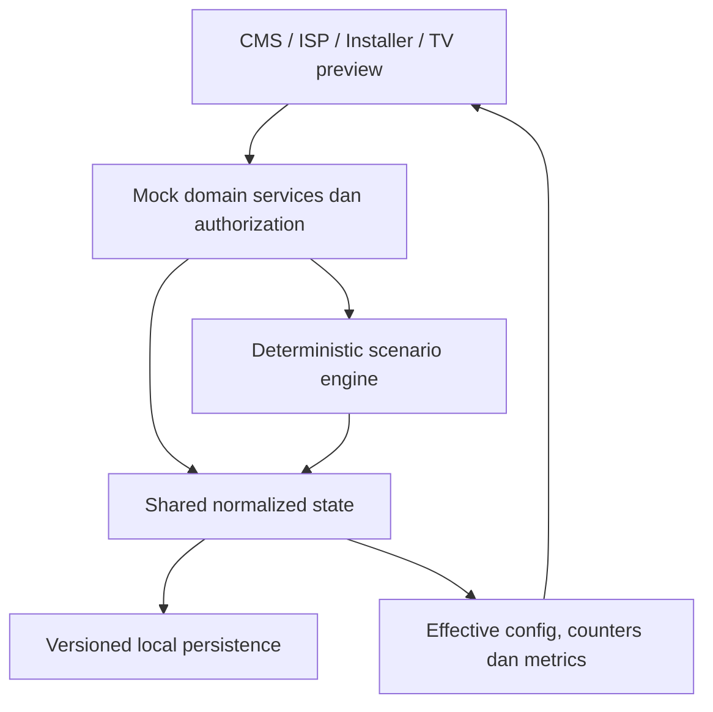

# GOJJA SmartTV
# Prototype Specification & Build Brief v1.0

**31 Oktober 2026 — Asia/Jakarta**  
**Deliverable yang diatur:** prototype web interaktif lintas peran, dengan CMS SaaS, portal ISP, CMS properti, simulasi Installer Connector, dan TV Guest App preview yang memakai data serta state bersama.

## Ringkasan untuk builder

Bangun satu prototype yang menunjukkan perjalanan nyata dari pengaturan pelanggan sampai pengalaman TV di kamar. Pengguna harus dapat membuat perubahan di CMS, memublikasikannya, dan melihat dampaknya di preview endpoint yang tepat. Prototype bukan kumpulan gambar dashboard atau tautan yang hanya menghasilkan toast.

Gunakan React dan TypeScript sebagai rekomendasi frontend, layanan mock domain terpusat, fixture sintetis, penyimpanan lokal versioned, dan scenario controller yang deterministik. React bukan syarat hak pengelolaan TV; seluruh scan jaringan, ADB, instalasi APK, lock OS, firmware, provider premium, pembayaran, PMS dan AI dalam build ini merupakan simulasi yang ditandai. Tidak ada koneksi langsung ke TV atau kontrak provider nyata sebagai kewajiban brief ini.

Prioritaskan lima kualitas: navigasi lintas peran yang jelas; konsistensi data CMS–installer–TV; aturan hak dan scope yang dapat diuji; state normal/gagal/tertunda yang jujur; serta visual premium sesuai identitas GOJJA dan branding properti. Seluruh layar inti mempunyai ID, tindakan, state dan acceptance yang dapat ditelusuri.

**Build dianggap selesai** setelah flow wajib dapat dijalankan dari seed bersih, perubahan tersimpan saat reload, peran tidak melewati scope pada mock service, preview TV memakai effective config yang benar, scenario gagal dapat direproduksi, serta checklist acceptance dijalankan. Kelulusan prototype tidak memberi label certified pada perangkat atau provider produksi.

## Navigasi dokumen

1. Mandat, acuan dan batas
2. Tujuan validasi dan indikator keberhasilan
3. Scope build dan batas simulasi
4. Persona, scope dan permission
5. Information architecture dan route
6. Screen inventory
7. Fondasi visual dan interaction contract
8. Layout, responsive, accessibility dan locale
9. Model data dan aturan integritas
10. Seed data dan angka demonstrasi
11. Kontrak layanan mock dan persistence
12. State machine dan scenario engine
13. Spesifikasi flow end-to-end
14. Pelanggan, ISP, subscription dan invoice
15. Property, room, device dan capability
16. Installer, discovery, deployment dan recovery
17. Branding, profile resolver dan publication
18. Stay, corporate welcome dan reset sesi
19. Provider, package, entitlement dan lineup
20. Media, campaign dan placement
21. Analytics dan pengukuran
22. Release, approval dan maintenance
23. Support, AI dan audit
24. Spesifikasi TV Guest App
25. Form, validasi dan interaction patterns
26. Kondisi gagal, keamanan dan privasi prototype
27. Paket skenario demo dan usability review
28. Acceptance Test Catalogue
29. Traceability ke keputusan produk
30. Struktur implementasi dan urutan build
31. Handoff, QA dan definition of done
32. Keputusan sementara, referensi dan riwayat versi

## 1. Mandat, acuan dan batas

### 1.1 Pembaca dan penggunaan

Dokumen ini dipakai pemilik produk untuk review pengalaman, designer untuk layout/komponen, developer atau AI builder untuk implementasi, QA untuk pengujian flow, serta ISP/hotel untuk validasi operasional. Rincian di sini adalah ketentuan prototype yang direkomendasikan. Parameter demonstrasi tidak otomatis mengesahkan default produksi atau harga komersial.

Acuan utama adalah **Product Consolidation & Decision Register v1.1** [I01]. Identitas visual mengikuti **GOJJA Design & Brand Guideline v1.0** [I02]. PRD dan spesifikasi fase pertama tetap sumber detail sebelumnya [I03][I04], dibaca bersama delta konsolidasi. Bila ada konflik: instruksi terbaru pemilik produk → batas hak/platform → arah konsolidasi → brief ini untuk detail demonstrasi → baseline yang tidak diubah → mockup visual.

### 1.2 Yang diserahkan oleh pekerjaan build nanti

Kode frontend yang dapat dijalankan, fixture seed, scenario engine, mock domain service, local persistence, aset berizin/placeholder terkontrol, README, daftar simulasi, acceptance report dan known limitations. Dokumen ini sendiri merupakan brief, bukan kode aplikasi atau laporan pengujian yang sudah dijalankan.

### 1.3 Prinsip kejujuran demonstrasi

- App shell menampilkan **Demo environment — synthetic data** secara tenang tetapi tetap terlihat.
- Simulated scan/install/provider/payment/AI mempunyai label pada panel tindakan dan hasilnya.
- Nama kemampuan perangkat fiktif diberi label **Demo capability profile**, bukan certified real model.
- Sales-facing TV preview boleh bersih dari panel teknis; frame preview tetap menandai konsep/demo.
- Tidak menggunakan nama tamu nyata, provider secret, nomor rekening nyata atau bukti bayar nyata.
- Fitur roadmap diberi label dan dipisahkan dari scope produksi P1; prototype tidak mengubah scope kontrak.

## 2. Tujuan validasi dan indikator keberhasilan

| Q-ID | Pertanyaan yang ingin dijawab | Tugas validasi | Bukti yang dicatat |
| --- | --- | --- | --- |
| Q-01 | Apakah ISP memahami pelanggan, pembayar dan scope miliknya? | Masuk sebagai ISP, buka pelanggan dan kuota | Salah navigasi, pemahaman batas, kebutuhan bantuan |
| Q-02 | Apakah hotel mampu branding tanpa developer? | Ubah warna/logo, preview, publish | Task completion, validasi, waktu yang diamati |
| Q-03 | Apakah onboarding cukup jelas untuk installer? | Scan demo sampai Ready dan failure recovery | Tahap membingungkan, target salah, langkah terlewat |
| Q-04 | Apakah paket provider dan lineup tidak membingungkan? | Alokasikan paket ke kelas kamar | Pemahaman rights, quota dan deny reason |
| Q-05 | Apakah welcome/group dan bahasa berguna? | Manual check-in, room move, checkout | Kesesuaian konteks dan risiko nama lama |
| Q-06 | Apakah hotel percaya pada kendali update? | Approve window, lihat kamar tidak siap | Pemahaman approval/readiness dan gangguan |
| Q-07 | Apakah promo terasa proporsional? | Welcome, Home, masuk TV, rapid channel change | Skip/back behaviour, repetisi dan keterbacaan |
| Q-08 | Apakah analitik bisa ditafsirkan benar? | Baca starts, play seconds, QoE dan coverage | Kesalahan menyebut audience/revenue |
| Q-09 | Apakah desain mendukung tamu dengan remote? | Home → TV → Info → bahasa → Back | Focus loss, dead ends, teks terlalu kecil |

Tidak ada benchmark waktu/konversi yang diklaim sebagai hasil. Target review: seluruh skenario wajib dapat diselesaikan dengan state konsisten; tidak ada blocker pada scope/rights/privacy; feedback dikumpulkan dengan denominator peserta dan konteks tugas. Target angka usability final ditetapkan pemilik produk sebelum sesi evaluasi.

## 3. Scope build dan batas simulasi

### 3.1 Prioritas deliverable

**M = Must** dalam prototype v1.0. **S = Should** bila flow M telah stabil. **L = Later**; boleh ada explanatory state, bukan tombol aktif yang menyesatkan. M/S/L adalah prioritas prototype, berbeda dari P1/P1C/P2 produk.

| Domain | M | S / L |
| --- | --- | --- |
| SaaS dan roles | Persona switch, scope, 2 ISP, direct, property switch | S: invite lifecycle demo; L: SSO nyata |
| Business | Subscription/seat, invoice, payment verification demo | L: bank/gateway nyata, ERP reseller |
| Property dan fleet | Room/class/group, endpoint, capabilities, last_seen | S: CSV import wizard; L: provisioning OEM nyata |
| Installer | Discovery/auth/map/deploy/verify/recover simulasi | L: native connector, raw LAN scan/ADB |
| Branding | Preset, colors, menu/info, inheritance, preview, publish | S: additional themes; L: arbitrary HTML/JS |
| Guest | Manual stay, corporate group, room move, 4 guest locales | S: PMS event simulator; L: PMS integration nyata |
| Provider | Contracts/package/allocation/lineup, deny paths | L: provider API/SDK/DRM berbayar nyata |
| Content | Asset metadata demo, internal campaign, eligible selection | S: external offer acceptance demo; L: exchange/payout |
| Update | Release approval, property permission, readiness, job results | L: APK/OS installation nyata |
| TV | D-pad/keyboard, Home/player/info/promo/language/help | S: licensed sample video; L: OTT login/casting nyata |
| Analytics | Fixture history + labelled session demo events, filters | L: ad fraud, billing impression, enterprise BI |
| Support | Ticket, read-only diagnostic explanation demo, audit | L: AI model nyata, self-fixing production |

### 3.2 Functional versus simulated

| Kemampuan | Perilaku build | Boundary yang terlihat |
| --- | --- | --- |
| Form, filter, sort, edit, preview | Benar-benar bekerja pada local domain store | Perubahan lokal; bukan backend produksi |
| Role dan entitlement | Diperiksa mock service, bukan hanya hidden controls | Bukan security boundary produksi di browser |
| Publish | Membuat immutable local version dan endpoint ACK scenario | Tidak mengirim ke TV fisik |
| Scan/deploy/lock/recovery | Scenario engine mengubah state job/device demo | Native connector required untuk real execution |
| Live TV | Channel guide/player state + mock frame/sample legal | Tidak menayangkan paket komersial nyata |
| Billing | Hitung invoice dan verify transaction reference demo | Tidak memproses uang atau mengirim invoice |
| Analytics | Historical fixtures dan events lokal dengan label asal | Tidak ada audience manusia aktual |
| AI triage | Rule-based/ranked diagnostic narrative yang disiapkan | Tidak disebut hasil LLM/live diagnosis |
| Session cleanup | Menghapus konteks GOJJA local assignment | OTT cleanup hanya simulation status |

Browser prototype tidak mencoba membuka port 5555, mengeksekusi shell, mencari jaringan publik, menambah firewall exception atau memasang sertifikat. Perintah yang ditampilkan berupa deskripsi aman, bukan terminal bebas.

## 4. Persona, scope dan permission

### 4.1 Persona demo

| Persona ID | Role / scope | Kemampuan |
| --- | --- | --- |
| U-GA | GOJJA Platform Admin | Organisasi/partner/plan/fleet; grant khusus rights.demoVerify untuk kontrak sintetis; tidak melihat provider secret atau nama guest secara default |
| U-GT | GOJJA Technical Admin | Release, certification profile demo, job diagnostics dan support escalation |
| U-GF | GOJJA Finance | Subscription, invoice, receipt/credit demo; tanpa release signing |
| U-IA | ISP Alpha Admin | C-01/P-01 dan order yang dibelinya |
| U-IB | ISP Beta Admin | C-02/P-02; dipakai untuk negative scope test |
| U-PM | P-01 Property Manager | Branding/publish, campaign, users, rights submission, install permission |
| U-CE | P-01 Content Editor | Draft media/branding/campaign; tidak publish |
| U-FO | P-01 Front Office | Stay/group/checkout dan readiness manual sesuai scope |
| U-IN | P-01 Installer | Connector, discovery, deployment yang ditugaskan; tidak finance/factory reset bebas |
| U-GU | Guest TV context | Navigasi TV dan bahasa; tidak memperoleh CMS session |

Persona switch adalah fitur demonstrator, bukan impersonation produksi. Simpan persona terakhir dan batasi deep links sesuai role. Persona scoped tidak mendapat global property selector. GOJJA admin yang membuka property context memakai indikator support/delegation; guest name tetap masked kecuali persona yang memang berhak.

### 4.2 Action matrix inti

| Action | GA | GT | GF | ISP scoped | Manager | Editor | FO | Installer |
| --- | --- | --- | --- | --- | --- | --- | --- | --- |
| Customer/order setup | Ya | Tidak | Review bisnis | Scope sendiri | Lihat miliknya | Tidak | Tidak | Tidak |
| Invoice issue/payment verify | Tidak default | Tidak | Ya | Lihat wholesale sendiri | Lihat direct miliknya bila tersedia | Tidak | Tidak | Tidak |
| Branding draft | Delegasi | Tidak | Tidak | Delegasi eksplisit | Ya | Ya | Tidak | Tidak |
| Branding/campaign publish | Delegasi | Tidak | Tidak | Delegasi eksplisit | Ya | Tidak | Tidak | Tidak |
| Manual stay | Tidak default | Tidak default | Tidak | Tidak default | Ya | Tidak | Ya | Tidak |
| Provider submit/config | Katalog; secret masked | Diagnostic terbatas | Commercial review | Hak distribusi/delegasi | Kontrak properti | Tidak | Tidak | Test connection bila ditugaskan |
| Release technical approve | Tidak default | Ya | Tidak | Tidak | Tidak | Tidak | Tidak | Tidak |
| Property install permission | Tidak default | Tidak | Tidak | Delegasi eksplisit | Ya | Tidak | Readiness saja | Tidak |
| Scan/deploy job | Tidak default | Escalation scoped | Tidak | Installer role tambahan | Assignment saja | Tidak | Tidak | Ya |
| Guest reset | Tidak default | Escalation scoped | Tidak | Tidak default | Ya | Tidak | Ya | Test tanpa guest aktif |
| Restore/factory reset | Tidak default | Escalation + property authorization | Tidak | Tidak default | Authority sesuai flow | Tidak | Tidak | Eksekusi job approved |

GA/GT/GF bukan satu role superuser diam-diam. Bila review membutuhkan lebih banyak aksi, gunakan persona switch yang jelas. Permission check dilakukan saat membuka detail, mutation dan job execution; ID yang diketik manual tetap ditolak. Untuk F-09, U-GA memiliki grant eksplisit rights.demoVerify pada kontrak sintetis P-01/P-02/P-03; form review dibuka dari GA-08 dan memakai detail PR-15 dalam delegated review context. Grant ini tidak merupakan persetujuan legal/hak nyata dan tidak dimiliki manager/ISP secara implisit.

## 5. Information architecture dan route

### 5.1 Shell

CMS memakai sidebar, topbar berisi breadcrumb/context, judul halaman, primary action, filter dan content region. Header memuat demo indicator dan actor role. Context selector berbeda dari filter tabel. Beralih properti memperbarui seluruh scope; unsaved changes meminta Save draft/Discard/Stay.

| Surface | Route prefix | Navigasi |
| --- | --- | --- |
| Shared | /demo, /access, /settings | Demo launch, persona, denied/not found |
| GOJJA | /gojja | Overview, organizations, partners, subscriptions, fleet, providers, releases, finance, support, audit |
| ISP | /partner | Overview, customers, properties, subscriptions, deployments, providers, health |
| Property | /property/:propertyId | Overview, rooms, devices, branding, media, guests, TV services, campaigns, updates, analytics, users |
| Installer | /installer/:connectorId | Registration, networks, discover, authorize, map, deploy, verify, recovery |
| TV preview | /tv/:endpointId | Full-screen guest shell; demo frame optional via query/route state |

Parameter route bukan pemberi hak. Detail ID invalid menghasilkan 404 lokal; ID valid di luar scope menghasilkan denial tanpa membocorkan nama/owner objek. Detail/tab dapat memakai nested route atau query, asal deep-link/reload bekerja.

### 5.2 Navigation rules

Tombol Back browser mengembalikan konteks/filter sebelumnya. Row click membuka detail; checkbox tidak membuka row. Link diagnostik mempertahankan endpoint/property context. Modal bisa ditutup dengan Esc kecuali tindakan commit sedang diproses; focus kembali ke pemicu. URL tidak membawa nama tamu, secret atau signed playback token.

## 6. Screen inventory

Screen ID menunjuk page atau tab besar yang dapat dinavigasi; dialog tercakup dalam spesifikasi halaman induk. Seluruh ID berikut M kecuali ditandai S. Builder boleh berbagi komponen, bukan menggabungkan kewenangan yang berbeda.

### 6.1 Shared dan GOJJA

| ID | Screen / route suffix | Konten dan aksi utama | State penting |
| --- | --- | --- | --- |
| SH-01 | Demo launch /demo | Pilih persona, scenario, reset, jump to TV | Seed belum dimuat, schema mismatch |
| SH-02 | Demo access /access | Persona/scope confirmation; simulated sign-in | Access denied, session reset |
| SH-03 | Access/error shell | Denied, not found, unexpected error, retry | Tidak menampilkan data target di luar scope |
| GA-01 | Platform overview | Contracted/allocated/online, customers, ISP, invoice aging | Fixture vs live demo label |
| GA-02 | Organizations | Search/filter create customer, direct/reseller relation | Duplicate name/ID, empty |
| GA-03 | Organization detail | Properties, buyer/operator relations, users | Delegation expiry, inactive relationship |
| GA-04 | Partners | ISP list, status, scoped links | Suspended partner, no customers |
| GA-05 | Partner detail | Customers, order quantity, deployment health | No cross-ISP data |
| GA-06 | Plans/subscriptions | Plan catalog, contract/order quantity, effective dates | Hypothetical pricing, allocation limit |
| GA-07 | Global fleet | Endpoint list and certification profile demo | Offline, limited, wrong-scope target |
| GA-08 | Provider directory | Provider/distributor records and integration type | Candidate vs demo-ready |
| GA-09 | Release registry | Version, artifact metadata, compatibility and evidence checklist | Draft, not technically approved |
| GA-10 | Release detail/approval | Review simulated artifact/evidence, approve/reject | Missing checks; no property permission implied |
| GA-11 | Finance invoices | Buyer, period, amount, paid/outstanding | Unissued, overdue demo, partial |
| GA-12 | Invoice/payment detail | Lines, verify demo payment, credit draft | Duplicate transaction, overpayment |
| GA-13 | Tickets | Severity/scope/category/status and assignment | No telemetry, source outage |
| GA-14 | Ticket detail/triage | Evidence, rule-based diagnostic explanation, human notes | Injection sample rejected, no auto-fix |
| GA-15 | Audit explorer | Actor/action/resource/time/result filters, export demo | Masked fields, scope denial |

### 6.2 ISP portal

| ID | Screen | Konten dan aksi utama | State penting |
| --- | --- | --- | --- |
| IS-01 | Partner overview | Customers/properties/contracted/allocated, rollout health | Scope Alpha/Beta terpisah |
| IS-02 | Customers | Create scoped customer draft, detail link | Buyer vs operator explanation |
| IS-03 | Properties | Property inventory, network/install readiness | Pending site setup |
| IS-04 | Subscription/order | Wholesale order, assignments, available seats | Tidak membuat invoice retail otomatis |
| IS-05 | Deployments | Connector/job list, assign installer | Connector offline, scope expired |
| IS-06 | Provider services | Distribusi/contract role, allowed packages, property targets | ISP internet-only bukan content distributor |
| IS-07 | Service health | Device/source incidents and handoff tickets | Cloud/LAN/provider diagnosis terpisah |

### 6.3 Property CMS

| ID | Screen | Konten dan aksi utama | State penting |
| --- | --- | --- | --- |
| PR-01 | Property overview | Room/stay/device, publish, update, campaign alerts | Online bukan occupied/panel-on |
| PR-02 | Rooms/classes | Room list, class/group, add/edit, endpoint count | Duplicate code, multi-TV room |
| PR-03 | Room detail | Stay, endpoints, effective profiles, readiness | Vacant but dirty/unknown, room move |
| PR-04 | Devices | Filter/search/select endpoint, jobs | Offline/limited/version mismatch |
| PR-05 | Device detail | Identity, capabilities, applied vs desired, logs, actions | Simulated management profile |
| PR-06 | Branding editor | Preset/logo/background/colors/menu draft | Validation, inherited/override/stale |
| PR-07 | Effective preview | Pick room/locale/time/stay; source per field | Denied override, missing translation |
| PR-08 | Publish centre | Preview target diff, exclusions, schedule, ACK | Partial apply, expired preview |
| PR-09 | Media library | Upload metadata/image local, validate, usage | Rejected/processing/over demo quota |
| PR-10 | Asset detail | Versions, locale, ownership and dependencies | In-use delete blocked |
| PR-11 | Hotel information | Facility/contact/hours/QR/menu blocks | Service unavailable, unsafe link |
| PR-12 | Stay board | Check-in, search stay, checkout, extend | Overlap/stale context |
| PR-13 | Stay detail | Name visibility, locale, interval, room move/reset | Delayed checkout, cleanup pending |
| PR-14 | Corporate groups | Group message/creative/interval/membership | Kamar di luar active stay excluded |
| PR-15 | Provider contracts | Contract submission, scope, status, attachments metadata | Uploaded bukan verified |
| PR-16 | Provider connection | Source/DRM/app/headend metadata, masked refs, test | Token expired, wrong network, unsupported |
| PR-17 | Packages/allocations | Rights, purchased/allocated, class/room assignment | Exceeds quota, public-area denial |
| PR-18 | Channel lineup | Order/category/number/hide/preview | Hidden bukan revoked source access |
| PR-19 | Campaign list | Draft/review/scheduled/active/paused/ended | No eligible targets/assets |
| PR-20 | Campaign editor | Creative, placement, audience, locale, cap, priority | Invalid dates, collision, missing rights |
| PR-21 | Campaign preview/publish | Eligibility explanation and TV preview | Stale version, offline target |
| PR-22 | External offers — S | Material/terms/category accept/reject, version | Accepted tetapi tidak ada payout nyata |
| PR-23 | Updates | Available release, permissions/window/cohort | Not technical approved, unsupported route |
| PR-24 | Update job detail | Readiness, stage/status per endpoint, reconcile | New check-in, OutcomeUnknown |
| PR-25 | Analytics | Tabs fleet/content/channels/QoE/service demo | Coverage/denominator/sample sizes |
| PR-26 | Users/settings | Role/delegation, timezone/default language/policy | Cannot self-escalate privilege |
| PR-27 | Property billing | Direct invoice atau wholesale billing notice | Tidak memperlihatkan margin ISP |

### 6.4 Installer dan TV

| ID | Screen | Konten dan aksi utama | State penting |
| --- | --- | --- | --- |
| IN-01 | Connector registration | One-time demo pairing, scope/expiry | Expired/revoked connector |
| IN-02 | Network selection | Interface/subnet/site context, scan consent | Wrong LAN, isolation, no interface |
| IN-03 | Discovery list | Name/IP/model hint/status/confidence, manual add | No results, not TV, same IP other property |
| IN-04 | Authorization | On-TV steps, pairing demo, retry | Prompt pending, denied, different port |
| IN-05 | Room mapping/preflight | Target identity/room, capabilities/storage/recovery | Duplicate binding, no seat, unsupported |
| IN-06 | Deployment batch | APK/install/enroll/config progress, cancel pending | Partial fail, disconnect, OutcomeUnknown |
| IN-07 | Verification/hardening | Home/remote/player, debug policy, handoff evidence | Debugoff route unavailable, limitations |
| IN-08 | Recovery | Guest reset/restore/factory reset separate flows | Offline, destructive step-up, unsupported |
| TV-01 | Splash/provisioning | Official artwork slot, actual load status | Reduced motion, no looping |
| TV-02 | Welcome | Generic/personal/group message, continue | Context expired, no name, language fallback |
| TV-03 | Home | Hotel hero, Televisi, info, promo, help, language | Offline shell, missing asset |
| TV-04 | Channel guide | Categories/channel list/EPG demo | Not entitled, unavailable source |
| TV-05 | Player | Frame/sample, channel overlay, retry/back | Buffering/token/DRM/connection errors |
| TV-06 | Hotel info/service detail | Facility, hours, contact, QR/request demo | Closed/unavailable service |
| TV-07 | Promotions | Eligible promo detail and optional interstitial | Cap reached, expired, skip |
| TV-08 | Language/help | Four locales, navigation guide, front-office help | Long text/glyph fallback |
| TV-09 | Maintenance/recovery | Honest stage, do-not-power-off message as appropriate | Outcome unknown, app unavailable |

Total inventory: **68 layar/tab inti M dan 1 layar S**, 69 ID unik. Full-screen TV error states dapat menggunakan shell TV-09 atau overlay di layar terkait; jangan menambah route kosong sekadar memenuhi jumlah.

## 7. Fondasi visual dan interaction contract

### 7.1 Identitas

Wordmark standar adalah lowercase custom **gojja**, bukan tulisan uppercase dari font generik. Ciri diagonal o dan jj dipertahankan. Warna per huruf mengikuti I02: cobalt #0050F5, indigo #4F3FE5, violet #7C35E0, magenta #CA3596, coral #FF5E70. Tidak membuat logo alternatif. Jika master artwork belum tersedia dalam paket build, sediakan asset slot dengan label internal missing approved artwork; final visual sign-off tertahan sampai aset resmi dihubungkan.

CMS mengutamakan putih/soft surface, typography Inter, headings Plus Jakarta Sans bila tersedia, warna status semantik terpisah dari warna logo. Hindari full navy canvas. Sidebar charcoal tipis boleh dipakai sesuai mockup, tetapi konten utama tetap terang. Aksen spektrum dipakai hemat pada primary action, selection atau brand element.

TV menampilkan identitas hotel lebih dominan daripada platform. Tema contoh hangat: foto properti berizin/generic licensed, panel gelap transparan yang terbaca, teks terang, aksen champagne/cobalt sesuai theme. Transparansi bukan syarat jika mengurangi kontras. GOJJA tidak diwarnai ulang mengikuti hotel; pilih artwork reverse resmi bila perlu.

### 7.2 Token awal prototype

| Token | Nilai build awal | Penggunaan / batas |
| --- | --- | --- |
| cms.background | #F5F6FA | Latar; white untuk cards/editor |
| cms.text | #10172F | Teks utama, bukan seluruh canvas |
| cms.muted | #586174 | Secondary text; tetap diuji kontras |
| action.primary | #0050F5 | Aksi utama dengan label/ikon |
| border.default | #E3E7EF | Divider/input; bukan satu-satunya focus indicator |
| radius.control/card | 10px / 16px | Konsisten; jangan semua elemen berbentuk pill |
| spacing | 4, 8, 12, 16, 24, 32, 48 | Skala layout |
| cms.body | 15–16px | Data density tetap terbaca |
| cms.control.height | 44px | Target awal tombol/input utama |
| tv.canvas | 1920×1080 logical preview | Scaled dengan aspect ratio terjaga |
| tv.safeInset | 64px horizontal / 48px vertical | Parameter prototype, bukan sertifikasi overscan |
| tv.body/title | 28px / 48px awal | Ukuran logical; uji jarak nyata pada POC |
| tv.focus | Outline terang + perubahan surface/scale ringan | Tidak hanya warna; reduced motion supported |

Nilai token adalah ketentuan awal demonstrasi dan dapat direvisi setelah design review. Jangan menyatakan compliance accessibility atau performa TV fisik dari token saja.

### 7.3 Komponen wajib

AppShell, ContextSwitcher, RoleBadge, PageHeader, KPIWithDenominator, DataTable, FilterBar, StatusBadge, EmptyState, ErrorState, PermissionDenied, FormField, AssetPicker, LocaleTabs, EffectiveValueInspector, TargetPreview, DiffViewer, ApprovalPanel, JobTimeline, CapabilityList, AuditDrawer, TVFrame, FocusableTile, PlayerOverlay dan SimulationBadge. Tiap komponen memiliki loading/disabled/error state yang relevan; warna dilengkapi teks/ikon.

## 8. Layout, responsive, accessibility dan locale

### 8.1 CMS

Target review desktop 1440×900 dan laptop 1280×800; tablet 1024×768 harus tetap usable, mobile 390×844 untuk monitoring dan approval dasar. Pada lebar kecil, sidebar menjadi drawer, filter wrap dan tabel memakai prioritas kolom/detail drawer atau scroll yang diberi affordance. Jangan mengecilkan font seluruh dashboard untuk memaksa semua kolom muat.

CMS keyboard: Tab/Shift-Tab mengikuti urutan logis, Enter/Space mengaktifkan kontrol, Esc menutup overlay, visible focus, label programatik untuk form/ikon. Form error dibacakan melalui region yang sesuai dan terhubung dengan field. Grafik mempunyai ringkasan angka/tabel; status tidak bergantung warna. Modal mengelola focus trap/return. Reduced motion mematikan gerakan dekoratif.

### 8.2 TV navigation

Arrow keys = D-pad, Enter = OK, Escape/Backspace = Back ketika tidak mengetik, Home shortcut demo tersedia di frame (bukan merebut OS key browser). Arah fokus eksplisit pada grid/menu, bukan urutan DOM yang kebetulan. Back dari player kembali ke channel terpilih; Back dari info kembali ke tile asal; Back di Home tidak keluar ke setting OS. Focus tidak hilang saat data refresh; bila item dihapus, pindah ke neighbor/anchor yang ditentukan.

Mouse dan touch boleh membantu review, tetapi flow Core wajib dapat dijalankan dengan keyboard sebagai simulasi remote. Dialog TV berisi satu keputusan utama dan pilihan Back. Tidak ada hover-only action. Input nama/kontrak tetap pada CMS, bukan mengetik panjang menggunakan remote.

### 8.3 Locale coverage

Empat bahasa wajib untuk guest shell dan pesan/error inti TV. CMS prototype wajib ID/EN; zh-CN/ja-JP pada CMS bukan syarat kecuali scope diperluas. Editor menyediakan empat locale untuk konten tamu dan indikator completeness. Bahasa app tidak mengganti audio/subtitle provider atau bahasa OTT.

Fallback UI: guest choice → stay/group initial locale yang valid → property default → English safe strings. Fallback creative: guest locale → English → property default → generic valid. Hilangkan duplikasi locale yang sama pada rantai. Preview menampilkan locale resolved dan asalnya. Gunakan font fallback CJK yang teruji; lakukan human review terhadap copy final, jangan mengklaim native translation selesai dari placeholder.

## 9. Model data dan aturan integritas

### 9.1 Domain entities minimum

| Entity | Fields minimum untuk prototype | Invariant |
| --- | --- | --- |
| Organization | id, kind, name, status | Customer/partner terpisah dari payer role |
| Relationship | principal, target, role, actions, validUntil, active | Delegasi tidak lintas scope tanpa grant |
| Property | id, customerId, partnerId optional, timezone, locale, profile | Identity tidak bergantung nama hotel |
| Room/Class/Group | id, propertyId, code/name, memberships | Room code unik per property; group versioned |
| Endpoint | id, propertyId, roomId, identityRef, capabilityProfileId, version, lastSeen | Satu binding aktif; IP bukan credential |
| Assignment | id, endpointId, roomId, subscriptionId, version, status | RMA/transfer mengakhiri binding lama |
| Subscription | id, buyerId, customerId, planVersion, contractedSeats, dates, unitPrice | Purchased quantity berbeda dari allocated/online |
| Connector | id, propertyId, networkContext, scope, expiry, status | Revoke menghentikan new execution |
| DiscoveryCandidate | id, connectorId, networkId, ip, friendlyName, authState | Belum seat/endpoint; identity perlu konfirmasi |
| Job/Attempt | id, type, targetBindingVersion, idempotencyKey, state, reason, attempts | Unknown tidak di-retry sebagai pekerjaan baru otomatis |
| ProfileVersion | id, type, scope, version, fields, status | Published version immutable |
| Publication | id, sourceVersion, targetSnapshot, stageACKs, status | Received/Applied/Healthy tidak digabung |
| Stay | id, propertyId, roomId, interval, displayName optional, locale, contextVersion | Overlap ditolak; stale event tidak menghapus baru |
| CorporateGroup | id, interval, message/creative, stayMembership | Bukan permanent targeting nomor kamar |
| ProviderContract | id, holderId, supplierId, propertyScope, packageIds, basis, quantity, dates, rights, status | Upload bukan verified; expiry tetap berlaku |
| ProviderConnection | id, propertyId, sourceType, secretRef, testState | No raw secret; connection Ready bukan rights Active |
| ContentPackage | id, version, providerId, channelIds, restrictions | Package version immutable untuk histori |
| ContentAllocation | id, contractId, unit/endpointScope, dates, quantity | Contract basis diikuti; no over-allocation |
| Channel/Lineup | channelId/sourceRef/category/locale; ordered entries | Menyembunyikan lineup tidak memberi/menutup hak sendiri |
| Asset/Creative | asset metadata/status/version; creative localized refs | Ready asset only; ownership dan dependensi |
| Campaign | id, creativeVersion, placements, target, validity, cap, priority, approval | Version material menginvalidasi approval lama |
| Release/Permission | artifact metadata/technicalApproval; property target/window/expiry | Dua izin berbeda |
| Event/Session | eventId, source, endpoint/context refs, interval, outcome | Dedup; no guest name |
| Invoice/Receipt | buyer, lines, period, amount, state; transaction ref | Issued immutable; duplicate payment no double post |
| Ticket/Audit | scope, evidence refs, actor, action, outcome, timestamp | Append-only audit, redacted diagnostics |

### 9.2 Scope resolver

Setiap mock mutation mengevaluasi actor → relationship aktif → property/resource → action permission → plan/content rights → capability → approval → current version. Denial memakai code dan safe message. UI tidak dapat mengaktifkan fitur hanya dengan mengedit plan selector lokal.

Separate service action untuk preview dan commit. Preview membawa sourceVersion, target/binding versions, permission version, validUntil dan diff. Mutation memeriksa ulang: jika stale, return conflict dan tawarkan Refresh preview. Harga/quantity snapshot saat invoice issue tidak berubah ketika plan katalog diedit.

### 9.3 Konfigurasi lintas layer

Platform → customer brand → property → room class → room → stay adalah urutan default profile presentation. Room groups menambahkan overlay sementara dengan explicit priority. Bila dua group setara memberi field berbeda, tolak publish konflik sampai publisher memilih pemenang; jangan pakai urutan array tak terlihat. Hak konten/security selalu diinterseksikan. Reset to inherited menghapus override, bukan menyalin nilai parent sebagai override baru.

## 10. Seed data dan angka demonstrasi

### 10.1 Demo clock

Fixed initial clock: **2 November 2026, 14.00 WIB (Asia/Jakarta)**. Ini jam data sintetis, bukan tanggal hari ini atau jadwal delivery. Timestamp disimpan sebagai ISO UTC, UI menampilkan timezone property. Scenario controller menyediakan advance 5 minutes/1 hour/next day dan reset. Scheduler/cap/expiry/last_seen memakai injected clock yang sama, bukan campuran Date.now dengan fixture beku.

### 10.2 Organisasi dan subscription

Semua nama berikut fiktif untuk demonstrasi. Tidak menggunakan Hotel Tentrem sebagai pelanggan seed default.

| ID | Nama / relasi | Subscription / quantity | Buyer |
| --- | --- | --- | --- |
| ISP-A | Alpha Hospitality Network | Reseller C-01; partner pool tidak diaktifkan | Membeli SUB-01 |
| ISP-B | Beta Property Connect | Reseller C-02; partner pool tidak diaktifkan | Membeli SUB-02 |
| C-01 / P-01 | Hotel Arunika Yogyakarta | SUB-01 Core Demo: 12 seat × Rp15.000 | ISP-A |
| C-02 / P-02 | Bayu Bali Suites | SUB-02 Core Demo: 8 seat × Rp15.000 | ISP-B |
| C-03 / P-03 | Sora Serviced Residence, short stay | SUB-03 Direct Demo: 10 seat × Rp25.000 | C-03 |

Rp15.000 adalah hipotesis wholesale; Rp25.000 direct hanya angka demo, bukan tarif disahkan. Total contracted = **30 seat**, total allocated pada seed = **14**, available = **16**. Tidak menjumlah order partner dengan alokasi customer sebagai dua pendapatan. Seed tanpa partner pool untuk menghindari double billing.

### 10.3 Rooms/endpoints

| Property | Rooms | Endpoints | Online / offline | Notes |
| --- | --- | --- | --- | --- |
| P-01 | 101, 102, 103 Standard; 201, 202 Deluxe; 301 Suite | E-01..E-07 | 5 / 2 | Room301 mempunyai E-06 dan E-07 |
| P-02 | 401, 402 Deluxe; 501, 502 Suite | E-08..E-12 | 4 / 1 | Room502 mempunyai E-11 dan E-12 |
| P-03 | 601, 602 Studio | E-13..E-14 | 2 / 0 | Hospitality short stay, bukan Home |

Total 12 room, 14 enrolled endpoint, 11 online dan 3 offline. Offline endpoint: E-05, E-07, E-12. E-09 online tetapi Limited. E-14 online tetapi assisted-update-only. Endpoint E-01..E-05 masing-masing room101/102/103/201/202; E-08/09/10 masing-masing room401/402/501; E-13/14 room601/602.

Room102 dan103 memiliki corporate stays aktif S-02/S-03, group G-CORP, departure 3 November 11.00 WIB. Room101 S-01 aktif, displayName sintetis “Bapak Aditya”, ID locale. Room201 vacant tetapi housekeeping belum ready. Room202 vacant, offline. Room301 S-04 aktif; kedua TV menerima konteks stay sama tetapi assignment berbeda. P-02 room401 S-05 aktif, room501 S-06 aktif; room402/502 vacant. P-03 room601 S-07 aktif, room602 vacant. Seed occupied rooms = **7/12**, vacant = **5/12**. Tidak menurunkan occupancy dari status online.

Discovery candidates DVC-01/02/03 belum terdaftar dan tidak termasuk 14 seat allocated. DVC-01 reachable/auth pending; DVC-02 found tetapi ADB unreachable; DVC-03 unsupported/unconfirmed. Skenario deploy M menambah room104 dan endpoint E-15 setelah konfirmasi, sehingga P-01 allocated menjadi8, global15 dan available15; counter harus dihitung ulang.

### 10.4 Demo capability profiles

- **CAP-M1 Demo Managed:** Home/policy/scheduled APK route/recovery adapter tersedia dalam simulasi; bukan sertifikasi hardware nyata. E-01..E-08, E-10..E-13 memakai profil ini kecuali field override disebut.
- **CAP-L1 Demo Limited:** guest shell/Home tersedia; OS lock, debug re-enable restriction dan silent update tidak didukung. E-09.
- **CAP-A1 Demo Assisted:** config sync tersedia; APK update membutuhkan bantuan installer lokal. E-14.

Capability mempunyai enum Supported/Unsupported/Unknown, evidenceType=DemoFixture, limitation dan route. Tidak memakai boolean tunggal managed=true untuk membuka semua aksi.

### 10.5 Provider dan finance fixtures

Provider F-A dan F-B adalah provider fiktif. Channel berupa “Nusantara News”, “World Journey”, “Family Cinema”, “Arena Sport” dan “Hotel Info”, dengan badge Demo channel. Logo/channel program fiktif atau aset berizin; tidak mengklaim daftar resmi Transvision/MNC.

P-01 contract CT-01: basis **room**, quantity6, Basic seluruh kamar; International untuk room201/202/301, Sports room301. Hak demo secara eksplisit mencakup dua TV room301, tidak termasuk lobby. P-02 CT-02 basis **endpoint**, quantity5, Basic semua endpoint; Sports tambahan hanya E-10/E-11/E-12. P-03 CT-03 Draft/Submitted dan belum verified; hanya Hotel Info milik properti tersedia, premium ditolak. Alokasi tidak boleh dianggap valid dari invoice software.

Invoice fixtures November: INV-01 SUB-01 Rp180.000 Issued unpaid; INV-02 SUB-02 Rp120.000 Paid melalui receipt sintetis; INV-03 SUB-03 Rp250.000 Issued unpaid. Total issued Rp550.000, paid Rp120.000, outstanding Rp430.000, belum ada pajak/demo tax disabled. Semua nominal simulasi sebelum pajak; tidak disebut invoice legal. Additional content quote dipisah dan tidak dijumlah sebagai MRR software.

Campaign seed: CMP-01 spa internal Active, CMP-02 group welcome Active untuk S-02/S-03, CMP-03 dining Draft, CMP-04 expired. Pre-TV default off. Satu release REL-01 version demo 1.0.1 technical pending; endpoint current demo1.0.0. Ticket TK-01 provider token expired pada E-09 dan TK-02 failed asset download pada E-05.

## 11. Kontrak layanan mock dan persistence

### 11.1 Architecture prototype

UI memanggil domain services, bukan menulis langsung array fixture dari komponen. Gunakan satu store dengan normalized entities dan selectors. Layanan mock memeriksa actor/scope/version, mengubah domain state, menulis audit, lalu mengeluarkan event internal. Simulasi async memakai job scheduler terkontrol yang dapat dihentikan/diulang; jangan setTimeout acak tanpa state tersimpan.



Satu browser session menjadi minimum build. Preview TV berada di route yang memakai store sama; tab baru hanya didukung bila sinkronisasi lintas tab benar-benar diimplementasikan. Bila tidak, gunakan embedded TV preview dan beri pesan bahwa detached preview snapshot perlu refresh. Jangan menjanjikan real-time lintas tab dari dua store terpisah.

### 11.2 Service action catalogue

Nama di bawah adalah kontrak logis, bukan final endpoint backend produksi.

| Service / action | Input penting | Output / event |
| --- | --- | --- |
| identity.setDemoPersona | personaId | actor/scope; tidak menciptakan grant baru |
| customers.create / subscriptions.change | actor, customer/buyer refs, quantity, expectedVersion | Draft/approved demo order dan audit |
| rooms.create / endpoints.bind | property, roomCode, endpoint/candidate, seat, bindingVersion | Room/assignment; deny pada duplicate/overquota |
| connectors.enroll / revoke | property, code, scope, expiry | Connector demo identity/status |
| discovery.start / manualAdd | connector, networkContext, scenarioId, target input | Candidate list; bukan endpoint otomatis |
| deployment.preview / commit / reconcile | candidate, room, artifact, versions, idempotencyKey | Target preview/job/result per endpoint |
| profiles.saveDraft / resolve | type/scope/fields/version; previewContext | Draft/effective values/provenance |
| publications.preview / commit / cancel | sourceVersion, target selectors, schedule, previewId | Immutable publication + ACK states |
| stays.checkIn / extend / move / checkout | room/interval/name/locale/contextVersion | Stay/context version, cleanup tasks |
| contracts.submit / verifyDemo | rights scope/package/date/quantity | Distinct contract state; only authorized reviewer |
| connections.testDemo | connectionId, endpoint/network context, scenario | Reachability/auth/DRM result; not rights activation |
| packages.allocate / lineups.save | contract/package/target, expectedVersion | Allocations; rejected target reasons |
| campaigns.save / preview / approve | creativeVersion, target/placement/validity/cap | Eligibility trace/publish; approval version bound |
| releases.technicalApprove | releaseId, checklistVersion, actor | Technical approval only |
| updates.grantPermission / evaluate / run | property/scope/window/expiry, release, endpoint states | Readiness reasons/job stages |
| finance.issue / verifyPayment / credit | draft/version, transactionRef/amount, invoiceId | Immutable issued lines/receipt/adjustment |
| tickets.create / triageDemo / escalate | scope/symptom/evidence refs | Ticket/rule-based diagnostic suggestions |
| recovery.preview / authorize / executeDemo | actionType, endpoint/binding, approvals | Scope-specific job and effects |
| analytics.query / events.record | scope/date/dimension; unique eventId/payload | Derived dataset/quality annotations |
| demo.reset / advanceClock / injectScenario | seedVersion/duration/scenarioId | Repeatable scenario, no real external action |

Mutations returning error do not modify partial unrelated state. For deployment multi-target, partial outcomes are explicit per target; invoice posting and seat allocation use atomic mock transactions. Idempotency key re-use with same payload returns same result; same key with different payload returns conflict.

### 11.3 Result envelope

Success shape: `{ data, resourceVersion, auditId, simulation: true }`. Error shape: `{ code, messageKey, fieldErrors, retryable, correlationId, safeDetails }`. Codes wajib: SCOPE_DENIED, PERMISSION_DENIED, STALE_VERSION, PREVIEW_EXPIRED, QUOTA_EXCEEDED, CAPABILITY_UNSUPPORTED, RIGHTS_INACTIVE, AUTH_REQUIRED, CONNECTOR_OFFLINE, SOURCE_UNAVAILABLE, TOKEN_EXPIRED, OUTCOME_UNKNOWN dan VALIDATION_FAILED.

Reason code dipetakan ke copy manusiawi dan next action. Jangan menampilkan stack trace atau provider URL mentah. Field error mempertahankan input. Unexpected exception memberi retry/reset demo option tanpa mengklaim commit gagal bila outcome belum diketahui.

### 11.4 Persistence dan reset

Gunakan IndexedDB untuk local uploaded blobs dan metadata atau alternatif yang dapat dipertanggungjawabkan. Small normalized JSON dapat memakai localStorage; jangan memasukkan video/base64 besar ke localStorage. Store mempunyai seedVersion, schemaVersion, savedAt, demoClock dan actor. Pada schema mismatch tawarkan migrate yang didukung atau reset, bukan crash.

Reset Demo meminta konfirmasi, mengembalikan seed/counter/clock/permissions/caps/jobs, menghapus upload blob demo dan tidak memanggil layanan eksternal. Export Demo State menghasilkan JSON tersanitasi dengan versi dan synthetic marker. Import hanya schema allowlist, size limit dan scope reset; jangan menjalankan kode dari JSON. Import/export S jika membatasi waktu build; reset/persistence M.

### 11.5 Parameter waktu demonstrasi

| Parameter | Default prototype | Perilaku |
| --- | --- | --- |
| Endpoint online freshness | 5 menit | Seed online lastSeen13.59 WIB; offline12.00 WIB pada demo date |
| Heartbeat online simulation | Setiap60detik demo clock | Hanya endpoint berstatus connected; offline tidak diperbarui |
| Occupancy readiness freshness | 5 menit | Readiness stale meminta evaluasi ulang; active stay tetap authoritative selama context valid |
| Preview token lifetime | 15 menit demo clock | Expired preview tidak dapat commit |
| Connector enrollment code | 5 menit demo clock, single-use | Setelah consume/expiry harus dibuat ulang |
| Property install permission default | Window yang dipilih, maksimum24jam demo | Expiry eksplisit; revoke/version change dievaluasi saat eksekusi |
| Personal context offline lease | Minimum(departure, last validation+30menit) | Online auto-revalidate; expiry memakai generic context |
| Campaign offline validity | Minimum(campaign end, last validation+60menit) | Stop/revoke online lebih cepat; offline pending terlihat |
| Sample async stage | 0,5–1detik UI per stage | Deterministik, dapat pause; bukan timing TV nyata |

Semua nilai merupakan fixtures/parameter simulator, bukan SLA atau policy produksi. Advance clock memproses business expiry/events secara urut; periodic heartbeat dapat dikoaleskan ke waktu akhir untuk endpoint yang tetap connected. Scenario disconnect harus memotong heartbeat pada timestamp yang tepat. Room readiness tidak diperbarui hanya oleh heartbeat; perlu konfirmasi/manual/PMS simulation yang sah.

## 12. State machine dan scenario engine

### 12.1 State utama

| Domain | States / transisi penting | Larangan |
| --- | --- | --- |
| Connector | Unregistered → Enrolled → Online/Offline → Revoked/Expired | Revoked tidak menjalankan job baru |
| Candidate | Found → Reachable → AuthRequired/Authorized → PreflightPassed | Found tidak langsung Enrolled |
| Deployment | Planned → Preflight → Installing → Enrolling → Configuring → Verifying → Ready/Limited | Progress tidak langsung100% saat command dikirim |
| Job outcome | Queued/Running/Deferred/Failed/Succeeded/Cancelled/Expired/OutcomeUnknown | Unknown tidak diberi label Failed pasti |
| Asset | Uploading → Validating → Ready/Rejected → Retired | Tidak publish asset belum Ready |
| Profile | Draft → Review → Approved → Published → Superseded | Published bytes/fields immutable |
| Publication ACK | Pending → Received → Verified → Applied → Healthy | Tidak menggabungkan empat tahap |
| Contract | Draft → Submitted → Verified → Active → Expired/Suspended/Terminated | Submit bukan verifikasi hak otomatis |
| Campaign | Draft → Review → Approved → Scheduled/Active → Ended; Paused/Rejected/Cancelled | Approved mengacu creative/target version |
| Stay | Planned → InHouse → CheckedOut; room move sebagai assignment transition | Overlap/check-out versi lama ditolak |
| Release | Draft → TechnicalReview → Approved/Rejected → Withdrawn | Property approve tidak mengesahkan artifact |
| Update | AwaitingApproval → AwaitingReadiness → Staged → Installing → Verifying → Healthy | Context baru memerlukan readiness recheck |
| Invoice | Draft → Issued → PartiallyPaid/Paid/Overdue; Void/Credit sesuai aturan | Issued tidak diedit in-place |

### 12.2 Scenario controls

Scenario selector tersembunyi dari guest UI namun tersedia pada demo frame/tool panel. Scenario memuat id, affected scope/endpoint, preconditions, deterministic transitions, expected outputs, reset checkpoint dan synthetic evidence. Tidak menggunakan probabilitas random untuk acceptance. Animasi progress boleh dipercepat tetapi urutan state dan alasan tetap sesuai kontrak.

| SCN-ID | Injection | Hasil wajib |
| --- | --- | --- |
| SCN-01 | Happy onboarding | Auth → install → enrollment → config → verified Ready |
| SCN-02 | No local connector | Scan unavailable dengan install/register instructions |
| SCN-03 | Found but unreachable | Kandidat ditemukan; auth/install tertahan; manual diagnostics |
| SCN-04 | TV authorization pending/denied | Tidak menjalankan install; retry setelah confirmation |
| SCN-05 | Disconnect after install command | OutcomeUnknown; reconcile menemukan package atau menyatakan belum ada |
| SCN-06 | Managed handoff unavailable | Tidak menutup route sambil mengklaim silent update supported |
| SCN-07 | New check-in before install | Update deferred dengan changed occupancy reason |
| SCN-08 | Expired contract/token | Rights denial dibedakan dari token refresh/connectivity |
| SCN-09 | Corrupt/missing media | Old valid config bertahan atau generic fallback |
| SCN-10 | Cross-property request | Safe denial; tidak membocorkan objek lain |
| SCN-11 | Delayed checkout event | Current stay tidak terhapus |
| SCN-12 | Duplicate/offline playback batch | Metrics tetap deduplicated dengan quality flags |
| SCN-13 | Wrong signer/checksum | Artifact rejected; tidak memasang |
| SCN-14 | Partial batch/offline target | Per-target status dan denominator benar |
| SCN-15 | Price/payment duplicate | Receipt sama, jumlah terutang tidak berkurang dua kali |
| SCN-16 | Unsupported reset/OTT cleanup | Action disabled/explained, tidak melaporkan sukses palsu |

Cancel hanya menghentikan pekerjaan yang belum committed atau stage yang memang cancellable. Bila install simulated sedang pada tahap kritis, UI menjelaskan cancel pending execution stop request, bukan menyatakan app sudah dipulihkan. Demo clock advancement yang melewati jadwal memproses event secara berurutan dan idempotent.

## 13. Spesifikasi flow end-to-end

Setiap flow memuat entry, precondition, langkah, exit dan negative path. Flow F-01..F-18 merupakan coverage wajib; optional subfitur diberi tanda S. ID layar merujuk §6.

### F-01 — Mulai demo dan berganti persona

Entry SH-01. Pilih seed/scenario lalu persona. Sistem memuat actor, grants dan context yang diizinkan; arahkan ke overview surface sesuai role. Berganti persona mempertahankan domain data tetapi membuang transient privileged view dan fokus ke route sah. Exit: role badge dan scope benar. Jika deep link lama di luar scope, SH-03; bukan menampilkan isi sesaat sebelum redirect.

### F-02 — Membuat customer/properti melalui ISP atau direct

Entry GA-02 atau IS-02. Pilih customer/operator/payer relationship secara eksplisit; masukkan nama, property timezone/locale dan profile. Buat draft subscription atau hubungkan yang sah. Preview menjelaskan siapa menagih siapa. Commit menghasilkan properti kosong dengan onboarding checklist. ISP tidak dapat menunjuk ISP lain sebagai owner melalui payload. Direct property tidak wajib memiliki partner. Exit: property muncul hanya pada scope yang berhak; tidak ada auto-charge dari create customer.

### F-03 — Seat, room dan endpoint allocation

Entry GA-06/IS-04/PR-02. Tambah room104 pada P-01, pilih class Standard, pastikan code unik. Endpoint belum dibuat sampai deployment/enrollment selesai. Preflight memeriksa available seat dan active binding. Saat E-15 berhasil bound, allocated bertambah tepat1; retry commit tidak bertambah lagi. Seat shortage menahan enrollment dan memberi tindakan tambah quantity/request owner, tanpa auto-beli. RMA berbeda dari tambahan seat baru.

### F-04 — Discovery dan otorisasi lokal

Entry IS-05 → IN-01..IN-04. Installer memilih connector P-01 dan network context, membaca cakupan scan, lalu Start simulated scan. Tabel menampilkan tiga kandidat dengan statuses terpisah. Pilih DVC-01, konfirmasi device hint dan langkah on-TV authorization. Demo action “Simulate TV approval” hanya pada frame. Exit Authorized. SCN-02/03/04 memberi no connector/unreachable/denied; nama IP tidak disimpulkan sebagai identitas pasti.

### F-05 — Deploy, enroll, verify dan harden

Entry IN-05 untuk DVC-01 room104. Preflight menampilkan demo capability, storage, artifact signer/hash dan rollback prerequisite. Commit membuat job dengan idempotency; stage berjalan IN-06, assignment dibuat satu kali, config dimuat. IN-07 memeriksa Home/remote/player/handoff; hardening hasil spesifik, bukan toggle “lock all”. Exit Ready atau Ready with Limitations dengan evidence demo. SCN-05 menampilkan OutcomeUnknown dan reconcile; SCN-06 menahan klaim management setelah debugoff. Re-run tidak menduplikasi seat.

### F-06 — Branding draft → preview → publish → TV

Entry PR-06 sebagai editor. Pilih preset, ganti accent/logo/info/menu dan terjemahan, save draft. PR-07 memilih room101/locale ID/time; source per field dan diff ditampilkan. Editor tidak dapat publish. Manager membuka draft yang sama, PR-08 menghitung target7, online5/offline2 pada seed P-01. Publish scenario membuat ACK bertahap; online eligible mendapat applied version, offline Pending. TV-03 E-01 berubah setelah Applied; versi draft tidak bocor sebelum itu. Stale preview meminta refresh; corrupt asset mempertahankan versi lama.

### F-07 — Manual check-in dan corporate welcome

Entry PR-12/14. Manager/FO membuat stay pada kamar vacant yang sesuai interval; displayName opsional. Group menarget stay membership dan periode, bukan semua nomor kamar selamanya. Preview TV-02 menunjukkan welcome personal/group dan locale. Room di luar interval ditandai excluded. Exit konteks active version; tidak mengirim nama ke event analytics. Existing S-02/S-03 digunakan untuk demo group sebelum menambah stay baru.

### F-08 — Extend, room move, checkout dan stale event

Entry PR-13. Extend memperbarui context version; room move memeriksa target kosong dan memindahkan binding konteks tanpa menukar hardware inventory. Checkout menutup stay terkait dan memicu cleanup GOJJA; TV kembali generic/default locale. SCN-11 menyuntik checkout versi lama setelah stay baru, menghasilkan ignored stale event. OTT cleanup panel menampilkan Supported/Unknown/Unsupported dengan label simulasi, tidak menyebut seluruh aplikasi telah logout.

### F-09 — Provider contract dan connection

Entry PR-15. Manager mengisi contract holder/supplier/use scope/dates/basis/packages/quantity dan metadata dokumen sintetis. Submit menghasilkan Submitted, belum Active. Persona reviewer yang didelegasikan memverifikasi demo rights; connection PR-16 diuji terpisah dengan endpoint/network context. Contract Verified/Active tidak menyembunyikan Connection Failed. SCN-08 membedakan contract expired dari token expired. Tidak menempel URL premium nyata sebagai bukti hak.

### F-10 — Package allocation dan lineup per kelas kamar

Entry PR-17. Pilih CT-01 dan package, target class/rooms, lihat quantity berdasarkan room dan multi-TV inclusion. Rights panel menunjukkan room301 dua TV diizinkan dalam fixture; lobby tidak. Deny bila Sports dialokasikan ke room101 di luar scope. PR-18 menata nomor/urutan/hide kemudian preview/publish. TV guide hanya memuat effective channels; service tetap menolak openChannel yang tidak berhak. Hidden channel tidak otomatis revoked dari source; UI menjelaskan perbedaan.

### F-11 — Internal campaign dengan eligibility

Entry PR-19/20. Buat dining promo dari asset Ready, empat locale/fallback, placement Home hero, audience/validity/priority/cap. PR-21 menjelaskan eligible/excluded target, conflict dan pemenang slot. Publisher menyetujui version lalu publish; TV-03/07 mengikuti resolver. Cap diterapkan per declared scope; expiry/offline lease scenario bekerja. Jika S external offer diaktifkan, PR-22 menampilkan materi/terms, acceptance dan version reapproval, tanpa saldo payout nyata.

### F-12 — TV guest journey

Entry /tv/E-01. Splash singkat → welcome sekali pada konteks sesuai policy → Home. Navigasi D-pad ke Televisi, guide, player demo, Back, hotel info, promo, bahasa lalu help. Rapid zapping tidak memutar iklan tiap channel. E-13 menunjukkan source premium belum berhak; tetap dapat memakai Hotel Info/layanan. TV preview frame menampilkan endpoint dan applied version untuk reviewer, bukan pada UI guest produksi.

### F-13 — Release dan property approval

Entry GA-09/10 sebagai GT. REL-01 technical pending, evidence checklist demo wajib diisi sebelum approve. Manager PR-23 kemudian memberi permission target/window/cohort dan expiry; tanpa itu install ditahan. FO dapat memberi manual room readiness tetapi bukan technical approve. Ready room tidak sama dengan hanya vacant; room201 seed dirty dan room202 offline memberi reasons. Exit job AwaitingReadiness/Staged, tidak otomatis semua online diinstall.

### F-14 — Update race, batch results dan reconcile

Entry PR-24. Uji cohort satu endpoint yang diizinkan/ready; stage verified, install simulated, reboot/status, health. SCN-07 membuat check-in baru tepat sebelum commit sehingga job Deferred. SCN-05/14 memberi unknown/partial; unknown perlu reconcile, offline bukan Failed pasti. Version E-xx berubah hanya setelah install terverifikasi. Selesai bukan berarti panel power atau firmware diperbarui. Config rollback dan APK recovery tampil sebagai jalur berbeda.

### F-15 — Invoice dan payment demo

Entry GA-11/12 sebagai GF. Buka INV-01, review software line12×15K, issue immutable jika masih draft scenario. Verifikasi transaksi sintetis Rp180K unique reference; state Paid, global outstanding turun dari430K ke250K. Retry reference sama mengembalikan receipt yang sama. Partial payment, overpayment/unapplied dan credit diuji melalui scenario. Property reseller melihat billing arrangement notice, bukan margin wholesale yang tidak didelegasikan.

### F-16 — Analytics, filters dan interpretation

Entry PR-25/GA-01. Pilih scope/date/channel/campaign; semua KPI dan tabel mengikuti filter yang sama. Historical fixture dan current demo session diberi label asal. Mainkan/skipping/buffering event untuk menghasilkan perubahan local metrics; kirim ulang batch SCN-12 tidak double count. Coverage, denominator dan clock quality terlihat. Tunjukkan bahwa channel low usage dengan high failure berbeda dari channel stable/kurang dipilih.

### F-17 — Ticket, triage dan handoff

Entry GA-13/14 atau IS-07 create ticket. Simulated diagnostics membandingkan endpoint/source/network facts; menampilkan Observed, Inference, Suggested next action dan Limitations. Rule-based suggestion tidak disebut agent sudah memperbaiki. Log injection sample tidak menjalankan command. Escalate menulis assignment/history; attach release proposal hanya link demo tanpa merge/deploy.

### F-18 — Recovery, RMA dan offboarding

Entry PR-05/IN-08. Pilih guest reset, restore recorded environment atau factory reset simulated. Preview dampak/permission/capability; unsupported disabled dengan reason. Factory reset meminta authority + step-up demo + target code confirmation; aksi tetap simulasi. RMA mencabut binding old endpoint lalu bind replacement ke seat yang sama; old device tidak menerima stay baru. Offline recovery job Pending/Unknown ditampilkan jujur. Local recovery instructions tetap tersedia saat scenario cloud unavailable.

## 14. Pelanggan, ISP, subscription dan invoice

GA-01/IS-01 menampilkan contracted seats, allocated endpoints, available seats, online endpoints dan customer/property counts dengan definisi. Online memakai freshness sesuai demo clock, bukan browser uptime. Partner Alpha tidak melihat Beta/direkt kecuali delegated; card jumlah tidak menghitung hidden rows sebagai accessible data.

Subscription form: customer, buyer, sales route, plan version, quantity, unit price fixture, start/end, billing basis, status dan notes. Quantity integer positif; pengurangan di bawah allocation ditahan atau dijadwalkan setelah deallocation; tidak menghapus device untuk menyesuaikan angka. Hypothetical price indicator mengikuti setiap quote/invoice demo.

Invoice detail menampilkan line source, period, quantity, unit, discount bila dipakai, net amount, tax state dan balance. Currency disimpan integer rupiah atau decimal-safe; jangan floating point untuk total. Issue membekukan snapshot. Changes memakai credit/adjustment draft yang ditinjau, bukan edit nominal issued. Payment form menerima transactionRef unik, occurredAt, amount dan synthetic evidence; tombol dinamai **Verify demo payment**, bukan Pay now bank nyata.

Sistem tidak menghitung provider charge dari software online counts. Provider costs dapat ditampilkan sebagai quote terpisah dengan basis dari contract. Tidak ada otomatisasi debt collection yang mengunci TV fisik. Suspended subscription memakai safe limited service state dan notice sesuai simulasi, bukan brick atau penghapusan bebas.

## 15. Property, room, device dan capability

PR-02 mendukung class/group dan pencarian room code. Room detail menampilkan occupancy, housekeeping, maintenance authorization dan endpoint online sebagai empat fakta berbeda. Multi-TV room301/502 harus mempunyai endpoint tabs; room-level branding berlaku keduanya kecuali override yang sah.

PR-05 memisahkan Inventory, Effective configuration, Capabilities, Connectivity, Jobs dan Audit. Tampilkan desired/app applied version, last successful sync, last_seen, pending publication dan route update. Capability row memuat status, route, demo evidence, observedAt dan limitation. Model/SKU fiktif tidak meniru certified hardware real.

RMA hanya memindah entitlement/binding sesuai flow; histori endpoint lama tetap ada dan credential status Revoked. Inventory identity bukan MAC/IP tunggal. Cross-property transfer membutuhkan role/approval baru dan evaluasi rights; prototype M cukup memperlihatkan blocked transfer serta authorized RMA dalam properti sama.

## 16. Installer, discovery, deployment dan recovery

### 16.1 Registration dan local context

IN-01 menampilkan connector type demo, property, installer, allowed actions/subnet, expiry dan revoke control. Pair code demo sekali pakai, dapat expired; jangan memakai satu hardcoded code yang tetap valid setelah reset/consume kecuali reset fixture memang dijalankan. Browser shell menjelaskan native app dibutuhkan untuk koneksi LAN nyata.

IN-02 menampilkan Wi-Fi/Ethernet sebagai fixture, selected interface, subnet, gateway dan networkContextId. Properti berbeda dapat memiliki IP sama. Scan scope ditentukan installer dalam grant; internet/public range tidak diterima. Consent scan dicatat pada audit demo. Permission/mobile network changes merupakan states demonstrasi, bukan OS permission browser yang dipalsukan.

### 16.2 Discovery dan mapping

Kolom: friendly name, IP/port hint, service hint, confidence, reachability, authorization, selected room. Unknown name menggunakan “Unnamed candidate”; nama panjang/HTML diperlakukan plain text. Tidak semua host menjadi TV. Manual add memerlukan IP/port dan konfirmasi network scope; no arbitrary hostname URL fetch.

IN-05 memperlihatkan target room, observed identity hint, unsupported capabilities, storage fixture, seat available, artifact target compatibility dan recovery prerequisite. Installer harus mengonfirmasi “target display cocok” dalam simulasi. Bulk mapping menampilkan diff dan kesalahan per row; satu room boleh dua endpoint jika jelas, satu endpoint tidak boleh dua active rooms.

### 16.3 Deployment timeline

Stages: Authorization checked → Artifact verified → Package installed → App launched → Enrollment bound → Profile/assets staged → Applied → Functional verification → Hardening/handoff → Site acceptance. Progress mencerminkan stage yang tersimpan; offline stops progress. Detail setiap target menyimpan attempt/reason/timestamps, bukan satu batch progress palsu.

Sediakan Retry eligible failures, Reconcile unknown, Cancel not-started dan Export sanitized result. Export S bila belum didukung, jangan tombol kosong. Tombol Close tidak membatalkan job diam-diam. Reload memulihkan current job dari store; simulator dapat pause sampai user resume.

### 16.4 Hardening dan recovery

Checklist meliputi default Home, remote navigation, stream test, settings escape observed, debug connectivity, re-enable restriction status, approved update route, local recovery instructions dan limitations. Isi tiap item Pass/Fail/NotSupported/NotTested. Template semua centang otomatis tidak dianggap verifikasi.

Jika debugoff memutus satu-satunya management route dalam scenario, hasil **Ready with Limitations / assisted maintenance**, bukan Managed fully locked. Factory reset menghapus konteks local demo endpoint/binding sesuai skenario, tidak menghapus invoice/audit. Restore stock Home tidak diklaim identik dengan snapshot factory. Konfirmasi destruktif menampilkan property, room, endpoint dan scope reset.

## 17. Branding, profile resolver dan publication

### 17.1 Editor

Tabs: Identity, Theme, Home/menu, Hotel information, Locales dan Advanced targeting. Panel kiri mengedit, kanan preview; pada laptop/tab kecil preview menjadi tab. Setiap field memperlihatkan Inherited/Overridden/Locked dan Reset to inherited. Save draft terpisah dari Request review/Publish. Data lama tidak tertimpa ketika tab locale berpindah.

Field: themePresetId, logoAssetId, backgroundAssetId, primary/accent colors, text treatment, hero selection, menu allowlist/order/labels, property contacts/hours dan default locale. Televisi/Bantuan tidak dapat dihapus jika wajib pada product policy. Custom CSS/JS/HTML tidak tersedia.

### 17.2 Effective preview

Pilih property/room/endpoint, locale, demo clock dan generic/current/synthetic stay. Inspector menampilkan value/source/version/reason. Perubahan draft hanya preview, tidak mengubah TV applied. Bila room class dan corporate overlay konflik, tampilkan conflicting fields. Perlu akses review name untuk preview personal; role lain melihat safe synthetic placeholder.

### 17.3 Publication contract

Preview: draftVersion, targetCount, eligibleCount, online/offline, exclusions/reasons, prior/current diff, locale coverage, asset dependencies, scheduledTime dan preview expiry. Confirmation menyatakan ini publish demo. Commit re-check version/scope dan creates publication. Endpoint applied snapshots tidak diselesaikan dengan membaca latest draft secara langsung.

P-01 seed publish target7 dengan5 online/2offline; status percentages memakai denominator7. Menampilkan 100% online subset bukan 100% semua target. Reconnect scenario menerapkan versi valid terkini; old superseded version tidak applied setelah yang lebih baru. Retire asset in use memerlukan replacement/dependency resolution. Rollback config menghasilkan publication version baru.

## 18. Stay, corporate welcome dan reset sesi

### 18.1 Forms dan board

Stay board menampilkan room, InHouse/Planned/Vacant, arrival/departure, locale, display-name visibility dan cleanup status. Name masked bagi role di luar FO/manager. Create: room, arrival/departure, optional name, locale dan optional group. Seed names sintetis diberi label pada context/fixture, bukan di setiap kalimat guest welcome.

Overlap check memperhitungkan exact interval; planned booking tidak otomatis tampil personal. Group membership mengacu stay IDs/assignments. Pilih kamar yang tidak memenuhi interval menampilkan excluded reason. Extend memindahkan expiry; room move menutup old context, mempertahankan audit dan mengaplikasikan target profiles.

### 18.2 Checkout

Confirmation: nama masked/visible sesuai role, room/endpoint affected, GOJJA context cleanup dan OTT capabilities terpisah. Commit memakai expected contextVersion. TV offline memiliki cleanup Pending/lease, bukan immediate success. TV preview sesudah expiry generic. Bahasa guest preference tidak terbawa ke stay berikutnya.

Session reset tidak memerlukan APK update. TV preview event/session refs mengganti pseudonymous context; historical analytics tetap tanpa nama. Tombol “Reset all apps” universal tidak ada. FO tidak memperoleh factory reset dari menu checkout.

## 19. Provider, package, entitlement dan lineup

### 19.1 Contract workflow

Form CT: holder, provider/distributor relationship, property/use territory, contract ref, validity, packages/version, quantity/basis, per-class permission, multi-TV/public-area restrictions, distribution mode, allowed apps/devices, renewal metadata dan document attestation. Attachment prototype cukup synthetic metadata atau local file; jangan mengunggah ke server eksternal.

Status Submitted menunggu reviewer demo yang berwenang. Property/ISP tidak memverifikasi haknya sendiri jika role tidak diberikan. Verification demo bukan GOJJA legal approval nyata; checklist dan source evidence fiktif terlihat sebagai simulasi. Contract Active dan Connection Ready ditampilkan berdampingan.

### 19.2 Connection dan source test

Source types: Official stream, Official API/SDK placeholder, Local headend, Official app/deeplink, Tuner/input placeholder. P1 prototype cukup fully-simulated stream/headend/app metadata. Field token/secret menampilkan secretRef/masked placeholder, bukan input yang menyimpan credential nyata. Connection test memilih endpoint/network context dan scenario success/token expired/DRM unsupported/source unavailable/IP restriction.

Cloud reachability fixture dan TV-side reachability fixture berbeda. Tidak ada success banner tunggal yang menyebut service active jika rights belum verified. Deep link harus terstruktur/allowlisted demo path; external app belum terpasang memberikan explanatory state, bukan redirect liar.

### 19.3 Allocation dan guide

Pilih package lalu target class/rooms/endpoints berdasarkan contract basis. Preview menampilkan seat/unit quantity, allowed/denied reasons dan effective dates. CT-01 room-based6 mengizinkan duaTV di301 secara eksplisit. CT-02 endpoint-based5 tidak boleh menjadi enam hanya karena lima kamar. CT-03 belum verified menolak premium meski software paid.

Lineup editor mendukung drag alternatif Move up/down, category, channel number unik dan localized display label. Channel Catalog bukan daftar hak semua properti. Duplicate channel sumber berbeda dipilih melalui source precedence eksplisit; jangan diam-diam switch ke provider lain saat outage. Source fallback hanya jika approved fixture rights tersedia. OpenChannel mock service memeriksa entitlement lagi meski caller memanipulasi UI.

Marketplace OTT tiles memakai label Available app / Guest account required / Included by specific demo contract. Netflix/HBO/Max/Vision+ boleh disebut sebagai contoh kategori konseptual, tetapi seed memakai generic third-party app tile tanpa klaim licensed inclusion.

## 20. Media, campaign dan placement

### 20.1 Asset lifecycle

Media library menerima gambar lokal terbatas dan metadata video demo. Rekomendasi batas build: gambar lokal10MB/file, video metadata-only pada M; satu sample video berizin dapat disertakan sebagai bundled asset S. Nilai ini parameter build, bukan quota subscription produksi. Validasi MIME/size/dimensi di browser bersifat demonstrasi; jangan menyatakan setara secure server content scanning.

Upload menampilkan Uploading → Validating → Ready/Rejected. Rejected menyimpan reason dan retry; asset belum Ready tidak masuk picker publikasi. Asset fields mencakup title, kind, mime, size, dimensions/duration, locale, ownership marker, property scope dan version. Mengganti file menghasilkan versi baru. Delete asset in use ditahan dengan daftar campaign/profile dependent. Thumbnail gagal memiliki placeholder yang rapi.

### 20.2 Campaign editor

Fields: name, objective, internal/external, creative localized variants, placement, target selectors, start/end/timezone, priority, cap scope/value, skip/sound preferences, service availability, fallback dan approvals. Untuk demo, priority0–100, nilai lebih tinggi didahulukan; tie-breaker scheduledStart lalu campaignId. Ini algoritme prototype yang harus didokumentasikan, bukan final ad auction.

Home hero dapat rotasi berdasarkan eligible campaigns dengan budget slot; welcome/group tidak menjadi queue semua promo. Property manager melihat timeline serta conflict summary. Bila service closed, promo booking tidak menampilkan klaim tersedia saat itu kecuali creative jelas membolehkan booking berikutnya.

Cap prototype awal: welcome once per stay bila context valid; generic welcome once per demo boot/session, diberi nama berbeda; pre-TV disabled secara default dan jika diaktifkan maksimum1 exposure per stay untuk demo. Nilai durasi/skip bukan keputusan produksi. Ganti channel di player tidak memicu pre-TV lagi. Stop/back/skip merekam outcome yang berbeda.

### 20.3 Approval dan external offer S

Editor Request review, manager approve atau reject dengan notes. Materi/target/placement/validity berubah setelah approval → version baru, approval lama tidak berlaku untuk versi itu. Pause active campaign memproduksi updated desired config; offline endpoint masih pending sampai lease/expiry. Jangan menghapus exposure history ketika campaign diubah.

External offer detail memuat advertiser sintetis, kategori, creative version, placement, periode, target proposal, cap, fee basis ilustratif, exclusions, cancellation dan accept/reject. Tampilkan “Commercial model illustration; no payout processed”. Payout balance tidak ditambahkan hanya karena menekan accept. Bila S tidak dibangun, menu roadmap membawa explanatory page, bukan link mati yang menjanjikan transaksi.

## 21. Analytics dan pengukuran

### 21.1 Data sources

Tiga label asal data: **Historical fixture**, **Current demo session**, dan **Estimated/Incomplete**. Default analytics menampilkan historical fixture pada periode yang ditandai, dengan toggle include demo session. Jangan diam-diam menggabungkan generated session events dengan angka headline hardcoded.

Live session controller: play/pause/buffer/skip/stop/complete/advance waktu mengeluarkan event unik. Browser hidden/tab background menghentikan exposure simulation atau memberi gap quality flag; tidak mengklaim foreground visual ketika tidak diketahui. Frame simulator tidak dianggap panel sensor.

### 21.2 Contoh fixture analitik yang konsisten

Periode sintetis CMP-01: 1 November 2026, P-01. Sepuluh video starts pada empat endpoint; enam complete masing-masing30detik, dua skipped masing-masing5detik, satu interrupted20detik, satu failed setelah first frame2detik. Total play seconds = **212**, completion rate = **60%**, starts10, completion6, skipped2, interrupted1, failed-after-start1. Quartiles25%=7,50%=7,75%=6 berdasarkan progress sample30detik. Attempt gagal sebelum first frame dicatat terpisah dan tidak menambah starts.

Channel fixture P-01 periode yang sama:8 playback attempts,7 starts dan1 failed-before-start. Tujuh durasi valid:600,300,240,180,120,60,30detik. Total **1.530detik =25,5menit**, median session180detik, unique reporting endpoints4. Tidak menyebut8 orang menonton. Target measurement set5 endpoint; reporting coverage4/5=80%. Coverage global fleet harus memakai denominator sendiri, bukan angka80% yang disalin lintas scope.

Service funnel fixture terpisah:20 tile exposures →8 detail opens →3 QR landing sessions →2 requests →1 confirmed →0 fulfilled/paid. Tidak menampilkan revenue dari request belum paid. Ini data demonstrasi, bukan conversion benchmark industri. Ad financial states billable/settled tidak tersedia pada M; jangan menurunkan nominal dari starts212detik.

### 21.3 Query semantics

Filter: property, date range/timezone, endpoint/class, campaign/creative/placement, channel/source, locale dan outcome. Invalid date range ditolak. Date boundaries memakai timezone property; cross-property aggregate menyatakan timezone report. Unique endpoint dihitung setelah filter, bukan menjumlah unique per hari. Median dihitung dari sessions valid, bukan rata-rata median bucket.

Dashboard tabs: Fleet, Content, Channels, QoE dan Service funnel. Grafik mempunyai tabel alternatif, tooltip definisi dan empty/insufficient data state. MRR/invoice metrics berasal dari subscription/finance store, bukan viewing events. Current fleet counters tidak dicampur dengan historical reporting coverage.

### 21.4 Event schema contoh

```json
{
  "eventId": "DEMO-EVT-0001",
  "schemaVersion": 1,
  "source": "current_demo_session",
  "propertyId": "P-01",
  "endpointId": "E-01",
  "assignmentVersion": 1,
  "playbackSessionId": "DEMO-PLAY-01",
  "type": "playback_started",
  "campaignId": "CMP-01",
  "creativeVersion": 1,
  "placementId": "home_hero",
  "occurredAt": "2026-11-02T07:00:00Z",
  "monotonicMs": 1200,
  "bootRef": "DEMO-BOOT-01",
  "clockTrust": "demo_controlled",
  "simulation": true
}
```

Tidak ada displayName, nomor kamar sebagai public attribution token, raw URL atau credential. eventId duplicate diabaikan dengan dedup counter; conflicting payload dengan ID sama ditandai invalid. Play seconds tidak dihitung dari receivedAt−startedAt saat buffering/offline. Stop hilang ditandai incomplete; jangan mengisi gap otomatis sebagai watched duration.

## 22. Release, approval dan maintenance

### 22.1 Technical review

GA-10 menampilkan release package/version, simulated artifact hash/signer, compatible demo profiles, schema, checklist evidence, release notes, known limitations dan recovery plan. Checklist wajib berstatus lengkap untuk approval; fake cryptographic fields diberi Demo metadata, bukan tanda verifikasi nyata. Technical approve tidak menekan install di property.

PR-23 menampilkan releasenotes/dampak, applicable devices, supported route, permission scope/window/expiry dan standing policy option demo. Property permission dapat revoked sebelum commit; job memeriksa versi izin terkini. Installer persona tidak dapat membuat property approval sendiri.

### 22.2 Readiness panel

Per endpoint: active/fresh stay state, housekeeping/manual maintenance readiness, power/network observations, storage, route capability, window, release approval, artifact compatibility dan conflicting jobs. Unknown diisi Unknown, bukan diasumsikan Safe. Room201 seed vacant tetapi dirty → AwaitingReadiness. Room202 offline → Deferred/offline. In-house room tidak eligible untuk disruptive update default.

Tombol Evaluate tidak memasang. Run approved cohort memilih eligible subset; excluded reasons tetap terlihat. SCN-07 menambahkan stay baru sebelum execution check untuk membuktikan race handled. Large “sedang update” TV message muncul pada tahap simulasi app yang sesuai, tidak menjamin daya stabil.

### 22.3 Result dan recovery

Unduh/staging, verification, install, app relaunch dan health ditampilkan terpisah. Manifest checksum failure dan signer mismatch menghalangi install. Retry hanya transient eligible; unknown melalui reconcile. Unsupported silent route mengarahkan assisted maintenance. Tidak menawarkan toggle Play Store override universal.

Config rollback memilih snapshot dan publish baru. APK recovery menunjukkan forward fix/approved route; “downgrade” tidak otomatis tersedia. Firmware update memiliki explanatory state bahwa OEM route terpisah dan tidak dijalankan oleh prototype.

## 23. Support, AI dan audit

Ticket form: property/endpoint/source refs, category, severity proposal, symptom plain text, diagnostic attachments metadata dan contact role. Duplicate suggestion membantu tetapi tidak menghapus laporan. State Open → Triaged → InProgress → AwaitingCustomer/Provider → Resolved → Closed; reason/evidence diperlukan saat resolve.

Triage panel **Simulated diagnostic assistant** menggunakan fixture/rules: Observed facts, Possible causes, Evidence links, Suggested actions, Confidence limitation, Escalation owner. TK-01 token expiry tidak otomatis disebut GOJJA bug; TK-02 offline asset tidak otomatis disebut provider outage. Tidak ada agent yang menjalankan patch, shell, merge, signing atau posting finance.

Audit fields: actor/role, action, resource safe reference, property scope, timestamp, expected/new version, reason, result dan simulation. Audit log append-only di store; user biasa tidak punya Delete audit. Export redacts names/secrets. Persona switching dan scenario injection juga tercatat sehingga hasil demo tidak dikira event produksi.

## 24. Spesifikasi TV Guest App

### 24.1 Splash dan welcome

TV-01 memakai artwork resmi dengan fallback static/reduced motion; durasi visual awal2–3detik adalah arah desain prototype. Jika loading belum selesai, setelah motion tampilkan status actual simulation, bukan memperpanjang brand loop. Sound default off pada browser prototype; audio hanya setelah explicit user activation dan memakai aset berizin. Tidak menjanjikan autoplay audio yang browser blokir.

TV-02 menampilkan hotel brand, optional safe displayName atau corporate greeting, background dan pilihan Continue/Language. Welcome cap terikat stay/context sesuai policy. Back/Continue menuju Home; reboot preview tidak membuat tamu baru. Jika personal context expired/offline-unknown, gunakan generic welcome.

### 24.2 Home

Primary tile Televisi paling mudah dicapai, lalu Hotel information, Facilities/Services, Promotions, Help dan Language. Hero dapat menampilkan promo spa/dining internal. Focus awal Televisi atau tile yang dipilih terakhir sesuai valid state; jangan otomatis fokus iklan. Room label kecil boleh untuk guest context, guest name opsional sesuai privacy. Tanggal/jam memakai demo clock/timezone property.

Theme mengikuti endpoint applied profile, bukan draft global. Empty/expired hero memakai generic property image. Home idle content hanya berjalan saat Home idle, bukan mengambil alih player/OTT. Pause/reset cap saat stay berubah sesuai resolver.

### 24.3 Guide dan player

TV-04 kategori dan channel list dengan channel number/logo/name/language serta EPG sample berlabel. Tidak memerlukan EPG nyata untuk M. Selection menjelaskan Not included/Unavailable tanpa memunculkan channel premium sebagai bisa dimainkan. TV-05 memuat sample frame, title/channel overlay, buffering/loading, audio/subtitle options hanya bila demo source mendukung, dan Back.

Rapid channel requests membatalkan response sebelumnya; callback lama channelA tidak menimpa channelB. Error reason: rights inactive, token expired, source unavailable, network issue, unsupported format. Retry bounded dalam scenario dan tidak menunjukkan spinner tanpa batas. Initial pre-TV off. Jika enabled pada demo, cap/skip berlaku saat entry ke TV, bukan tiap zap.

### 24.4 Info, service dan QR

Facility detail menampilkan deskripsi singkat, hours, contact dan local QR/deep-link demo. No external booking/payment default. QR boleh mengarah ke local demo service request route dengan token sintetis non-PII; bila deployment belum punya public route, tampilkan sample QR dengan label tidak aktif dan gunakan action “Open demo landing” pada reviewer frame. Jangan menjanjikan scan dari HP bekerja jika URL hanya localhost.

Request menciptakan local request status Received, bukan booking confirmed/paid. TV tidak menampilkan field kartu/payment. Fasilitas seed harus konsisten dengan informasi CMS; jangan mengklaim layanan hotel nyata yang tidak ada.

### 24.5 Error dan maintenance

Offline Ready menampilkan Home/informasi cached demo yang valid; internet TV unavailable diberi alasan. Incompatible endpoint menggunakan Limited state, bukan crash. Maintenance memberikan stage, permintaan tidak memutus daya jika relevan dan support path; tidak memblokir tamu selamanya saat scenario selesai/gagal. Unpaired menampilkan enrollment instructions tanpa guest/property lama.

## 25. Form, validasi dan interaction patterns

### 25.1 Field dictionary ringkas

Nilai batas di bawah merupakan prototype defaults yang dapat ditinjau. Production validation wajib ditetapkan dalam spesifikasi turunan.

| Field group | Aturan build | Error/action |
| --- | --- | --- |
| Organization/property name | Trim,1–120 karakter, plain text | Required/too long; duplicate legal identity tidak diputus dari nama saja |
| Room code |1–20 karakter, unik per property, case-normalized compare | Duplicate mempertahankan input |
| Display name | Opsional,1–80 bila diisi; control chars dibuang | Tidak mengirim ke metrics/log |
| Menu label |1–40 karakter per locale, no markup | Missing locale memakai fallback dan warning |
| Info title/body |1–80 / maksimal4.000 karakter plain structured content | Unsafe markup/link rejected |
| HEX colors | #RRGGBB valid; contrast/focus review | Invalid hex block save; contrast warning/block publish policy |
| Dates | end>start, timezone explicit, finite valid timestamp | Ambiguous range meminta koreksi |
| Quantity | Integer positif; alokasi≤rights/order berdasarkan basis | QUOTA_EXCEEDED, no auto-charge |
| Money | Integer rupiah; amount>0 untuk payment | No NaN/negative/duplicate transaction |
| Priority | Integer0–100 demo | Out-of-range field error |
| IP/port manual | Valid local-scope fixture input; port1–65535 | Out of allowed scope ditolak |
| URLs/QR | Relative local demo route atau allowlisted https host/scheme | javascript/file/data schemes tidak diterima sebagai link |
| Assets | Scope, Ready status, format/size build limits | File extension saja tidak disebut secure validated |
| Confirmation code | Sesuai target pada dialog destruktif, bukan global PIN | Wrong target blocks execute |

### 25.2 Table dan bulk actions

Search debounce singkat dan loading state; filter chips dapat Clear all. Sorting stabil, pagination jika perlu, selected rows scope jelas. “Select all” membedakan current page vs all filtered targets. Filter/property berubah → selection direvalidasi. Bulk preview menampilkan exclusions, count dan impact sebelum commit. Tidak ada bulk factory reset satu klik tanpa review.

### 25.3 Save, feedback dan concurrency

Save draft menghasilkan version/timestamp. Unsaved changes prompt saat keluar, tab locale tetap preserve. Primary action disabled hanya bila ada alasan yang terlihat. Toast singkat melengkapi inline status; informasi penting tidak hilang bersama toast. Conflicting edit return STALE_VERSION dengan compare/reload, bukan silent overwrite.

Loading tidak mengganti angka terakhir menjadi0 tanpa penjelasan. Empty adalah tidak ada data, error adalah query gagal, unauthorized adalah tidak berhak—ketiganya memakai copy/tindakan berbeda. Success state menyebut operasi tepat: “Draft saved”, “Publish queued”, “Applied on5 of7 targets”, bukan semuanya “Done”.

## 26. Kondisi gagal, keamanan dan privasi prototype

### 26.1 Batas kepercayaan

Mock authorization dalam browser menguji perilaku rancangan, bukan isolasi produksi. Jangan menyimpan data rahasia atau membuka prototype untuk operasi nyata. Real authentication, backend security, penetration testing, signed artifacts dan OEM authority berada di implementasi/POC berikutnya.

Tidak ada outbound analytics tracking, email/SMS, payment, install, LAN probe atau AI API yang dijalankan diam-diam. Download/export hanya data sintetis. Sumber aset eksternal dibatasi dan kegagalan fetch tidak memblokir demo; prefer bundling aset berizin. Tidak menyertakan akun admin nyata atau password reusable.

### 26.2 Failure presentation matrix

| Failure | UI copy direction | Next action |
| --- | --- | --- |
| Connector offline | Local installer unavailable; scan belum dijalankan | Register/open connector demo |
| ADB unreachable | Tidak dapat menjangkau route; penyebab belum pasti | Cek network/port/authorization instructions |
| Auth pending | Menunggu konfirmasi di TV | Approve/reject simulated on-TV prompt |
| Unknown job | Hasil command belum dapat dipastikan | Reconcile, jangan blind retry |
| Rights inactive | Paket belum aktif/di luar cakupan | Review contract, bukan reset TV |
| Source token expired | Akses sumber perlu diperbarui melalui route resmi | Test/refresh simulation atau provider escalation |
| Offline target | Publish/cleanup pending, last_seen ditampilkan | Wait/reconnect scenario |
| Stale occupancy | Update readiness belum dapat dipastikan | Refresh/manual ready with audit |
| Unsupported capability | Route ini tidak mendukung tindakan | Compatible/assisted alternative |
| Missing asset | Materi tidak siap atau rusak | Select replacement/fallback |
| Wrong scope | Anda tidak berhak mengakses resource ini | Back ke scope yang sah |
| Payment duplicate | Transaksi sudah direkonsiliasi | Buka receipt yang sama |

### 26.3 Privacy behaviours

Name visibility mengikuti persona. Screenshots/exports default memakai synthetic/ masked names. QR tidak membawa guest name atau raw room identifier sebagai public key. Guest reset mereset konteks dan bahasa tanpa menghapus histori invoice. Historical metrics memakai pseudonymous refs; no advertiser room-viewing list. Simulation logs yang berisi script/instructions dirender plain text dan tidak mengubah tool permissions.

## 27. Paket skenario demo dan usability review

### 27.1 Demo scripts

| DEM-ID | Audience / durasi sasaran presentasi | Urutan | Pesan utama |
| --- | --- | --- | --- |
| DEM-01 | Hotel owner; sasaran8–12menit, bukan hasil ukur | U-PM PR-01 → branding/publish → TV → promo → updates | Kendali properti dan pengalaman tamu |
| DEM-02 | ISP; sasaran8–12menit | U-IA overview → customer/order → installer → provider → health | Operasi partner dengan scope/rights jelas |
| DEM-03 | Product/engineering; sasaran15–20menit | SCN-05/07/10/11/12/13 → audit | Failure states, integrity dan batas produksi |
| DEM-04 | Guest UX; sasaran5–8menit | TV-01..08 via keyboard; language, back, unavailable source | Remote-friendly, brand hotel, promosi proporsional |

Durasi hanya panduan penyusunan demo. Presenter wajib membuka simulation disclosure sebelum mengklaim kemampuan. Tidak semua menu harus dikunjungi dalam sales demo; acceptance tetap mencakup seluruh M.

### 27.2 Usability review sheet

Catat participant type/role, property context tanpa PII tidak perlu, task ID, initial state, completion/assistance, observed time, wrong turns, expectation mismatch, severity dan quote yang diizinkan. Pisahkan usability issue dari technical POC blocker dan commercial question. Jangan mengubah cap/flow diam-diam di tengah pengukuran tanpa mencatat versi.

### 27.3 Reset checkpoints

Checkpoint baseline; post-branding; post-install E-15; post-corporate check-in; post-provider verification; post-update race; post-payment. Jika build hanya mendukung full reset M, presenter menggunakan seed scripts untuk membangun state berikutnya. Checkpoint selective reset S tidak boleh meninggalkan counter/relations tidak konsisten. README menjelaskan urutan yang reproducible.

## 28. Acceptance Test Catalogue

### 28.1 Penggunaan

Seluruh AT-P001..AT-P072 berstatus **Not Run** saat brief diterbitkan; belum ada aplikasi yang diuji dalam pekerjaan penyusunan dokumen ini. Expected result adalah syarat prototype, bukan test evidence. QA mencatat build/seed/schema/scenario, actual result, screenshot/log safe reference, reviewer dan severity. Regression scenario memakai seed bersih atau checkpoint yang dinyatakan.

Test otomatis diprioritaskan untuk authorization, resolver, entitlement, idempotency, readiness, stale context, finance dan analytics yang rawan kesalahan domain. Interaksi visual/remote/navigation diperiksa end-to-end/manual. Jangan menambah unit test yang hanya mengulang markup tanpa memvalidasi perilaku.

### 28.2 Identity, scope, data dan business

| Test | Setup/action | Expected result | Flow / screen |
| --- | --- | --- | --- |
| AT-P001 | Reset seed dan masuk GA |30 contracted,14 allocated,16 available,11 online,3offline,12 rooms | F-01; SH-01/GA-01 |
| AT-P002 | Masuk ISP-A, buka P-02 lewat deep link dan service | Safe denial; tidak ada nama/data Beta bocor | F-01; IS-01/SH-03 |
| AT-P003 | GA mencoba technical approve tanpa GT role | PERMISSION_DENIED; tidak mengubah release | F-13; GA-10 |
| AT-P004 | Editor mencoba publish via action/service | Ditolak; draft tetap tersimpan | F-06; PR-06/08 |
| AT-P005 | Ganti persona saat di privileged detail | Route/context direvalidasi tanpa flash data terlarang | F-01; SH-02/03 |
| AT-P006 | Payload manipulasi propertyId pada mutation | SCOPE_DENIED dan audit aman | F-02; GA-03/IS-03 |
| AT-P007 | Tambah direct customer/property | Tidak wajib ISP; payer/operator eksplisit | F-02; GA-02/03 |
| AT-P008 | Room code duplikat di P-01 | Validation error tanpa kehilangan input | F-03; PR-02 |
| AT-P009 | Room code sama di property berbeda dengan scope sah | Valid; namespace per property | F-03; PR-02 |
| AT-P010 | Tambah assignment saat seat habis | Ditolak tanpa auto-order/charge | F-03; IN-05 |
| AT-P011 | Retry binding dengan idempotency sama | Endpoint/seat tidak bertambah dua kali | F-05; IN-06 |
| AT-P012 | RMA satu endpoint dalam property | Revoked old binding; quantity subscription sama | F-18; PR-05 |
| AT-P013 | Tinjau invoice seed | Total550K,paid120K,outstanding430K; no tax applied demo | F-15; GA-11 |
| AT-P014 | Verify INV-01 payment180K dua kali dengan reference sama | Paid; total paid300K/outstanding250K, satu receipt baru | F-15; GA-12 |
| AT-P015 | Edit issued invoice | Ditolak; adjustment/credit route tersedia | F-15; GA-12 |
| AT-P016 | ISP/property reseller membuka billing | Scope visibility sesuai grant; margin partner tidak bocor | F-15; IS-04/PR-27 |
| AT-P017 | Reload setelah branding draft/job dibuat | State/version/job tersimpan, actor scope dicek ulang | F-01/06; SH-01/PR-06 |
| AT-P018 | Reset demo setelah beberapa mutation | Seed/clock/counts/caps/jobs kembali konsisten | F-01; SH-01 |

### 28.3 Installer, capabilities dan recovery

| Test | Setup/action | Expected result | Flow / screen |
| --- | --- | --- | --- |
| AT-P019 | Scan ketika connector offline | Tidak ada hasil palsu; instruksi local connector | F-04; IN-01/03 |
| AT-P020 | Scan dua properti dengan IP privat sama | Kandidat dibedakan network/property context | F-04; IN-02/03 |
| AT-P021 | Kandidat found tetapi ADB unreachable | Tidak langsung disebut debugoff/ready; deploy tertahan | F-04; IN-03 |
| AT-P022 | TV authorization denied | Install tidak berjalan; retry berizin tersedia | F-04; IN-04 |
| AT-P023 | Manual add di luar subnet grant | Ditolak; tidak melakukan external probe | F-04; IN-03 |
| AT-P024 | Happy deploy DVC-01→room104→E-15 | Stages tepat; allocated15;P-01=8; available15 | F-05; IN-05/06 |
| AT-P025 | Disconnect sesudah install command | OutcomeUnknown; reconcile sebelum retry | F-05; IN-06 |
| AT-P026 | Wrong signer/corrupt artifact scenario | Install ditolak; previous state tetap | F-05/14; IN-06/PR-24 |
| AT-P027 | Hardening tanpa management handoff | Limitation/assisted route; tidak full-managed success | F-05; IN-07 |
| AT-P028 | Capability Limited E-09 | Silent update/full lock unsupported secara terpisah | F-18; PR-05 |
| AT-P029 | Guest reset vs factory reset | Berbeda permission, dampak dan konfirmasi; tidak menghapus invoice | F-18; IN-08 |
| AT-P030 | Recovery target offline/unsupported | Pending/deny jujur; local instructions tersedia | F-18; IN-08 |

### 28.4 Branding, stay dan provider

| Test | Setup/action | Expected result | Flow / screen |
| --- | --- | --- | --- |
| AT-P031 | Edit property accent dan room override | Effective preview menunjukkan value/source/version benar | F-06; PR-06/07 |
| AT-P032 | Reset field to inherited | Override dihapus, perubahan parent berikutnya mengalir | F-06; PR-06 |
| AT-P033 | Dua group setara konflik pada field sama | Publish tertahan dengan conflict resolution | F-06/07; PR-07/14 |
| AT-P034 | Publish P-01 seed baseline | Target7;online5/offline2;ACK terpisah;preview TV applied saja | F-06; PR-08/TV-03 |
| AT-P035 | Stale preview atau asset corrupt | Commit ditolak/old valid profile bertahan | F-06; PR-08 |
| AT-P036 | Hapus Ready asset yang sedang dipakai | Dependency block; replacement/retire flow | F-11; PR-09/10 |
| AT-P037 | Corporate group S-02/S-03 | Welcome hanya pada membership/interval sah | F-07; PR-14/TV-02 |
| AT-P038 | Check-in overlap/extend/room move | Overlap ditolak; expiry/context version diperbarui | F-08; PR-12/13 |
| AT-P039 | Delayed checkout A setelah check-in B | B tetap aktif; stale event diaudit | F-08; PR-13 |
| AT-P040 | Checkout dan reload TV | Generic welcome/default locale; OTT status terpisah | F-08; TV-02/08 |
| AT-P041 | Submit CT-03 tanpa reviewer | Submitted, premium tetap denied | F-09; PR-15/17 |
| AT-P042 | Connection Ready tetapi rights inactive | UI membedakan; openChannel tetap denied | F-09/10; PR-16/TV-05 |
| AT-P043 | CT-01 room301 dua TV dan lobby target | Dua TV sesuai explicit right; lobby ditolak | F-10; PR-17 |
| AT-P044 | CT-02 endpoint quota dilampaui | Over-allocation ditolak berdasarkan endpoint, bukan room | F-10; PR-17 |
| AT-P045 | Manipulasi guide untuk open premium tanpa hak | Mock playback service menolak | F-10; TV-04/05 |
| AT-P046 | Reorder/hide channel dan publish | Guide urutan benar; hidden bukan rights revocation | F-10; PR-18 |

### 28.5 Campaign, measurement, update dan guest UX

| Test | Setup/action | Expected result | Flow / screen |
| --- | --- | --- | --- |
| AT-P047 | Campaign eligible/expired/missing locale | Resolver memberi alasan/fallback, bukan semua diputar | F-11; PR-20/21 |
| AT-P048 | Pre-TV off, rapid zapping, re-entry capped | Tidak ada ad tiap zap; cap entry bekerja bila diaktifkan | F-11/12; TV-05/07 |
| AT-P049 | Edit creative material setelah approval | Version baru memerlukan review; histori tetap | F-11; PR-20 |
| AT-P050 | Pause campaign dengan TV offline | Pending/offline/lease terlihat; tidak klaim instant all-stopped | F-11; PR-21 |
| AT-P051 | Replay duplicate/offline event batch | Dedup, quality flags, no double-count | F-16; PR-25 |
| AT-P052 | Hitung CMP-01 fixture | Starts10,complete6,60%,212play sec; tidak disebut10 viewers | F-16; PR-25 |
| AT-P053 | Hitung channel fixture dan funnel | Attempts8/starts7;25,5min;median180sec;funnel paid0 | F-16; PR-25 |
| AT-P054 | Filter scope/date dan clear filter | KPI/chart/table sama scope; denominator diperbarui | F-16; PR-25 |
| AT-P055 | Release belum technical approved | Property install tidak dapat melewati technical gate | F-13; GA-10/PR-23 |
| AT-P056 | Technical approved tanpa property permission | Install tertahan; tidak menganggap technical approval cukup | F-13; PR-23 |
| AT-P057 | Vacant dirty/offline/unknown occupancy | Readiness reasons berbeda; tidak auto-install | F-13; PR-24 |
| AT-P058 | Check-in baru sebelum install | Eligibility lama batal dan job Deferred | F-14; PR-24 |
| AT-P059 | Healthy update vs unknown/partial batch | Version dan denominator benar; unknown perlu reconcile | F-14; PR-24 |
| AT-P060 | Jalankan TV Core hanya keyboard/D-pad | Focus terlihat; semua aksi reachable; Back konsisten | F-12; TV-01..08 |
| AT-P061 | Ganti guest locale ke zh-CN/ja-JP | Core strings/glyph/fallback benar; no global CMS locale overwrite | F-12; TV-08 |
| AT-P062 | ChannelA response lambat setelah pilihB | TetapB; stale response tidak mengambil player | F-12; TV-05 |
| AT-P063 | Offline shell dan expired personal context | Informasi umum valid; nama lama tidak tampil | F-08/12; TV-02/03 |
| AT-P064 | Buka service request demo | Received saja; QR displayed bukan scanned/paid | F-12/16; TV-06 |
| AT-P065 | Support triage/injection sample | Rule-based label, no shell/deploy, human escalation | F-17; GA-14 |
| AT-P066 | Audit mutation denied/succeeded | Scope,actor,time,version/result tercatat; sensitive fields masked | F-01..18; GA-15 |
| AT-P067 | CMS keyboard/dialog/form error | Label/focus trap/return/error association bekerja | Semua CMS |
| AT-P068 | Desktop/laptop/tablet/mobile target | No inaccessible actions; tabel/form tetap usable | §8; semua surface |
| AT-P069 | Logo/aset belum resmi atau fetch gagal | Tidak mengarang final logo; fallback dan limitation jelas | §7/24 |
| AT-P070 | Semua aksi hardware/provider/payment/AI | Simulation boundary terlihat pada tindakan dan hasil | §3; semua surface |
| AT-P071 | Unsaved changes/stale concurrent draft | Save/discard/stay; conflict tidak silent overwrite | F-06; PR-06/08 |
| AT-P072 | Route/sidebar/button sweep seluruh M | Tidak ada dead links; unsupported actions beralasan; README akurat | §6/31 |

PR-22 external offer S memiliki additional acceptance bila dibangun: accept mengikat creative/terms version, material change reapproval, no payout/cash mutation dan no individual guest data. S tidak wajib dipaksakan masuk agar acceptance M tampak lengkap.

## 29. Traceability ke keputusan produk

Tabel menghubungkan keputusan D-ID di konsolidasi v1.1 ke bagian brief dan test prototype. Bukan pengganti traceability FR/API/test produksi. Keputusan bersifat evidence hardware/commercial hanya diwujudkan sebagai limitation/flow demonstrasi sampai POC terpisah tersedia.

| Keputusan konsolidasi | Implementasi brief | Flow / acceptance |
| --- | --- | --- |
| D-001, D-008 | Profil Hospitality, unit/room/endpoint/stay terpisah; Home/Residence roadmap | F-02/03/08; AT-P001/009/012/038 |
| D-002, D-019 | Demo capability profiles dan exact-support disclosure | F-05/18; AT-P027/028/030/070 |
| D-003 | Dua ISP, direct, scoped relationships | F-01/02; AT-P002/006/007/016 |
| D-004, D-005 | Harga hipotesis dan potensi bukan growth forecast | §10/14; AT-P001/013/070 |
| D-006, D-007, D-010 | Quota/demo cost boundaries, L1, Core tidak bergantung ad payout | §3/14/23; AT-P010/016/065 |
| D-009, D-026 | Editor/publisher, effective resolver, provenance dan conflicts | F-06; AT-P004/031..035/071 |
| D-011 | React/TS prototype; target production stack terpisah | §11/30; AT-P017/018/072 |
| D-012, D-013, D-014 | Connector vs cloud job vs optional edge explanation | F-04/05; AT-P019/020/025/070 |
| D-015, D-016 | Discovery/manual add/auth stages; no universal5555 assumption | F-04; AT-P020..023 |
| D-017, D-018, D-021 | Handoff/debug restrictions/action allowlist | F-05; AT-P027/028/070 |
| D-020 | Tiga recovery actions dan local fallback | F-18; AT-P029/030 |
| D-022 | Install/enroll/billing activation terpisah | F-03/05/15; AT-P010..014/024 |
| D-023, D-025 | Manual/group/stale context dan checkout | F-07/08; AT-P037..040/063 |
| D-024 | Empat guest locales; CMS ID/EN | F-12; AT-P061/067 |
| D-027 | Artwork standar lowercase dan theme hierarchy | §7/24; AT-P069 |
| D-028, D-029, D-030 | Supply contracts/packages/basis/class allocation | F-09/10; AT-P041..044 |
| D-031, D-032 | Entitlement service dan official route placeholder | F-09/10; AT-P042/045/070 |
| D-033 | OTT available vs included dan cleanup capability | F-08/12; AT-P040/070 |
| D-034 | Direct source architecture boundary; no real relay | §3/19/30; AT-P070 |
| D-035, D-036, D-037 | Creative/placement/cap/approval; external offer S | F-11; AT-P047..050 |
| D-038, D-039, D-040 | Dictionary, QoE, dedup dan financial states deferred | F-16; AT-P051..054/064 |
| D-041, D-042, D-043 | Change types, two approvals, readiness | F-13/14; AT-P055..059 |
| D-044, D-045 | Unknown reconcile, route limits, signer checks demo | F-05/14; AT-P025/026/059 |
| D-046 | Rule-based read-only diagnostic demo, no actual AI deployment | F-17; AT-P065 |
| D-047, D-048 | Scope split dan simulation disclosure | §3/20/27; AT-P070/072 |
| D-049, D-050 | Open parameter/approval record dan baseline tidak ditimpa | §1/31/32; review handoff |

Semua D-001..D-050 dicakup pada tabel, tetapi banyak membutuhkan evidence di luar prototype. CR-001..CR-020 tetap dikelola pada konsolidasi; brief ini menindaklanjuti terutama CR-001..010,012..019 melalui flow, bukan menandai seluruh revisi dokumen sudah selesai. CR-011 power protocol dan CR-020 business forecast memerlukan workstream tersendiri.

## 30. Struktur implementasi dan urutan build

### 30.1 Struktur repository yang direkomendasikan

| Area | Isi |
| --- | --- |
| src/app | Routing, shells, providers, error boundaries |
| src/domain | Types, invariants, selectors, authorization, resolver, entitlement |
| src/services | Mock command/query services, result envelope, audit |
| src/features/platform | Organizations, partners, subscriptions, releases, finance, support |
| src/features/property | Rooms, branding, stays, provider, campaign, analytics, settings |
| src/features/installer | Connector, network, discover, deploy, verify, recovery |
| src/features/tv | Guest routes, focus management, player simulator, overlays |
| src/components | Shared UI/components, tables, forms, approval and jobs |
| src/demo | Seed, clock, scenario definitions, checkpoints, validation |
| src/i18n | CMS ID/EN; guest ID/EN/zh-CN/ja-JP dictionaries |
| src/styles | Tokens, themes, focus, responsive, reduced motion |
| public/assets | Approved artwork dan licensed demo visuals |
| docs | README/build guide, scenario map, simulation list, acceptance report |

State library, component kit dan chart library dipilih builder sesuai lingkungan yang tersedia lalu dicatat versinya pada lockfile. Tidak perlu mencari library baru hanya untuk memenuhi nama tertentu. Pilih satu cara routing/forms/state yang konsisten. Jangan memasukkan backend NestJS/DB produksi sebagai syarat prototype frontend; domain boundaries disiapkan agar mock service dapat diganti adapter nanti.

### 30.2 Build increments

| Increment | Hasil konkret | Exit review |
| --- | --- | --- |
| B-01 Foundation | Shell, routes, personas, seed, local clock/persistence, tokens | Scope/deep link/seed counts benar |
| B-02 Vertical slice | Property branding draft → preview → publication → TV Home | Applied/draft terpisah, focus/brand terbaca |
| B-03 Guest context | Manual stay/group/checkout dan empat locale | Stale context dan reset bahasa lulus |
| B-04 Device journey | Rooms/device, connector/deploy/verify/recovery simulation | Unknown/retry/seat integrity lulus |
| B-05 Provider | Contract/connection/package/allocation/lineup → TV guide | Rights tidak dapat dibypass |
| B-06 Campaign/measurement | Internal campaign, eligibility/caps, analytics fixtures/events | Metrics/QoE/dedup konsisten |
| B-07 Operations/business | Release/approval/readiness, finance, support/audit | Two approvals, payment idempotency, role boundaries |
| B-08 Polish/handoff | Responsive, locales, asset/focus QA, scripts, acceptance report | M done; S/limitations didokumentasikan |

Tidak menetapkan minggu/biaya sebelum kapasitas builder dan target platform diketahui. Jika effort terbatas, kurangi breadth S atau visual dekoratif, bukan menghilangkan invariants rights/scope/approval sambil mempertahankan klaim flow lengkap.

### 30.3 Builder contract

1. Baca I01/I02 dan brief ini; jangan menafsirkan mockup lama sebagai hak perangkat universal.
2. Bangun thin vertical slice dulu sampai CMS→TV state benar sebelum memperbanyak dashboard.
3. Gunakan services/resolvers/selectors sebagai titik keputusan; jangan duplikasi aturan di tiap halaman.
4. Semua primary action mempunyai efek domain, denial reason, atau explanatory unavailable state.
5. Tidak membuat fake success untuk scan/install/payment/PMS/AI; label simulation konsisten.
6. Tinjau file/routes/components yang sudah ada bila melanjutkan repo, pertahankan hasil pengguna yang tidak terkait.
7. Simpan synthetic sample data deterministik dan hitung derived counters dari source of truth.
8. Jika aset resmi tidak tersedia, dokumentasikan blocker visual; jangan mengubah logo menjadi hasil improvisasi.
9. Jalankan checks relevan serta acceptance domain sebelum menyatakan selesai; laporkan hasil aktual dan limitations.
10. Tidak melakukan deploy publik, integrasi akun nyata atau tindakan pada perangkat fisik sebagai bagian brief tanpa scope/otorisasi yang sesuai.

### 30.4 Parameter konfigurasi demo

```json
{
  "prototypeVersion": "1.0",
  "seedVersion": "gojja-demo-1",
  "schemaVersion": 1,
  "demoClockStart": "2026-11-02T07:00:00Z",
  "defaultTimezone": "Asia/Jakarta",
  "cmsLocales": ["id", "en"],
  "guestLocales": ["id", "en", "zh-CN", "ja-JP"],
  "preLiveTvEnabled": false,
  "externalOffersEnabled": false,
  "realDeviceExecutionEnabled": false,
  "realPaymentsEnabled": false,
  "realAiEnabled": false
}
```

Flag menunjukkan demo scope, bukan security bypass. Mengubah realDeviceExecutionEnabled tidak membuat implementasi native tersedia. Build wajib tidak mengandung path real execution pada v1.0 ini.

## 31. Handoff, QA dan definition of done

### 31.1 Paket handoff

- Source code dengan manifest/lockfile serta instruksi install/start/build sesuai lingkungan aktual.
- Seed/data dictionary, demo clock dan daftar persona/grants.
- Screen/route map, shared component list dan state service contracts.
- Scenario catalogue beserta langkah reset/reproduce; contoh successful dan failure results.
- Approved asset manifest: source, license/permission, local filename, usage dan missing items.
- Simulation inventory untuk ADB/network, rights/provider, updates, payment, PMS, AI dan OTT.
- Acceptance report dengan status Pass/Fail/Blocked/Not Run, evidence dan known limitations.
- README yang memisahkan cara menjalankan prototype, scope yang didemonstrasikan dan kebutuhan POC berikutnya.

### 31.2 Verification minimum

Typecheck/lint/build sesuai toolchain; validasi fixture/relasi/counter; tests bermakna untuk domain invariants; end-to-end flow prioritas; keyboard/remote focus review; viewport review; console/runtime error review; reload/reset; no-secret/no-unintended-external-call inspection. Library/framework version compatibility mengikuti environment builder saat implementasi, bukan asumsi dokumen ini.

Acceptance evidence tidak perlu menyertakan screenshot setiap tabel jika tes domain sudah cukup; pilih bukti yang menunjukkan hasil. Snapshot visual tidak menggantikan pengujian deny/right/stale state. Jika suatu check tidak tersedia, laporkan apa yang belum diverifikasi beserta dampaknya.

### 31.3 Definition of Done prototype v1.0

1. Seluruh68 screen/tab M dapat dinavigasi dengan data dan tindakan sesuai spec;1 S diimplementasikan atau jelas ditandai deferred.
2. F-01..F-18 dapat dijalankan menggunakan fixture/scenario tanpa mutasi manual developer tools.
3. Scope/rights/version/idempotency/readiness/guest reset dan finance invariants lulus tes yang relevan.
4. CMS edit→publish→endpoint applied→TV preview konsisten; draft tidak bocor.
5. Seed counts dan invoice/analytics sample calculations tervalidasi; mutations memperbarui derived counters.
6. Guest Core mendukung remote keyboard, empat locale, focus/back dan offline states; CMS ID/EN sesuai coverage.
7. Simulasi terlihat tanpa mengganggu guest layout; tidak ada klaim real hardware/provider/payment/AI execution.
8. Persist/reload/reset dapat diandalkan; runtime error kritis/dead primary actions tidak tersisa.
9. Aset resmi/izin dan kekurangan artwork dicatat; missing master logo menghalangi final visual approval, bukan ditutupi improvisasi.
10. QA report menyatakan hasil actual, open issues, scope S dan batas production readiness.

### 31.4 Severity dan release prototype

Blocker: wrong-scope data, stale guest leak, unauthorized rights action, impossible-to-finish core flow, data loss/corrupt persistence. High: wrong seat/invoice/measurement totals, failed approval/readiness, focus dead end atau misleading hardware success. Medium: layout/readability/translation issue yang masih ada workaround. Low: polish/alignment/copy minor.

Tidak ada open Blocker atau High yang mengubah janji utama saat demo accepted. Waiver untuk scope M memerlukan catatan pemilik produk, reason, risiko, workaround dan revisi claim; bukan mengganti test Failed menjadi Passed. Kelulusan demonstrasi tidak memberi izin produksi/sertifikasi/kontrak.

## 32. Keputusan sementara, referensi dan riwayat versi

### 32.1 Build defaults dan open items

| Item | Default untuk mulai build | Yang tetap terbuka |
| --- | --- | --- |
| Platform | Responsive React/TS web prototype | Hosting dan URL share mengikuti pekerjaan build nanti |
| Device execution | Seluruhnya simulated | Platform native connector/managed route ditentukan POC |
| Properties | Tiga properti fiktif, bukan endorsement hotel nyata | Hotel/aset nyata hanya bila izin/penggunaan sesuai |
| Logo | Artwork standar lowercase gojja | Master vector dan asset bundle perlu disediakan/disetujui |
| Locale | Guest4, CMS2 | Human review copy CJK dan cakupan CMS lanjutan |
| Data | Local versioned store dengan fixed clock | Real backend/API adapter bukan scope build ini |
| Provider | Provider/channel fiktif, contract states dan entitlement nyata dalam mock | Provider resmi/test access/rights belum terkonfirmasi |
| Ads | Internal promo M; external offer S, financial settlement L | Paid pilot memerlukan scope dan kontrak terpisah |
| Analytics | Fixtures + local demo session labelled | Production event/retention/consent policy tetap review |
| Price | Wholesale15K hypothesis, direct25K demo | Harga/minimum/quota/SLA produksi belum disahkan |
| Performance | Respons interaksi yang lancar di browser review | Tidak ada klaim benchmark boot/power/update TV fisik |

Default ini mengurangi blocker prototype tanpa menutup open decision register pada konsolidasi. Perubahan material dicatat sebagai brief revision dengan flow/test terdampak.

### 32.2 Sumber internal

- [I01 — GOJJA SmartTV Product Consolidation & Decision Register v1.1](https://chatgpt.com/library?file_id=libfile_663108c65b008191b8c48161bc003638&account_id=personal): sumber utama arah, D/CR-ID, risiko dan gate. Dibaca ulang untuk penyusunan brief ini.
- [I02 — GOJJA Design & Brand Guideline v1.0](https://chatgpt.com/library?file_id=libfile_c9d4dbb63988819190c720a53caab695&account_id=personal): logo, warna, hierarki, typography dan motion; bagian identitas/design ditinjau untuk brief.
- [I03 — Master PRD v1.0](https://chatgpt.com/library?file_id=libfile_5a0010cf62208191843d0db162feacc2&account_id=personal): baseline requirement produksi sebelumnya; gunakan bersama delta I01, bukan menganggap file ini sudah direvisi.
- [I04 — Phase 1 PRD & Functional Specification v1.0](https://chatgpt.com/library?file_id=libfile_7138c03ba3b08191b8fc81b147e78b9d&account_id=personal): baseline flow/FS dan acceptance, dengan empat bahasa serta onboarding delta dari I01.
- [I05 — Technical Architecture & Integration Specification v1.0](https://chatgpt.com/library?file_id=libfile_55ae5043013081918ec5c97bd67f31b9&account_id=personal): target arsitektur produksi, tidak diwajibkan terbangun seluruhnya dalam prototype frontend.
- [I06 — Device Compatibility & Certification Plan v1.0](https://chatgpt.com/library?file_id=libfile_d13a7899b2e48191b6d40f2f039ae0cc&account_id=personal): evidence perangkat dan power/update POC; brief tidak memberi hasil lulusnya.

Referensi publik teknis/provider berada pada I01. Tidak ada riset harga, kontrak atau benchmark vendor baru yang diklaim dalam brief ini. Spesifikasi layar/fixture/parameter build merupakan rancangan untuk demonstrasi, bukan fakta eksternal.

### 32.3 Riwayat versi

| Versi | Tanggal | Isi | Status |
| --- | --- | --- | --- |
|1.0 |31 Oktober2026 | Brief interaktif69 layar/tab,18 flow,16 failure scenarios,72 acceptance tests; data/demo/domain/UX/handoff lengkap | Disiapkan untuk review dan build; tests belum dijalankan |

Review record: reviewer/role, tanggal, scope approved, requested changes, asset dependencies, waivers, build version yang dinilai, acceptance report dan next action. Field tersebut diisi setelah review; tidak ada persetujuan atau evidence yang dibuat seolah sudah diberikan.

**Langkah berikutnya:** turunkan brief ke UI/UX Design System & Interaction Guide, lalu implementation prompt serta build increment B-01/B-02. Technical POC berjalan terpisah untuk membuktikan LAN/device/provider; keputusan produksi tetap mengikuti gate dan evidence konsolidasi v1.1.
