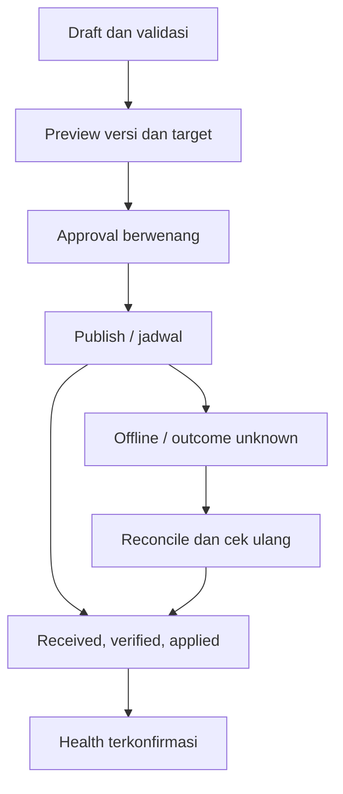

# GOJJA SmartTV
# UI/UX Design System & Interaction Guide v1.1

**31 Oktober 2026 — Asia/Jakarta**  
**Cakupan:** CMS pusat GOJJA, portal ISP, CMS properti, Installer Connector UI, dan pengalaman TV tamu beserta preview.

## Ringkasan eksekutif

Dokumen ini menetapkan bahasa visual, design tokens, komponen, pola layout, aturan interaksi, navigasi remote, accessibility, lokalisasi, serta kriteria review GOJJA SmartTV. Tujuannya adalah membuat seluruh permukaan produk terasa sebagai satu ekosistem, sementara setiap properti tetap dapat memiliki branding yang jelas.

CMS memakai light mode yang terang pada seluruh shell, termasuk sidebar/menu/header, serta dark mode graphite hangat. Tidak memakai latar menu atau dashboard navy/biru gelap/hitam pada light mode. Typography terbaca, struktur informasi tenang, glass/transparency digunakan terukur, dan tindakan eksplisit. TV memakai identitas hotel, fotografi relevan, teks besar serta fokus D-pad yang kuat. Installer mengutamakan ketepatan target, prasyarat lokal, tahap pekerjaan dan pemulihan. Status teknis serta finansial tidak disamakan hanya karena memiliki warna yang serupa.

**Pembaruan v1.1:** login dan Property Overview terbaru menjadi acuan komposisi utama. Shell memakai sidebar terang berlogo, menu yang dapat digulir secara independen, footer foto hospitality, header lengkap dan main-content scroll terpisah. Desain menggunakan Plus Jakarta Sans/Inter, ivory–pearl, indigo sebagai primary action, serta Warm Graphite Dark yang wajib diimplementasikan meskipun dua mockup terbaru hanya menggambarkan Light. Struktur 69 layar/tab tetap ditelusuri; katalog berkembang menjadi 64 komponen dan acceptance menjadi 120 pemeriksaan desain. Bagian scan diselaraskan dengan Implementation Prompt terbaru: frontend/backend fungsional dan local connector untuk LIVE_LAB, bukan simulasi yang diberi label perangkat nyata. File PRD, Build Brief, dan Implementation Prompt tidak otomatis ikut direvisi melalui pekerjaan ini.

Dua gambar adalah referensi visual yang ditetapkan untuk v1.1, bukan produk berjalan. Status “final” di sini menyatakan arah desain yang dipakai dalam brief, bukan hasil uji browser, persetujuan hak foto, sertifikasi TV, master vector, atau bukti implementasi.

**Instruksi aset yang wajib ikut setiap handoff:**

> Dalam pengerjaan prototype, pemilik produk akan menyertakan **logo GOJJA yang diunggah** dan **gambar/image attachment desain prototype standar sebagai contoh visual**. Gunakan logo tersebut sebagai sumber identitas visual dan gambar attachment sebagai rujukan layout, komposisi, hierarki, karakter premium, serta pengalaman CMS/installer/TV. Untuk login/dashboard staf, acuan utama adalah V-11 dan V-12 pada register aset. Jangan mengetik ulang atau menggambar ulang logo dengan font generik. Ikuti aturan interaksi dan domain dari spesifikasi terbaru; jangan menyalin typo, angka ilustratif, ketidaksesuaian model/IP, atau klaim kemampuan perangkat yang mungkin ada pada gambar. Jika ada beberapa attachment yang berbeda, catat mana yang paling baru dan telah ditetapkan pemilik produk. Dokumen ini tidak membuat logo atau referensi prototype baru.

Logo standar adalah lowercase custom **gojja**, konsep Open Future, dengan urutan warna cobalt–indigo–violet–magenta–coral. Nama produk dalam teks tetap **GOJJA SmartTV**. Logo hotel dominan pada guest experience; GOJJA dominan pada platform CMS; hak co-branding/white-label mengikuti entitlement.

Nilai ukuran dan token baru di dokumen ini adalah baseline implementasi prototype, bukan bukti kesesuaian semua TV fisik. Kontras pasangan warna solid yang disebut telah dihitung secara matematis (primary indigo dihitung ulang pada v1.1); kontras foto/video/transparansi, jarak menonton, performa, font CJK dan navigasi perangkat nyata tetap membutuhkan pengujian. Tidak ada klaim bahwa prototype, komponen Figma, master vector atau sertifikasi accessibility telah selesai dibuat.

### Ikhtisar perubahan v1.0 R1 → v1.1

| Area | Baseline v1.1 | Bagian rujukan |
| --- | --- | --- |
| Visual utama | V-11 login dan V-12 dashboard ditetapkan sebagai acuan | §2, §9 |
| Brand | Artwork lowercase gojja tetap; primary CMS indigo, aksen cobalt/violet/coral terukur | §2, §6–7 |
| App shell | Header lengkap, sidebar logo/menu scroll/footer foto, main scroll mandiri | §9, §14 |
| Auth | Form nyata, feedback aman, role landing dan optional provider yang jujur | §9.3–9.4 |
| Data | Overview SSOT, room/endpoint/seat dibedakan, snapshot image tidak memaksa fixture | §9.5–9.8 |
| Local scan | Dashboard menjadi control UI; actual scan/connect melalui local connector | §21.5–21.7 |
| Motion dan mode | Kontrak R1 dipertahankan, diterapkan pada shell baru; Light/Dark wajib | §6, §12, §30 |
| Coverage | 64 komponen, 69 screen/tab mapping, 4 panel lab terkait I04, 120 design QA | §18, §31–32 |
| Batas pekerjaan | Dokumen desain; belum ada code, scan fisik, audit accessibility atau sertifikasi baru | §32–34 |

## Daftar isi

1. Mandat dan hierarki acuan
2. Logo unggahan, attachment visual dan asset governance
3. Prinsip desain dan batas pengalaman
4. Permukaan produk dan hierarki brand
5. Arsitektur token dan naming
6. Warna, status dan kontras
7. Tipografi dan konten multibahasa
8. Spacing, sizing, radius dan elevation
9. Grid, layout dan responsive CMS
10. Layout TV dan koordinat preview
11. Ikon, fotografi, media dan QR
12. Motion, splash dan audio
13. Anatomi dan kontrak komponen
14. Navigation dan app shell
15. Buttons, forms dan selection
16. Tables, filters, cards dan analytics
17. Dialog, drawer, notification dan feedback
18. Komponen domain GOJJA
19. Branding editor, inheritance dan preview
20. Publish, approval dan asynchronous jobs
21. Installer interaction guide
22. Provider, paket dan entitlement UX
23. Stay, welcome dan privacy UX
24. Campaign dan promotional experience
25. TV focus, remote dan navigasi
26. Template layar TV dan player
27. Error, offline, recovery dan destructive actions
28. Copy, locale, tanggal dan angka
29. Accessibility dan inclusive interaction
30. Implementasi token dan component library
31. Mapping screen dan design handoff
32. Design QA dan acceptance checklist
33. Governance, perubahan dan delivery
34. Referensi, glosarium dan riwayat versi

## 1. Mandat dan hierarki acuan

### 1.1 Fungsi dokumen

Designer memakai dokumen ini untuk mengembangkan frame dan komponen; developer/AI builder untuk membangun UI yang konsisten; QA untuk memeriksa interaksi dan readability; product owner untuk menjaga arah brand serta pengalaman. Dokumen melengkapi, bukan menggantikan, requirement domain dan build brief.

Rujukan utama: Brand Guideline [I01], Product Consolidation v1.1 [I02], serta Prototype Specification & Build Brief [I03]. I03 menetapkan69 ID layar/tab,18 flow,16 failure scenarios dan72 acceptance tests prototype. I04 adalah Prototype Implementation Prompt & Acceptance Checklist v1.0 yang memperbarui scope prototype menjadi functional backend dan real local scan/connect. Design system ini tidak menambah scope produksi secara otomatis.

### 1.2 Hierarki konflik

1. Instruksi eksplisit terbaru pemilik produk dan batas hak/platform yang berlaku.
2. Artwork logo yang ditetapkan pemilik brand untuk bentuk; nilai brand tertulis I01 sampai direvisi eksplisit.
3. I04 untuk perubahan scope prototype fungsional, backend SSOT, RBAC server-side dan real connector/LIVE_LAB; I02/I03 untuk aturan domain dan coverage layar yang tidak ditimpa eksplisit I04.
4. Dokumen ini untuk tokens, komponen, layout dan interaction detail.
5. Image attachment prototype standar untuk arah visual, komposisi dan hierarki.

Bila gambar memperlihatkan kontrol tanpa kewenangan yang sah, pertahankan karakter visual tetapi ubah state/aksi mengikuti spesifikasi. Bila screenshot berisi contoh logo yang tidak standar, ganti dengan logo unggahan resmi. Perbedaan bentuk/warna yang material dicatat untuk keputusan brand; tidak diselesaikan dengan sampling OCR atau perkiraan desainer.

### 1.3 Klasifikasi aturan

**Wajib:** invariants identitas, scope, state, focus dan keselamatan interaksi. **Baseline:** token/ukuran implementasi yang direkomendasikan. **Adaptif:** branding properti dan layout responsive dalam batas keterbacaan. **Belum tervalidasi:** hasil fisik TV, motion/audio final, master vector, native device authority dan compliance audit. Kata “wajib” menyatakan requirement rancangan, bukan laporan bahwa sudah lulus.

## 2. Logo unggahan, attachment visual dan asset governance

### 2.1 Pernyataan attachment dalam paket build

Setiap brief/prompt pembangunan harus membawa bagian berikut:

> **Assets supplied by owner:** logo GOJJA yang diunggah, image attachment contoh standar prototype CMS, TV app, dan installation/deployment flow. Pertahankan identitas logo dan gunakan attachment sebagai visual reference. Bangun komponen UI yang nyata dan interaktif; jangan memakai screenshot seluruh dashboard sebagai pengganti implementasi. Gunakan data serta perilaku terbaru dari spesifikasi. Referensi hotel pada gambar adalah konsep visual, bukan bukti pelanggan atau kontrak.

Jika pemilik mengunggah logo berupa raster pada brandboard, jangan menyebutnya SVG/master vector. Pakai sumber sesuai kualitasnya untuk prototype sementara, mempertahankan proporsi; final production export tetap membutuhkan artwork yang disahkan. Jangan menghapus background atau menggambar ulang tanpa pekerjaan aset yang memang diminta/disetujui.

### 2.2 Register referensi visual yang sudah dikenal

| V-ID | Referensi | Peran | Batas pemakaian |
| --- | --- | --- | --- |
| V-01 | [GOJJA Option03 brand identity board.png](https://chatgpt.com/library?file_id=libfile_f7cadea059f0819194e2868a2fe983d8&account_id=personal) dan logo unggahan pemilik | Siluet/arah identitas Open Future | Bukan master geometri vektor; nilai HEX mengikuti I01 |
| V-02 | [GOJJA SmartTV Hotel Tentrem CMS.png](https://chatgpt.com/library?file_id=libfile_83eb19dd148c81919231b5902191431d&account_id=personal) | Komposisi CMS, brand/property context, editor dan analitik | Teks/angka ilustratif; bukan data hotel aktual |
| V-03 | [GOJJA Android TV Deployment Storyboard.png](https://chatgpt.com/library?file_id=libfile_98c73c71c5d481919b7923f5712d6169&account_id=personal) | Urutan discovery/auth/map/deploy/verify/recovery | Nama/IP/status serta kemampuan harus mengikuti I03 |
| V-04 | [GOJJA SmartTV hotel experience showcase.png](https://chatgpt.com/library?file_id=libfile_fcb3f3f8712c81918fa4823d1735b453&account_id=personal) | Splash, welcome, Home, live guide, promo, service, bahasa | Konsep guest experience; tidak menyatakan aplikasi resmi Hotel Tentrem |
| V-05 | [GOJJA SmartTV open future design system.png](https://chatgpt.com/library?file_id=libfile_4996a5fb7d10819198ffb8ed4dd3c55e&account_id=personal) | Board brand dan digital experience terbaru: logo, type, graphic, layout, mode, motion | Referensi visual terpadu; HEX, ukuran, nama font dan istilah presisi mengikuti aturan tertulis, bukan OCR gambar |
| V-06 | [GOJJA SmartTV linen hospitality dashboard.png](https://chatgpt.com/library?file_id=libfile_f7570dc110b08191941b245a66307db1&account_id=personal) | Eksplorasi login, overview, branding dan dark overview | Arah komposisi/sidebar terang; arsip eksplorasi; login/dashboard kini mengikuti V-11/V-12 |
| V-07 | [Pearl concierge hotel dashboard suite.png](https://chatgpt.com/library?file_id=libfile_9833e92e1df4819186497fda7b31c7ac&account_id=personal) | Eksplorasi hospitality login, room/update approval dan mode | Perbaiki contoh occupied/ready, jadwal dan angka ketika implementasi mengikuti domain I03 |
| V-08 | [GOJJA Open Atrium SmartTV Suite.png](https://chatgpt.com/library?file_id=libfile_3cae1b4a86308191b8e4926cec7f1525&account_id=personal) | Eksplorasi navigasi atas dan content/analytics | Arsip alternatif layout; tidak mengganti shell V-12 |
| V-09 | [Corbel dashboard](https://demo.codeandchill.store/corbel/#/dashboard) | Referensi mekanisme motion menu, chart, KPI dan theme | Kode publik ditinjau 31 Oktober 2026; bukan template/aset yang diambil ulang atau audit browser langsung |

| V-10 | [KARYA reference capture A](https://chatgpt.com/library?file_id=libfile_89088bd19c4c8191874f265bf27f2016&account_id=personal) dan [KARYA reference capture B](https://chatgpt.com/library?file_id=libfile_3e8be360436c8191acbd380ef8d4c6ca&account_id=personal) | Screenshot referensi layout yang diberikan pemilik: sidebar berlogo/footer foto, header, hero, split login | Pair capture adalah referensi komposisi; verifikasi isi saat handoff, jangan menyimpulkan jenis screen hanya dari nama. Identitas, serif, warna hijau dan data ERP tidak dipakai |
| V-11 | [GOJJA SmartTV Luxury Resort Login Screen.png](https://chatgpt.com/library?file_id=libfile_aa79600b4cc08191b4119066a236821e&account_id=personal) | **Acuan utama login v1.1**: hospitality split, logo, pearl auth panel, utilities dan footer | Gambar generatif; artwork logo sumber tetap V-01; foto/font/akses autentikasi harus diimplementasikan dengan aset dan kemampuan nyata |
| V-12 | [GOJJA SmartTV hotel operations dashboard.png](https://chatgpt.com/library?file_id=libfile_60defeb163f08191a7d81d858672ba34&account_id=personal) | **Acuan utama dashboard/shell v1.1**: property header, independent sidebar scroll, footer foto, overview | Angka/image bersifat ilustratif. Aturan SSOT, definisi metrik, RBAC, hak konten dan state I04 mengatasi detail gambar |

Register tersebut menautkan referensi yang tersedia, bukan pernyataan bahwa screenshot telah diukur pixel-by-pixel. Review fidelity kode terhadap gambar merupakan pekerjaan setelah prototype dirender. Tidak ada lampiran gambar baru yang diklaim disertakan secara fisik di file Markdown ini; tautan menunjuk aset tersendiri. V-05 tetap board brand bersama; V-11/V-12 menggantikan V-06/V-07/V-08 sebagai acuan utama login/dashboard. V-06..V-08 menjadi arsip eksplorasi, bukan alternatif default builder. V-09 tetap acuan motion; V-10 hanya inspirasi struktur yang diadaptasi ke GOJJA. Dark mode mengikuti aturan tertulis karena V-11/V-12 hanya Light.

### 2.3 Asset manifest wajib

Untuk tiap aset catat assetId, originalFilename, approvedVersion, owner/source, license/permission, format, dimensions/viewBox, colour space, background/transparency, usageScope, approvedBy/date bila ada, checksum bila didukung, serta status Placeholder/Reference/Approved/Retired. Status tidak diisi Approved tanpa keputusan pemilik.

Nama rekomendasi setelah aset benar-benar dibuat: gojja-wordmark-fullcolor-v1.0.svg, gojja-wordmark-white-v1.0.svg, gojja-wordmark-midnight-v1.0.svg, gojja-smarttv-lockup-fullcolor-v1.0.svg. Nama ini adalah kontrak penamaan, bukan klaim file sudah ada. Aset font/foto/sonic juga memerlukan sumber dan hak penggunaan.

### 2.4 Logo rules

Gunakan artwork dengan aspect ratio terkunci. Clear space minimum1x, x=diameter titik j pada master; cover/splash dianjurkan2x. Baseline ukuran minimum wordmark120 px dan lockup180 px dari I01 harus diuji pada output sebenarnya. Logo tidak dipaksa masuk sidebar collapsed36 px; gunakan expanded brand area atau secondary mark resmi jika kelak disetujui.

Full-colour di putih menjadi default. Pada foto/TV gelap pilih reverse white resmi jika biru/ungu tidak cukup terbaca. Tidak ada gradient baru, glow, emboss, outline, letter recolouring atau o menjadi play icon. Flat artwork menjadi baseline; gradient hanya dari aset yang disahkan. Descriptor SmartTV terpisah dari lettering. Horizontal lockup baru tidak diciptakan melalui dokumen ini.

## 3. Prinsip desain dan batas pengalaman

| Prinsip | Perilaku konkret | Anti-pattern |
| --- | --- | --- |
| Scope selalu jelas | Property/role/target aktif terlihat sebelum tindakan | Global action pada halaman yang terlihat lokal |
| State jujur | Received, Applied dan Healthy terpisah | Hijau “Selesai” saat baru queued |
| Tamu memegang kendali | Back/skip/bahasa mudah, Televisi dominan | Promo mengambil fokus atau mengulang tiap zap |
| Premium melalui ketepatan | Spacing, alignment, foto dan copy terkurasi | Terlalu banyak gradient, glass dan animasi |
| Self-service terbimbing | Template, preview, validation, provenance | Form bebas tanpa guardrail |
| Kesalahan dapat dipulihkan | Alasan dan next action sesuai penyebab | “Error” generik dengan tombol retry tak terbatas |
| Privacy seperlunya | Nama tamu hanya di scope yang berhak | Nama muncul pada export/chart/QR umum |
| Pola lintas peran konsisten | Shared components, permission berbeda | Semua admin mendapat tombol yang sama |

UI tidak menjanjikan full OS replacement, semua TV certified, universal reset/lock, pemutaran OTT termasuk, atau pendapatan iklan terjamin. Capability Unsupported/Unknown ditampilkan jelas. Simulation badge ditempatkan pada frame/actions demo tanpa mengotori guest screen setiap saat.

## 4. Permukaan produk dan hierarki brand

| Surface | Identitas dominan | Konten utama | Hal yang tetap seragam |
| --- | --- | --- | --- |
| GOJJA CMS | GOJJA | Bisnis, armada, release, finance, support | Semantics/status/komponen sistem |
| ISP portal | GOJJA + partner sesuai kontrak | Pelanggan dan layanan dalam scope | Permission, navigasi, metrics definitions |
| Property CMS | Nama properti jelas, GOJJA platform | Branding, kamar, stay, provider, campaign | Struktur form, approval, validasi dan safety |
| Installer UI | GOJJA + property/connector context | Target lokal, job, verification | Scope, state, reason dan recovery patterns |
| TV guest | Hotel/properti | Televisi, layanan, promo dan bantuan | Focus, Back, language, error semantics |
| Demo frame | GOJJA | Persona/scenario/endpoint controls | Label synthetic/simulated terpisah dari guest UI |

White-label adalah entitlement, bukan keputusan desainer. Menonaktifkan Powered by GOJJA tidak menghapus informasi teknis yang diperlukan pada CMS. Token hotel tidak mengganti warna status error/success atau bentuk logo GOJJA. Residence/Home masa depan memerlukan workflow berbeda; jangan menyalin aturan checkout/kiosk hotel sebagai default rumah.

## 5. Arsitektur token dan naming

### 5.1 Tiga lapis

**Primitive:** nilai dasar, misalnya color.cobalt. **Semantic:** tujuan, misalnya color.action.primary.bg. **Component:** keputusan komponen, misalnya button.primary.background merujuk semantic. UI memakai semantic/component tokens; property theme hanya boleh mengubah slot yang diizinkan. Jangan memakai arbitrary hex di tiap page.

Namespace: brand.*, cms.*, tv.*, installer.*, status.*, interaction.*, typography.*, spacing.*, radius.*, elevation.*, motion.*, breakpoint.*, density.*. Nama status merepresentasikan makna; jangan menamai token hijau untuk seluruh sukses karena sebagian “active” bukan sehat/paid.

### 5.2 Modes

Modes wajib: **CMS Light dan CMS Warm Graphite Dark**, mencakup login, CMS pusat, portal ISP, CMS properti, installer, modal, drawer, tabel, chart dan feedback. CMS compact density opsional; reduced motion wajib tersedia. Dark mode bukan placeholder atau menu roadmap. Pemilihan System boleh ditambahkan sebagai opsi ketiga, tetapi Light/Dark eksplisit selalu tersedia.

Light memakai white/ivory/pearl hingga sidebar dan topbar; tidak ada rail gelap sebagai aksen. Dark memakai graphite/taupe hangat medium, bukan navy atau pure black. Property theme membuat scoped override pada guest scene; mode kerja staf tidak mengubah tema TV hotel yang sudah dipublikasikan. High-contrast fallback menggunakan solid background dan focus yang lebih jelas tanpa mengubah logo.

### 5.3 Unit dan platform

CMS memakai CSS px/rem sesuai implementasi responsive. TV preview menggunakan logical design canvas1920×1080. Android native memakai dp/sp dan density mapping tersendiri; jangan langsung menganggap64 logicalpx preview=64 dp. Design intent dan proporsi ditransfer melalui adapter/native review, kemudian diuji pada certification tuple.

## 6. Warna, status dan kontras

### 6.1 Primitive brand dan neutral

| Token | HEX | Tujuan |
| --- | --- | --- |
| brand.cobalt | #0050F5 | Huruf g; secondary brand accent dan focus |
| brand.indigo | #4F3FE5 | Huruf o; primary action CMS v1.1 |
| brand.violet | #7C35E0 | j pertama |
| brand.magenta | #CA3596 | j kedua |
| brand.coral | #FF5E70 | Huruf a; bukan default error |
| neutral.midnight | #10172F | Teks utama CMS |
| neutral.white | #FFFFFF | Card/editor surface |
| neutral.surface | #F5F6FA | Background CMS |
| neutral.slate | #586174 | Secondary text |
| neutral.border | #E3E7EF | Divider dekoratif dan pemisahan surface |
| neutral.controlBorder | #7A8496 | Batas kontrol yang perlu dikenali terhadap putih |

Border #E3E7EF tidak dipakai sebagai satu-satunya petunjuk batas input bila kontrasnya tidak memadai. Pertahankan label, surface dan focus; gunakan controlBorder sesuai kebutuhan. Disabled state tetap terbaca meskipun mempunyai pengecualian pada sebagian kriteria accessibility; jangan mengandalkan opacity rendah seluruh form.

### 6.2 Semantic pairs

| Semantic | Foreground | Background | Rasio solid terhitung, dibulatkan |
| --- | --- | --- | --- |
| action.primary | #FFFFFF | #4F3FE5 |6,61:1 |
| text.primary | #10172F | #FFFFFF |17,71:1 |
| text.secondary | #586174 | #FFFFFF |6,22:1 |
| status.success | #166534 | #DCFCE7 |6,49:1 |
| status.warning | #92400E | #FEF3C7 |6,37:1 |
| status.danger | #B91C1C | #FEE2E2 |5,30:1 |
| status.info | #1D4ED8 | #DBEAFE |5,49:1 |
| status.neutral | #475569 | #F1F5F9 |6,92:1 |
| control.boundary | #7A8496 | #FFFFFF |3,77:1 |
| tv.text | #F8F5EE | #10151C |16,83:1 |
| tv.text.secondary | #CDD3DD | #10151C |12,18:1 |
| tv.accent | #DCC6A1 | #10151C |11,03:1 |

Perhitungan memakai relative luminance sRGB untuk pasangan opaque. Tidak membuktikan kontras pada foto, video, gradient, opacity, focus over media atau semua hover states. Pasangan putih di indigo sesuai token mempunyai rasio cukup untuk teks normal; property primary colour lain harus dihitung ulang dan foreground dipilih melalui allowed palette/contrast check, bukan selalu putih.

### 6.3 Makna status

| Keluarga | Contoh label | Warna/ikon | Catatan |
| --- | --- | --- | --- |
| Ready/Healthy/Verified result | Healthy, Applied verified | Success + check | Hanya tahap yang telah terkonfirmasi |
| In progress/information | Installing, Reviewing, Received | Info + progress/info | Tidak berarti selesai |
| Waiting/attention | Awaiting approval, Deferred | Warning + clock | Sertakan sebab |
| Failure/denial | Failed, Rights denied | Danger + alert | Error tidak selalu memerlukan reset |
| Unknown/offline/draft | Outcome unknown, Offline, Draft | Neutral + unknown/cloud-off | Offline bukan device rusak pasti |
| Financial state | Issued, Paid, Overdue | Label khusus + semantic sesuai arti | Active subscription tidak sama dengan Paid |

Unknown tidak diberi spinner tak terbatas. Selected adalah state navigasi, bukan Success. Billing dan content entitlement tidak dibuka hanya karena badge hijau dari domain lain.

### 6.4 CMS Light dan Warm Graphite Dark

| Semantic slot | Light | Dark | Aturan |
| --- | --- | --- | --- |
| shell.background | #F6F4EF (ivory default); #F5F6FA untuk panel utilitas | #4B4A47 | Tidak ada navy/black canvas |
| shell.sidebar | #FFFFFF | #4B4A47 | Light sidebar selalu terang, tidak mewarisi TV dark |
| shell.header | #FFFFFF atau white-glass tervalidasi | #504F4B | Translucency fallback opaque |
| surface.default | #FFFFFF | #5B5955 | Card/editor/dialog/chart memakai semantic mode |
| surface.input | #FFFFFF | #504F4B | Label/error tetap terbaca |
| text.primary | #10172F | #F8F5EE | Midnight hanya teks/monochrome logo, bukan canvas Light |
| text.secondary | #586174 | #E2DFD8 | Tidak sekadar opacity teks utama |
| control.boundary | #7A8496 | #C3BFB6 | Periksa terhadap adjacent input/surface |
| action.primary.bg / fg | #4F3FE5 / #FFFFFF | #4F3FE5 / #FFFFFF | Indigo solid baseline; gradient hanya enhancement tombol utama yang kontrasnya diuji |
| navigation.selected | #EEF0FF dengan teks indigo | #65615E dengan teks #F8F5EE | Label/focus/selected berbeda |
| chart.primary | #4F3FE5 / #0050F5 | #C7B9FF | Dark lilac untuk graphic, bukan otomatis body text |
| focus.ring | #0050F5 + white gap | #C7B9FF + dark gap | Kontras pada kedua sisi diverifikasi |
| link.text | #1D4ED8 | #E4DCFF | Underline/focus saat diperlukan |

Brand colours pada artwork tidak berubah ketika mode berubah. Di dark mode pilih approved reverse white atau fullcolour di light plaque yang cukup luas; jangan meredupkan/mewarnai logo melalui filter CSS. Perhitungan tambahan: #F8F5EE pada #4B4A47 ≈8,14:1; pada #5B5955 ≈6,42:1; #E2DFD8 pada #5B5955 ≈5,25:1; chart #C7B9FF pada #5B5955 ≈3,93:1. Chart colour tidak memenuhi target normal body-text 4,5:1 pada surface itu sehingga tidak dipakai sebagai small body label.

Status badge memakai semantic pair yang sudah teruji atau mode-specific pair yang dihitung ulang; jangan invert seluruh halaman dengan CSS filter. Setiap hover/selected/disabled/focus dan chart gridline/tooltip perlu mode-specific review. Foto/video tetap aset asli dengan scrim sesuai kondisi; tidak di-invert.

### 6.5 Theme preference dan scope

Preference staf bersifat per-user, bukan per-property. Pilihan Light/Dark bertahan saat berganti properti/role yang sah dan reload; account lain tidak otomatis mewarisi preference sebagai keputusan finalnya. Prototype menyimpan preference pada key namespaced user/demo persona dengan schema version; produksi dapat menyinkronkan preference akun dengan local cache. Storage blocked memakai in-memory fallback tanpa crash.

Default tanpa preference adalah Light. Jika opsi System dibangun, precedence explicit user choice → saved System/OS → default Light. Perubahan OS hanya diikuti dalam mode System. Apply theme sebelum first paint bila environment memungkinkan, dengan script/CSP/SSR integration yang sesuai; jangan menyembunyikan seluruh app sampai animasi selesai. Login dan authenticated shell memakai preference yang konsisten tanpa membocorkan data akun.

Mode switch tidak menyimpan draft, memublikasikan branding, mengubah guest locale, mereset cap promo, membatalkan job atau menambah event playback. Preview TV menggunakan published/draft property theme yang dipilih reviewer; staff theme control hanya mengubah frame CMS. Photo/transparency theme preset hotel adalah konfigurasi terpisah.

## 7. Tipografi dan konten multibahasa

### 7.1 Typeface

Heading: Plus Jakarta Sans500/600/700 bila aset font tersedia. Body/UI: Inter400/500/600; angka tabular untuk tabel finansial/KPI. Fallback CJK yang direkomendasikan Noto Sans SC dan Noto Sans JP atau system font yang memadai; verifikasi file/version/lisensi sebelum bundling. Wordmark tetap artwork, bukan font ini.

### 7.2 Type scale CMS

| Token | Size/line-height | Weight | Pemakaian |
| --- | --- | --- | --- |
| cms.display |32/40 px |600 | Overview sederhana; tidak semua halaman |
| cms.h1 |28/36 px |600 | Page title |
| cms.h2 |22/30 px |600 | Section title |
| cms.h3 |18/26 px |600 | Card/dialog heading |
| cms.body |16/24 px |400 | Form dan informasi utama |
| cms.bodyCompact |15/22 px |400 | Tabel berdata padat |
| cms.label |14/20 px |500 | Label dan helper yang tetap terbaca |
| cms.caption |12/18 px |400 | Metadata tambahan, bukan aksi/isi penting |
| cms.kpi |32/40 px |600 | Angka utama dengan unit/denominator |

Caption12 px bukan alasan mengecilkan critical status atau pesan gagal. Headline dan body dapat reflow pada text zoom; line-height fixed px di tabel hanyalah nilai desain awal, implementasi sebaiknya scalable. Hindari semua-kapital dan tracking panjang untuk teks antarmuka.

### 7.3 Type scale TV preview

| Token | Logical size/line-height | Pemakaian |
| --- | --- | --- |
| tv.hero |64/76 px | Welcome/headline singkat |
| tv.h1 |48/60 px | Judul layar |
| tv.h2 |36/48 px | Section/promo heading |
| tv.body |28/40 px | Informasi dan error singkat |
| tv.label |28/36 px | Tile/menu/control |
| tv.meta |24/34 px | Jam/channel metadata nonutama |

Nilai mengikuti canvas1920 logicalpx; ketika preview diperkecil, reviewer harus dapat membuka full size untuk menilai. Jangan menilai readability TV dari board6 screen berukuran kecil saja. Tidak ada letter-spacing dekoratif untuk CJK; hindari forced uppercase transformation pada dictionary locale.

### 7.4 Panjang teks

Menu CMS/TV dan field content mengikuti batas I03; tidak memotong informasi kritis diam-diam. Ellipsis untuk label data panjang boleh dengan full value reachable pada detail/accessible name. TV welcome maksimal2–3 baris visual awal; nama panjang memakai safe shortened display atau generic greeting sesuai privacy, bukan font yang terus mengecil.

## 8. Spacing, sizing, radius dan elevation

| Kategori | Baseline | Aturan |
| --- | --- | --- |
| Spacing CMS |4,8,12,16,24,32,48,64 px | Gunakan skala konsisten |
| Control height |44 px default;48 px large;36 px compact terkontrol | Compact tidak mengurangi hit area action utama |
| Input gap |8 px label-control;8 px helper;24 px antargroup | Error tidak menimpa field bawah |
| Card padding |24 px desktop;16 px narrow | Selaraskan dengan halaman |
| Radius |10 px control;16 px card;20 px dialog;full untuk badge/avatar | Jangan semua elemen pill |
| Border |1 px control;2 px selected bila relevan | Focus ring terpisah dari border |
| CMS focus |2 px outline +2 px offset baseline | Diperiksa terhadap dua surface di sekitarnya |
| TV focus |4 logicalpx outline +4gap baseline | Tidak terpotong container |
| TV tile gap |24–32 logicalpx | Ruang untuk focus/scale1,02opsional |

Elevation CMS: level0 flat; level1 card sangat halus atau border saja; level2 dropdown; level3 drawer/dialog. Contoh shadow awal:0 4 px 16 px rgba(16,23,47,0.08) untuk elevated surface, bukan semua card. TV focus tidak hanya mengandalkan shadow. Stacking tokens: base0, sticky100, dropdown300, drawer500, modal700, toast800, demo controls900 bila dibuka; urutan relatif, bukan jaminan melewati system UI OS.

## 9. Grid, layout dan responsive CMS

### 9.1 Arah layout v1.1 yang ditetapkan

Nama kerja arah visual: **Luxury Hospitality — Pearl Workspace**. V-11 adalah rujukan login, V-12 adalah rujukan Property Overview sekaligus shell CMS. Komposisi mengadaptasi screenshot V-10 yang diberikan pemilik: panel hospitality, identitas sidebar, utility header, hero kontekstual, KPI dan area operasional. Tidak memakai logo/warna hijau/serif/data konstruksi dari referensi. Kesan premium diperoleh dari proporsi, fotografi, tipografi dan ketelitian state; bukan menambah gold, glow, glass atau animasi pada setiap kontrol.

Mockup 16:9 dipakai untuk review komposisi. File generatif aktual menjadi rujukan rasio visual; tidak ada jaminan bahwa dimensi pikselnya identik dengan target prompt. Implementasi memakai CSS responsive, bukan screenshot yang diperkecil atau canvas 2048 px terkunci. Pada 1920×1080, sidebar 256 px, topbar 80 px dan content padding 24–32 px adalah baseline; pada 1440×900 sidebar 240 px/topbar 72 px. Semua nilai memakai box sizing border-box. Konten tidak diperbesar atau diperkecil dengan transform seluruh aplikasi.

| Elemen | Baseline desktop | Perilaku |
| --- | --- | --- |
| Sidebar expanded | 240 px pada 1440; 256 px pada ≥1600 | Grid tiga row: brand auto, navigation minmax(0,1fr), footer auto |
| Sidebar compact | 76 px | Ikon berlabel aksesibel; wordmark lengkap tidak dipaksa masuk; foto footer disembunyikan |
| Header | 72 px laptop; 80 px wide desktop | Tetap di atas main scroller, scope dan utilities terjaga |
| Main padding | 24 px laptop, 32 px wide | Gap panel 16–24 px; tidak memampatkan isi agar semua fitur masuk |
| Hero overview | Min-height 176–208 px | Judul/action kiri dan foto/scrim kanan; isi dapat menambah tinggi |
| KPI | 3 kolom laptop; 6 wide | Min lebar 176 px jika tersedia; isi reflow, denominator tidak terpotong |
| Main data row | 60:40 pada main area cukup lebar | Tabel kesehatan dan insights; single column bila ruang tidak cukup |
| Supporting row | 3 kolom wide; 2/1 narrow | Brand/Welcome, Update Approvals, Recent Activity |
| Main footer | Auto, setelah konten | Copyright/help/status yang berasal dari state; tidak menutup data |

Desktop shell memakai tinggi 100dvh dengan fallback 100vh, main column min-width:0, navigation dan main-scroller min-height:0. Body desktop tidak ikut menjadi scroller kedua. Fullscreen browser/F11 bukan prasyarat penggunaan. Pada zoom atau tinggi kecil, footer/sidebar beradaptasi sebagaimana §14.

### 9.2 Breakpoints dan target review

| Viewport CSS | Shell | Overview / login |
| --- | --- | --- |
| ≥1600 px | Sidebar expanded, header lengkap | 6 KPI, 60:40 panel; login split 60:40 |
| 1280–1599 px | Sidebar expanded, search dapat dipersempit | 3 KPI per row; panel split hanya bila kolom tabel ≥620 px dan chart ≥360 px |
| 1024–1279 px | Compact sidebar default, expanded toggle | 2–3 KPI; panel satu kolom; login split 50:50 atau auth-first sesuai tinggi |
| 768–1023 px | Drawer navigation, compact header | 2 KPI; login auth dominan dan photo strip opsional |
| 480–767 px | Drawer; property context row boleh wrap | 2 KPI bila setiap card tetap ≥176 px; tabel scroll lokal |
| <480 px | Drawer; utility sekunder pada menu More | 1 KPI per row; login single column; tidak ada horizontal page overflow |

Review pada 1920×1080, 1440×900, 1280×800, 1024×768, 768×1024 dan 390×844; reflow juga pada 320 CSS px equivalent untuk konten yang berlaku. Batas di atas adalah baseline implementasi, bukan breakpoint library wajib. Pengujian 200% text zoom dan 400% page zoom tidak boleh diselesaikan dengan memaksa desktop canvas mengecil. Tabel dua dimensi mempunyai scroll lokal; form/heading/aksi tidak ikut overflow.

### 9.3 Login page — struktur dan visual

Desktop memuat dua wilayah dalam satu halaman, bukan modal login di atas dashboard yang belum autentikasi. Panel kiri hospitality ±60%, kanan auth ±40%; masing-masing memiliki minimum space untuk copy dan form. Kiri menggunakan foto resort Indonesia yang sudah selesai, bukan konstruksi; overlay pearl/ivory gradien memberi bidang baca. Tidak menyalin aset milik referensi tanpa hak penggunaan. Login generik tidak menampilkan nama/nama tamu/properti privat sebelum otorisasi.

Urutan kiri: logo resmi → headline **A more connected stay.** → subheadline **One platform. Every guest experience.** → penjelasan pendek → empat ikon/caption → footer **Open. Connected. Forward.**. Caption: SmartTV & Rooms, Brand & Content, Channels & Campaigns, Fleet & Insights. Ini deskripsi produk, bukan kontrol navigasi palsu. Foto decorative mempunyai alt kosong; logo mempunyai accessible name. Headline default 48/56 px pada wide desktop, 36/44 pada laptop, 28/36 pada narrow; Plus Jakarta Sans, tidak memakai serif KARYA.

Panel kanan memiliki utility bahasa, Light/Dark dan Help di bagian atas; form 400–480 px max-width dalam pearl surface, dengan border halus dan radius24 px. Isi: logo lockup → Welcome back → subtitle workspace → Work email → Password → Remember me dan Forgot password → Sign in → opsi Google bila autentikasi benar-benar tersedia → secure-access note → Contact administrator → Terms/Privacy. Input min 44 px, primary 48 px. Padding32–40 desktop/24 narrow. Card bukan screenshot; semua field/tautan memakai semantic HTML dan perilaku nyata.

Opsi Google tidak menjadi tombol sukses palsu. Bila provider OAuth belum dikonfigurasi, tampilkan hanya bila ada handler explanatory yang jelas di DEMO, atau sembunyikan pada LIVE; gunakan email/password sebagai jalur utama yang berjalan. Terms/Privacy/Help harus menuju konten aktual/halaman placeholder yang jujur; jangan pakai href # yang melompat ke atas. Tidak perlu tombol Demo Accounts di login produksi. DEMO memakai banner/entry yang jelas dan akses yang terpisah dari LIVE.

Pada mobile, panel marketing dipersingkat menjadi logo, headline opsional dan photo strip; form diprioritaskan tanpa scrolling panjang melewati marketing. Utility tetap reachable. Keyboard layar tidak menutupi submit/error; vertical scrolling halaman auth diperbolehkan. Form tidak di-fixed tengah jika tinggi viewport rendah. Dark login memakai graphite surface dan scrim yang disesuaikan; foto tidak di-invert dan logo memakai reverse resmi/light plaque.

### 9.4 Login interaction dan state contract

| State / trigger | Perilaku wajib | Hal yang dicegah |
| --- | --- | --- |
| Initial | Label permanen, autocomplete username/current-password; tab order alami | Placeholder sebagai satu-satunya label |
| Password reveal | Button type=button, accessible label berubah; focus tetap | Submit form karena klik mata |
| Invalid input | Field-level error + summary jika banyak; fokus error pertama saat submit | Error hanya warna/toast |
| Submitting | Satu request aktif, label Signing in…, tombol stabil, aria-busy | Double submit dan angka progress palsu |
| Invalid credentials | Pesan generik yang aman; email dipertahankan, password sesuai kebijakan auth | Account enumeration dan password pada logs |
| Rate limited | Penjelasan dan retry guidance dari server; field tetap terbaca | Countdown yang mengklaim limit server telah selesai tanpa verifikasi |
| MFA required | Step tambahan hanya jika backend mendukung; method/recovery jelas | Mengaku MFA aktif dari desain saja |
| Expired session | Return-to route tersanitasi; draft nonrahasia dapat dipulihkan setelah reauth sesuai kebijakan | Password/token disimpan untuk memulihkan form |
| Success | Server menentukan scope; masuk role landing yang sah; theme bertahan | Mengandalkan role dropdown client sebagai otorisasi |
| Multiple properties | Tampilkan scope picker jika belum ada pilihan yang sah | Mengakses properti terakhir yang haknya sudah dicabut |
| Forgot password | Confirmation generik; token expiry dan delivery mengikuti backend | Mengungkap apakah email terdaftar |
| Theme/language switch | Nilai input, focus dan pending auth tidak hilang | Remount form/replay login request |

Remember me mengatur kebijakan session persistence yang didukung server; tidak menyimpan password atau token sensitif di localStorage. UI tidak menetapkan sendiri umur session. Penanganan cookie/token, CSRF dan session revocation mengacu I04 serta implementasi keamanan backend. Screen reader mendengar final outcome sekali, bukan seluruh frame animasi. Login/logout tidak memicu scan atau perubahan branding.

### 9.5 Property Overview — komposisi yang diimplementasikan

PR-01 menggunakan shell V-12. Header utility dan sidebar tetap; isi overview mempunyai hero, KPI, operational row, supporting row dan footer. Hero menampilkan nama properti/lokasi, judul Property Overview, subtitle singkat dan tanggal/zona. Primary **Scan devices** hanya untuk role yang berhak; secondary **Open TV preview** membuka preview dengan property/profile/locale yang eksplisit. Pengguna noninstaller melihat primary yang relevan, misalnya View devices atau Review approvals. Jangan membuka akses scan hanya karena tombol muncul pada gambar.

Foto hero terletak terutama di kanan, dengan scrim kiri yang memastikan heading tidak bertabrakan. Hero tidak autoplay video; decorative photo tidak menangkap klik/focus. Date/time adalah label display, bukan janji live clock. Dashboard refresh tidak mengulang animasi seluruh halaman.

| Blok | Isi utama | Kontrak |
| --- | --- | --- |
| Licensed TVs | Contracted seats, assigned, available | Seat aktif tidak sama dengan candidate discovery atau TV online |
| TVs online | Endpoint online / enrolled monitored endpoints | Offline dan stale/unknown dibedakan; tooltip menampilkan interval observasi |
| Occupied rooms | Kamar occupied / kamar dalam scope | Dua TV satu suite tetap satu kamar |
| Active campaigns | Campaign yang memenuhi definisi aktif | Published, scheduled, eligible-now dan proof of play dipisahkan |
| Updates pending | Device target atau job yang masih menunggu approval | Unit tertulis; jangan mencampur dua device dan dua release |
| Monthly plan | Recurring software amount dalam invoice/contract scope | Harga fixture bukan penawaran final; pajak/prorata/add-on terpisah |
| Device & Room Health | Room, endpoint, status, profile, last observation | Aggregate suite dapat diexpand menjadi dua endpoint; exact identity tersedia |
| Playback Insights | Time range, metric, legend, source/coverage | Dua series memakai definisi event yang sama bila digambar bersama |
| Brand & Welcome | Published thumbnail/version/locale | Preview jelas published/draft; action sesuai permission |
| Update Approvals | Release, targets, approval dan eligibility | Approved tidak berarti immediate install; readiness diperiksa ulang |
| Recent Activity | Timeline audit/job yang tersaring | Event punya subject/type/timestamp; bukan data acak untuk dekorasi |

Pada laptop, konten tambahan boleh berada di bawah fold. Tidak memperkecil semua font untuk memaksakan keseluruhan screenshot wide masuk 1280 px. Lower panels tidak berisi primary destructive action. Chart mempunyai accessible summary/table; no data adalah empty state, bukan garis palsu nol.

### 9.6 Kontrak data ilustratif dan SSOT

V-12 menampilkan Hotel Arunika sebagai **data demo**, bukan Hotel Tentrem atau bukti pelanggan. Label fixture di bawah adalah contoh review visual; runtime menghitung dari PostgreSQL/API I04 dengan effective time, bukan menyalin nilai ini ke setiap komponen.

| Nilai pada mockup property P01 | Rekonsiliasi |
| --- | --- |
| 12 licensed seats | 7 assigned + 5 available; billing berdasarkan contracted seats sesuai model |
| 7 endpoints | 6 kamar; suite301 mempunyai2TV |
| 5 online,2offline | Room202 offline; room 301 aggregate1offline dari2TV |
| 4/6 occupied | 101,102,103,301 occupied;201/202 vacant pada snapshot seed |
| Rp180.000 recurring Core | 12×Rp15.000 fixture; bukan harga final semua channel/OTT |
| 2 campaign /2update pending | Angka ilustrasi image; hanya boleh muncul runtime bila entity/target fixture memang menghasilkan2 |
| Graph25–31Oct | Ilustrasi image; bukan histori aktual yang telah diukur |

Saat memakai seed I04 dengan clock 2 Nov2026, seluruh label waktu mengikuti clock tersebut; jangan mencampur screenshot31Oct dan stay tanggal2Nov sebagai satu laporan real. Foto/copy/static showcase dapat memakai31Oct2026 sebagai snapshot visual tersendiri yang diberi Demo snapshot. Endpoint counts5/7 pada V-12 adalah snapshot visual yang berbeda dari baseline global11online/14endpoints; jangan mengubah source fixture agar cocok ke screenshot tanpa scenario/version yang eksplisit. Jika P01 pada fixture aktual mempunyai2offline dari7endpoint, angka5online dapat cocok; state tetap dihitung, bukan dipaksa.

Activity dan graph diturunkan dari audit/telemetry seed. Jika belum ada histori channel/campaign harian, tampilkan No data untuk LIVE dan seeded telemetry berlabel DEMO untuk simulasi. Jangan mengarang historical trend agar grafik terisi. Nilai monthly plan, invoice unpaid, collected dan marketplace revenue memakai domain masing-masing; angka paid tidak berubah karena action visual theme.

### 9.7 Halaman lain dan konsistensi role

Template lain mempertahankan header/sidebar/spacing/type, bukan menyalin semua elemen overview. List memakai title/action/filters/table; detail memakai identity/status/provenance; editor memakai form+preview; approval memakai impact/diff/target/time; job memakai per-device timeline. Hero foto hanya untuk overview dan surface hospitality terpilih, tidak wajib pada invoice, audit, installer atau form operasional.

| Role family | Landing dan header context | Menu/data |
| --- | --- | --- |
| GOJJA platform administrator | Global/organization scope eksplisit | Bisnis, partners, plans, fleet, provider review, releases, finance, support, audit sesuai grant |
| GOJJA technical/support | Work queue/fleet/ticket scope | Tidak otomatis boleh invoice/menyamar sebagai hotel atau approve commercial rights |
| ISP owner/operator | Partner dan customer/property selector | Hanya customer/contract/deployment dalam delegasi; tidak melihat ISP lain |
| Property owner/admin | Properti aktif | Branding, rooms, devices, campaign, updates, finance/access sesuai permission |
| Property marketing/content | Brand/content workspace | Tidak mendapat ADB/release/security hanya karena dapat publish welcome |
| Front office | Room/stay/welcome workspace | Nama tamu scoped, manualstay; tidak otomatis deploy atau billing |
| Installer | Work order/property/connector context | Discovery/authorization/mapping sesuai grant; tidak otomatis mengelola semua properti |
| Guest | TV guest Home | Tidak melihat CMS, akun staff, network credentials atau invoice |
| Residence/Home future | Belum menjadi flow Phase1 | Jangan menggunakan checkout hotel sebagai default rumah |

Role family adalah ringkasan navigasi, bukan pengganti katalog16roles+2service principals dan grant sets I04. Semua endpoint backend tetap memeriksa permission/resource scope. Header yang sama tidak berarti menu/action yang sama.

### 9.8 Loading, empty, stale dan unavailable overview

Skeleton mempertahankan geometri tanpa menampilkan angka0 seolah data terkonfirmasi. Panel boleh gagal independen; kegagalan chart tidak menghapus TV health. Data lama dapat tetap terlihat dengan timestamp dan Stale badge, sementara action yang memerlukan preflight memakai pemeriksaan server baru. Property tidak punya device → CTA enrollment; connector offline → prerequisite card; permission denied → panel ringkas atau dihilangkan sesuai kebijakan, tanpa membocorkan total.

Success green “Cloud connected” di footer hanya bila health yang relevan terkonfirmasi; koneksi browser ke API, connector heartbeat dan status tiap TV ditampilkan terpisah. “All systems operational” di login hanya jika ada status service yang nyata; bila belum ada, ganti copy netral “Secure GOJJA workspace”. Foto gagal dimuat → ivory/graphite fallback dan teks tetap utuh.


## 10. Layout TV dan koordinat preview

### 10.1 Canvas dan safe regions

Canvas desain1920×1080 logical; safe inset awal64horizontal dan48vertical. Header sekitar112 logicalpx, footer/help region80 logicalpx bila diperlukan; sisanya untuk hero/content. Safe inset tidak dinyatakan universal overscan compliance; uji native panel/firmware tetap diperlukan.

Preview dalam CMS menggunakan aspect ratio16:9, uniform scale dan letterbox bila container berbeda. Teks/focus/controls dirender sebagai bagian scene; jangan memisahkan ukuran label dari scale scene. Overlay reviewer controls berada di luar guest safe area/frame dan tidak menghalangi focus.

### 10.2 Layout Home awal

Brand/time di header, hero di upper-middle, navigasi guest pada rail bawah/tengah yang mudah dicapai. Televisi menjadi primary tile; layanan, promo, bahasa dan help jelas. Layout jumlah tile disesuaikan entitlement; tidak meninggalkan ruang kosong besar atau memindah focus ke item tersembunyi. Hotel dominant; GOJJA kecil/proporsional sesuai kontrak.

### 10.3 Glass dan fallback

Scrim gelap di belakang teks harus memastikan kontras sepanjang frame/foto. Backdrop blur optional dan berbiaya; unsupported/low performance fallback ke opaque panel. Jangan mengasumsikan blur meningkatkan kontras semua background. TV metadata kecil tidak ditempatkan di area foto paling ramai. Focus ring putih di atas foto putih memerlukan dark keyline/backplate agar tetap terlihat.

## 11. Ikon, fotografi, media dan QR

Ikon CMS memakai satu keluarga outline konsisten ukuran20/24 px, stroke yang seragam; TV ikon32–48 logicalpx sesuai tile. Label teks menyertai ikon tindakan penting. Ikon decorative disembunyikan dari accessibility tree; icon button punya accessible name dan tooltip opsional, bukan tooltip sebagai satu-satunya label.

Foto hotel hangat, bersih, autentik/relevan; gunakan crop focal point metadata, tidak menghilangkan objek utama. CMS card preview16:9, logo contain tanpa crop, channel logo contain dengan neutral background. Tidak mengubah logo hotel atau memproduksi fasilitas fiktif sebagai fakta hotel nyata. Placeholder memakai style rapi dan label internal, bukan broken image.

Video memilih thumbnail yang tidak mengandung PII. Aspect ratio mismatch memakai contain/letterbox atau crop yang di-preview; jangan stretch. Jangan autoplay video bersuara di CMS list. Durasi/codec readiness merupakan metadata, bukan jaminan seluruh TV dapat memutar.

QR memiliki quiet zone dan kontras solid; tidak di-overlay gradient/foto. Ukuran awal TV240 logicalpx untuk diuji jarak/ponsel, bukan jaminan scan. Sertakan label tujuan dan alternatif bantuan. QR ditampilkan bukan bukti scan/booking/paid. Prototype localhost memakai sample QR berlabel atau local demo landing sesuai I03; jangan mengklaim HP pasti dapat membukanya.

## 12. Motion, splash dan audio

### 12.1 Tujuan dan batas

Motion memberi continuity, menunjukkan perubahan konteks dan membantu pengguna membaca data. Referensi Corbel dipakai untuk logika animasi, bukan untuk menyalin layout, source code aplikasi, logo, foto, data atau aset berlisensi. GOJJA mengimplementasikan ulang perilaku dalam komponen React dengan lifecycle yang benar dan tetap tunduk pada kontrak domain I03.

CMS/login/installer memakai motion web; TV native mempunyai fokus/motion adapter yang harus diuji pada device. Jangan memindahkan semua transisi desktop yang berat ke TV box. Tidak ada persentase job, nilai finance, angka analytics atau timing install yang direkayasa demi animasi.

### 12.2 Temuan yang diverifikasi pada kode publik Corbel

Peninjauan 31 Oktober 2026 terhadap HTML dan bundle publik mendapati GSAP, helper reduced motion, animasi active navigation dengan clip-path, tween nilai angka, digit strip/odometer, garis SVG via strokeDasharray/strokeDashoffset, dan startViewTransition untuk theme reveal. Theme disimpan serta diterapkan sebelum first paint; reveal memakai origin tombol dan durasi sekitar 620 ms. Active-pill menggerakkan dua tepi dengan timing berbeda, sekitar 360/550 ms, sehingga bentuk terasa lentur tanpa men-scale label.

Temuan ini adalah code inspection, bukan pengukuran browser interaktif/FPS atau jaminan seluruh browser mendukung efeknya. Detail source dapat berubah; evidence snapshot pada §34.2. Prinsip yang diadopsi: retained shell, single active indicator, calm staged entry, meaningful chart reveal, legible numeric update, optional circular theme reveal dan fallback aksesibel. Library GSAP direkomendasikan sebagai satu engine utama; bukan kewajiban menyalin functions minified dari vendor.

### 12.3 Motion tokens GOJJA

| Token | Baseline GOJJA | Easing / penggunaan |
| --- | --- | --- |
| motion.instant | 0 ms | Reduced motion, permission/security state |
| motion.feedback | 120 ms | Focus/pressed feedback; tidak menahan input |
| motion.micro | 180 ms | Hover, switch icon, selected surface |
| motion.panel | 240 ms | Dialog/drawer/secondary content |
| motion.route | 280 ms | Fade + translateY ringan 8–12 px |
| motion.stagger | 35 ms, maksimum total tambahan 140 ms | Section entry, bukan delay ratusan row |
| motion.navEdgeLead | 360 ms | Active-pill leading edge, power3.out intent |
| motion.navEdgeTrail | 550 ms | Trailing edge, power3.inOut intent |
| motion.chartEnter | 900 ms | SVG curve reveal, power3.out/inOut sesuai chart |
| motion.chartUpdate | 400 ms | Retarget data graphic tanpa redraw semua |
| motion.metric | 650 ms | Count interpolation dari nilai terakhir ke nilai baru |
| motion.digitRoll | 700 ms | Odometer optional, stagger digit 25 ms maksimum 100 ms |
| motion.themeReveal | 620 ms | Circle expansion, cubic-bezier(.65,0,.35,1) |
| motion.themeFallback | 180 ms atau instant | CSS colour transition bila aman; reduced motion instant |
| motion.splash | 2–3 detik arah awal | Brand entrance, bukan progress wait |

Durasi merupakan baseline desain yang dapat disesuaikan melalui tokens setelah review. Jangan menganggap durasi motion sama dengan network/command completion. Panel boleh interaktif sebelum settle jika focus dan hit testing benar; tidak ada semua tombol disabled selama animasi dekoratif. Tidak menggunakan overshoot/bounce besar pada layout atau data profesional.

### 12.4 Navigation active indicator

Satu indicator bergerak dari item aktif lama ke baru pada sidebar, tab atau segmented control; orientation adapter mengatur sumbu. Untuk horizontal tabs, leading/trailing edges dapat memakai dua tween lalu membentuk inset clip-path dengan radius. Untuk sidebar, gunakan shared indicator position/height atau translate yang ekuivalen; label tidak ikut stretch. Label asli tetap accessible; duplicate visual label di clipped layer memakai aria-hidden dan tidak focusable.

Ukur elemen setelah font ready dan layout settle. Saat resize, drawer berubah, locale memanjang, zoom atau nav scroll, hitung ulang bounds; first render/reduced motion langsung ke target. Pilihan cepat A→B→C membatalkan/retarget tween ke posisi aktual tanpa queue A/B/C yang panjang. State aria-current/selected berubah sesuai route commit, bukan setelah animasi selesai. Active indicator bukan focus ring; keyboard focus tetap terlihat pada item yang belum diaktifkan.

### 12.5 Route, tab dan section transitions

Sidebar/header/context tidak remount setiap route. Content region melakukan fade/slide pendek; page heading diberi focus setelah navigation commit yang sesuai. Back memulihkan scroll/filter/focus anchor. Antara dua property/role, authorization dan clearing data scope lama berlangsung sebelum data baru ditampilkan; jangan mempertahankan snapshot tenant lama demi crossfade cantik.

Stagger hanya pada beberapa section di atas fold. Table row scroll/refresh tidak dianimasikan ulang satu per satu. Permission denied, personal-context expiry dan security changes ditampilkan segera. Unsaved-change prompt diselesaikan sebelum route transition. User cepat berpindah menu membatalkan visual lama dan response stale; tidak membiarkan panel A menimpa C.

### 12.6 Chart motion

Line/area chart SVG boleh memakai pathLength normalisasi dan stroke dash reveal; area fade halus setelah garis mulai. Bar tumbuh dari baseline dengan transform origin yang benar; donut memakai dashoffset hanya jika data/jenis chart sesuai. Axis/title/legend tetap stabil; grafik tidak menggambar seolah ada data pada empty/error state.

Pada query/filter baru, tampilkan loading/update state, lalu animasikan data yang telah valid. Tidak membuat spike/drop sementara sebagai data nyata. Bila struktur series berubah dan morph path tidak aman, crossfade plot secara singkat dengan axes/units yang tepat. Tooltip dan tabel alternatif memakai nilai final, tidak nilai interpolasi visual. Theme switch hanya mengubah palette; tidak me-replay chart entrance atau re-fetch sebagai efek tema.

Jika chart library punya animation engine sendiri, pilih salah satu pemilik animation untuk property yang sama. Jangan GSAP dan library bersamaan mengendalikan path/scale sehingga jitter. Matikan repeat entrance saat heartbeat, focus/hover atau unrelated state update. Reduced motion langsung ke final plot. Large datasets memakai decimation/aggregation sesuai metode data, bukan penurunan kualitas diam-diam.

### 12.7 Numeric motion dan financial integrity

KPI nonkritis dapat tween dari last displayed committed value ke nilai baru; integer memakai integer formatter, unit/decimal locale terpisah. Tidak reset ke 0 setiap mount/refresh. Odometer memakai strip digit dan stable character widths; separator/currency tidak bergulir. Perubahan jumlah digit membuat layout stabil dengan tabular figures dan reserved width yang memadai.

Angka authoritative di state/service tetap final; intermediate display hanya layer visual. Accessible name/summary dan data table memakai final value. Jangan mengirim live-region announcement pada setiap frame; announce hasil final bila perlu. Duplicate event tidak menciptakan kenaikan palsu. Counter invoice balance/payment amounts tidak dibuat bergerak lewat angka yang dapat disalahartikan; gunakan final formatted value atau crossfade singkat. Critical failure/denied/unknown tidak berubah menjadi angka 0.

### 12.8 Light–dark circular reveal

Trigger selalu terlihat pada login dan authenticated shell. Simpan desired theme, commit mode melalui token/data-theme, lalu progressive enhancement dengan Document.startViewTransition bila tersedia dan pengguna tidak reduced-motion. Origin circle dari pusat tombol yang benar-benar diaktifkan; radius menutup titik terjauh viewport. Fallback jika API/pseudo-element/animation gagal: tema tetap committed dan preference tersimpan; tampilkan final theme tanpa crash.

Theme manager harus mengoordinasikan commit React/DOM sebelum snapshot baru diambil. Default crossfade view-transition pseudo-elements perlu dinonaktifkan/disesuaikan agar tidak bentrok circular reveal. Snapshot bersifat dekoratif dan tidak menjadi lapisan yang menerima input. Setelah selesai/skip/reject, cleanup animation references, temporary classes dan busy state. Handle promise rejection tanpa unhandled error. Rapid toggle mengikuti last user intent; tidak menciptakan beberapa global transition yang menumpuk.

Theme reveal tidak digunakan saat user sedang melihat personal sensitive overlay yang tidak boleh disnapshot; gunakan instant/fallback jika boundary keamanan mengharuskan. Tidak menyalin screenshot atau snapshot data lintas property ketika scope berubah. Mode switch tidak mengubah draft, playback, account, route, focus, chart data atau job. Login/page/modal/charts/tooltips mengikuti theme semantic yang sama; no unthemed white flash atau black drawer tersisa.

### 12.9 Transparency dan glass

Glass adalah surface effect, bukan blur seluruh halaman. Header/login overlay/selected toolbar boleh memakai alpha putih atau warm graphite dengan border dan scrim; backdrop-filter optional. Opaque fallback mandatory saat unsupported, reduced transparency/user preference yang tersedia, low performance atau contrast tidak terjamin. Hindari deep backdrop layers, full-screen animated blur dan video di belakang form kecil. Logo tetap sharp; text tidak dirasterkan menjadi bagian blurred layer.

### 12.10 Reduced motion dan user preferences

Hormati prefers-reduced-motion [S11] dan opsi in-app Motion: Standard/Reduced bila dibuat. OS Reduced menang atas in-app Standard. Reduced: no route displacement, pill snap, no digit rolling/count interpolation, chart final, no circular theme reveal, no parallax; focus/status/result tetap berfungsi. Tidak menonaktifkan feedback penting hanya karena animation dimatikan.

Hentikan dekorasi saat document hidden; saat kembali tampilkan final state terkini, bukan replay backlog. Data/job real tetap dapat berjalan; hanya visual pause. Toggle reduced saat animation berjalan menghentikan/menyelesaikan ke current committed state. Audio tidak diputar sebagai kompensasi motion yang dimatikan.

### 12.11 React/engine lifecycle

Gunakan satu motion coordinator: route, theme, menu dan component lifecycle memiliki ownership jelas. GSAP context/useGSAP atau scoped equivalent membantu cleanup [S10]; cleanup tween/listener/ResizeObserver/timers pada unmount. Strict Mode double mount tidak menghasilkan dua ticker, dua route animation atau duplicate service mutations. Animasi hanya mengamati state; tidak menjadi pemicu invoice posting/publish/install.

Jangan imperative edit elemen yang dimiliki React tanpa integration boundary yang jelas. Animated numeric span boleh memakai controlled ref dengan accessible final value terpisah. Chart/scroll refs scoped component; no global selector mengenai semua hotel preview sekaligus. Dependency versions, licence dan bundling dicatat pada lockfile saat build; tidak mengasumsikan source Corbel berlisensi untuk reuse.

### 12.12 Splash dan sonic

Splash Open→Connect→Resolve berakhir pada artwork standar. Tidak mengulang tiap channel/resume/retry. Loading lama menampilkan status nyata sesudah motion selesai. Sonic arah 0,8–1,2 detik belum berarti aset final ada; sound default off pada browser, explicit user activation dan aset berizin diperlukan. Properti dapat silent; jangan menaikkan volume OS. CMS route/theme transitions tidak memakai suara.

### 12.13 Motion review sequence

Review first entry → nav A/B/C cepat → property switch → chart filter → same data refresh → KPI change → digit length change → theme both directions → resize/zoom → modal open → reduced motion change → storage/API unavailable → unmount/reload. Catat viewport/browser/library/performance dan final-state correctness. Static mockup V-05..V-08 hanya storyboard; review ini memerlukan rendered prototype yang belum dibuat melalui dokumen.

## 13. Anatomi dan kontrak komponen

Setiap komponen memiliki purpose, anatomy, variants, sizing, content rules, permissions, states, keyboard/focus, accessible semantics, responsive behaviour, domain events dan acceptance examples. State bukan sekadar variant visual: pending action harus mencegah duplicate commit, denial harus memuat reason, error harus mempertahankan input.

### 13.1 Base state contract

Default → hover untuk pointer → focus-visible untuk keyboard → pressed → pending → success/error result. Selected, expanded, disabled, read-only, inherited, overridden dan permission-limited merupakan state ortogonal. Disabled menjelaskan prasyarat; read-only masih dapat dibaca/copy sesuai hak. Pending tidak mengubah copy menjadi sukses. Loading button mempertahankan ukuran dan accessible label; fokus tidak hilang ke body.

### 13.2 Component naming

Gunakan nama PascalCase untuk kode dan nama konsisten di design library. Variant axes eksplisit, misalnya Button/Intent=Primary/Size=Default/State=Focused. Jangan membuat komponen ButtonBlue2. Reuse shared primitives; specialized domain component membungkus primitive dengan context/reasons/version, bukan menduplikasi seluruh gaya.

### 13.3 Shared content contract

Komponen menerima localization key, status code, reason, resource safe label, permission state dan test hook bila relevan. Screen mengirim data yang telah authorized, bukan rahasia yang hanya disembunyikan lewat CSS. Label tidak boleh menyebut field secret pada tooltip title. Colour dan icon tidak menjadi satu-satunya pembawa makna.

## 14. Navigation dan app shell

| C-ID | Komponen | Anatomi / variant | Keyboard, state dan responsive |
| --- | --- | --- | --- |
| C-01 | AppShell | Sidebar, topbar, breadcrumb, context, page slot, demo strip | Skip to content; mobile drawer; loading/error tidak menghapus context |
| C-02 | ContextSwitcher | Property/organization label, searchable allowed scope, active check | Arrow/select/Enter; change revalidates unsaved state; no unauthorized options |
| C-03 | Breadcrumb | Hierarchy links dan current page | Current nonlink; overflow collapse dengan menu berlabel |
| C-04 | SideNavigation | Sections, icon+label, active route, optional badge | Anchors nyata; aria-current; collapsed tooltip+name; no tab trap |
| C-05 | Tabs | Tabs/list, active indicator, panels | Roving focus dengan arrows; manual activation untuk panel berat; selected berbeda dari focused |
| C-06 | PersonaDemoSwitcher | Role, synthetic context, scope summary | Demo-only, confirmation untuk unsaved edit; bukan production impersonation |

Main heading berubah sesuai route dan context. Browser Back memulihkan filter/scroll relevan; tidak mengembalikan data di luar role setelah persona berganti. Context switcher selalu menampilkan property name/code, bukan avatar logo saja. Badge angka nav mencerminkan jumlah data dalam scope, bukan leak total tenant lain.

Label menu v1.1 mengikuti tabel §14.2, dengan pengelompokan bisnis yang tetap familiar. Istilah ADB/manifest/DRM hanya pada installer/technical detail yang membantu keputusan; jangan memaparkannya pada halaman hotel marketing biasa.

### 14.1 Sidebar anatomy dan footer hospitality

Sidebar expanded adalah satu region navigation dengan logo tetap di atas, area menu yang dapat scroll di tengah dan footer foto di bawah. Border kanan1px memisahkan shell. Brand block padding24px, artwork lockup180–200px jika ruang cukup, subtitle PROPERTY WORKSPACE12px dan letter spacing terukur. Logo tidak menjadi tombol publish atau target perubahan property; bila menjadi Home link, accessible name “GOJJA SmartTV — overview”.

Navigation group headings Workspace/Administration memakai caption12px; item44–48px min-height, icon20px, gap12px, padding12–16px. Active item memakai lavender #EEF0FF, indigo text/icon dan marker3px; aria-current="page" wajib. Tidak memakai background sidebar navy/hitam atau pill hijau. Hover lebih ringan dari selected; keyboard focus mempunyai ring tersendiri. Expanded submenu mempertahankan parent group, chevron/aria-expanded dan urutan fokus alami. Tidak menampilkan separator/group title kosong setelah RBAC filtering.

Footer mempunyai Help link lalu foto resort dengan scrim untuk tagline Open. Connected. Forward., dan label GOJJA SmartTV/version build yang nyata bila tersedia. Foto footer sekitar144–192px tinggi pada viewport tinggi≥900; diperkecil atau dihilangkan ketika viewport pendek. Footer tidak menutupi menu terakhir. Foto tidak scroll bersama menu dan tidak merespons pointer sebagai action kecuali ada tujuan eksplisit; tagline dekoratif tidak wajib diulang screen reader. Logo/guestnames tidak disisipkan ke foto generatif sebagai pengganti asset nyata.

### 14.2 Navigation map berdasarkan V-12

| Label EN | Label ID | Target / aturan |
| --- | --- | --- |
| Overview | Ringkasan | PR-01 property; GA-01/IS-01 pada family terkait |
| Rooms & Guests | Kamar & Tamu | PR-02/03 dan stay PR-12..14; tab sesuai permission |
| Devices | Perangkat | PR-04/05 enrolled inventory, bukan scan candidates |
| Discovery & Deploy | Temukan & Pasang | IN-01..08 di shell dashboard; local connector prerequisite |
| Brand Studio | Studio Branding | PR-06..08; effective version/preview |
| Content Library | Pustaka Konten | PR-09..11; media dan informasi |
| Campaigns | Kampanye | PR-19..22; offer eksternal mengikuti scope Should/featureflag |
| Channels & Packages | Channel & Paket | PR-15..18; kontrak/connection/rights dibedakan |
| Updates | Pembaruan | PR-23/24; release dan approval properti |
| Analytics | Analitik | PR-25; data coverage/definitions |
| Users & Access | Pengguna & Akses | PR-26 dan scope grant yang sah |
| Subscription | Langganan | PR-27/context billing menurut payer permission |
| Support | Bantuan | Scoped ticket route/drawer; reuse support service, bukan akses global otomatis |
| Settings | Pengaturan | Tabs kebijakan, theme personal/integrasi dalam route sah; tidak membuat OS privilege |

Label diselaraskan keV-12 menggantikan label menu generik terdahulu. Tidak berarti menambah69screen menjadi83screen; satu menu dapat membuka layar/tab lama yang sama. Profile menu memuat personal preferences/logout. Device Discovery bukan popup eksternal tanpa context; tetap terintegrasi dashboard walaupun eksekusi berada di connector. Pada role tanpa hak installer, hide action+menu dan backend deny deep link; admin dapat menyediakan explanation pada halaman permission denied tanpa nama aset tenantlain.

### 14.3 Scroll contract desktop

| Wilayah | Scroll ownership | Persistensi / rule |
| --- | --- | --- |
| Body authenticated desktop | Tidak scroll | Shell fixed viewport; jangan menerapkan overflow:hidden ke login/mobile tanpa alternatif |
| Sidebar navigation | Overflow-y:auto, min-height:0 | Simpan posisi peruser/menu; active route direveal sekali jika di luar viewport |
| Sidebar brand/footer | Tetap di shell sidebar | Tidak memblokir menu; footer adaptif pada viewport pendek |
| Main content | Satu main-scroller overflow-y:auto | Header tetap di atas; footer halaman ikut konten |
| Table | Overflow-x:auto bila perlu | Scrollregion berlabel; bukan seluruh halaman horizontal |
| Dropdown/popover | Portal sesuai overlay tokens | Tidak dipotong oleh sidebar/menu overflow |
| Drawer/modal | Scroll internal yang disengaja | Background inert/locked saat modal; tidak ada double-trap |

Gunakan native scrollbar yang terlihat ketika overflow dengan thumb netral yang dapat dikenali; tidak menyembunyikan scrollbar seluruhnya demi estetika. Baseline lebar8–10px; pointer target/OS interaction tetap berjalan, forced-colors tidak ditimpa. Scrollbar-gutter:stable dapat dipakai bila didukung; fallback menghindari pergeseran konten signifikan. Tidak memasang custom scrolljacking, smoothwheel fisika buatan, atau handler preventDefault untuk semua wheel.

Wheel di nav menggerakkan nav; saat mencapai boundary jangan memindahkan seluruh layout secara mengejutkan. overscroll-behavior:contain dapat dipakai di sidebar. Pan/keyboard/touch tetap standar. Tab ke menu di bawah fold harus melakukan scrollIntoView nearest yang tidak menggerakkan main content. Jangan memaksa active indicator tetap absolute terhadap viewportketika navigation scroll; bounds harus relatif ke scroll container dan dihitung ulang setelah resize/font/locale changes.

Route baru memulai main content atas secara default, dengan focus keheading ketika initiated navigation dan tidak mengganggu keyboard. Browser Back memulihkan posisi/filter daftar; jika context/permission berubah, lakukan revalidation sebelum memulihkan data. Hash anchors/validation summary menggunakan scroll-margin-top/bottom sehingga focus tidak terhalang sticky header/action bar. Menu scrollposition tidak direset karena theme berubah atau grafik refresh.

### 14.4 Header structure dan overflow priority

Urutan visual desktop: collapse button → global search → property/context selector dengan thumbnail → DEMO/LIVE marker bila relevant → locale → theme → notifications → user avatar/name/role. Header putih/pearl dengan divider; glassalpha≥0,92hanya bila actual contrast lulus. Property selector bukan filterchart. Search hanya mengembalikan room/device/content yang authorized; scope ditampilkan dan empty state tidak menyebut item tenantlain.

Pada1280, search dapat menjadi icon yang membuka labelled dialog, username dapat disingkat dengan full name reachable. Pada tablet/mobile, prioritaskan navigation trigger, active property, notification dan user menu; language/theme/search masuk menu More yang accessible. Tidak menghapus context untuk mempertahankan semua icon. Bell badge menunjukkan jumlah notification relevan, tidak mencampur total platform dengan total hotel. Avatar gagal mempunyai initials fallback. Ketika context switcher dibuka, menu dapat dicari dan memiliki currentcheck; item tak berwenang tidak muncul.

Contextswitch selama draft memberi Save/Discard/Stay, sesuai akses write aktual. Navigasi keproperty baru menginvalidasi caches/query keys yang scoped; pending job dipertahankan di scope asal dan tidak diberi label property baru. Error dari request lama tidak muncul sebagai errorproperty baru. Safe default bukan memilih hotelpertama diam-diam saat current access dicabut.

### 14.5 Collapsed sidebar, short viewport dan mobile drawer

Collapsed desktop memakai ikonmenu76pxrail; accessible name dan tooltip keyboard/focus untuk setiapitem. Karena belum ada approved GOJJA app mark, expanded wordmark disembunyikan dan logo lengkap dapat diposisikan pada header atau expanded drawer; jangan membuat hurufg/cutomeric menjadi icon resmi baru. Collapse button bernama Expand navigation/Collapse navigation dan aria-expanded. Collapse mengubah geometry/layout sekitar220ms ease-out, bukan menskalakan glyph; reduced motion snap.

Padaheight≤720px, footer photo maks96px; pada≤600pxfoto hilang, helplink ringkas tetapreachable, nav mendapat prioritas tinggi. Padazoom/reflowboleh beralih drawer lebih awal; jangan membuatnav tinggi0. Mobile navigation adalah modaldrawer dengan close button,min-height 44 controls, backdrop, focus contained,Escape close dan focus return keopener. Logo/context masih terlihat, namun foto footer boleh dihilangkan. Swipe opsional tidak menjadi satu-satunyaclose.

### 14.6 Footer dan connection status

Mainfooter memuat copyright,Help/Privacy dan state koneksi. Pada narrowviewportwrapmenjadi2baris; tidak tetap menutupi data last row. Connection state read-only; click detail hanya untuk role berhak. Tampilkan Browser/APIreachable,Connector heartbeat fresh/offline,danTV health secara independen. Iniproperty-level jikaP01aktif; tidak menggunakan connector P02untukmenampilkanhijau. Status stale mempunyai timestamp; “online”tidak ditampilkan berdasarkan connection icon statik.


## 15. Buttons, forms dan selection

| C-ID | Komponen | Variant/anatomy | Behaviour wajib |
| --- | --- | --- | --- |
| C-07 | Button | Primary, secondary, tertiary, danger; default/large/compact | Verb+object; satu primary dominan per decision region; pending idempotent |
| C-08 | IconButton | Icon, hit area, accessible name, optional tooltip | Hit target44 px default; tidak ikon tanpa arti; tooltip bukan satu-satunya akses |
| C-09 | TextField | Label, input, helper, error, optional prefix/suffix | Label persistent; read-only/disabled berbeda; no placeholder-only label |
| C-10 | TextArea | Label, count, helper, error | Auto-grow dibatasi; plain/sanitized content; preserve text saat gagal |
| C-11 | SelectCombobox | Trigger, current value, list/search | No-results terpisah dari loading; selection tidak mengubah scope diam-diam |
| C-12 | Checkbox | Box, label, hint; mixed state | Multi-select; Space toggle; mixed count konsisten |
| C-13 | RadioGroup | Group legend, options, hints | Pilihan eksklusif; arrow navigation; whole option hit area |
| C-14 | Switch | Label, on/off, supporting text | Untuk binary preference dengan timing jelas; bukan approval/install button |
| C-15 | DateTimeRange | Start/end, timezone, calendar/time input | End>start, invalid range inline; review zona sebelum schedule |
| C-16 | AssetPicker | Scope/search/grid/upload, selected preview, metadata | Ready only; source property/rights jelas; contain logo; missing asset fallback |
| C-17 | LocaleFieldGroup | Four guest locale tabs, completeness, fallback | Draft per locale tersimpan; machine/sample translation status jelas |
| C-18 | OrderedListEditor | Items, drag handle, move up/down, labels | Alternatif keyboard tanpa drag; unique order/number; focus stays with moved item |

### 15.1 Button intent

Primary indigo digunakan untuk Save draft, Preview changes, Publish approved content atau Approve installation sesuai tahap. Jangan memakai label Apply untuk semua aksi berbeda. Danger hanya bagi tindakan destruktif; Reconcile unknown bukan danger. Button “Deploy” memerlukan target preview dan permission; tidak dilabel “Done” saat baru queued.

### 15.2 Form layout dan validation

Form satu kolom untuk field panjang; dua kolom untuk pasangan ringkas seperti tanggal atau contact, runtuh ke satu pada narrow layout. Label di atas input, required dijelaskan per form dan field. Validation cepat untuk format setelah blur; validation domain pada preview/submit. Jangan memarahi user sebelum mulai mengetik.

Error summary di atas form panjang menyebut field bermasalah dengan link focus. Inline error mempertahankan input dan menyebut cara perbaikan. Unsaved changes menyediakan Save draft/Discard/Stay. Stale version menyediakan compare/reload; tidak silent overwrite. Switch “Auto-update” harus membuka konfigurasi permission/window/expiry, bukan langsung memberi izin universal.

### 15.3 Sensitive input

Provider credentials tidak muncul dalam input biasa untuk hotel editor; gunakan secret reference dan status koneksi. Bila input credential nyata dibuat pada fase berikutnya, izin reveal/copy berbeda dari izin configure. Prototype tidak menyimpan raw secret. Password/OTP pattern memakai paste/password manager yang semestinya; tidak menambah tantangan kognitif atau typing ulang yang tidak diperlukan.

## 16. Tables, filters, cards dan analytics

| C-ID | Komponen | Anatomi / variant | Behaviour wajib |
| --- | --- | --- | --- |
| C-19 | DataTable | Caption/header, sortable columns, rows, selection, row menu | Native table semantics default; full grid hanya jika interaction contract lengkap |
| C-20 | FilterBar | Search, filters, active chips, clear all | Context filter tidak sama dengan context switch; query state konsisten |
| C-21 | Pagination | Range, total, prev/next, page size | Scope totals benar; selection all-page vs all-results eksplisit |
| C-22 | ContentCard | Header/body/footer/action; flat/elevated | Card click tidak bertabrakan dengan checkbox/link di dalam |
| C-23 | MetricCard | Value, unit, denominator, period, definition, source | No fake trend; unknown tidak menjadi0; label fixture/demo jelas |
| C-24 | ChartWithTable | Title, series/legend, axes, tooltip, table alternative | No colour-only series; filters sama dengan KPI; accessible summary |
| C-25 | StatusBadge | Label+icon+semantic pair; compact/default | State spesifik domain; not clickable kecuali jelas menjadi control |
| C-26 | CapabilityList | Capability, supported/unknown, route, evidence, limitation | No generic locked=true; demo evidence bukan certification |

### 16.1 Table layout

Row height awal56 px default,48 px compact jika target interaksi tetap memadai. Name/identity left, numeric/currency right dengan tabular figures, status consistent width. Kolom ID panjang truncate dengan detail/copy berizin. Sticky headers dan horizontal scroll pada tabel lebar tidak menutup focus. Mobile priority columns dan detail view; jangan menyembunyikan action tanpa pengganti.

Selected rows menampilkan bulk bar dengan jumlah, property scope, excluded/unsupported dan preview action. Mengubah filter/property merevalidasi selection. Tombol row checkbox tidak membuka detail; keyboard action menu memiliki label misalnya “Actions for TV E-01”. Sort tidak memindahkan fokus ke awal halaman tanpa kebutuhan.

### 16.2 Metrics dan chart

MetricCard menyatakan apa/berapa/dari berapa/kapan/sumber. Contoh: “Applied5/7 targets;2 offline pending”, bukan “100%done” berdasarkan online subset. Online bukan occupied. Viewing starts bukan viewers. Paid bukan fulfilled. No-data, incomplete-data dan query-error mempunyai copy berbeda.

Grafik time series menampilkan timezone, range dan unit. Unique endpoints tidak dijumlah dari daily unique; median dihitung dari sessions. Warna series dibantu dash/marker/label; legenda dapat diakses dengan keyboard bila interaktif. Pie/donut tidak dipakai untuk banyak kategori kecil; tabel ranking channel/QoE lebih berguna untuk tindakan.

## 17. Dialog, drawer, notification dan feedback

| C-ID | Komponen | Tujuan | Behaviour wajib |
| --- | --- | --- | --- |
| C-27 | ModalDialog | Keputusan terfokus, form pendek | Focus masuk, Tab contained, Esc close sesuai stage, return focus; background inert |
| C-28 | DetailDrawer | Inspeksi kontekstual | Title/context, close, deep-link option; mobile full-screen bila perlu |
| C-29 | Toast | Feedback singkat nonkritis | Bukan satu-satunya status; tidak mencuri focus; action error tetap inline |
| C-30 | InlineAlert | Info/warning/error yang perlu dibaca | Icon+title+body+action; role/status sesuai urgency, bukan semuanya alert |
| C-31 | EmptyState | Tidak ada hasil/data | Sebab relevan, next step sesuai izin; tidak sama dengan error |
| C-32 | LoadingSkeleton | Placeholder data | Ukuran stabil; reduced motion; no fabricated numbers |
| C-33 | ErrorRecoveryPanel | Masalah dan langkah pemulihan | Safe code/correlation/ref, scoped retry, help; no raw stack/secret |
| C-34 | DestructiveConfirmation | Reset/hapus/revoke berisiko | Exact target+impact+authority; default focus least destructive; typed target hanya bila relevan |

Dialog mengikuti panduan interaksi modal WAI-ARIA APG [S06]. Pilih modal hanya jika konten belakang benar-benar tidak interaktif; drawer nonmodal tidak memakai aria-modal tanpa mengelola inert/focus. Escape menutup dialog UI tidak sama dengan membatalkan job yang sudah committed. Jika stage tidak bisa dibatalkan, jelaskan bahwa close hanya menutup panel, pekerjaan tetap berjalan.

Toast baseline4–6 detik untuk feedback sederhana; informasi penting permanen di halaman. Pengguna dapat dismiss/menemukan status melalui activity log. Destructive result atau job failure tidak menghilang setelah toast. Error dari dua aksi berbeda tidak saling menimpa sehingga user salah memahami target.

## 18. Komponen domain GOJJA

| C-ID | Komponen | Anatomi | Makna dan invariants |
| --- | --- | --- | --- |
| C-35 | TargetPreview | Target scope/count, eligible/excluded, versions, expiry | Commit memakai preview valid; reasons dapat ditelusuri |
| C-36 | EffectiveValueInspector | Value, inherited source, version, lock/override, reset | Reset menghapus override, bukan menyalin nilai parent |
| C-37 | ChangeDiff | Before/after, fields, asset preview, affected locale/rooms | Draft vs applied dibedakan; tidak menampilkan name yang tidak berhak |
| C-38 | ApprovalPanel | Authority, object/version, impact, expiry, approve/reject | Technical approval berbeda property permission |
| C-39 | JobTimeline | Stage, attempt, timestamps, per-target outcome, reconcile | Unknown bukan failed; retry tidak menduplikasi efek |
| C-40 | ContractRightsSummary | Holder/provider, territory/use, basis/quantity, validity, packages | Upload/paid/connection ready bukan bukti hak aktif |
| C-41 | ReadinessMatrix | Occupancy freshness, maintenance, online/power observation, route, window | Vacant/online tidak otomatis ready |
| C-42 | MediaCreativeCard | Asset/version/locale/duration/Ready/rights/dependencies | Creative berbeda file; retired asset history tetap |
| C-43 | MeasurementCoverage | Reporting/target denominator, clock/gaps, source labels | Playback bukan audience; estimate ditandai |
| C-44 | SimulationBadge | Demo fixture/simulated action, explanation | Tidak mengklaim ADB/provider/payment/AI nyata |

### 18.1 Status grammar lintas domain

Nama event dan badge harus sesuai objek. Contract Submitted tidak diganti Active karena Connection Ready. Publication Applied tidak berarti TV panel terlihat. Release Approved tidak berarti hotel sudah mengizinkan install. Invoice Paid tidak berarti layanan provider selesai provision. Data model terpisah diwujudkan dalam komponen, bukan hanya disimpan di backend.

### 18.2 Authority pattern

Panel berisiko menampilkan actor role dan authority source, bukan hanya avatar. Approver melihat scope/version/target/time dan dampak. Delegation expired membuat action unavailable dengan alasan, tetapi tidak membocorkan data di luar scope. Personal data dan provider secrets tidak dimunculkan di approval summary yang dibagikan lintas peran.

### 18.3 Komponen theme dan motion yang dipertahankan dari R1

| C-ID | Komponen | Anatomi | Contract |
| --- | --- | --- | --- |
| C-53 | ThemeModeControl | Light/Dark dengan sun/moon dan accessible label; System optional | Per-user preference, keyboard, actual selected mode; login dan authenticated shell |
| C-54 | ThemeTransitionLayer | View Transition snapshot/circle origin/radius/fallback | Decorative only; last intent wins; cleanup/rejection handled; tidak snapshot lintas scope |
| C-55 | NavigationMotionIndicator | Shared active pill/underline/rail adapter | Labels tidak distretch; aria-current sesuai route; resize/font ready/reduced motion |
| C-56 | MotionPreferenceControl | Standard/Reduced dan OS effective status | OS Reduced menang; current animation berhenti aman; tidak mengubah data/jobs |

Animated KPI adalah capability C-23, chart reveal capability C-24, route entrance capability C-01; tidak perlu komponen paralel yang menduplikasi source of truth. C-53..C-56 dipakai pada semua staff surfaces yang relevan, bukan disuntik ke guest Home sebagai setting admin.

### 18.4 Komponen tambahan v1.1 — login dan hospitality shell

C-01..C-56 dipertahankan. Delapan komponen berikut menyusun arah V-11/V-12, bukan delapan layar baru. Semua menerapkan Light/Dark, keyboard/focus, permission dan loading/error contract komponen dasar.

| C-ID | Komponen | Anatomi / variants | Interaction dan acceptance |
| --- | --- | --- | --- |
| C-57 | HospitalityLoginLayout | Photo narrative, utility strip, auth surface, legal footer; split/narrow | Form diprioritaskan pada mobile; foto gagal tidak merusak layout; no unauthenticated private data |
| C-58 | AuthenticationForm | Email/password/reveal/remember/submit/recovery; optional OAuth/MFA | Native labels/autocomplete, single submit, safe errors, actual server session; OAuth hanya bila dikonfigurasi |
| C-59 | BrandedSidebarFrame | Brand row, scrollable navigation, help/photo footer; expanded/compact/drawer | Independent scroll, active reveal, noncropped logo, footer adaptif; tidak ada scrolljacking |
| C-60 | WorkspaceUtilityHeader | Navigation toggle, search, context selector, mode/locale, notices/user | Header overflow priority; role/property jelas; no cross-tenant search/cache |
| C-61 | PropertyHeroBanner | Property identity, title, hospitality photo/scrim, date, primary/secondary action | Semantic heading; no hidden privilege; hero boleh berubah height; media decorative nonfocusable |
| C-62 | OperationalOverviewGrid | KPI strip, health table, insight, support row; wide/laptop/mobile | Reflow6→3→2→1; state/data read from one projection; no chart invented for empty data |
| C-63 | ConnectionStatusFooter | Browser/API, connector scoped status, timestamp, help/legal | Fresh/stale/offline terpisah; tidak mengklaim semua TVonline; wrap narrow; no covered content |
| C-64 | ConnectorReadinessPanel | Selected connector/property, mode, grant, interface/subnet, capability, next step | Prerequisite/scan/pair/inventory states actual; DEMO never converts intoLIVE; manual add fallback |

Component props mempunyai discriminated state untuk Unsupported/Unknown/Loading/Error; jangan memakai isSuccess boolean yang sama bagi online, authorized dan enrolled. Root provider menyediakan auth scope, mode, theme, locale dan effective motion preference; service principals tidak memiliki login UI persona biasa. Auth connector token tidak ditampilkan pada header/avatar.

### 18.5 State matrix surface baru

| Komponen | Loading | Empty / unavailable | Failure / denied | Recovery |
| --- | --- | --- | --- | --- |
| C-57/58 login | Stable submit/form geometry | Missing photo/provider fallback | Generic auth failure atau validation inline | Retry sesuai server; recoverylink nyata |
| C-59 sidebar | Shell context loading placeholder | No authorized nav memberi support/logout, bukan menu semua | Denied deep link tidak menyembunyikan keseluruhan shell | Reauthenticate/reselect scope |
| C-60 header | Search busy dan contextpending | Search No matching results | API error berbeda dari no results | Preserve query, explicit retry |
| C-61 hero | Property metadata skeleton | No photo yet → pearl brand field | Property not found/denied route | Authorized switcher |
| C-62 overview | Perpanel skeleton | No device/history/campaign | Perpanel reason dantimestamp | Refresh yang scope-safe |
| C-63 footer | Checking, bukan online default | Connector Not configured | Offline/expiredgrant/stale | View connector detail sesuai permission |
| C-64 readiness | Checking prerequisites | No connector registered | Missing grant/unsupported OS/network unreachable | Install/openconnector, grant local, choose interface |


## 19. Branding editor, inheritance dan preview

### 19.1 Layout

Tabs Identity/Theme/Menu/Information/Locales/Targeting; editor kiri dan TV preview kanan. Pada viewport sempit preview menjadi tab penuh, bukan thumbnail terlalu kecil. Persistent bar menampilkan Draft version, Saved at, Preview, Request review/Publish sesuai permission. Tab locale menyimpan nilai belum dikirim.

### 19.2 Field presentation

Setiap field menampilkan Inherited/Overridden/Locked dan source yang dapat dibuka. Locked field punya alasan plan/policy; permission lock bukan error form. Warna hotel memakai allowed theme slots. Contrast validation menguji foreground/background/focus states; tidak cukup memeriksa warna primary sendiri. Logo property dan GOJJA memakai asset slot terpisah.

Layer presentation: platform → customer brand → property → class → room → stay; group overlay memiliki priority dan conflict resolution. Content rights/security memakai intersection. Preview source inspector harus menyebut prinsip ini agar pengguna tidak mengira room override dapat membuka premium channel.

### 19.3 Preview contexts

Pilih property/room/endpoint/locale/time/stay sample sesuai grant. Badge Draft preview berbeda Applied preview. Current guest name hanya untuk role berhak; reviewer lain mendapat synthetic placeholder. Missing locale ditandai dengan resolved fallback, bukan dianggap translation lengkap. Simulasi offline dan limited capability tersedia pada reviewer controls, bukan guest menu.

Reset to inherited confirmation menjelaskan field/dampak; perubahan parent berikutnya akan mengalir. Dua group setara konflik tidak diselesaikan lewat “last edited wins” tersembunyi. Publisher memilih resolution lalu membuat versi baru. Clone profile tidak menyalin secret atau rights contract.

## 20. Publish, approval dan asynchronous jobs

### 20.1 Publication interaction

Draft → validate → preview diff/targets → approval → schedule/publish → received → verified → applied → healthy. Setiap tahap mempunyai copy, timestamp dan counted denominator. Target preview harus dapat membuka exclusions/offline/unsupported. Jadwal memakai timezone properti; pergantian timezone meminta review pending schedule.



Diagram menggabungkan pola publication/job, bukan menyatakan offline identik dengan unknown. Offline pending berarti belum diketahui terkirim; OutcomeUnknown berarti efek command yang mungkin sudah berjalan belum terkonfirmasi. Detail reason tetap berbeda.

### 20.2 Two approvals

Release technical approval memakai object artifact/version/evidence. Property permission memakai target/window/expiry/occupancy policy. UI menunjukkan dua panel terpisah yang dapat diperiksa; tidak satu checkbox “Approved”. Standing policy menjelaskan siapa mengizinkan otomatis, batas target, jenis update dan masa berlaku. Check-in baru membatalkan readiness lama.

### 20.3 Job behaviour

Close panel bukan cancel job. Cancel queued dapat dilakukan; stage committed dapat hanya request cancellation atau unavailable. OutcomeUnknown menyediakan Reconcile, bukan primary Retry tanpa cek. Aggregate menunjuk sukses/gagal/deferred/unknown/offline per target. Stale preview meminta refresh. Rollback config membuat publication baru; APK recovery tidak diberi label universal downgrade.

Notifikasi “Sedang memperbarui. Mohon jangan memutus listrik perangkat” hanya pada tahap relevan dan tidak menyiratkan software mengendalikan listrik kamar. App/OS/firmware/cloud changes diberi tipe dan dampak yang berbeda. Rilis Play Store/vendor tidak dianggap otomatis mengikuti granular timing yang belum didukung route.

## 21. Installer interaction guide

### 21.1 Wizard structure

Wizard: Connector → Network → Discovery → Authorization → Mapping/preflight → Deploy → Verify/harden → Acceptance/recovery. Stepper menyatakan current/completed/blocked, tidak semua completed hanya karena halaman telah dikunjungi. Pengguna dapat kembali sebelum commit; sesudah commit, edit membuat job/change baru dengan impact preview.

Property, connector, network context, installer identity dan selected target selalu terlihat pada halaman kritis. Friendly name dan IP hanyalah hints; target display confirmation diperlukan pada mapping. Jangan menggunakan nama “ADM” pada UI; istilah yang benar ADB, dijelaskan sebagai mekanisme instalasi/debug pada technical help.

### 21.2 Discovery result

Kolom Name, IP/port hint, Service hint, Reachability, Authorization, Candidate confidence dan room mapping. State Found tidak menjadi TV enrolled. No results memberi pilihan network guidance/manual add. “Tidak terjangkau” tidak menyimpulkan debugoff; helper menjelaskan jaringan, firewall, isolation, port dan authorization sebagai kemungkinan.

Scan action menampilkan selected subnet/interface dan izin. Cloud CMS menampilkan local connector requirement. Same Wi-Fi tidak diberi badge “secure network”. Tidak menyediakan unrestricted subnet sweep, internet scan, arbitrary command atau URL proxy. Port5555 bukan universal; pairing/different-port route ditampilkan bila scenario mendukung.

### 21.3 Mapping dan deployment

Mapping preview memperlihatkan property, room code, endpoint identity, seat, capability, artifact dan recovery readiness. Duplicate assignment/overquota ditolak inline per target. Bulk progress menampilkan per-device stages. Teks misalnya “Installed; waiting for enrollment” lebih tepat daripada “Ready” saat package baru terpasang.

Saat disconnect sesudah command, tampilkan “Hasil pemasangan belum dapat dipastikan” dengan Reconcile dan last observation. Jangan memutar progress sampai100% karena timer habis. Setelah hardening, checklist Home, remote, playback, update route, debug closure dan developer restriction terpisah. Unsupported menampilkan limitations dan assisted path; bukan kegagalan semua fungsi Core.

### 21.4 Verification dan recovery

Checklist Pass/Fail/NotSupported/NotTested dengan evidence/ref. Debugoff bukan “tamu tidak bisa mengaktifkan developer mode lagi”. App-owned shell restriction berbeda dari OS kiosk. Restore recorded changes, guest reset dan factory reset menggunakan panel terpisah, target exact, permission dan local fallback. Button Reset to original tidak boleh dipakai tanpa menjelaskan arti original.

### 21.5 Mode DEMO / LIVE_LAB dan scope implementasi terbaru

I04 mengganti bagian frontend-only dari brief lama untuk prototype. DEMO menjalankan domain workflow terhadap backend/database sintetis; LIVE_LAB memakai authorized local connector untuk scan/connect/read-only inventory nyata. Empat panel lab I04 ditambahkan pada area discovery/installer yang sama: readiness/grant, scan results, pairing/connect, inventory/evidence. Label internal implementasi diselaraskan dengan ID I04 saat build; tidak membuat empat workflow produk terpisah.

Environment marker persisten berada pada header dan action critical. DEMO memakai warna amber/neutral dan teks “DEMO · Synthetic data”. LIVE_LAB memakai label neutral “LIVE LAB · Authorized devices”; label ini bukan automaticPass. Tidak ada button yang memindahkan synthetic candidate keLive. Mengganti mode memerlukan workspace route dan query cache terpisah; data provenance selalu tersimpan, bukan CSSbadge saja.

### 21.6 Flow Scan devices dari dashboard

1. Klik Scan devices memeriksa permission/scoped property melalui backend; jika tidak berhak, tolak tanpa network request ke connector.
2. Buka Discovery & Deploy dalam shell yang sama. Readinesspanel menampilkan connector yang cocok property, last heartbeat, local grant/server grant, OS/version dan supported adapter.
3. Connector belum ada/offline → petunjuk Download/Open connector dan retry; situs cloud tidak mengklaim dapat langsung scan LAN. Jika instalasi belum tersedia, label Not implemented, bukan status Connected palsu.
4. Tampilkan network interface, explicit range dan endpoint probe policy. User lokal menyetujui grant; dashboard tidak memperluas local grant secara sepihak.
5. Scan berjalan sebagai job; progres menunjukkan host/service counts dan actual elapsed, bukan setiaphost dijamin TV. Cancel berarti mencegah pekerjaanbaru dan menyatakan request aktif mungkin selesai.
6. Resultlist memisahkan servicehint, reachable, authorization/pairing dan device verification. No results memberi network guidance/manualadd; tidak menyimpulkan developer modeoff.
7. User memilih candidate, mengotorisasi promptTV atau memasukkan pairing code secara aman jika route mendukung. Pairingport dan connection port berbeda.
8. Connected diperoleh dari transport readydan inventory query allowlist yang aktual. Read-onlyinventory menampilkan model/build/serialmasked/capabilities yang benar-benar dibaca.
9. Roommapping/enrollment terpisah; candidate tidak langsung mengurangi seat. InstallAPK, configACKdan hardening hanya jika milestoneAPK/toolchain/capability yang relevan sudah diimplementasikan.
10. Per-device evidence dan audit dapat ditinjau; jika command result unknown, reconcile sebelum retry. CMS kembali keoverview tanpa kehilangan ongoing job.

Default boundedscan I04: satu privateIPv4 /24 maksimal254host, concurrency8, probe600ms, discovery12s, total45s; nilai ini merupakan baseline lab dan harus mengikuti grant serta adapter timeout aktual. Timeout bukan berartiTV tidak ada atau debugoff. No unrestricted scan, internetADB, firewallbypass atau portforwarding. Securityhints berada pada installer, tidak memenuhi hero dengan technical jargon.

### 21.7 Pair/connect UX dan kegagalan yang perlu dibedakan

| Kondisi | Pesan / next action | Klaim yang dilarang |
| --- | --- | --- |
| Host reachable, noADB | “Layanan instalasi belum terkonfirmasi”; review device route/network | “Developer mode pasti mati” |
| Unauthorized | “Izinkan koneksi pada TV ini”; exactcandidate dan timeout | Klik Approve CMS menggantikan dialogTV |
| Pair required | Separate secure pairing form; label code/port dengan expiry | Menganggap semua TV memakai5555 |
| Wrong/expired pairing code | Field error dan retry terkendali; code dimask/cleared sesuai kebijakan | Code disimpan di audit/screenshot |
| Connected transport, inventory failed | Partial state; query evidence/error | Verified hanya berdasar stdout adb connect |
| Disconnect after side effect | Outcomeunknown + Reconcile | Autoretry install/factoryreset |
| Connector lostheartbeat | Jobstale/interrupted dengan timestamp | Jobfailedpasti atau installation success |
| Unsupported management | Explain assisted/OEMpath danlimitations | InstallAPK=DeviceOwner atau fullOSlock |
| Hardening closesADB | Verify app management route terpisah; mark ADB disconnected normal | Seluruh device offline karena ADB ditutup |
| Revokedgrant | Disable actions, show revocation cause, reconcile running job | Melanjutkan scan dengan cached permission |

Browser/cloud connection, connector heartbeat, ADB transport danGOJJAdevice agent merupakan empat health domain berbeda. Menyembunyikan developer menu tidak membuktikan tamu tidak bisa mengaktifkannya. Disconnect ADB tidak mencabut trusted key. Reset tamu, clear app session, restore launcher dan factoryreset mempunyai permission/impact/evidence berbeda; UI tidak menyatukannya menjadi “Reset TV”.


## 22. Provider, paket dan entitlement UX

### 22.1 Information model terlihat

TV Services memisahkan Contracts, Connections, Packages/Allocations dan Channel lineup. Label ringkas menjelaskan bahwa software subscription, kontrak konten dan status playback berbeda. User memasukkan provider relationship BYO/ISP/GOJJA bundle/hybrid sesuai scope; upload dokumen tidak langsung mengaktifkan channel.

Contract summary memuat holder, supplier/distributor, scope properti, territory/use case, dates, basis kamar/TV/concurrency, quantity, packages dan restrictions. Detail sensitif masked sesuai role. Status Submitted/Verified/Active/Expired/Suspended memiliki helper dan approval history. Verification demo diberi badge synthetic review, bukan legal clearance nyata.

### 22.2 Allocation editor

Target selector memakai unit sesuai contract basis. Room dengan dua TV tidak dihitung satu tanpa aturan explicit. Class/package assignment preview menjelaskan allowed/denied, quantity dan biaya ilustratif bila ada. Public-area rights berbeda dari kamar. Hide channel adalah presentation choice, bukan revoke hak; akses source tetap diperiksa.

Connection test menampilkan jalur cloud-side atau TV-side, network context dan outcome. Contract Active + Connection Failed tetap dua status. Token expired bukan content contract expired. Official app tile diberi Available app/Guest account required/Included under contract; jangan logo OTT saja tanpa penjelasan entitlement.

### 22.3 Guide editing

Channel rows mendukung number/category/display label/locale/ordered move. Uniqueness dan source precedence ditinjau. Drag-and-drop dilengkapi move controls keyboard. Fallback provider tidak otomatis dipilih dari source lain tanpa hak yang disetujui. Hasil publish mengikuti applied version endpoint, bukan latest draft.

## 23. Stay, welcome dan privacy UX

Stay board menampilkan room, interval, locale, occupancy/source freshness dan cleanup status. Nama tamu hanya untuk role FO/manager yang berhak; platform/ISP tidak otomatis mendapatkannya. Nama optional; manual operation tidak membutuhkan passport/payment card. Konten group/corporate memakai stay membership dan waktu valid, bukan list nomor kamar permanen.

Check-in form memeriksa overlap; Planned tidak otomatis personal display. Extend mengubah expiry, move menutup konteks room lama. Checkout confirmation menjelaskan GOJJA session reset dan status OTT per aplikasi secara terpisah. Delayed checkout A tidak boleh menghapus B; UI menunjukkan stale event ignored di audit, bukan success yang menyesatkan.

Guest language override berlaku selama stay; checkout mengembalikan property default. Offline personal lease habis → generic welcome. Boot tidak memulihkan nama lama tanpa validasi. Welcome tidak memaksa nama lengkap jika display policy memilih generic. Corporate message selalu memiliki fallback ketika group membership berakhir.

Property staff mengatur nama/message melalui CMS; guest TV tidak menjadi formulir identitas panjang. Room number pada TV proporsional; QR/service tokens tidak memasukkan nama atau nomor kamar mentah yang mudah dieksploitasi sebagai public identifier.

## 24. Campaign dan promotional experience

### 24.1 Content hierarchy

Asset → creative version → campaign → placement/playlist. UI membedakan file dan pesan/campaign sehingga mengganti aset tidak diam-diam mengganti materi yang sudah disetujui. Eligibility inspector memperlihatkan scope acceptance, period, placement, locale, Ready asset, audience, cap dan service availability, lalu priority/rotation.

### 24.2 Placement rules

| Placement | Experience rule | Focus/cap |
| --- | --- | --- |
| Splash | Identitas singkat pada launch relevan | Bukan ruang iklan tak terbatas; tidak loop |
| Welcome | Generic/personal/group sesuai stay valid | Continue/Language jelas; once-per-stay hanya jika stay diketahui |
| Home hero | Promo internal eligible | Tidak merebut focus dari tile Televisi |
| Service detail | Promo kontekstual sesuai jam/ketersediaan | Booking request tidak disebut confirmed sebelum hasil |
| Idle Home | Hanya saat Home idle | Any remote interaction mengembalikan kendali yang jelas |
| Optional pre-TV | Default off, cap/skip jelas | Tidak tiap zap; return/back tidak menjadi loop |
| Shared signage | Konten umum di area bersama | Tanpa nama guest dan rights kamar otomatis |

Tidak menginjeksi iklan ke OTT/stream pihak ketiga. External ad memerlukan material/version/period/placement/category acceptance. Perubahan material reapproval. Pause saat TV offline memperlihatkan pending/lease; bukan klaim berhenti instan di seluruh layar.

### 24.3 Measurement UX

Dashboard memakai “Playback starts”, “Played seconds”, “Unique endpoints”, “Completion” dan “Coverage”, bukan “People reached” tanpa pengukuran sah. Progress video tidak menghitung buffering sebagai watchtime. Observed/Validated/Eligible/Billable/Settled terpisah; data P1 tidak menambah revenue hotel otomatis. QR displayed bukan scan, request bukan paid, app launch bukan title watch history.

## 25. TV focus, remote dan navigasi

Android TV guidance menekankan navigasi directional dan fokus yang dapat dikenali [S07]. Aturan di bawah adalah kontrak GOJJA; native implementation tetap memerlukan key/remote/firmware test.

### 25.1 Input mapping

| Input | Guest behaviour |
| --- | --- |
| Up/Down/Left/Right | Pindah ke focusable neighbor sesuai peta, scroll hanya untuk membuka item |
| OK/Enter | Aktifkan item; press feedback segera; tidak double submit saat repeat |
| Back | Tutup overlay → kembali parent screen → Home sesuai hierarchy |
| Long/repeat key | Repeat navigation dengan throttle yang diuji; tidak melewati target tak terkendali |
| Volume/mute | Ikuti kemampuan OS/panel; GOJJA tidak menjanjikan kontrol universal |
| Home OS key | Mengikuti route launcher/OEM; prototype memakai kontrol Home pada frame |
| Mouse/touch | Opsional untuk review; bukan satu-satunya cara menjalankan Core |

Browser Escape/Backspace dipakai sebagai Back hanya saat TV surface aktif dan bukan sedang input/shortcut browser. Jangan mengambil key global saat reviewer mengedit CMS. Tidak ada remapping setting OS yang diklaim tersedia dari CSS/browser.

### 25.2 Focus states

Unfocused → Focused → Pressed → Active/Selected. Focus ring dan surface cukup jelas pada foto/video. Selected channel tetap ditandai ketika focus berada pada kategori. Focused bukan auto-play. Scale ringan maksimal1,02baseline hanya bila tidak crop; reduced motion tanpa scale.

Focusable item mempunyai stable key. Data refresh mempertahankan item jika masih ada; item dihapus → neighbor terdekat atau anchor yang dinyatakan. Tidak pernah jatuh ke body tanpa target. Scroll container membawa item fokus terlihat; sticky UI tidak menutupnya. Virtualized guide/list wajib mempertahankan focus management, bukan meng-unmount current focused item tanpa pengganti.

### 25.3 Initial focus dan restoration map

| Screen | Initial focus | Back/restoration |
| --- | --- | --- |
| Welcome TV-02 | Continue | Ke Home; language modal kembali Continue/trigger |
| Home TV-03 | Televisi atau last valid guest tile | Back tetap pada Home/help behaviour yang disepakati, bukan setting admin |
| Channel guide TV-04 | Last selected valid channel, else first eligible | Back ke Home tile Televisi |
| Player TV-05 | Overlay controls jika dibuka; scene tidak memerlukan invisible focus | Back ke channel row terpilih |
| Info TV-06 | First service atau Back untuk detail panjang | Back ke service tile asal |
| Promo TV-07 | Skip/Continue sesuai state yang tersedia | Back keluar promo ke origin; tidak mengulang entry |
| Language/help TV-08 | Current locale/help first relevant | Apply kembali ke trigger dan locale baru |
| Maintenance TV-09 | Help/Back jika diizinkan stage | Jangan memberi action yang membatalkan critical install tanpa dukungan |

### 25.4 Home neighbor example

Untuk rail Televisi → Hotel info → Services → Promotions → Language → Help: Left/Right bergerak dalam rail, tidak wrap di batas default. Up dari rail ke hero CTA hanya jika ada CTA eligible; Down dari hero kembali ke last focused rail tile. Jika hero tanpa CTA, Up tetap di rail/next logical anchor, bukan focus dekorasi. Menu entitlement yang hilang dihapus dari focus graph.

Guide: Left dari channel list kembali category column; Right memilih detail/player action jika tersedia; Up/Down tetap dalam kolom. Switching category menempatkan focus pada tab/row yang jelas, tidak auto-scroll player di belakang. Focus graph eksplisit diuji, bukan mengandalkan geometri kebetulan.

## 26. Template layar TV dan player

### 26.1 TV component catalogue

| C-ID | Komponen | Anatomi | Contract |
| --- | --- | --- | --- |
| C-45 | TVFocusTile | Icon/image, short label, selection/focus frame | Stable focusId, explicit neighbors, no hover-only |
| C-46 | TVWelcome | Property artwork, greeting, safe name/group, Continue, locale | Context lease/expiry; generic fallback; no repeated splash |
| C-47 | TVChannelGuide | Category rail, rows, metadata, selected marker | Entitlement filter, error states, cancelled stale request |
| C-48 | TVPlayerOverlay | Channel/title, playback state, Back/retry, optional tracks | Source/rights/network/DRM reasons differ; no arbitrary OTT capture |
| C-49 | TVPromoPlacement | Creative/version, progress, skip/continue, optional info | Cap, validity, locale, source attribution; no repeated zap interstitial |
| C-50 | TVLocaleDialog | Native language labels, current choice, Apply/Back | Four locales, glyph support, focus restoration |
| C-51 | TVServiceQR | Service/hours/status, QR/alternative, request status | No PII raw token; QR display≠conversion |
| C-52 | TVMaintenancePanel | Stage, safe instructions, support, current outcome | Simulated label on frame; no false power/OS control |

### 26.2 Splash dan welcome

Background tenang dengan artwork official. Logo tidak diberi efek yang mengubah bentuk. Status provisioning tampil setelah motion bila belum siap. Welcome hotel memakai brand/foto property; body pendek dan tidak mengisi semua sisi layar dengan promosi. Continue selalu discoverable dengan remote. Nama/group optional sesuai policy, tidak fallback ke nama guest sebelumnya.

### 26.3 Home dan information

Home memprioritaskan Televisi, information/services, promotion, language dan help. Hero tidak selalu video; image/generic fallback lebih aman ketika format/asset belum tervalidasi. Info/service layout memakai headline,2–3 baris ringkas, hours/contact/QR dan Back. Detail panjang memakai scroll terarah dengan focus yang jelas, bukan paragraf kecil satu layar penuh.

### 26.4 Guide dan player

Guide menunjukkan nomor/nama/logo channel dan kategori. Logo contain, tidak crop. EPG hanya jika source mendukung; “Program information unavailable” lebih jujur daripada jadwal rekaan pada layanan nyata. Prototype boleh EPG fiktif berlabel demo. Premium denied tidak menampilkan Play aktif yang kemudian selalu gagal tanpa alasan.

Player request cancellation per selection memastikan channelA response lambat tidak menimpa B. Loading berbeda buffering dan error. Overlay auto-hide hanya ketika playback stabil dan tidak sedang digunakan; baseline5 detik setelah interaction terakhir untuk prototype, dipause saat focus berada pada dialog/menu. Error/retry controls tidak auto-hide. No endless spinner; failure memberi next action sesuai reason.

### 26.5 Language dan help

Pilihan: Bahasa Indonesia, English, 简体中文, 日本語 dengan label native plus optional short translation. Jangan memakai bendera negara sebagai satu-satunya penanda bahasa. Current locale ditandai selected terpisah dari focus. Help berisi remote guide/contact property yang benar dari CMS; no hidden admin master PIN pada guest page.

## 27. Error, offline, recovery dan destructive actions

### 27.1 State taxonomy

| State | Meaning | UI response |
| --- | --- | --- |
| Loading | Permintaan berjalan dan hasil belum ada | Skeleton/stage yang jujur, cancel bila aman |
| Empty | Tidak ada data yang memenuhi kondisi | Alasan dan clear filter/create sesuai role |
| Offline | Komunikasi tidak tersedia/last_seen lama | Last observation, cached-safe functions, pending effects |
| Limited | Sebagian capability tidak didukung | Fungsi tersedia dan assisted route, bukan crash |
| Denied | Tidak punya scope/rights/permission | Safe reason; jangan bocor detail resource terlarang |
| Failed | Tahap diketahui gagal | Cause category dan bounded retry/correct input |
| OutcomeUnknown | Command mungkin sudah berdampak | Reconcile sebelum retry |
| Expired | Context/rights/approval/media tidak berlaku | Generic fallback atau renew/review sesuai domain |

### 27.2 Recovery actions

Guest context reset, restore GOJJA recorded environment dan factory reset OEM harus berbeda nama, ikon, dampak, authority dan confirmation. Destructive dialog menyebut property/room/endpoint exact. Default focus ke Cancel atau judul penjelasan; tidak preselect reset. Tindakan offline tidak menghasilkan sukses local wipe tanpa ACK. Cloud unavailable mempunyai local staff recovery instructions, bukan guest escape menu umum.

### 27.3 Error anatomy

Title singkat → fakta yang diketahui → dampak → next action → support/reference jika perlu. Contoh: “TV belum dapat dijangkau. Connector P-01 belum menerima respons dari perangkat ini. Periksa jaringan atau otorisasi TV, lalu coba koneksi kembali.” Jangan mengklaim developer mode pasti mati atau menyarankan factory reset untuk token provider expired.

Technical detail expandable hanya bagi peran relevan. Correlation ID dapat dicopy, raw stack/token tidak. Retry memiliki limit/reason; dukungan manusia tetap tersedia jika AI/diagnostics tidak yakin.

## 28. Copy, locale, tanggal dan angka

### 28.1 Voice

Bahasa jelas, profesional, ramah dan langsung. Gunakan tindakan konkret: Simpan draft, Tinjau perubahan, Publikasikan, Setujui pemasangan, Periksa ulang hasil. Hindari “Success!” untuk tahap ambigu. Warning menjelaskan dampak tanpa menakut-nakuti; no marketing superlative dalam pesan operasional.

| Context | Copy ID | Copy EN |
| --- | --- | --- |
| Draft | Draft tersimpan. Belum diterapkan ke TV. | Draft saved. Not applied to TVs yet. |
| Publication | Diterapkan pada 5 dari 7 TV. 2 TV masih offline. | Applied to 5 of 7 TVs. 2 TVs are still offline. |
| Unknown | Hasil tindakan belum dapat dipastikan. Periksa ulang sebelum mencoba lagi. | The outcome is not confirmed. Reconcile before retrying. |
| Rights | Channel ini belum termasuk dalam hak akses properti. | This channel is not included in the property's access rights. |
| Readiness | Pemasangan ditunda karena status kamar berubah. | Installation deferred because the room status changed. |
| Checkout | Sesi GOJJA diakhiri. Status aplikasi lain ditampilkan terpisah. | GOJJA session ended. Other app status is shown separately. |
| Maintenance | Pembaruan sedang berlangsung. Mohon jangan memutus listrik perangkat. | Update in progress. Please do not disconnect device power. |
| Demo | Simulasi pemasangan. Tidak ada perubahan pada TV fisik. | Installation simulation. No physical TV is changed. |

Copy di tabel adalah template; angka memakai localization placeholders, bukan string 5 of 7 yang diketik tetap. Native CJK translation membutuhkan review manusia; jangan mengisi machine-generated copy sebagai Approved tanpa review.

### 28.2 Locale rules

Guest ID/EN/zh-CN/ja-JP wajib pada prototype. CMS ID/EN baseline; empat locale CMS bukan kewajiban v1.1. Bahasa initial berasal stay/group/property; guest override hanya stay. Audio/subtitle/third-party app language mempunyai kontrol tersendiri bila didukung. Bahasa tidak dianggap nationality.

Editor menampilkan source locale, translation completeness, fallback used dan unreviewed label. UI fallback dan creative fallback mengikuti I03; dedup locale yang sama pada rantai. Jangan concatenation kalimat terjemahan dari potongan kata; gunakan full message key dengan parameter. CJK line breaking tidak disamakan dengan kata Latin; periksa no split glyph, missing glyph dan fixed-height clipping.

### 28.3 Format data

IDR memakai formatter locale dan currency-safe data; finance numbers right-aligned. Tanggal/jam mempunyai timezone label pada schedule/approval/report; relative time dilengkapi absolute timestamp pada detail. Fixed demo clock2 November 2026dijelaskan sebagai data sintetis, bukan tanggal hari ini. Durasi memakai unit eksplisit: played seconds, minutes, bukan duration tanpa satuan.

Unknown bukan0. Total/allocated/online dan occupied/vacant/dirty adalah metrik berbeda. Dataset contoh I03 tetap30 contracted/14 allocated/11 online/3 offline sebelum mutation; design jangan hardcode angka dari image attachment lama. Names/IDs diperlakukan plain text dan tidak dipakai sebagai executable HTML.

## 29. Accessibility dan inclusive interaction

### 29.1 Target dan bukti

Target rancangan web adalah mengikuti kriteria WCAG2.2levelAA yang relevan [S01]. Dokumen ini bukan conformance statement. Klaim compliance memerlukan evaluasi implementasi dengan scope, metode, platform dan hasil yang dinyatakan. Native TV juga memerlukan uji assistive technology/remote dan kondisi menonton; kelulusan web tidak otomatis mensertifikasi TV Android.

### 29.2 Visual dan motor

Teks normal target minimal4,5:1; teks besar yang memenuhi definisi ukuran WCAG dapat memakai3:1 [S02]. Informasi visual kontrol/graphic yang diperlukan memakai target3:1terhadap adjacent colours sesuai kriteria dan pengecualiannya [S03]. Pasangan warna I01yang berfungsi sebagai logo mempunyai aturan tersendiri, tetapi descriptor/status/control tidak dianggap logo untuk menghindari readability check.

Action target default internal44×44 CSSpx atau lebih untuk CMS/installer; ini standar kenyamanan GOJJA, bukan klaim semua target WCAG AA wajib44 px. WCAG2.2SC2.5.8memakai minimum24×24 CSSpx atau kondisi spacing/pengecualian yang ditentukan [S05]. Toolbar compact tetap mempertahankan usable hit area. Drag list mempunyai alternatif move controls. Jangan mewajibkan gesture presisi atau drag sebagai satu-satunya cara.

### 29.3 Keyboard, focus dan structure

Semua flow Core dapat diakses keyboard tanpa trap. Focus visible dan disediakan logical return. Sticky banners/header/action bars tidak menutup focused control; GOJJA menargetkan fully visible focus sebagai kebijakan internal, melampaui sekadar tidak tertutup seluruhnya pada SC2.4.11minimum [S08]. Dialog Tab containment hanya saat modal terbuka, bukan keyboard trap yang tidak dapat ditutup [S06].

Gunakan semantic heading hierarchy, native buttons/links/form labels dan table captions. ARIA menambah semantik yang benar, tidak menggantikan semua HTML native. Status asynchronous memakai announcement yang proporsional; jangan membaca setiap1%progress ke screen reader. Toast tidak mengambil focus. Disabled explanation tersedia tanpa hanya mengandalkan tooltip hover.

### 29.4 Reflow, zoom dan text

CMS mendukung text enlargement dan konten reflow tanpa kehilangan fungsi; uji lebar320 CSSpx equivalent pada area yang berlaku, dengan pengecualian layout dua dimensi yang memang diperlukan [S04]. Form/page header tidak ikut terjebak dalam fixed1920canvas TV. TV preview boleh zoom/fit; reviewer dapat membuka scene resolusi penuh. Support text spacing override tanpa clipping field/error messages.

### 29.5 Media dan sensory

Informasi penting tidak hanya audio/warna/motion. Video informational perlu caption/transcript sesuai konten dan scope accessibility yang ditetapkan. Sonic logo optional dan dapat silent. No rapid flashing/forced motion; reduced motion menyediakan equivalent state. Guest tidak harus menunggu promo atau mendengar audio untuk memahami tindakan dasar. Foto decorative mempunyai alt kosong; foto informative mempunyai alt yang relevan tanpa keyword stuffing.

### 29.6 Test coverage

Automated accessibility scan membantu mendeteksi sebagian isu, bukan menggantikan manual keyboard, screen-reader, focus over image/video, CJK rendering, zoom/reflow dan TV remote review. Catat browser/OS/assistive tech versi aktual pada build. Tidak menambahkan hasil Pass sebelum tes dilakukan.

## 30. Implementasi token dan component library

### 30.1 CSS baseline contoh

Nilai berikut kontrak awal; implementasi boleh memakai CSS variables/design tokens compiler yang sesuai. TV scale unit adalah scene logicalpx, bukan Android dp. Overrides scoped pada TV scene, bukan global root.

```css
:root {
  --brand-cobalt: #0050f5;
  --brand-indigo: #4f3fe5;
  --brand-violet: #7c35e0;
  --brand-magenta: #ca3596;
  --brand-coral: #ff5e70;
  --cms-bg: #f6f4ef;
  --cms-surface: #ffffff;
  --cms-text: #10172f;
  --cms-text-secondary: #586174;
  --cms-divider: #e3e7ef;
  --cms-control-border: #7a8496;
  --action-bg: var(--brand-indigo);
  --action-fg: #ffffff;
  --focus-ring: #0050f5;
  --status-success-bg: #dcfce7;
  --status-success-fg: #166534;
  --status-warning-bg: #fef3c7;
  --status-warning-fg: #92400e;
  --status-danger-bg: #fee2e2;
  --status-danger-fg: #b91c1c;
  --status-info-bg: #dbeafe;
  --status-info-fg: #1d4ed8;
  --status-neutral-bg: #f1f5f9;
  --status-neutral-fg: #475569;
  --font-heading: "Plus Jakarta Sans", sans-serif;
  --font-ui: "Inter", system-ui, sans-serif;
  --font-cjk-sc: "Noto Sans SC", sans-serif;
  --font-cjk-jp: "Noto Sans JP", sans-serif;
  --space-1: 4px;
  --space-2: 8px;
  --space-3: 12px;
  --space-4: 16px;
  --space-6: 24px;
  --space-8: 32px;
  --space-12: 48px;
  --radius-control: 10px;
  --radius-card: 16px;
  --radius-dialog: 20px;
  --control-height: 44px;
  --motion-fast: 120ms;
  --motion-standard: 180ms;
  --motion-panel: 240ms;
  --motion-route: 280ms;
  --motion-stagger: 35ms;
  --motion-nav-lead: 360ms;
  --motion-nav-trail: 550ms;
  --motion-chart-enter: 900ms;
  --motion-chart-update: 400ms;
  --motion-metric: 650ms;
  --motion-digit-roll: 700ms;
  --motion-theme: 620ms;
  --motion-theme-fallback: 180ms;
  --cms-sidebar: #ffffff;
  --cms-header: #ffffff;
  --cms-input: #ffffff;
  --cms-link: #1d4ed8;
  --chart-primary: #4f3fe5;
  --nav-selected-bg: #eef0ff;
  --nav-selected-fg: #4f3fe5;
}

:root[data-theme="dark"] {
  --cms-bg: #4b4a47;
  --cms-sidebar: #4b4a47;
  --cms-header: #504f4b;
  --cms-surface: #5b5955;
  --cms-input: #504f4b;
  --cms-text: #f8f5ee;
  --cms-text-secondary: #e2dfd8;
  --cms-divider: #77746e;
  --cms-control-border: #c3bfb6;
  --cms-link: #e4dcff;
  --chart-primary: #c7b9ff;
  --focus-ring: #c7b9ff;
  --nav-selected-bg: #65615e;
  --nav-selected-fg: #f8f5ee;
}

.cms-shell {
  color: var(--cms-text);
  background: var(--cms-bg);
}

.cms-sidebar { background: var(--cms-sidebar); }
.cms-header { background: var(--cms-header); }
.cms-surface { background: var(--cms-surface); }
.cms-input { background: var(--cms-input); }
.cms-nav[aria-current="page"] {
  color: var(--nav-selected-fg);
  background: var(--nav-selected-bg);
}

@supports (backdrop-filter: blur(12px)) {
  :root:not([data-theme="dark"]) .cms-header[data-glass="true"] {
    background: rgba(255, 255, 255, 0.92);
    backdrop-filter: blur(12px);
  }
}

:root[data-transparency="reduced"] .cms-header {
  background: var(--cms-header);
  backdrop-filter: none;
}

.tv-scene {
  --tv-bg: #10151c;
  --tv-text: #f8f5ee;
  --tv-text-secondary: #cdd3dd;
  --tv-accent: #dcc6a1;
  --tv-focus-inner: #ffffff;
  --tv-focus-outer: #10151c;
  --tv-safe-x: 64px;
  --tv-safe-y: 48px;
  color: var(--tv-text);
  background: var(--tv-bg);
}

.ui-control:focus-visible {
  outline: 2px solid var(--focus-ring);
  outline-offset: 2px;
}

.tv-focusable[data-focused="true"] {
  outline: 4px solid var(--tv-focus-inner);
  outline-offset: 4px;
  box-shadow: 0 0 0 8px var(--tv-focus-outer);
}

@media (prefers-reduced-motion: reduce) {
  .ui-animated,
  .tv-focusable,
  .theme-transition-layer,
  .navigation-motion-indicator {
    transition-duration: 0ms;
    animation: none;
  }
}
```

Code menunjukkan intent token/focus/mode, bukan aplikasi lengkap atau sertifikasi pada setiap scene. Uji clipping, scrollable containers, active backgrounds dan OS high-contrast modes. Dark mode tidak memakai filter inversion. Semantic divider tidak otomatis control boundary. Reduced-motion CSS tidak menghentikan tween JS sendiri; motion manager wajib membaca effective preference dan menghentikan/menyelesaikan tween. View Transition pseudo-element styles dan React commit integration diselesaikan dalam component C-54, bukan dianggap sudah berfungsi dari snippet ini.

### 30.2 Property theme contract

```json
{
  "themeVersion": 1,
  "propertyId": "P-01",
  "presetId": "hotel-warm-dark",
  "slots": {
    "tv.accent": "#DCC6A1",
    "tv.backgroundAssetRef": "DEMO-ASSET-P01-HERO",
    "property.logoAssetRef": "DEMO-ASSET-P01-LOGO"
  },
  "lockedNamespaces": ["brand", "status", "interaction.safety"],
  "guestLocales": ["id", "en", "zh-CN", "ja-JP"],
  "contrastValidation": "required_before_publish",
  "assetStatus": "demo_reference",
  "simulation": true
}
```

Locked namespace adalah aturan resolver/service, bukan jaminan keamanan dari JSON/CSS saja. Default semantic text/focus dapat menyesuaikan melalui preset tervalidasi, bukan arbitrary unsafe CSS. Runtime native mempunyai mapper sendiri; font/assets/locale tidak otomatis tersedia karena token tercantum.

### 30.3 Design library structure

Jika nanti dibuat di Figma atau tool sejenis, pages yang direkomendasikan:00Readme,01Foundations,02BrandAssets,03CMSComponents,04DomainComponents,05TVComponents,06Patterns,07ScreenTemplates,08PrototypeFlows,09QA. Dokumen ini tidak membuat file Figma. Component variants mencakup state, density, locale expansion dan permission; jangan menyimpan hanya default look.

Story/component playground pada kode menampilkan primitives, semantic colours, text scale, table/form states, domain states dan TV focus. Token names sama antara design library dan code bila memungkinkan. Changes melalui mapping file, bukan menyalin hex dari screenshot ke setiap JSX.

### 30.4 Performance dan platform translation

Gunakan aset sesuai ukuran, lazy-load noncritical images, batasi video/blur layers, hindari rerender seluruh TV scene pada heartbeat. Loading font tidak memindahkan focus atau merusak ukuran tile. Layout fixed scene mengizinkan scaling preview tetapi CMS tetap responsive. Native motion/decoder/OS settings tetap tunduk pada capability; webpreview bukan bukti performa panel/box.

Baseline target review web adalah animasi terasa lancar pada perangkat review yang dicatat, tanpa janji 60fps universal. Instrument dropped frames/long tasks bila tersedia, input latency dan memory/listener count setelah repeated navigation. Uji laptop biasa serta browser tanpa View Transitions; tidak menguji hanya mesin desain cepat. Fallback lebih sederhana lebih baik daripada motion yang tersendat atau menghalangi operasi.

### 30.5 Kontrak ThemeManager dan MotionCoordinator

ThemeManager menyimpan requestedMode, effectiveMode, preferenceSource, currentTransitionId dan storage status. MotionCoordinator membaca reduced preference, visibility dan active route scope. Event order: user intent → validate mode → persist preference bila memungkinkan → commit data-theme → optional snapshot/reveal → cleanup → final mode. Jika API gagal, state akhir tetap mode terakhir yang diminta, bukan rollback preference tanpa penjelasan.

Pseudocode perilaku, bukan kode siap produksi:

```text
onThemeIntent(mode, trigger):
  record last requested mode and user-scoped preference
  if reduced motion, protected scope, or API unavailable:
    cancel decorative transition; commit final mode; return
  reconcile/finish previous decorative transition
  begin supported View Transition with synchronous theme commit
  when ready, reveal new snapshot from trigger origin
  on any error, ensure final requested mode is committed
  always clean transition objects; retain focus and route
```

Jangan menunda authoritative state, approval, error atau cleanup tamu di balik motion timeline. Hindari listener localStorage yang menyinkronkan preference antar-user yang tidak sama. Optional multi-tab theme sync hanya untuk user identity yang sama dan tidak menukar domain store. No flash-of-wrong-theme test diperlukan pada hard reload/login/logout, bukan hanya saat klik toggle.

### 30.6 Login dan authenticated transition

Login visual mengikuti foto hospitality yang berizin, form white/pearl pada Light dan warm graphite pada Dark. Foto split panel atau strip mengikuti layout terpilih; bukan dua variasi wajib untuk user. Logo standard, workspace access, Email, Password, Remember me, Forgot password dan Sign in punya focus/label dan contrast yang sama baik. Theme toggle tidak menghapus email input atau memicu submit. Remember me memengaruhi sesi autentikasi sesuai implementasi, bukan default consent untuk tracking.

Saat sign-in demo/nyata berhasil, shell masuk dengan route content reveal singkat; permission/scope sudah valid sebelum data sensitif ditampilkan. Tidak menggunakan full-screen brand splash setiap menu. Skeleton/loading nyata muncul jika data belum siap. Logout menghapus data/session sesuai policy; theme preference nonsecret dapat dipertahankan secara user-scoped tanpa membocorkan nama akun pada halaman login umum.

### 30.7 CSS layout shell v1.1 — contoh terarah

Snippet berikut memperlihatkan scroll ownership, bukan aplikasi lengkap. Navbar menu, routing, drawer focus trap, auth, realtime job dan permission tetap memerlukan komponen nyata. Jangan mengunci body login dengan class authenticated-shell.

```css
.authenticated-shell {
  height: 100vh;
  height: 100dvh;
  display: grid;
  grid-template-columns: 240px minmax(0, 1fr);
  overflow: hidden;
  background: var(--cms-bg);
}
.sidebar-frame {
  min-height: 0;
  display: grid;
  grid-template-rows: auto minmax(0, 1fr) auto;
  background: var(--cms-sidebar);
  border-inline-end: 1px solid var(--cms-divider);
}
.sidebar-nav {
  min-height: 0;
  overflow-y: auto;
  overscroll-behavior-y: contain;
  scrollbar-gutter: stable;
  padding: 8px 16px 16px;
}
.sidebar-nav a {
  min-height: 44px;
  display: flex;
  align-items: center;
  gap: 12px;
  scroll-margin-block: 16px;
}
.workspace-column {
  min-width: 0;
  min-height: 0;
  display: grid;
  grid-template-rows: 72px minmax(0, 1fr);
}
.workspace-header {
  min-width: 0;
  display: flex;
  align-items: center;
  gap: 16px;
  padding-inline: 24px;
  background: var(--cms-header);
}
.workspace-scroll {
  min-width: 0;
  min-height: 0;
  overflow: auto;
  scrollbar-gutter: stable;
}
.workspace-content { padding: 24px; }
.overview-kpis {
  display: grid;
  grid-template-columns: repeat(3, minmax(0, 1fr));
  gap: 16px;
}
.overview-panels {
  display: grid;
  grid-template-columns: minmax(0, 1fr);
  gap: 24px;
}
.table-scroll {
  max-width: 100%;
  overflow-x: auto;
}
.auth-page {
  min-height: 100vh;
  min-height: 100dvh;
  display: grid;
  grid-template-columns: minmax(0, 3fr) minmax(400px, 2fr);
}
.auth-form { width: min(100%, 480px); margin-inline: auto; }
@media (min-width: 1600px) {
  .authenticated-shell { grid-template-columns: 256px minmax(0, 1fr); }
  .workspace-column { grid-template-rows: 80px minmax(0, 1fr); }
  .workspace-content { padding: 32px; }
  .overview-kpis { grid-template-columns: repeat(6, minmax(0, 1fr)); }
  .overview-panels { grid-template-columns: minmax(0, 3fr) minmax(0, 2fr); }
}
@media (min-width: 1024px) and (max-width: 1279px) {
  .authenticated-shell { grid-template-columns: 76px minmax(0, 1fr); }
}
@media (max-width: 1023px) {
  .authenticated-shell { grid-template-columns: minmax(0, 1fr); }
  /* Drawer is a separate controlled modal; no active hidden offscreen links. */
  .sidebar-frame[data-variant="desktop"] { display: none; }
  .overview-kpis { grid-template-columns: repeat(2, minmax(0, 1fr)); }
  .auth-page { grid-template-columns: minmax(0, 1fr); }
  .auth-marketing { display: none; }
  .auth-page .auth-brand-mobile { display: block; }
}
@media (max-width: 479px) {
  .overview-kpis { grid-template-columns: minmax(0, 1fr); }
  .workspace-content { padding: 16px; }
}
@media (max-height: 720px) {
  .sidebar-footer-photo { max-height: 96px; overflow: hidden; }
}
@media (max-height: 600px) {
  .sidebar-footer-photo { display: none; }
}
```

Breakpoints contoh harus diselaraskan dengan computed widths dan container layout saat build; jangan mengaktifkan split tabel/chart jika min-width keduanya tidak cukup. Reduced motion/theme snippets §30.1 tetap berlaku. Auth mobile tetap memiliki logo di auth surface meskipun marketing panel disembunyikan. Table wrapper hanya diberi tabindex/regionlabel bila diperlukan untuk scroll keyboard, bukan menambah tabstop setiap row tanpa alasan.

### 30.8 Data binding, role-aware shell dan build order

Backend API adalah sumber scope/data; React query/store hanya cache projection. Query keys mencakup environment, tenant/property, resource, filters dan effective clock. Sidebar diturunkan dari permission catalog dan allowed routes, bukan16salinan array perpersona. Frontend permission untuk clarity; backend tetap enforcement. Angkaoverview dihitung di domain/querylayer yang sama dengan list/detail; tidak ada counter hardcode di card dan arrayberbeda di tabel.

Urutan implementasi: foundation tokens/artwork/font → login/auth session → shellcontext/RBAC → sidebar/header/scroll → seededoverview melaluiAPI → empty/error/stalestates → brand/media/update screens → connector readiness/discovery/pair/inventory → motion/theme → responsive/a11y/evidence. Scanjob yang berjalan tidak boleh berhenti hanya karena user menutupdrawer atau berpindahroute; cancellation eksplisit mengikutijob contract. UI keeps alive bukan izin tak terbatas untuk terus scan tanpa grant.

Performance acceptance ditinjau pada perangkat staf target yang dicatat. Load foto hero/login secara responsif, beri dimensions untuk mencegah layout shift, kompres tanpa mengubah brand artwork, dan lazyload foto footer bila sesuai. Fullscreen backdrop blur/loopingvideos tidak diperlukan. Event auth/job/mutation tidak dijalankan dari animation callbacks. Importfont minim dan fallback dirancang agar angka/form tidakmelompat secara signifikan. Rendering untrusted media/HTML mengikuti sanitization policy, tidak mengeksekusi content CMS sebagai script.


## 31. Mapping screen dan design handoff

### 31.1 Mapping ke screen inventory I03

Rentang pada tabel mencakup semua69 screen/tab; PR-22Should tetap opsional. Sebuah screen memakai shared primitives selain komponen utama yang disebut. Tidak ada requirement membuat halaman baru di luar I03 hanya untuk melengkapi katalog komponen.

| Screen ID | Template/pattern | Komponen utama / state khusus |
| --- | --- | --- |
| SH-01, SH-02, SH-03 | Demo entry / access / denied | C-01/06/30/31/33/44; synthetic scope |
| GA-01 | Global overview | C-20/23/24/43; contracted/allocated/online berbeda |
| GA-02, GA-03 | Organization list/detail | C-19/22/27/28; operator/payer relations |
| GA-04, GA-05 | Partner list/detail | C-02/19/22; no cross-ISP visibility |
| GA-06 | Plans/subscription | C-09/11/15/19/38; pricing hypothesis |
| GA-07 | Global fleet | C-19/25/26/39; capability demo evidence |
| GA-08 | Provider directory/review | C-19/28/38/40; delegated synthetic rights review |
| GA-09, GA-10 | Release list/detail/approval | C-19/37/38/39; technical approval only |
| GA-11, GA-12 | Invoice/receipt | C-19/23/27/34; immutable issued totals |
| GA-13, GA-14 | Tickets/triage | C-19/28/30/33/44; rule-based read-only demo |
| GA-15 | Audit | C-19/20/28; masked fields/scope |
| IS-01, IS-02, IS-03 | Scoped overview/customer/property | C-01/02/19/23; partner ownership |
| IS-04 | Order allocation | C-19/23/35/38; available seats/no retail invoice automatic |
| IS-05 | Deployment operations | C-19/26/35/39/44 |
| IS-06, IS-07 | Provider/service health | C-25/26/33/40/43 |
| PR-01 | Property overview | C-02/23/25/39/41 |
| PR-02, PR-03 | Room list/detail | C-19/22/28/41; occupancy vs maintenance |
| PR-04, PR-05 | Device list/detail | C-19/25/26/34/39 |
| PR-06, PR-07, PR-08 | Branding/effective preview/publish | C-16/17/18/35/36/37/38/39 |
| PR-09, PR-10, PR-11 | Media/asset/info | C-10/16/17/31/42; dependencies/locale |
| PR-12, PR-13, PR-14 | Stay/group workflow | C-15/17/19/27/34; context versions |
| PR-15, PR-16, PR-17, PR-18 | Contract/connection/package/lineup | C-18/26/35/38/40; rights != connection |
| PR-19, PR-20, PR-21, PR-22 | Campaign/offer optional | C-15/17/35/37/38/42/44 |
| PR-23, PR-24 | Updates/job | C-26/35/38/39/41; property approval/readiness |
| PR-25 | Analytics | C-20/23/24/43; coverage/denominator/source |
| PR-26, PR-27 | Users/policy/billing context | C-11/14/19/30/38; role/delegation/privacy |
| IN-01, IN-02, IN-03, IN-04 | Connector/network/discovery/auth | C-02/19/26/30/33/44 |
| IN-05, IN-06, IN-07, IN-08 | Mapping/deploy/verify/recovery | C-26/34/35/38/39/41/44 |
| TV-01, TV-02, TV-03 | Splash/welcome/Home | C-44outside frame/C-45/46/49 |
| TV-04, TV-05 | Guide/player | C-47/48; request cancel, rights/error |
| TV-06, TV-07, TV-08, TV-09 | Info/promo/locale/maintenance | C-49/50/51/52 |

Seluruh staff shell/login/installer menggunakan C-53/C-54 untuk mode, C-55 untuk active navigation dan C-56 untuk effective motion preference pada settings yang relevan. Metric/chart C-23/C-24 mengikuti motion contract §12. Guest TV mempertahankan property theme dan focus native/preview; tidak menerima staff theme propagation otomatis.

### 31.2 Handoff annotations minimum per screen

Screen ID dan persona/scope; route/context; screenshot reference V-ID; component IDs; token/mode; data source/version; loading/empty/error/offline/denied; primary/secondary action and permission; validation; focus entry/neighbors/return; responsive variant; four-locale expansion; applied/draft distinction; analytics event bila perlu; simulation boundary; unresolved design issues.

### 31.3 Fidelity review against attachments

Lakukan review setelah ada rendered implementation: bandingkan page hierarchy, whitespace, proportions, brand placement, dominant colour usage, editor/preview balance, TV hero/navigation dan typography. Jangan menilai hanya similarity screenshot jika interaksi melanggar scope/approval/focus. Screenshot teks kecil yang kabur pada board bukan alasan memakai typography kecil pada hasil build.

Gunakan visual reference yang ditetapkan pemilik, catat version dan viewport. Jika ada koreksi: scoped change dengan before/after, reason, affected token/component dan regression check. Jangan redesign seluruh page ketika hanya diminta mengganti logo. Screenshot testing tidak mengekspor data guest nyata.

### 31.4 Assets supplied by owner checklist

- [ ] Logo GOJJA unggahan ditautkan ke manifest dan dipakai sebagai asset, bukan teks generik.
- [ ] Image attachment prototype standar terdaftar V-ID/version dan tersedia bagi builder.
- [ ] File logo identified sebagai reference raster atau approved master secara jujur.
- [ ] Properti/foto/contoh Hotel Tentrem ditandai konsep bila bukan pelanggan resmi.
- [ ] Hak/izin gambar, font, sonic dan partner logo ditinjau sebelum distribusi produksi.
- [ ] Missing master vector/white/mono/small size tidak dianggap selesai diam-diam.

### 31.5 Paket visual v1.1 dan aturan fidelity

Builder wajib menerima dokumen ini bersama artwork GOJJA yang diunggah dan dua image attachment: V-11 Login dan V-12 Dashboard. Tautan §2 memungkinkan reviewer membuka file; gambar juga disertakan sebagai attachment langsung pada prompt build. Jika attachment tidak tersedia bagi builder, ambil asset yang sah atau laporkan gap; jangan menebak logo dari nama. Jangan memasang gambar dashboard sebagai background HTML untuk “memenuhi” fidelity.

Urutan keputusan: function/data/security I04 → brand artwork V-01/I01 → normative tokens/interactions v1.1 → V-11/V-12 untuk komposisi. Untuk layout, V-11/V-12 mengalahkan eksplorasiV-06..08. Jika raster tampak memakai sedikit gradient/glow pada logo, original uploaded artwork tetap sumberbentuk/warna; treatment generatif tidak menjadi master baru.

Setiap screen handoff memuat frame ID, role/scope, width/height CSS, density, mode/locale, dataset version/effective clock, component IDs, loading/empty/error/denied/offline state, focus/keyboardmap, scroll ownership, transition rules, permissions, API data fields, optimistic mutation policy, mediaassetIDs/licence, evidence gap dan acceptance refs. Design file pages direkomendasikan Foundations/Components/Auth/Shell/Property/ISP/Platform/Installer/TV/States/Motion/QA. Dokumen ini tidak mengklaim fileFigma/code telah dibuat.

Fidelityreview membandingkan render aktual terhadapV-11/V-12 pada aspect ratio yang sebanding: brand shape/placement, columnratios, sidebar/headergeometry, textscale, whitespace, photo treatment dan panel priority. Jangan pixel-diff raster pada viewport berbeda tanpa normalisasi. Detailteks/angkamockup yang bertentangan denganfixtures/permissions harus sengaja berbeda dan dicatat, bukan diperbaiki menjadi data yang salah. Fontfontactual dan fallback harus diperiksa melalui devtools/render, bukan asumsi visual.

### 31.6 Handoff delta ke dokumen pendamping

| Dokumen | Delta yang perlu dirujuk oleh implementer | Status pada penerbitan v1.1 |
| --- | --- | --- |
| Prototype Build Brief v1.0 | V-11/V-12, shell §9/14, real connector I04 yang menimpa scope lama | File sumber tidak diubah oleh revisi ini |
| Implementation Prompt & Acceptance Checklist v1.0 | Pakai UI/UX v1.1 menggantikan referensi v1.0R1; tambahkan DQ081..120 | File sumber tidak diubah; I04 tetap authority hardware/RBAC |
| Master PRD | Referensi desain v1.1 dan label navigasi; business requirements tetap | Tidak ditulis ulang di pekerjaan ini |
| Architecture / Certification | Real connectorlab boundary/evidence mengikutiI04 | Tidak ada sertifikasi/perangkatbaru yang diakui otomatis |
| Brand Guideline | Logo/clearspace/font tetap; indigo primaryCMS diselaraskan semanticlayer | Tidak mengganti masterartwork atau membuat logo baru |

Builder membaca delta ini bersama file asli; jangan menganggap file lain otomatis sudah mengandung semua revisi. Jika ditemukan konflik selain delta eksplisit, catat decision/impact dan gunakan instruksi terbaru pemilik tanpa mengendurkan domain security/platform constraints.


## 32. Design QA dan acceptance checklist

### 32.1 Status dan metode

DQ-001..DQ-120 berikut adalah kriteria **Not Run** pada penerbitan v1.1. Perhitungan warna solid pada §6 sudah dilakukan sebagai pemeriksaan token; tidak menjadikan seluruh design QA Pass. Hasil QA nanti mencatat build, viewport, persona, locale, scenario, reference image version, actual outcome dan evidence. Pemeriksaan source publik Corbel memvalidasi pola teknologi, bukan hasil implementasi GOJJA.

| DQ-ID | Pemeriksaan | Expected result / bukti |
| --- | --- | --- |
| DQ-001 | Logo dibandingkan dengan unggahan pemilik | Lowercase gojja, dua j/titik, cut-o, proporsi dan colour order benar |
| DQ-002 | Tidak ada logo teks/font improvisasi | Artwork/source jelas; missing master dicatat |
| DQ-003 | Logo di dark/photo/mobile sidebar | Versi resmi, clear space dan readability; no cropped wordmark |
| DQ-004 | V-01..V-12 register | Source/version/status/hak tercatat; image board terbaru dan motion reference dibedakan |
| DQ-005 | CMS/TV co-branding | GOJJA platform dominan, hotel guest dominan, contract white-label diikuti |
| DQ-006 | Attachment visual versus domain | Style dipertahankan; typo/angka/IP/klaim lama tidak disalin |
| DQ-007 | Token usage | Semantic/component tokens, no arbitrary theme leak |
| DQ-008 | Status colours dan label | Ikon/teks mendukung arti; no colour-only state |
| DQ-009 | Contrast solid states | Actual rendered normal/hover/focus/error pairs dihitung/diuji |
| DQ-010 | Contrast foto/video/glass | Worst-frame readability; opaque fallback tersedia |
| DQ-011 | Typography CMS | Body/control terbaca, hierarchy konsisten, no critical tiny text |
| DQ-012 | Typography TV/CJK | Tidak clipped/tofu; ukuran/line breaks di-fullscene review |
| DQ-013 | Spacing/radius/elevation | Skala konsisten, no excessive pills/shadows |
| DQ-014 | Responsive desktop/laptop |1440/1280layout tidak overlap/hidden actions |
| DQ-015 | Tablet/mobile/reflow |1024/390dan applicable320 CSSpx tanpa hilang fungsi |
| DQ-016 | TV scene scaling |16:9uniform, safe area/focus tidak crop; controls reviewer terpisah |
| DQ-017 | AppShell/context | Active role/property selalu jelas; switch scope tidak leak |
| DQ-018 | Navigation/deep links | Breadcrumb/Back/active route konsisten; denied page aman |
| DQ-019 | Context switch unsaved | Save/discard/stay dan revalidation berjalan |
| DQ-020 | Buttons pending | No duplicate commit, no resizing/focus loss, verb tepat |
| DQ-021 | Input/labels/errors | Persistent labels, helper/field error/summary accessible |
| DQ-022 | Switch/checkbox/radio intent | Selection berbeda approval/action; keyboard operable |
| DQ-023 | Ordered controls | Move up/down alternatif drag; focus following item |
| DQ-024 | Date/timezone | Explicit zone/range/expiry; no hidden shift |
| DQ-025 | Table action/selection | Checkbox bukan row navigation; selected scope/count benar |
| DQ-026 | Bulk preview | Target/eligible/excluded/offline/versions terlihat |
| DQ-027 | Modal behaviour | Focus masuk/contained/return, background inert, Esc sesuai stage |
| DQ-028 | Drawer versus modal | Semantics/focus sesuai; no unintended trap |
| DQ-029 | Feedback taxonomy | Loading/empty/denied/error/offline berbeda |
| DQ-030 | Toast/status | Critical outcomes persisten; no focus theft/countdown-only info |
| DQ-031 | Draft/effective/applied | Inspector/provenance/diff benar; draft tidak bocor ke guest |
| DQ-032 | Inheritance reset/conflict | Reset override benar; group conflict explicable |
| DQ-033 | Publication stages | Received/Verified/Applied/Healthy dan denominator berbeda |
| DQ-034 | Release versus hotel permission | Dua authority panel dan readiness recheck jelas |
| DQ-035 | Unknown/partial job | Reconcile sebelum retry; close bukan cancel |
| DQ-036 | Installer prerequisite | Cloud tidak digambarkan scan LAN langsung tanpa connector |
| DQ-037 | Discovery status | Found/reachable/auth/install/enroll terpisah; no debugoff inference |
| DQ-038 | Exact target/capability | Property/room/device/route/evidence; no universal managed toggle |
| DQ-039 | Rights/connection/paid | Independent states; no implied premium inclusion |
| DQ-040 | Package unit/lineup | Room/TV/public rights jelas; hiding bukan enforcement |
| DQ-041 | Stay/group expiry | Personal data scoped; group time/membership; stale checkout aman |
| DQ-042 | Session reset/OTT | GOJJA cleanup bukan universal logout/reset |
| DQ-043 | Campaign/caps | Eligibility/priority/locale/skip; no every-zap ad |
| DQ-044 | External offer | Version acceptance/terms; no automatic payout from play facts |
| DQ-045 | Metrics source/coverage | Fixture/current/estimate, units, denominator dan no viewer claim |
| DQ-046 | Chart accessibility | Table/summary/label noncolour, filters konsisten |
| DQ-047 | TV initial focus | Welcome/Televisi/current locale sesuai map |
| DQ-048 | TV directional paths | Rail/category/grid dapat diakses; no focus on decorative element |
| DQ-049 | TV Back/restore | Player→selected channel→Home; dialog→trigger |
| DQ-050 | TV refresh/virtualization | Current focus dipertahankan/valid fallback; no body drop |
| DQ-051 | Rapid zapping | Old response tidak mengganti pilihan terakhir |
| DQ-052 | TV error/offline | Generic context fallback; no endless spinner/nama lama |
| DQ-053 | Language change |4guestlocale,CMSID/EN; no forced app/audio language claim |
| DQ-054 | Motion/audio | Reduced motion/silent; no splash/sound loop atau fake progress |
| DQ-055 | QR/media | Quiet zone/readable/alternative, no displayed=scanned claim |
| DQ-056 | Destructive actions | Reset types terpisah, safe initial focus, exact target/impact |
| DQ-057 | Keyboard/screen reader | Semantic structures, labels, focus visibility, status announcements |
| DQ-058 | Simulation/AI | Honest demo labels, no fabricated autonomous fix/real device action |
| DQ-059 | Entire69 screen mapping | Components/templates/states covered, optionalPR-22clear |
| DQ-060 | Handoff/review evidence | Assets/tokens/variants/issues/version+acceptance report lengkap |
| DQ-061 | Light mode semua staff surfaces | Sidebar/topbar/menu/login/table/modal/drawer putih/pearl; tidak ada navy/black shell |
| DQ-062 | Dark mode semua staff surfaces | Warm graphite/taupe lengkap; tidak sekadar invert atau sebagian komponen tertinggal |
| DQ-063 | Logo dan semantic states kedua mode | Artwork resmi/white plaque/reverse; status/focus/chart/tooltip tetap terbaca |
| DQ-064 | Preference reload/login/property switch | Mode tersimpan user-scoped; no wrong-theme flash, no input/draft loss |
| DQ-065 | Staff theme vs TV property theme | Switch CMS tidak publish profile/mengganti guest locale/reset cap/job |
| DQ-066 | Circular reveal dua arah | Origin trigger/radius benar, no input-block snapshot; final mode tepat |
| DQ-067 | View Transition tidak tersedia atau gagal | Instant/CSS fallback, no crash/unhandled rejection/stuck busy |
| DQ-068 | Theme toggle cepat A→B→A | Last intent wins; tidak overlap snapshot/timer; focus tetap |
| DQ-069 | Reduced motion OS/in-app | OS Reduced menang; pill snap/chart final/no count-roll/no circular reveal |
| DQ-070 | Menu indicator timing dan accessibility | Leading/trailing motion halus; label tidak stretch; aria-current/focus benar |
| DQ-071 | Menu resize/font/locale/scroll | Recompute bounds; pill tidak meleset/menutup label |
| DQ-072 | Rapid route changes + scope switch | No stale panel/data leak; cleanup timeline dan final route benar |
| DQ-073 | Page content stagger | Terbatas section; no long row cascade/interaction delay/full app remount |
| DQ-074 | Chart entry/filter/data refresh | Reveal sekali saat relevan; same data/theme tidak replay; table final tetap benar |
| DQ-075 | Numeric update/digit length | Last→new correct value; no fractional integer/reset0/layout shift; currency stable |
| DQ-076 | Finance/a11y metric integrity | Invoice final values; screen reader tidak menerima setiap animation frame |
| DQ-077 | Strict Mode/unmount/back navigation | No duplicate ticker/listener/jobs; animation tidak menjalankan mutation |
| DQ-078 | Hidden tab/reduced preference mid-motion | Decorative motion berhenti/final; no replay backlog atau data stall |
| DQ-079 | Glass unsupported/low performance | Opaque fallback readable; no deep blur atau input lag dominan |
| DQ-080 | Corbel adaptation/source rights | Logic diimplementasikan ulang, no source/assets copied, dependency licence dicatat |

### 32.2 Severity dan acceptance

Blocker: wrong-target/unauthorized action, sensitive data exposure, core focus dead end atau misleading destructive success. High: ambiguous approval, wrong rights/metrics, unreadable Core TV, logo salah, critical action inaccessible. Medium: responsive/content/translation issue dengan workaround yang jelas. Low: polish minor tanpa mengubah keputusan.

Final design sign-off tidak memiliki unresolved Blocker/High yang memengaruhi demo utama. Missing approved logo master bisa menjadi visual blocker produksi, sementara prototype memakai reference asset yang ditandai bila pemilik menerima batasnya. Waiver dicatat dengan owner/reason/scope, tidak mengubah test Failed menjadi Passed.


### 32.3 Pemeriksaan tambahan v1.1 — seluruhnya Not Run

Tabel ini memperluas DQ-001..080, bukan mengganti 100 test fungsional/RBAC/LIVE/UX dalam I04. Test visual tidak membuktikan real scan atau permission backend. Setiap row di bawah berstatus **Not Run** sampai ada build dan evidence.

| DQ-ID | Pemeriksaan | Expected result / bukti |
| --- | --- | --- |
| DQ-081 | Login fidelity V-11 | Split hospitality/auth, logo, headline, utilities dan footer sesuai arah; bukan screenshot sebagai UI |
| DQ-082 | Dashboard fidelity V-12 | Header, sidebar, hero, metrics, health/insights dan support row terbaca pada desktop |
| DQ-083 | Indigo primary dan font | Tombol utama indigo; Plus Jakarta Sans/Inter aktual; tidak mewarisi serif/hijau referensi |
| DQ-084 | Sidebar logo source | Actual uploaded artwork, clear space, descriptor dan aspect ratio; tidak typed replacement |
| DQ-085 | Sidebar independent scroll | Wheel/nav keyboard hanya menggerakkan nav; logo/footer tidak menutup menu |
| DQ-086 | Sidebar short height | Height600/720, zoom dan expanded nav tidak membuat menu terakhir inaccessible |
| DQ-087 | Sidebar active outside viewport | Active item direveal tepat dan indicator tetap sejajar setelah scroll/locale/resize |
| DQ-088 | Compact navigation | Full logo tidak dipaksa kecil; tooltip/label/expand tersedia tanpa invented app mark |
| DQ-089 | Mobile drawer | Focus trap/close/Escape/backdrop/focus return berfungsi; no background scroll leak |
| DQ-090 | Header overflow | Property context selalu jelas; utilities masukMore dengan akseskeyboard pada narrow |
| DQ-091 | Header search RBAC | Result dan suggestion hanya data authorized; no cross-property cachedresult |
| DQ-092 | Footer state accuracy | API/connector/TV status terpisah; no default green bila belum health checked |
| DQ-093 | Login narrow/keyboard | Form utama reachable pada390/320, virtual keyboard dan heightpendek |
| DQ-094 | Auth validation | Label/autocomplete/error dan password toggle benar; no secret in logs/evidence |
| DQ-095 | Single auth submit | Enter/doubleclick hanya1request pending; server outcome menentukan routing |
| DQ-096 | OAuth conditional | Google button benar-benar terhubung atau jelas unavailable; no fake signedin |
| DQ-097 | Remember/recovery | No password persistence; reset confirmation generik; routes bekerja |
| DQ-098 | Auth failure branches | Invalid/rate-limited/expiredsession/MFA supported mempunyai state/recovery tepat |
| DQ-099 | Theme during login | Input/focus/pendingrequest bertahan; no remount/doubleauth |
| DQ-100 | Role landing | Property/ISP/platform/installer masuk landing dan menus sesuai actual grants |
| DQ-101 | Context switch cache | Data/request lama tidak menimpa scopebaru; unsavedprompt/jobscope benar |
| DQ-102 | Overview seat reconciliation | 12contracted=7assigned+5available hanya pada seed/scenario yang cocok |
| DQ-103 | Room vs endpoint counts | Suite2TV dihitung2endpoint1room; aggregate health dapat diperinci |
| DQ-104 | Online freshness | Denominator/updateinterval/timestamp jelas; Offline/Stale/Unknown terpisah |
| DQ-105 | Campaign/update counts | Actual active definition/targetunit; 2digambar tidak dipaksa menjadi2runtime |
| DQ-106 | Price/invoice integrity | Rp180K fixture labelled; recurring/paid/overdue/contentrights tidak disamakan |
| DQ-107 | Chart source/empty | DEMOhistory berlabel; LIVEempty no fabricated trend; accessible data alternative |
| DQ-108 | Demo clock consistency | 31Octvisualsnapshot dan2Novseed tidak dicampur; timezone property benar |
| DQ-109 | Scan entry integrated | Scan membuka scoped discovery dalam dashboard, bukan fake cloudLANaction |
| DQ-110 | Connector prerequisites | Missing/offline/expiredgrant memberi alasan dan local next step |
| DQ-111 | DEMO/LIVE separation | Separate scope/provenance/cache; no synthetic candidate menjadi Verified LIVE |
| DQ-112 | Bounded scan consent | Localgrant/networkrange/actionlimit ditampilkan; cancel semantics jujur |
| DQ-113 | ADB state precision | Found/reachable/pair/authorized/transport/inventory/enrolled terpisah |
| DQ-114 | Pair code privacy | Pair/connectport terpisah; no code in screenshot/audit/telemetry |
| DQ-115 | Hardware evidence | Physical verification wajib sebelum klaim pass; unavailable hardware=Not Run/Blocked |
| DQ-116 | Capability and reset claims | No universal OS lock/5555/factoryreset; resettypes dan limitations jelas |
| DQ-117 | Update readiness | Approval, schedule, occupied/vacant, power/online dan recheck independent |
| DQ-118 | Hero/photo fallback | Photo missing/reduced transparency mempunyai fallback; no unreadable overlay |
| DQ-119 | Responsive overview | 1920/1440/1280/1024/768/390/320 sesuai grid; footer/actions tidak clipped |
| DQ-120 | Complete handoff evidence | 64componentcontracts,69screen mapping+4labpanels,mode/locale/states dan120DQ terdokumentasi |

### 32.4 Review gates dan format hasil

**G-Visual:** actual uploaded artwork, V-11/V-12 composition, readable typography/contrast, both staff modes dan responsive shell. **G-Interaction:** auth/navigation/scroll/motion/form/focus bekerja tanpa dead end. **G-Domain:** scoped data/metrics/approval/rights/stays konsisten dengan SSOT. **G-Live:** I04 hardware evidence menunjukkan actual bounded discovery/ADBconnection/inventory; gambar atau test frontend tidak memenuhi gate ini.

Outcome per test: Not Run, Blocked, Pass, Fail, atau Not Applicable dengan reason. Satu record berisi test ID, build/commit, environment, source/seed version, role/grants/property, mode/locale/viewport/zoom, steps, expected/actual, evidence path, reviewer dan timestamp. Screen recording motion dan keyflow berguna; pairing code/password/PII harus dimask atau tidak direkam. Dokumen v1.1 sendiri hanya dapat dinilai pada kelengkapan/koherensi naskah; seluruh gates implementasi tetap belum lulus.

Release prototype tidak boleh mengklaim “scan berhasil” tanpa G-Live. Software preview boleh diserahkan dengan status partially verified bila hardware belum tersedia, disertai daftar Not Run/Blocked yang jelas. Produkpilot memerlukan gates dan QA tambahan I04/Certification, bukan cukup120DQdesain.


## 33. Governance, perubahan dan delivery

### 33.1 Ownership

Pemilik brand menetapkan identitas/logo. Product owner menetapkan flow/scope dan tradeoff. Design owner menjaga tokens/components/layout. Engineering menjaga implementation semantics dan platform constraints. QA/security/privacy reviewer menilai hasil sesuai bidang. Peran ini usulan tanggung jawab, belum penunjukan orang atau persetujuan yang dibuat-buat.

Routine penggunaan sesuai guideline tidak memerlukan approval ulang. Perubahan logo/palet/white-label, removal mandatory guest access, destructive flow, scope rights atau tracking personal memerlukan review material. Developer dapat memilih detail layout rutin dalam token yang disepakati tanpa menghentikan pekerjaan untuk setiap padding.

### 33.2 Versioning

Patch: copy/alignment/bug tanpa perubahan contract. Minor: komponen/mode kompatibel atau asset additions. Major: identitas, token semantics, focus/navigation contract atau migration-breaking theme schema. Property theme dan published profile mempunyai version sendiri; design system update tidak langsung memublikasikan tema baru ke semua hotel.

Penerbitan ini memperbarui baseline menjadi v1.1 sesuai permintaan pemilik, mempertahankan histori dokumen sebelumnya. Perubahan utamanya adalah komposisi login/dashboard, detail shell dan penyesuaian interaction contract terhadap I04; identitas logo dan domain produk tetap. Revisi berikutnya memakai minor untuk perubahan kontrak yang terkontrol dan patch untuk koreksi editorial; perubahan requirement disertai decision record.

### 33.3 Change request fields

DS-CR-ID, problem, source/reference attachment version, affected token/component/screen, before/after, reason, accessibility/domain/rights impact, migration/fallback, acceptance tests, owner, reviewer, decision/effective version. Scoped annotation edit mempertahankan area lain; jangan redesign total dari permintaan mengganti logo.

### 33.4 Paket deliverable berikutnya

Dokumen ini menjadi acuan untuk Implementation Prompt & Acceptance Checklist serta component library/prototype build. Paket desain actual nanti berisi tokens export, component variants, templates responsive, focus maps, four-locale examples, approved asset manifest, simulation labels, QA report dan known gaps. Tidak ada Figma/source app/audio/logo final baru yang dihasilkan oleh penulisan dokumen ini.

Urutan kerja: hubungkan attachment logo/reference → implement foundations/shell → vertical slice branding/publish/TV → domain patterns → installer/provider/update → accessibility/focus/locale QA → fidelity review dengan attachment → sign-off scoped. Technical POC tetap membuktikan hardware/provider terpisah.

## 34. Referensi, glosarium dan riwayat versi

### 34.1 Internal

- [I01 — GOJJA Design & Brand Guideline v1.0](https://chatgpt.com/library?file_id=libfile_c9d4dbb63988819190c720a53caab695&account_id=personal): identitas, typography, warna, clear space, co-branding dan motion; dibaca untuk penyusunan ini.
- [I02 — Product Consolidation & Decision Register v1.1](https://chatgpt.com/library?file_id=libfile_663108c65b008191b8c48161bc003638&account_id=personal): keputusan dan batas scope/rights/device/approval; baseline konsolidasi yang dirujuk.
- [I03 — Prototype Specification & Build Brief v1.0](https://chatgpt.com/library?file_id=libfile_ed91fa23d98c8191aab257fbcb6bafee&account_id=personal): persona, screen IDs, flow, fixture, simulation dan acceptance; bagian scope/brand/locale/layout diperiksa ulang untuk dokumen ini.
- [I04 — Prototype Implementation Prompt & Acceptance Checklist v1.0](https://chatgpt.com/library?file_id=libfile_46f9bb4449b48191ba7fca6d9333ea54&account_id=personal): sumber terbaru untuk functional prototype, backend SSOT, RBAC, mode DEMO/LIVE_LAB dan local connector; bagian mandat serta arsitektur dibaca ulang dalam revisi ini. Untuk API, grant dan fixture rinci, gunakan I04 utuh.
- V-01..V-04 adalah referensi terdahulu; V-05 board brand; V-06..V-08 arsip eksplorasi; V-09 motion; V-10 screenshot struktur yang disediakan pemilik; V-11/V-12 acuan utama login/dashboard v1.1. Gambar generatif bukan master artwork, data produksi atau hasil uji animasi.

### 34.2 Sumber standar primer

Sumber publik diakses31 Oktober 2026. Rujukan mendukung prinsip tertentu, bukan audit compliance implementasi GOJJA.

| Ref | Sumber | Pemakaian |
| --- | --- | --- |
| S01 | [W3C WCAG2.2](https://www.w3.org/TR/WCAG22/) | Target accessibility web dan kriteria yang relevan |
| S02 | [Understanding Contrast Minimum](https://www.w3.org/WAI/WCAG22/Understanding/contrast-minimum.html) | Contrast text dan definisi pengecualian/large text |
| S03 | [Understanding Non-text Contrast](https://www.w3.org/WAI/WCAG22/Understanding/non-text-contrast.html) | Control/graphic visual cues |
| S04 | [Understanding Reflow](https://www.w3.org/WAI/WCAG22/Understanding/reflow.html) | Width/zoom dan pengecualian layout dua dimensi |
| S05 | [Understanding Target Size Minimum](https://www.w3.org/WAI/WCAG22/Understanding/target-size-minimum) | Pointer targets24 px/spacing exceptions;44pxGOJJAadalah kebijakan internal |
| S06 | [WAI-ARIA APG Modal Dialog](https://www.w3.org/WAI/ARIA/apg/patterns/dialog-modal/) | Modal semantics, focus containment dan return |
| S07 | [Android TV Navigation](https://developer.android.com/training/tv/get-started/navigation?hl=en) | D-pad dan focus navigation principles |
| S08 | [Understanding Focus Not Obscured Minimum](https://www.w3.org/WAI/WCAG22/Understanding/focus-not-obscured-minimum.html) | Focus visibility terhadap author-created content |
| S09 | [MDN Document.startViewTransition](https://developer.mozilla.org/en-US/docs/Web/API/Document/startViewTransition) | Theme snapshot/reveal sebagai progressive enhancement; feature detection dan fallback diperlukan |
| S10 | [GSAP context](https://gsap.com/docs/v3/GSAP/gsap.context()/) | Scoped animation lifecycle/cleanup; bukan lisensi menyalin aplikasi Corbel |
| S11 | [MDN prefers-reduced-motion](https://developer.mozilla.org/en-US/docs/Web/CSS/@media/prefers-reduced-motion) | Mengikuti preference motion OS dan menyediakan reduced effects |
| S12 | [Corbel demo](https://demo.codeandchill.store/corbel/#/dashboard) | Kode HTML/JS/CSS publik diperiksa untuk motion, bukan visual browser execution/FPS test |

Tidak ada vendor/provider feature baru, marketing statistic atau harga pasar yang ditambahkan lewat dokumen ini. Native capability dan hak siaran mengikuti spesifikasi serta kontrak pada workstream terkait.

Evidence snapshot source Corbel pada 31 Oktober 2026: public JS bundle index-CPU6Hf-a.js, SHA-256 `482afa6c2bfdcdef8c9b56103deb3eedc453a5fd4642644c5cad93c191cbed42`; public CSS bundle index-RTUh9KzA.css, SHA-256 `c042eb74b7ca739edb94583d09d40de162af5f92a2c757a47ce73971cf4b2beb`. Nama/hash mengidentifikasi observasi, bukan dependency GOJJA. Tinjauan ulang source di masa depan harus menyebut versi yang benar; jangan menyatakan current implementation selalu sama dengan snapshot ini. Source/aset aplikasi tidak didistribusikan dalam dokumen.

### 34.3 Glosarium

| Istilah | Arti |
| --- | --- |
| Token primitive | Nilai dasar warna/ukuran/font |
| Token semantic | Nilai berdasarkan fungsi, seperti action/focus/status |
| Component contract | Anatomi, variants, states, interaction dan a11y suatu komponen |
| Focus | Target input remote/keyboard saat ini; berbeda dari selected |
| Applied | Konfigurasi telah diaktifkan endpoint; berbeda dari desired/draft |
| Provenance | Sumber layer/version/reason nilai konfigurasi |
| Scrim | Bidang overlay untuk mendukung readability di atas media |
| Scope | Batas sumber daya dan aksi yang berwenang |
| Capability | Kemampuan spesifik pada perangkat/route yang dibuktikan atau unknown |
| Entitlement | Hak software/konten efektif sesuai aturan terkait |
| OutcomeUnknown | Efek command belum terkonfirmasi; perlu reconcile |
| Visual reference | Attachment rujukan gaya/komposisi, bukan implementasi atau bukti teknis |
| Master artwork | Aset identitas yang sudah dipresisikan dan disahkan untuk reproduksi |
| Simulation badge | Penanda bahwa aksi/data tidak mewakili eksekusi nyata |

### 34.4 Riwayat versi

| Versi | Tanggal | Isi | Status |
| --- | --- | --- | --- |
|1.0 — draft awal |31 Oktober 2026 | 52 komponen,69 screen mapping,60 design QA,logo/reference attachment rules,tokens/focus/locale/accessibility | Histori baseline; digantikan konsolidasi R1 pada item yang sama |
|1.0 — R1 |31 Oktober 2026 | 56 komponen,69 screen mapping,80 design QA; Light/Warm Graphite Dark dan motion | Histori; digantikan v1.1 |
|1.1 |31 Oktober 2026 | 64 komponen;69 screen mapping + 4 panel lab I04;120 design QA; V-11/V-12 sebagai acuan utama; login, header, sidebar/footer/scroll, role-aware overview, responsive dan live connector UX | Baseline desain untuk build; seluruh uji implementasi Not Run |

**Catatan final untuk setiap builder:** lampirkan logo unggahan resmi V-01, board V-05, mockup login V-11 dan dashboard V-12. Implementasikan struktur pada §9, §14, kontrak komponen C-57..C-64, serta motion §12. Terapkan Light/Warm Graphite Dark secara lengkap; default Light terang termasuk sidebar/header. Foto bukan background seluruh form/data. Pakai I04 untuk backend SSOT, auth/RBAC dan real local connector; DEMO tetap sintetis dan LIVE_LAB tidak boleh memalsukan hasil. Screenshot adalah acuan komposisi; semua kontrol harus berupa UI nyata, semua angka berasal dari projection data, dan klaim perangkat memerlukan evidence. Jalankan DQ-001..DQ-120 dan evidence I04 sebelum mengklaim prototype lulus.
